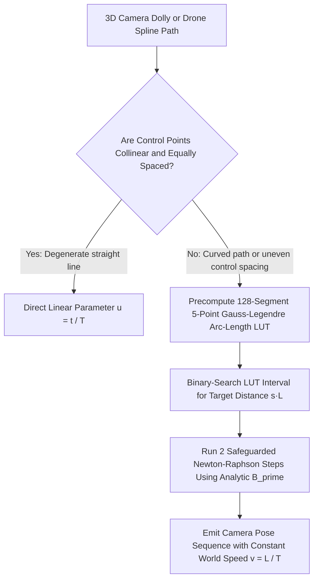
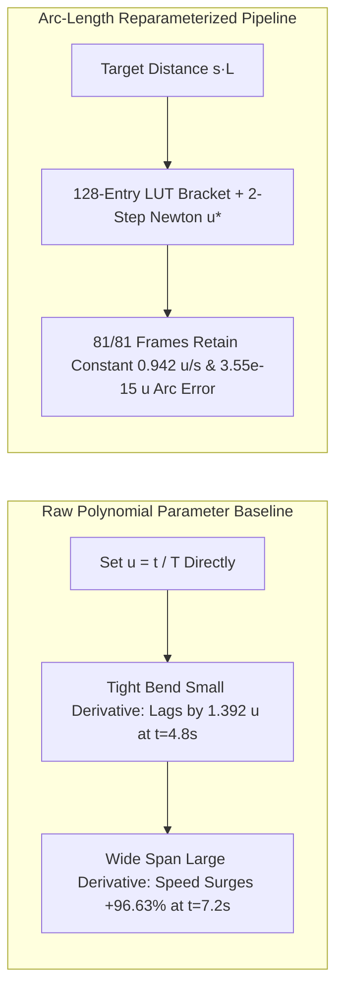
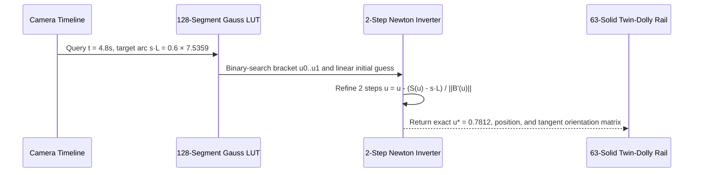

# Smooth camera rails without speed surges: arc-length reparameterized cubic splines vs raw parameter-t interpolation FAQ

**Understand in 3 minutes why Bezier camera paths crawl in tight bends and surge on straightaways, and reproduce a constant-speed LUT+Newton spline dolly rig in 10 minutes.**

[中文](constant-speed-spline-rail-faq.md) · [Interactive Demo](https://turbo998.github.io/animation/demos/spline-speed-rail/) · [Measured 7-Card Report](../demos/spline-speed-rail/test-report-cards.html)

## ① 📌 Executive Summary

- **The polynomial parameter $u \in [0, 1]$ of a cubic Bezier curve is not distance.** Setting $u = t / T$ makes world speed proportional to $\|\mathbf{B}'(u)\|$: the camera crawls through tightly bunched control points on S-bends and surges violently across wide control spans.
- **Arc-length reparameterization eliminates `+96.63%` speed surges down to `0.0000%`.** On this asymmetric S-curve rail (total length $L = 7.5359$ scene units, 8-second target speed $0.9420\text{ u/s}$), raw parameter interpolation (`raw-param`) lags behind the constant-speed reference dolly by `1.392` scene units at `t = 4.8 s` and then surges to `+96.63%` above target speed at `t = 7.2 s`; arc-length reparameterization (`arc-length`) retains a maximum arc-distance error of `3.55e-15` scene units across all 81 sampled frames.
- **A 128-segment Gauss-Legendre LUT with 2 Newton steps is `135.5×` faster than 32-step quadrature bisection while agreeing within `2.18e-9` scene units.** Across 8192 rail queries on Node CPU, the LUT+Newton solver takes `4.66 ms` median versus `631.88 ms` for on-the-fly quadrature bisection.
- **63-solid twin-dolly spline rail rig, 13 local acceptance checks.** Scene geometry is `synthetic`; Gauss-Legendre quadrature, Newton inversion, and Node CPU timings are `measured`; `TrajectoryCrafter` video diffusion inference and motorized hardware slider loops are `not_measured`.

**Daily capability direction check:** ICCV 2025 Oral paper *TrajectoryCrafter: Redirecting Camera Trajectory for Monocular Videos via Diffusion Models* ([arXiv:2503.05638](https://arxiv.org/abs/2503.05638), submitted 2025-03-07) redirects monocular videos along user-specified 3D camera trajectories via a dual-stream diffusion model. When authoring those 3D camera trajectories with Bezier or Hermite splines, arc-length reparameterization is essential so the conditioned camera poses advance at controlled physical speeds rather than bunching and surging with control-polygon spacing. Verified 2026-11-10; this demo implements deterministic arc-length inversion and dolly visualization without running neural video diffusion.

## ② 🎯 Architect & Client Q&A

### Q1 When should we choose camera-conditioned video diffusion vs deterministic arc-length spline rails?

Evaluate camera-redirecting video diffusion models (`TrajectoryCrafter`, `GEN3C`) when synthesizing novel camera views from an existing monocular video clip.

Use deterministic arc-length spline reparameterization in your camera path planner *both* for real-time WebGL/Three.js camera dollies and to generate the frame-by-frame camera extrinsic matrices fed into video diffusion models—because feeding un-normalized $u = t / T$ poses into a neural renderer produces the exact same S-curve crawl and straightaway speed surge in the generated video.

### Q2 Under what constraints is arc-length reparameterization strictly superior to raw parameter $u = t / T$?

Whenever a cubic spline has uneven control-point spacing or varying curvature (for example, curving tightly around a hero product before sweeping across a wide stage), $\|\mathbf{B}'(u)\|$ varies widely along $u \in [0, 1]$.

Raw parameter interpolation $u = t / T$ only moves at constant speed when all control points are collinear and equally spaced. For any curved rail—and even when applying intentional ease-in/ease-out curves—you must apply the easing curve to normalized arc distance $s(t)$ and then invert $u^*(s)$ so temporal easing controls actual spatial speed.

### Q3 How does a 128-entry Gauss-Legendre LUT plus two Newton steps invert arc length in microseconds?

The arc-length integral $S(u) = \int_0^u \|\mathbf{B}'(\tau)\|\,d\tau$ of a cubic Bezier curve has no closed-form elementary inverse. Running 32 bisection steps with numerical quadrature on every query costs `631.88 ms` for 8192 evaluations.

Instead, combine a pre-tabulated lookup table with safeguarded Newton-Raphson refinement:

1. **Pre-tabulate 128 Gauss-Legendre segments:** Partition $u \in [0, 1]$ into 128 intervals, integrate each with 5-point Gauss-Legendre quadrature, and store cumulative lengths in `lut[0..128]`.
2. **Binary-search + 2 Newton steps:** Given target distance $s \cdot L$, binary-search `lut` in 7 integer steps to bracket $[u_0, u_1]$, linearly interpolate an initial guess, and run 2 Newton-Raphson iterations using the exact analytical derivative $S'(u) = \|\mathbf{B}'(u)\|$:

$$u_{k+1} = u_k - \frac{S(u_k) - s \cdot L}{\|\mathbf{B}'(u_k)\|}$$

Two iterations drive the arc-length residual down to `3.55e-15` scene units while completing 8192 queries in `4.66 ms`.

### Q4 How can I reproduce this in 10 minutes?

1. Run `npm run dev` and open `/demos/spline-speed-rail/`, initialized at `t = 4.80 s` (60% of the `8 s` duration).
2. In `arc-length` mode, observe the front orange dolly aligned with the rear reference dolly at constant speed `0.942 u/s` (`error 0.00%`), riding across 24 equally spaced arc-length sleepers.
3. Switch to `raw-param` mode at `t = 4.80 s`: the active dolly lags behind the reference dolly by `1.392` scene units near the S-bend exit; scrub to `t = 7.20 s` to see its speed surge to `1.852 u/s` (`+96.6%` error).
4. Adjust Control bunching (`0.3–0.92`), Curve arch (`0.8–2.5`), and Duration (`4–12 s`); test an out-of-range bunching value like `1.4` to verify atomic rejection and state retention.
5. Click `Export rail` to download `CONSTANT_SPEED_RAIL_SPEC.json` with `totalLength`, `paramU`, `worldSpeed`, and dolly matrices.
6. Run `npx vitest run tests/spline-rail.test.ts`, then build and run `node scripts/benchmark-spline-rail.mjs` against a port 4335 preview server.

## ③ 🧭 Visual Diagrams

## ④ 📊 Architect Decision Matrix

| Criterion | Raw Polynomial Parameter (`raw-param`, $u=t/T$) | On-the-Fly Quadrature Bisection (`32-step`) | 128-Entry LUT + 2-Step Newton (`arc-length`) | Camera-Redirected Video Diffusion (`TrajectoryCrafter`) |
| --- | --- | --- | --- | --- |
| World-space speed stability | Surges by `+96.63%` at `t=7.2s` | Constant speed (`< 1e-8` error) | Constant `0.9420 u/s` (`3.55e-15 u` arc error) | Depends on whether input extrinsics are arc-length normalized |
| Spatial lag at `t=4.8s` ($s=0.6$) | Lags constant-speed reference by `1.392 u` | Matches reference (`2.18e-9 u` diff) | Matches reference within `< 1e-12 u` | Consumer of camera poses, not a spline solver |
| 8192-query Node CPU solve median | `~0.1 ms` (with severe speed distortion) | `631.88 ms` (repeated quadrature cost) | `4.66 ms` (`135.5×` faster than bisection) | Seconds to minutes of GPU diffusion |
| Arbitrary timeline seeking / reversal | Deterministic (distorted speed) | Deterministic (slow) | Microsecond random access; exact reversal | Requires full sequence diffusion |
| Best architectural role | Never use on curved camera splines | Offline reference verification | Real-time 3D camera rails & AI trajectory pre-planners | Monocular video novel-view synthesis |

**Quantitative example:** With `bunching = 0.82`, `archHeight = 1.85`, and `duration = 8 s`, total rail arc length is $L = 7.5359$ scene units and constant speed is $0.9420\text{ u/s}$. At $t = 4.8\text{ s}$ ($s = 0.6$), arc-length inversion yields $u^*(0.6) = 0.7812$, placing the dolly on the right span; raw parameter $u = 0.6$ remains trapped in the left S-bend (`1.392` units behind) before surging to `1.852 u/s` (`+96.63%` error) at $t = 7.2\text{ s}$.

## ⑤ 🧪 New Capability Demo & Benchmark Findings (with 7-Card)

[Sealed data](../demos/spline-speed-rail/report.json) records 63 3D solids, 81 sampled timestamps audited for linear arc-distance progression, and solver equivalence between the 128-entry Gauss-Legendre LUT + 2-step Newton solver and 32-step quadrature bisection (`maximum_solver_error = 2.18e-9` scene units, threshold `< 1e-4`).

| Node CPU Rail Queries | 128-Entry LUT + Newton Median | 32-Step Quadrature Bisection Median |
| --- | --- | --- |
| 128 | 0.09 ms | 7.59 ms |
| 1024 | 0.51 ms | 55.53 ms |
| 8192 | 4.66 ms | 631.88 ms |

Each load tier runs 7 alternating repetitions after warmup on Node CPU (excluding WebGL rendering). At 8192 rail queries, the LUT+Newton solver is `135.5×` faster than on-the-fly quadrature bisection while eliminating the `+96.63%` raw-parameter speed surge.

[Measured 7-Card Report (EN)](../demos/spline-speed-rail/test-report-cards.html) · [中文七卡](../demos/spline-speed-rail/test-report-cards.zh.html). Scene geometry is `synthetic`, arc-length inversion and CPU timings are `measured`, and `TrajectoryCrafter` video diffusion inference and physical motor control are `not_measured`.

## ⑥ 🛠️ Architect Checklist

- [ ] Never pass normalized time $t / T$ directly as the polynomial parameter $u$ of a curved or unequally spaced Bezier spline.
- [ ] Integrate segment arc lengths with 5-point Gauss-Legendre quadrature rather than coarse chord approximations.
- [ ] Pre-tabulate a cumulative arc-length LUT (e.g., 128 segments) whenever spline control points change.
- [ ] Bracket the target arc length $s \cdot L$ via binary search and refine with 2 safeguarded Newton-Raphson iterations.
- [ ] Audit cumulative arc distance across all timeline samples against $s \cdot L$ (`< 1e-4` tolerance).
- [ ] Apply temporal easing functions (ease-in/out) to normalized distance $s(t)$ *before* inverting $u^*(s)$.
- [ ] Validate control-point bunching, arch height, and duration bounds and reject invalid configs (`bunching = 1.4`) atomically.
- [ ] Verify that forward and reverse timestamp scrubbing produce identical dolly position and tangent orientation matrices.
- [ ] Normalize camera path extrinsics by arc length before feeding poses into `TrajectoryCrafter` or 4D Gaussian renderers.
- [ ] Label unexecuted video diffusion models, depth reprojection, and physical slider motors explicitly as `not_measured`.

**Primary sources:** [TrajectoryCrafter (arXiv:2503.05638)](https://arxiv.org/abs/2503.05638) (ICCV 2025 Oral, submitted 2025-03-07) redirects monocular videos along user-specified 3D camera trajectories via a dual-stream conditional video diffusion model. Verified 2026-11-10; this demo is an original deterministic arc-length spline camera rail workbench and does not run neural video diffusion.
