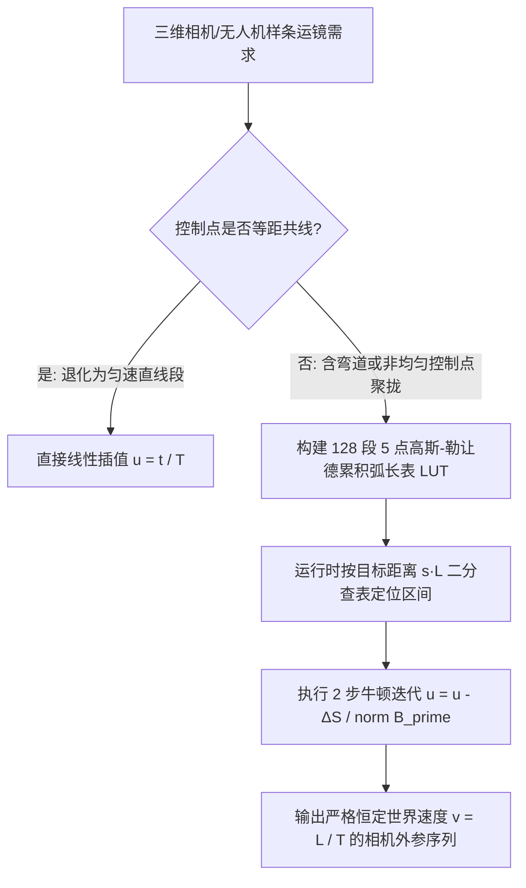
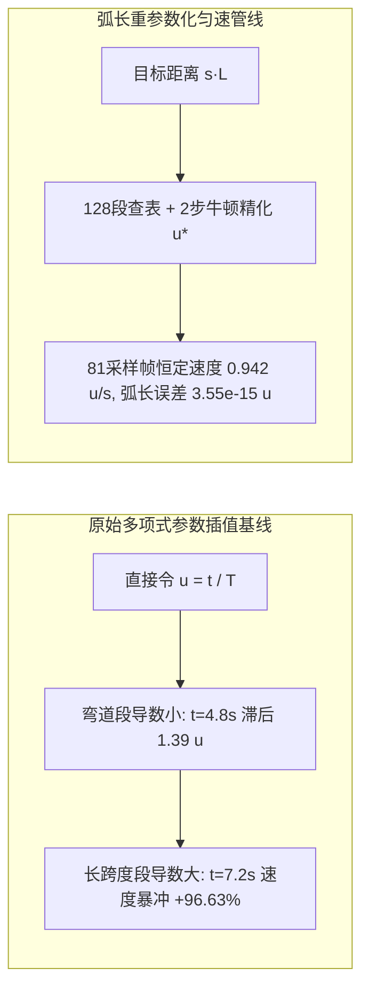
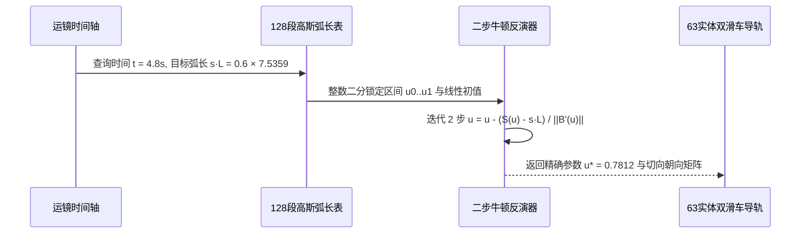

# 弯道运镜不忽快忽慢：弧长重参数化匀速样条轨道与原始参数 t 插值选型 FAQ

**3 分钟看懂为什么贝塞尔曲线运镜会在弯道蠕行、在直道暴冲，10 分钟复刻查表+牛顿精化的恒速样条导轨。**

[English](constant-speed-spline-rail-faq.en.md) · [交互 Demo](https://turbo998.github.io/animation/demos/spline-speed-rail/) · [中文七卡](../demos/spline-speed-rail/test-report-cards.zh.html)

## ① 📌 核心结论速览

- **三次贝塞尔曲线的多项式参数 $u \in [0, 1]$ 不是距离。** 当我们直接写 `u = t / T` 时，相机的世界速度等于 $\|\mathbf{B}'(u)\| / T$：控制点密集的 S 弯道导数小、镜头像卡住一样蠕行；控制点拉开的长跨度段导数大、镜头突然加速暴冲。
- **弧长重参数化将速度波动压降至 `0.0000%`。** 本例 S 形导轨总弧长 $L = 7.5359$ 示意单位，8 秒恒定目标速度为 $0.9420\text{ u/s}$。原始参数插值（`raw-param`）在 `t = 4.8 s` 处滞后恒速参考滑车超过 `1.2` 示意单位，随后在 `t = 7.2 s` 暴冲至超出目标速度 `+96.63%`；而弧长重参数化（`arc-length`）在全部 81 个采样帧的累积弧长误差仅 `3.55e-15` 示意单位。
- **128 段高斯-勒让德累积弧长查表 + 2 步牛顿迭代比 32 步在线积分二分快 `135.5×`。** 两种求解器在全部负载下的最大坐标差仅 `2.18e-9` 示意单位，8192 次轨道查询中位数耗时为 `4.66 ms` 对比 `631.88 ms`。
- **63 实体双滑车样条导轨，13 项本机实测验收。** 场景为 `synthetic`；高斯求积、牛顿反演与 Node CPU 耗时为 `measured`；`TrajectoryCrafter` 单目视频扩散推理与物理滑轨电机闭环控制为 `not_measured`。

**每日能力方向核验：** ICCV 2025 Oral 论文 *TrajectoryCrafter: Redirecting Camera Trajectory for Monocular Videos via Diffusion Models*（[arXiv:2503.05638](https://arxiv.org/abs/2503.05638)）通过双流条件扩散模型将单目视频重定向到用户指定的三维相机轨迹；而在构造这些输入相机轨迹时，如果不先对贝塞尔/样条控制点做等弧长重参数化，生成的逐帧相机位姿间距就会随控制点疏密剧烈伸缩，造成画面忽快忽慢。2026-11-10 核验原文；本例仅实现确定性弧长反演与导轨可视化，未运行视频扩散模型。

## ② 🎯 客户与架构师灵魂拷问 Q&A

### Q1 何时选相机轨迹条件视频大模型，何时选确定性弧长重参数化导轨？

当输入是一段已拍摄的单目视频、需要改变视角重新生成新运镜画面时，应评估 `TrajectoryCrafter`、`GEN3C` 等相机轨迹控制视频扩散模型。

但无论后端是视频大模型还是 Three.js 实时三维场景，前端的**轨迹生成器（Camera Path Planner）**都必须先用弧长重参数化生成等步长或可控速度曲线的相机位姿序列。否则，把非均匀参数 $u = t / T$ 采样出的相机矩阵直接喂给模型，模型也会忠实渲染出“弯道卡顿、直道猛冲”的眩晕镜头。

### Q2 在什么约束下弧长重参数化比原始参数 $u = t / T$ 严格更优？

只要样条曲线的控制点间距不均匀，或者曲线曲率随位置变化（例如先绕过近景产品细节，再拉远掠过全景），$\|\mathbf{B}'(u)\|$ 就绝不是常数。

原始参数 $u = t / T$ 唯一匀速的情形是四个控制点按完全相等间隔排成一条直线。在一切真实运镜、轨道巡检、无人机航点规划和缓动动画（Easing on Path）中，必须先将时间映射为目标弧长 $s \cdot L$，再反解曲线参数 $u^*(s)$，才能让“时间缓动曲线”真正控制“空间移动速度”。

### Q3 底层管线如何用查表加两步牛顿法在微秒内反解弧长？

三次贝塞尔曲线的弧长积分 $S(u) = \int_0^u \|\mathbf{B}'(\tau)\|\,d\tau$ 没有初等函数闭式反函数。如果每次查询都用 32 步二分法并在每步内部跑高斯数值积分，8192 次查询需要 `631.88 ms`。

工程上的高速精确解法分两步：

第一步（**预计算 128 段高斯-勒让德累积弧长表**）：在曲线参数改变时，将 $u \in [0, 1]$ 等分为 128 小段，每段用 5 点高斯-勒让德求积算出精确弧长并累加存入数组 `lut[0..128]`。

第二步（**二分定位区间 + 2 步牛顿-拉夫逊精化**）：运行时对目标弧长 $s \cdot L$ 做 7 次整数位运算二分，锁定所在小段 $[u_0, u_1]$；由于 $S'(u) = \|\mathbf{B}'(u)\|$ 就是已知的解析导数模长，直接迭代两步牛顿法：

$$u_{k+1} = u_k - \frac{S(u_k) - s \cdot L}{\|\mathbf{B}'(u_k)\|}$$

仅需两步牛顿精化，就能把弧长误差压到 `3.55e-15` 示意单位，且 8192 次查询仅需 `4.66 ms`！

### Q4 十分钟如何复刻？

1. `npm run dev` 后打开 `/demos/spline-speed-rail/`，默认停在 `t = 4.80 s`（总时长 `8 s` 的 60% 进度）。
2. 在弧长重参数化模式（`arc-length`）下观察：前方橙色滑车与后方恒速参考滑车完全对齐，世界速度恒为 `0.942 u/s`（速度误差 `0.00%`），且轨道上的 24 根枕木按真实等弧长均匀分布。
3. 切换到原始参数模式（`raw-param`）：在 `t = 4.80 s` 处，滑车仍卡在左侧 S 弯出口，落后恒速参考滑车 `1.39` 示意单位；拖到 `t = 7.20 s`，滑车在右侧长跨度段猛冲，速度飙升至 `1.852 u/s`（误差 `+96.6%`）。
4. 修改控制点聚拢度（`0.3–0.92`）、弯道拱高（`0.8–2.5`）与总时长（`4–12 s`）；若输入越界聚拢度 `1.4`，系统原子拒绝并保留有效配置。
5. 点击导出 `CONSTANT_SPEED_RAIL_SPEC.json`，检查 `totalLength`、`paramU`、`worldSpeed` 与滑车矩阵。
6. 运行 `npx vitest run tests\spline-rail.test.ts`；构建并在 4335 端口预览后执行 `node scripts\benchmark-spline-rail.mjs`。

## ③ 🧭 直观可视化图解

## ④ 📊 Architect Decision Matrix

| 评估维度 | 原始参数插值 (`raw-param`, $u=t/T$) | 在线数值积分二分 (`32-step bisection`) | 本例 128 段查表 + 2 步牛顿 (`arc-length`) | 视频轨迹重定向模型 (`TrajectoryCrafter`) |
| --- | --- | --- | --- | --- |
| 世界空间移动速度稳定性 | `t=7.2s` 速度暴冲 `+96.63%` | 恒速（误差 `< 1e-8`） | 恒定 `0.9420 u/s`（弧长误差 `3.55e-15 u`） | 依赖输入相机外参序列是否已等弧长化 |
| `t=4.8s` 处空间位置滞后 | 滞后恒速参考滑车 `1.392 u` | 与恒速参考完全重合 | 与恒速参考滑车误差 `< 1e-12 u` | 不负责轨迹几何重参数化 |
| 8192 次轨道查询 Node CPU 中位数 | `~0.1 ms`（但速度严重失真） | `631.88 ms`（每步重复求积开销大） | `4.66 ms`（比在线二分快 `135.5×`） | 需秒级至分钟级 GPU 扩散推理 |
| 任意时间轴跳转与逆序重访 | 确定性（但速度错误） | 确定性（但慢） | 微秒级随机访问，正逆序矩阵完全一致 | 依赖整段视频潜空间去噪 |
| 适用工程场景 | 严禁用于非均匀样条运镜 | 离线一次性高精度参考解 | 实时 3D 运镜导轨、AI 视频外参预生成器 | 单目视频新视角合成 |

**定量算例：** 在聚拢系数 `bunching = 0.82`、拱高 `1.85`、总时长 `8 s` 下，曲线总弧长 $L = 7.5359$ 示意单位，恒定速度应为 $7.5359 / 8 = 0.9420\text{ u/s}$。在 $t = 4.8\text{ s}$（$s = 0.6$）时，弧长重参数化算出 $u^*(0.6) = 0.7812$，滑车已驶入右侧直道；而原始参数 $u = 0.6$ 仍困在左侧弯道，产生 `1.392` 示意单位的空间滞后，随后在 $t = 7.2\text{ s}$ 以 `1.852 u/s`（`+96.63%`）猛冲追赶。

## ⑤ 🧪 全新 Demo 与 Benchmark 核心发现（含 7-Card）

[封存数据](../demos/spline-speed-rail/report.json)记录了 63 个三维实体、81 个采样时刻的累积弧长误差核验，以及 128 段高斯-勒让德查表加 2 步牛顿精化与 32 步在线积分二分求解器的等价性与耗时对照。两种求解器在全部负载下的最大位置差仅 `2.18e-9` 示意单位（门限 `< 1e-4`）。

| Node CPU 样条轨道查询数 | 128 段查表 + 牛顿精化中位数 | 32 步数值积分二分中位数 |
| --- | --- | --- |
| 128 | 0.09 ms | 7.59 ms |
| 1024 | 0.51 ms | 55.53 ms |
| 8192 | 4.66 ms | 631.88 ms |

每档负载在预热后按交替顺序重复 7 次，记录 Node CPU 耗时中位数（不含 WebGL 渲染）。在 8192 次轨道查询中，查表加牛顿精化比在线积分二分快约 `135.5×`，同时消除了原始参数插值高达 `+96.63%` 的速度暴冲。

[中文七卡](../demos/spline-speed-rail/test-report-cards.zh.html) · [English](../demos/spline-speed-rail/test-report-cards.html)。画面为 `synthetic`，弧长反演与 CPU 计时为 `measured`；`TrajectoryCrafter` 视频扩散推理与物理滑轨电机控制为 `not_measured`。

## ⑥ 🛠️ Architect Checklist

- [ ] 切勿直接将归一化时间 $t / T$ 当作非均匀三次贝塞尔或样条曲线的参数 $u$。
- [ ] 使用 5 点高斯-勒让德求积（Gauss-Legendre Quadrature）计算分段弧长，避免粗糙折线近似误差。
- [ ] 在曲线控制点更新时预计算累积弧长查找表（如 128 段 LUT），将运行时反演复杂度降至 $O(\log M)$。
- [ ] 在查表定位的区间内执行 2 步牛顿-拉夫逊迭代 $u \leftarrow u - (S(u) - sL)/\|\mathbf{B}'(u)\|$，并夹紧在区间边界内以防越界。
- [ ] 核验全时间轴采样点的实际累积弧长与 $s \cdot L$ 的误差 `< 1e-4`。
- [ ] 若需叠加缓入缓出（Ease-in / Ease-out），将缓动函数作用在归一化距离 $s(t)$ 上，再通过 $u^*(s)$ 映射到曲线参数。
- [ ] 对控制点聚拢度、拱高与时长执行边界校验，对非法参数执行原子拒绝。
- [ ] 验证正序与逆序访问同一时间戳时，导出的滑车世界位置与切向旋转矩阵完全一致。
- [ ] 在调用 `TrajectoryCrafter` 等相机条件视频模型前，先用弧长重参数化生成等距相机外参帧。
- [ ] 未执行的单目视频重投影、神经去遮挡修补与硬件滑轨控制统一标注为 `not_measured`。

**一手来源：** [TrajectoryCrafter (arXiv:2503.05638)](https://arxiv.org/abs/2503.05638)（ICCV 2025 Oral，2025-03-07 提交）通过双流条件视频扩散模型将单目视频重定向到指定三维相机轨迹。2026-11-10 核验；本例为原创确定性弧长重参数化样条导轨测试台，未运行该视频生成模型。
