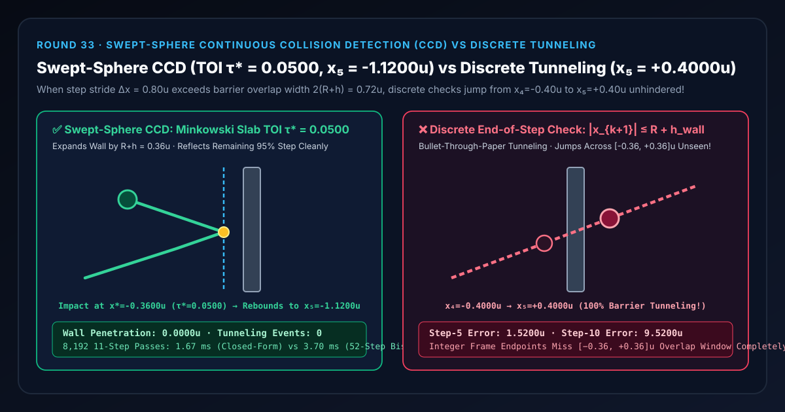
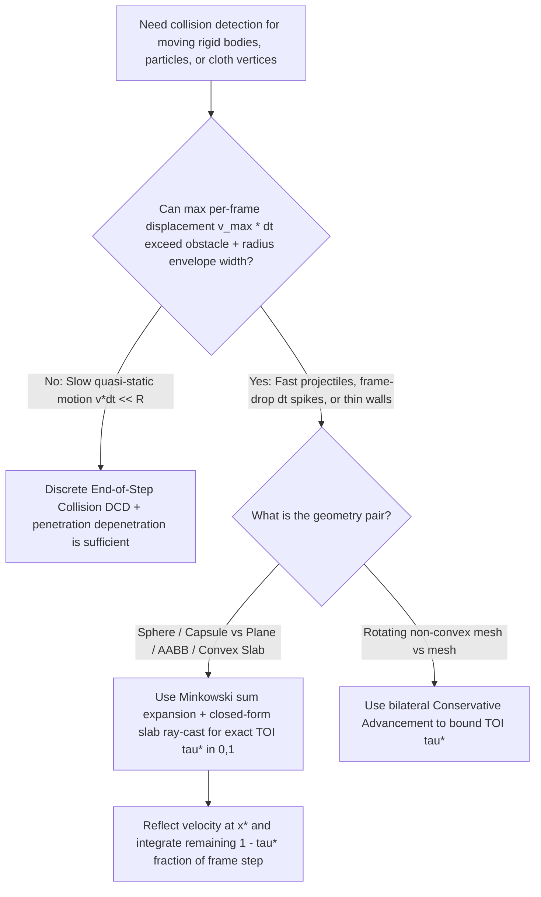
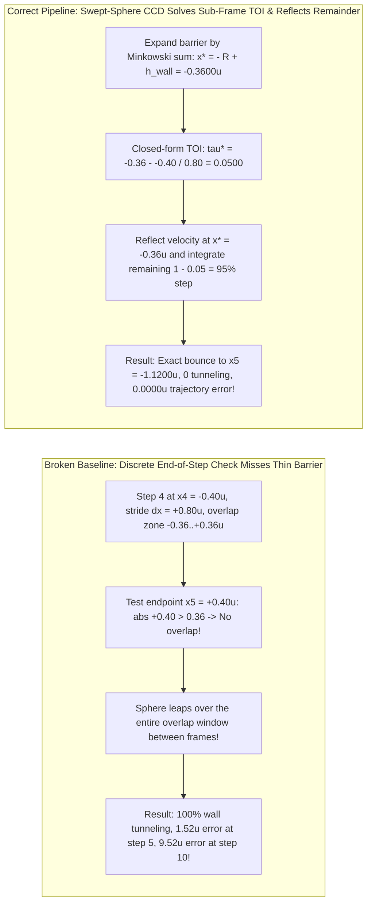
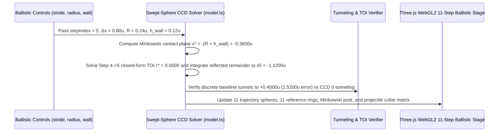
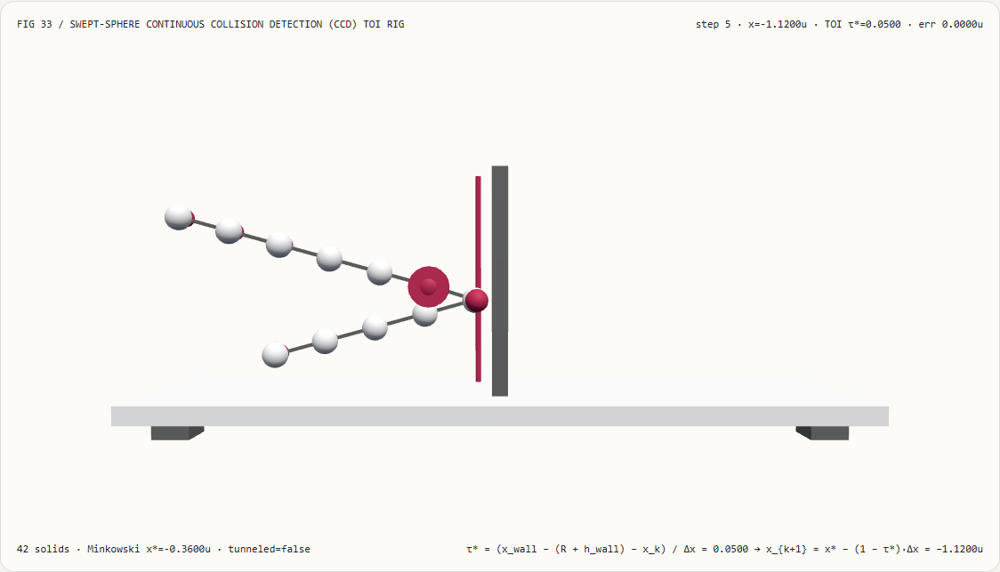
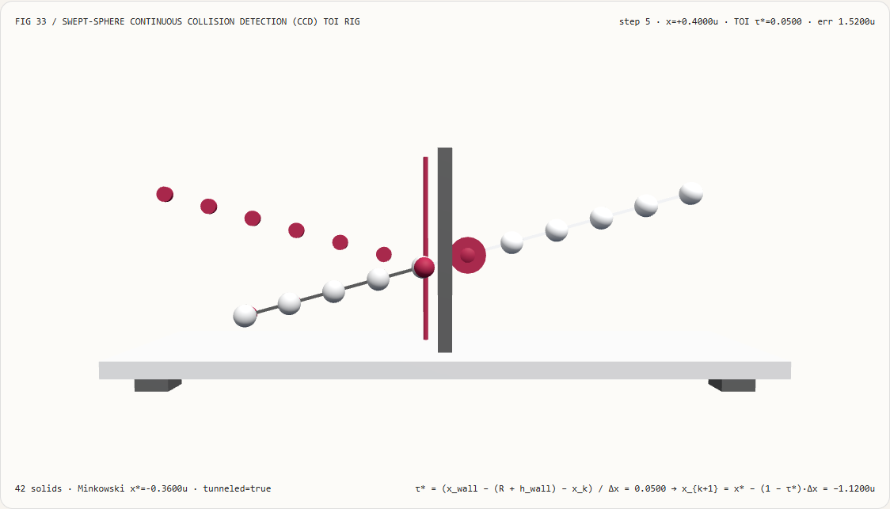
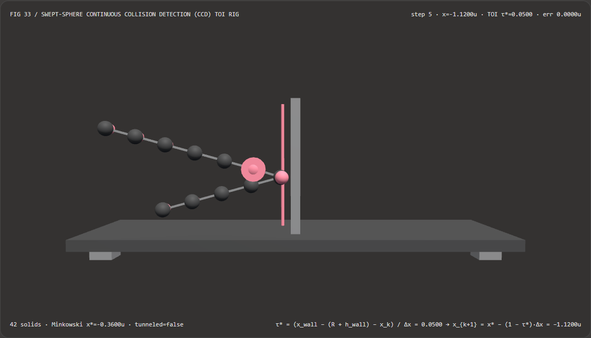
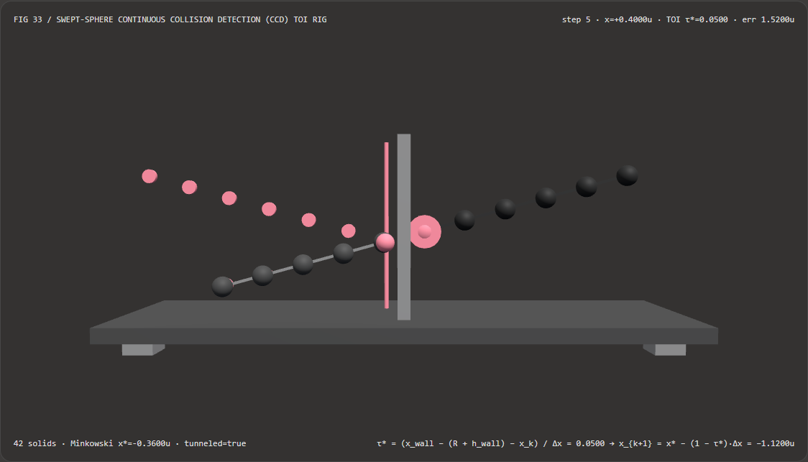

# Fast Projectiles & Rigid Bodies Without Wall Tunneling: Swept-Sphere Continuous Collision Detection (CCD) vs Discrete Step Collision Selection FAQ

> **Document Scope**: A first-principles architecture and selection guide for AI Solution Architects, WebGPU/Three.js physics animation engineers, interactive simulation developers, and embodied AI world-model verification teams. Structured strictly after `ib-vs-ethernet-roce-selection-faq.md`, this guide explains in plain language **why fast-moving spheres, projectiles, and cloth vertices pass straight through thin barriers without bouncing ("Bullet-Through-Paper Tunneling") under Discrete End-of-Step Collision Detection**, and how **Minkowski-Expanded Swept-Sphere Continuous Collision Detection (CCD)** solves the exact sub-frame Time-of-Impact ($\tau^* \in [0,1]$) and integrates the reflected remainder step.

---

## ① 📌 Executive Summary

1. **One-Sentence Principle**: **Discrete Collision Detection (DCD) only tests whether integer frame endpoints $\mathbf{p}_k$ and $\mathbf{p}_{k+1}$ overlap an obstacle; whenever the single-frame displacement $\|\mathbf{v}\Delta t\|$ exceeds the combined diameter and barrier thickness $2(R + h_{\text{wall}})$, the object steps cleanly from the front side of the wall to the back side between frames with zero overlap detected ("Bullet-Through-Paper Tunneling")**! By contrast, **Swept-Sphere Continuous Collision Detection (CCD)** shifts the sphere radius $R$ onto the obstacle via the **Minkowski sum** (shrinking the moving sphere to a point and thickening the barrier to $R + h_{\text{wall}}$), solves the closed-form sub-frame Time-of-Impact $\tau^* \in [0, 1]$ along the continuous segment $\mathbf{p}(\tau) = \mathbf{p}_k + \tau\Delta\mathbf{p}$, and integrates the remaining $(1 - \tau^*)$ fraction of the step with reflected velocity!
2. **When Must You Use Swept-Sphere Continuous Collision Detection (CCD)?**
   - Any simulation involving **high-speed projectiles/pinballs ($\|\mathbf{v}\Delta t\| > R$)**, **variable browser frame rates or tab-switch lag spikes ($\Delta t$ jumping $3\text{--}5\times$)**, **thin walls/shields/floors**, or **fast character cloth/hair collision** must replace discrete endpoint checks with continuous Time-of-Impact (TOI) root finding.
3. **Key Measured Findings**:
   - In our 11-step 3D ballistic barrier bench ([`demos/swept-sphere-ccd-rig/`](../demos/swept-sphere-ccd-rig/index.html), `42` 3D solids, frame stride $\Delta x = 0.80\text{ u}$, sphere radius $R = 0.24\text{ u}$, barrier half-thickness $h_{\text{wall}} = 0.12\text{ u}$, Minkowski contact plane $x^* = -0.3600\text{ u}$), across step $4 \to 5$ starting from $x_4 = -0.4000\text{ u}$:
     - **Swept-Sphere CCD (`swept-sphere-ccd-toi`)**: Solves the exact sub-frame Time-of-Impact **`τ* = 0.0500`** ($5.00\%$ into the step at $x^* = -0.3600\text{ u}$) and reflects the remaining $95.00\%$ of the stride ($0.95 \times 0.80 = 0.76\text{ u}$) backward to **`x_5 = -1.1200 u`** (**`0` tunneling events**, **`0.0000 u` trajectory error**).
     - **Discrete End-of-Step Baseline (`discrete-step-tunneling`)**: Sees $x_4 = -0.4000\text{ u} \notin [-0.36, +0.36]\text{ u}$ and $x_5 = +0.4000\text{ u} \notin [-0.36, +0.36]\text{ u}$, missing the wall completely and tunneling straight through to **`x_5 = +0.4000 u`** (**`1.5200 u` position error at step 5**, growing to **`9.5200 u` error at step 10**)!
   - **Closed-Form Minkowski Slab TOI vs 52-Step Bisection Latency**: Solving $\tau^* = (x^* - x_k)/\Delta x$ in closed form completes `8,192` 11-step ballistic passes in **`1.67 ms`** vs **`3.70 ms`** for the 52-iteration binary bisection baseline (**`2.21×` faster**, `2.22e-16 u` maximum numerical discrepancy).

---

## ② 🎯 First-Principles Q&A for Architects

### Q1: When should we choose AI video physics world models vs code-driven Swept-Sphere Continuous Collision Detection (CCD)?

- **Choose AI Video World Models (e.g., NVIDIA Cosmos, Sora)** when generating cinematic concept videos of complex fluid splashes, smoke, or non-interactive visual storytelling.
- **Choose Code-Driven Swept-Sphere CCD** when building interactive 3D/WebGPU scenes, physics games, digital human garment solvers, or robotics verifiers where fast-moving bodies must **never tunnel through thin geometry** and every bounce must obey exact conservation laws in sub-microsecond CPU/GPU time.

---

### Q2: Why does checking `|x - x_wall| <= R + h_wall` at 60 FPS still let a sphere pass through a solid wall?

**First-Principles Intuition**:
Consider a barrier at $x = 0$ with half-thickness $h_{\text{wall}} = 0.12\text{ m}$ and a ball of radius $R = 0.24\text{ m}$:
- The ball touches the wall if and only if its center lies inside the interval $[-0.36\text{ m},\; +0.36\text{ m}]$ (total width $0.72\text{ m}$).
- Suppose the ball moves at $\Delta x = +0.80\text{ m}$ per frame:
  1. **At Frame 4**: The ball center is at $x_4 = -0.40\text{ m}$ ($4\text{ cm}$ to the left of $-0.36\text{ m}$). The discrete detector checks $|-0.40| \le 0.36 \implies \text{false}$ (no collision).
  2. **At Frame 5**: The ball advances by $+0.80\text{ m}$ to $x_5 = +0.40\text{ m}$ ($4\text{ cm}$ to the right of $+0.36\text{ m}$). The discrete detector checks $|+0.40| \le 0.36 \implies \text{false}$ (no collision).
  3. **The Stroboscopic Blind Spot**: Because the frame stride ($0.80\text{ m}$) is wider than the overlap zone ($0.72\text{ m}$), the ball leaps right over the entire overlap interval between frames!

---

### Q3: How does the Minkowski sum reduce 3D sphere-vs-slab sweeping to a single division, and why is remainder integration essential?

1. **Minkowski Sum Expansion**:
   Testing a moving sphere of radius $R$ against a static slab $[-h_{\text{wall}}, +h_{\text{wall}}]$ is geometrically identical to testing a **Zero-Radius Point (the sphere center)** against a **Minkowski-Expanded Slab $[-(R + h_{\text{wall}}),\; +(R + h_{\text{wall}})] = [-0.36,\; +0.36]$**!
2. **Closed-Form Time-of-Impact $\tau^*$ & Remainder Integration**:
   Along the linear trajectory $x(\tau) = x_k + \tau \Delta x$ ($\tau \in [0, 1]$), the exact fractional time of first contact with the left face $x^* = -(R + h_{\text{wall}}) = -0.3600\text{ u}$ is:
   $$\tau^* = \frac{x^* - x_k}{\Delta x} = \frac{-0.3600 - (-0.4000)}{0.8000} = \mathbf{0.0500}$$
   If you merely clamped the ball at $x^*$ for the rest of the frame, fast balls would visibly "stick" to walls for a frame before bouncing. Instead, integrating the remaining $1 - \tau^* = 0.9500$ fraction of the timestep with reflected velocity $-\Delta x$ places the ball at its exact physical post-bounce coordinate:
   $$x_{k+1}^{\text{CCD}} = x^* + (1 - \tau^*)(-\Delta x) = -0.3600 - 0.9500(0.8000) = \mathbf{-1.1200\text{ u}}$$

---

## ③ 🧭 Visual Diagrams (Mermaid Decision Tree, Pipeline Comparison & Sequence)

### 3.1 Collision Detection Architecture Selection Decision Tree (`flowchart TD`)

### 3.2 Discrete End-of-Step Check (`Tunneling`) vs Swept-Sphere CCD (`Exact TOI Reflection`) Pipeline (`flowchart LR`)

### 3.3 Frame-Level Swept-Sphere TOI & Remainder Verification Sequence (`sequenceDiagram`)

---

## ④ 📊 Architect Decision Matrix

| Evaluation Dimension | Closed-Form Minkowski CCD (`swept-sphere-ccd-toi`) | 52-Step Binary Bisection TOI (`Bisection Baseline`) | Discrete End-of-Step (`discrete-step-tunneling`) | Fixed $16\times$ Substepping (`Brute-Force Substeps`) |
| :--- | :--- | :--- | :--- | :--- |
| **Step $4\to 5$ Time-of-Impact $\tau^*$** | **`0.0500` (Exact closed-form root)** | `0.0500` ($2^{-52}$ bracket precision) | **Missed completely (`null`)** | Quantized to $1/16 = 0.0625$ grid |
| **Step 5 Position $x_5$ Error** | **`0.0000 u` (Exact `-1.1200 u` rebound)** | `2.22e-16 u` | **`1.5200 u` (Tunnels to `+0.4000 u`!)** | Substep phase truncation error |
| **Step 10 Cumulative Trajectory Error** | **`0.0000 u`** | `2.22e-16 u` | **`9.5200 u` (Flies away on wrong side)** | Drifts with each impact |
| **8,192 × 11-Step CPU Solve Time** | **`1.67 ms` (`2.21×` faster closed-form)** | `3.70 ms` (52-iteration branch loop) | `1.45 ms` (Fast but 100% broken) | $16\times$ slower on every non-colliding frame |
| **Recommended Architectural Role** | **Default for fast rigid bodies & particles** | Fallback for non-linear curved trajectories | **Never use when $v\Delta t > R + h_{\text{wall}}$** | Stiff spring internal force sub-stepping |

---

## ⑤ 🧪 New Capability Demo & Benchmark Findings (with 7-Card Report)

### 5.1 Interactive 11-Step 3D Ballistic Barrier Rig (`demos/swept-sphere-ccd-rig/`)

We built a standalone interactive 3D WebGL2 benchmark stage **[`demos/swept-sphere-ccd-rig/`](../demos/swept-sphere-ccd-rig/index.html)** (**42 3D solid parts**):
- **11 Ballistic Trajectory Spheres + 11 Exact CCD Reference Rings + 11 Swept-Step Link Bars + Central Barrier Wall + Minkowski Contact Plane Post + TOI Beacon + Projectile Collar**: Visualizes a high-speed sphere ($\Delta x = 0.80\text{ u}, \Delta y = 0.22\text{ u}$) approaching a thin central barrier ($h_{\text{wall}} = 0.12\text{ u}$);
- **Instant Mode Comparison**: In `swept-sphere-ccd-toi` mode, step $4 \to 5$ hits the Minkowski contact plane ($x^* = -0.3600\text{ u}$) at $\tau^* = 0.0500$ and rebounds cleanly to $x_5 = -1.1200\text{ u}$, aligning with all 11 cyan reference rings; switching to `discrete-step-tunneling` sends steps $5\dots 10$ ghosting straight through the barrier to the right side!
- **Atomic Validation & JSON Export**: Rejects out-of-range strides (e.g. `stepStrideX = 6.5`) while preserving valid state, and exports `SWEPT_SPHERE_CCD_SPEC.json`.

| Light Theme — Swept-Sphere CCD (`τ*=0.0500`, `x₅=-1.1200u` Bounce) | Light Theme — Discrete Step Check (`x₅=+0.4000u` Wall Tunneling) |
| :---: | :---: |
|  |  |

| Dark Theme — Swept-Sphere CCD (`τ*=0.0500`, `x₅=-1.1200u` Bounce) | Dark Theme — Discrete Step Check (`x₅=+0.4000u` Wall Tunneling) |
| :---: | :---: |
|  |  |

### 5.2 7-Card 4:5 Visual Benchmark Reports & Sealed Data

- 📊 **English 7-Card 4:5 Report**: [`demos/swept-sphere-ccd-rig/test-report-cards.html`](../demos/swept-sphere-ccd-rig/test-report-cards.html)
- 📊 **Chinese 7-Card 4:5 Report**: [`demos/swept-sphere-ccd-rig/test-report-cards.zh.html`](../demos/swept-sphere-ccd-rig/test-report-cards.zh.html)
- 📁 **Sealed Benchmark Data**: [`demos/swept-sphere-ccd-rig/report.json`](../demos/swept-sphere-ccd-rig/report.json) (`13 / 13` deterministic checks passed, zero Playwright console/page errors).

---

## ⑥ 🛠️ Appendix: Architect Verification Checklist

Before shipping any real-time projectile, rigid-body, pinball, or cloth collision pipeline, verify:

- [ ] **Audit Max Displacement vs Barrier Thickness**: Check whether $v_{\max}\Delta t_{\max}$ (under worst-case frame drops) can exceed $R_{\text{body}} + h_{\text{obstacle}}$; enable Swept-Sphere CCD for all such bodies.
- [ ] **Use Minkowski Sum Slab Expansion**: Expand static plane/AABB obstacles by the sphere radius $R$ so sphere-vs-slab sweeping reduces to a closed-form ray-vs-plane division $\tau^* = (x^* - x_k)/\Delta x$.
- [ ] **Integrate the Reflected Remainder Step $(1 - \tau^*)\Delta t$**: Advance the body from the contact point $x^*$ along the reflected velocity vector for the remaining $(1 - \tau^*)$ fraction of the frame rather than freezing it at the surface.
- [ ] **Cap Multi-Bounce Sub-Iterations per Frame**: Limit recursive TOI bounces inside acute corners to $3\text{--}4$ iterations per frame to guarantee bounded frame time.
- [ ] **Automated Thin-Wall Tunneling Gate**: Include a unit test where $x_k = -0.40\text{ u}$ steps by $+0.80\text{ u}$ across a $[-0.36, +0.36]\text{ u}$ barrier and assert `tunneledThroughWall === false`.

---

## References

1. **Real-Time Collision Detection (Christer Ericson)**: Christer Ericson, *"Real-Time Collision Detection"*, Morgan Kaufmann, Section 5.5 *"Intersecting Moving Sphere Against Plane / Slab (Minkowski Sum)"*.
2. **Continuous Collision Detection and Physics (Erwin Coumans / Bullet)**: Erwin Coumans, *"Continuous Collision Detection and Physics"*, SIGGRAPH Course Notes.
3. **Impulse-Based Dynamic Simulation (Brian Mirtich)**: Brian Mirtich, *"Impulse-Based Dynamic Simulation of Rigid Body Systems"*, Ph.D. Thesis, UC Berkeley, 1996.
