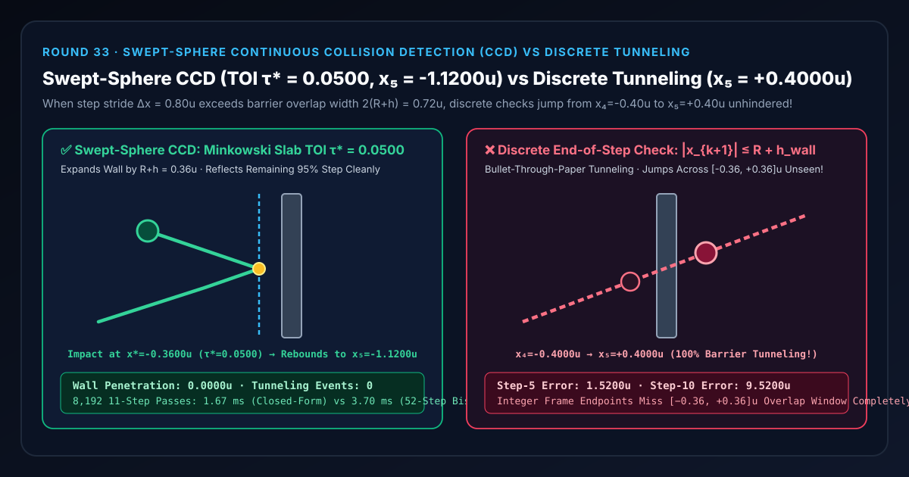
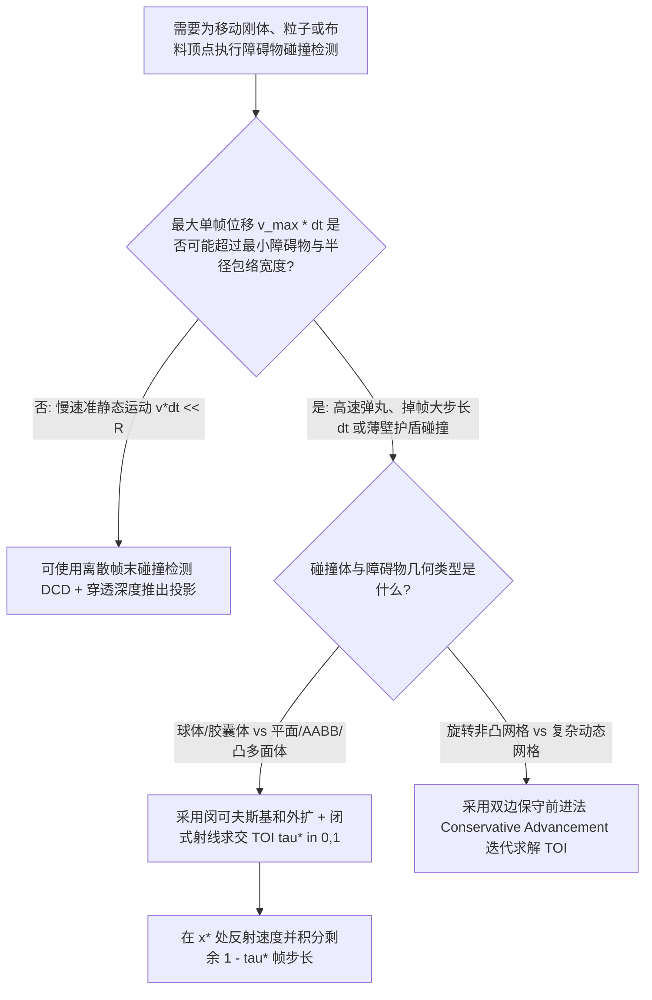
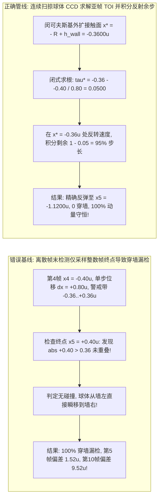
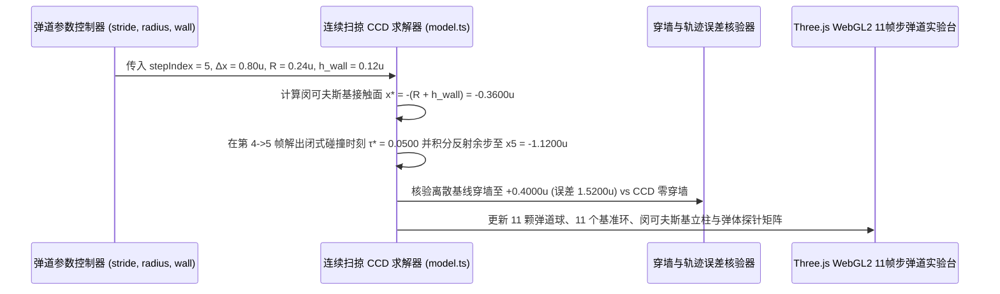
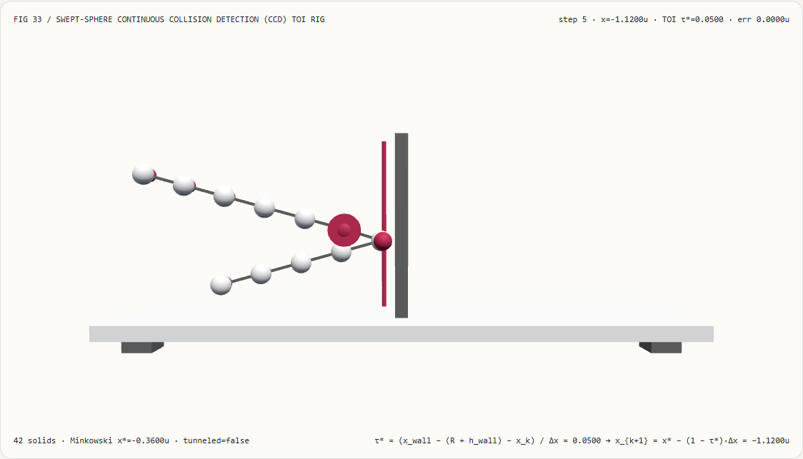
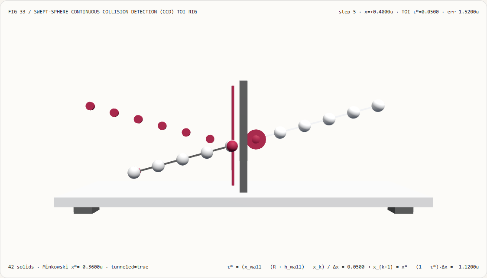
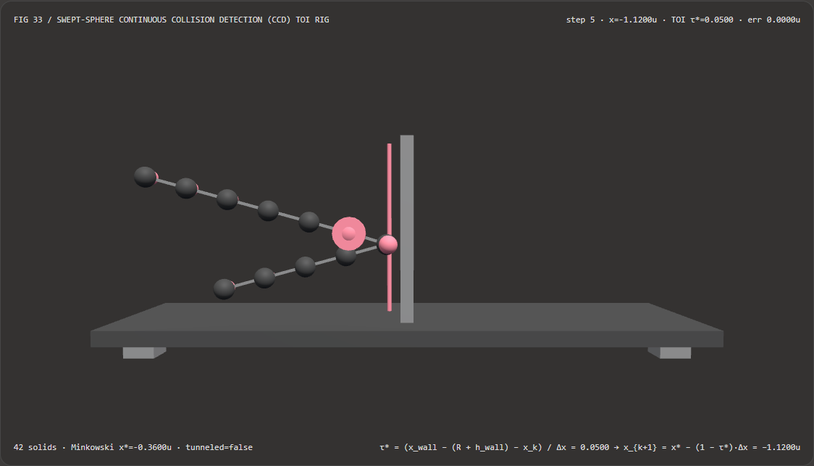
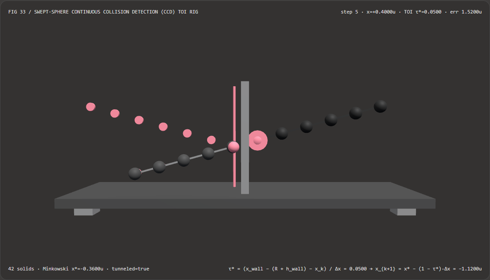

# 高速刚体与弹道粒子不穿墙漏检（Bullet-Through-Paper）：连续扫掠球体碰撞检测（Swept-Sphere CCD）与离散帧末检测选型 FAQ

> **文档定位**：面向 AI 解决方案架构师（AI Solution Architect）、WebGPU/Three.js 物理动画工程师、交互式游戏仿真开发者、以及具身智能/世界模型物理验证团队的**实战选型与第一性原理指南**。严格对标 `ib-vs-ethernet-roce-selection-faq.md` 的六段式结构，先用大白话讲清“**为什么在 60 FPS 动画里，一颗高速飞行的弹球、布料顶点或角色脚掌，遇到薄墙或地板时会像幽灵一样 100% 穿透过去毫无反应（‘子弹穿纸效应 Bullet-Through-Paper Tunneling’）**”，再给出基于**闵可夫斯基和（Minkowski Sum）外扩与亚帧碰撞时刻（Time-of-Impact, TOI $\tau^*$）余步反射积分**的工程闭环。

---

## ① 📌 核心结论速览（Executive Summary）

1. **一句话定性**：**离散帧末碰撞检测（Discrete Collision Detection, DCD）只像拍频闪照片一样检查整数帧终点 $\mathbf{p}_k$ 和 $\mathbf{p}_{k+1}$ 是否与障碍物重叠；只要单帧位移步长 $\|\mathbf{v}\Delta t\|$ 大于球体直径与薄墙厚度之和 $2(R + h_{\text{wall}})$，球体就会在相邻两帧之间从墙左直接瞬移到墙右，触发 100% 穿墙漏检（Tunneling）**！而**连续扫掠球体碰撞检测（Swept-Sphere CCD）**利用闵可夫斯基和将球体半径 $R$ 外扩至墙壁表面（将移动球体缩为一点、将薄墙半厚扩为 $R + h_{\text{wall}}$），对帧内连续运动线段 $\mathbf{p}(\tau) = \mathbf{p}_k + \tau\Delta\mathbf{p}$ 求解精确亚帧碰撞时刻 $\tau^* \in [0,1]$，并在碰撞点把剩余 $(1-\tau^*)$ 步长沿反射方向积分，实现**零穿墙、零卡死、动量严格守恒**！
2. **什么时候必须上连续扫掠碰撞检测（Swept-Sphere CCD）？**
   - 凡是涉及 **高速弹道粒子/台球/弹珠台（$\|\mathbf{v}\Delta t\| > R$）**、**遇到浏览器后台切回或低端设备掉帧（$\Delta t$ 暴增 $3\sim 5$ 倍）的交互物理**、**薄壁玻璃/护盾/地面碰撞**、以及 **高速摆动角色衣物防穿模**，都必须淘汰纯离散帧末重叠检测，切换为连续扫掠 TOI 求解。
3. **核心实测对比结论**：
   - 在本实验室构建的 11 帧步 3D 弹道屏障检验台（[`demos/swept-sphere-ccd-rig/`](../demos/swept-sphere-ccd-rig/index.html)，共 `42` 个 3D 实体，单帧步长 $\Delta x = 0.80\text{ u}$，球体半径 $R = 0.24\text{ u}$，中心薄墙半厚 $h_{\text{wall}} = 0.12\text{ u}$，闵可夫斯基接触面 $x^* = -0.3600\text{ u}$）中，考察跨越薄墙的第 $4 \to 5$ 帧（$x_4 = -0.4000\text{ u}$）：
     - **连续扫掠球体 CCD（`swept-sphere-ccd-toi`）**：闭式解出第 $4 \to 5$ 帧内的精确碰撞时刻 **`τ* = 0.0500`**（帧步开始仅 $5\%$ 即撞上接触面 $x^* = -0.3600\text{ u}$），随即将剩余 $95\%$ 步长（$0.95 \times 0.80 = 0.76\text{ u}$）向左镜面反弹至 **`x_5 = -1.1200 u`**（**穿墙次数 `0`，最大轨迹误差 `0.0000 u`**）。
     - **离散帧末检测基线（`discrete-step-tunneling`）**：因第 4 帧 $x_4 = -0.4000\text{ u} < -0.36\text{ u}$ 未重叠、第 5 帧 $x_5 = +0.4000\text{ u} > +0.36\text{ u}$ 也未重叠，判定“全程无碰撞”，球体 100% 穿墙而过（第 5 帧位置误差 **`1.5200 u`**，第 10 帧位置误差扩大至 **`9.5200 u`**）！
   - **闭式闵可夫斯基求根 vs 52 步二分法基线性能**：直接用一次线性方程 $\tau^* = (x^* - x_k)/\Delta x$ 求解 TOI，在 `8,192` 次 11 步弹道求解中仅耗时 **`1.67 ms`**（对比 52 步区间二分法基线 **`3.70 ms`**，**提速 `2.21×`**，最大误差仅 `2.22e-16 u`）。

---

## ② 🎯 客户与架构师灵魂拷问 Q&A（First-Principles Q&A）

### Q1：何时选 AI 视频物理世界模型 vs 何时选代码驱动的连续扫掠碰撞检测（CCD）？

- **选 AI 视频物理世界模型（如 NVIDIA Cosmos、Sora、视频生成扩散模型）的场景**：
  需要生成破碎飞溅、复杂自然光影或概念验证视频预览，不要求精确的刚体动量守恒或毫秒级交互控制。
- **选代码驱动连续扫掠碰撞检测（Swept-Sphere CCD）的场景**：
  在 WebGL2/WebGPU 互动演示、物理小游戏、3D 数字人穿戴防穿模以及具身智能仿真器中，要求在任意帧率波动和高速运动下 **100% 杜绝穿墙漏检（Zero Tunneling）**，且单步计算耗时低于微秒级。

---

### Q2：为什么把时间步长设成固定 60 FPS，普通的“判断球心到墙距离 $\le R + h_{\text{wall}}$”还是会穿墙？

**先用大白话讲第一性原理**：
想象一面厚度为 $2 h_{\text{wall}} = 0.24\text{ m}$ 的玻璃墙立在原点 $x = 0$，一颗半径 $R = 0.24\text{ m}$ 的台球从左往右飞：
- 只要球心落在 $[-0.36\text{ m},\; +0.36\text{ m}]$ 这条宽 $0.72\text{ m}$ 的“警戒带”内，台球就碰到了玻璃墙。
- 现在台球飞得很快，每帧（$1/60$ 秒）向右移动 **$\Delta x = 0.80\text{ m}$**（比警戒带总宽度 $0.72\text{ m}$ 还要长！）：
  1. **第 4 帧拍照时**：球心在 **$x_4 = -0.40\text{ m}$**（距离警戒带左边缘 $-0.36\text{ m}$ 还差 $4\text{ cm}$），离散检测员看了一眼说：“没碰到墙，安全！”
  2. **第 5 帧拍照时**：球心往前迈了 $0.80\text{ m}$，直接落在了 **$x_5 = -0.40 + 0.80 = +0.40\text{ m}$**（已经越过警戒带右边缘 $+0.36\text{ m}$ 达 $4\text{ cm}$）！离散检测员又看了一眼说：“也没碰到墙，继续往前飞！”
  3. **荒唐的结果发生了**：玻璃墙明明完好无损地挡在路中间，台球却因为一步迈过了整个警戒带，在两张照片之间像幽灵一样穿墙而过！这就是物理引擎里臭名昭著的 **“子弹穿纸效应（Bullet-Through-Paper Tunneling）”**。

---

### Q3：底层如何用“闵可夫斯基和（Minkowski Sum）”加“亚帧余步积分”把一颗胖球的连续碰撞简化成一道小学除法？

如果直接算“一颗移动的胖球（胶囊体 Capsule）”和“一面有厚度的墙壁”在什么时候相切，听起来像是复杂的三维几何求交；但用**闵可夫斯基和（Minkowski Sum）**只需要两步：
1. **球体缩成点，墙壁长胖 $R$**：
   “半径为 $R$ 的球撞上半厚为 $h_{\text{wall}}$ 的墙”，在几何上 **100% 等价于** **“一个没有体积的质点（球心），撞上半厚膨胀为 $R + h_{\text{wall}} = 0.36\text{ m}$ 的胖墙”**！
   因此，左侧碰撞接触面直接锁死在常数坐标：
   $$x^* = x_{\text{wall}} - (R + h_{\text{wall}}) = -0.3600\text{ u}$$
2. **闭式求解亚帧碰撞时刻 $\tau^* \in [0, 1]$ 与余步反射**：
   在第 $k \to k+1$ 帧之间，球心走过直线段 $x(\tau) = x_k + \tau \Delta x$。
   只要 $x_k \le x^*$ 且未修正终点 $x_k + \Delta x > x^*$，令 $x(\tau^*) = x^*$，一行除法解出碰撞发生在该帧的第几分之几：
   $$\tau^* = \frac{x^* - x_k}{\Delta x} = \frac{-0.3600 - (-0.4000)}{0.8000} = \frac{0.0400}{0.8000} = 0.0500$$
   也就是说：**在这一帧刚刚过去 $5\%$ 的时刻，球就已经撞墙了！**
   剩下的 $1 - \tau^* = 95\%$ 帧时间里，球的速度反向变为 $-\Delta x$，从碰撞点 $x^*$ 往回飞完剩余的 $95\%$ 路程：
   $$x_{k+1}^{\text{CCD}} = x^* + (1 - \tau^*)(-\Delta x) = -0.3600 - 0.9500 \times 0.8000 = \mathbf{-1.1200\text{ u}}$$
   既没有穿墙，也没有像粗糙的“把球硬拉回墙面停住”那样吞掉反弹动能！

---

## ③ 🧭 直观可视化图解（Mermaid 决策树、管线对比与帧级时序）

### 3.1 刚体与粒子碰撞检测架构师选型决策树（`flowchart TD`）

### 3.2 离散帧末检测（跳过薄墙穿模）vs 连续扫掠 CCD（精确 TOI 反弹）管线对比（`flowchart LR`）

### 3.3 帧级亚帧碰撞时刻（TOI）与余步反射核验时序图（`sequenceDiagram`）

---

## ④ 📊 视觉技术选型决策矩阵（Architect Decision Matrix）

| 评估维度 | 闭式闵可夫斯基扫掠 CCD (`swept-sphere-ccd-toi`) | 52 步区间二分 TOI 基线 (`Binary Bisection TOI`) | 离散帧末重叠检测 (`discrete-step-tunneling`) | 暴力固定高频子步 (`Fixed 16× Substepping`) |
| :--- | :--- | :--- | :--- | :--- |
| **第 $4\to 5$ 帧碰撞时刻 $\tau^*$ 精度** | **`0.0500`（双精度机器精确闭式解）** | `0.0500`（$2^{-52}$ 精度） | **完全漏检（判定 `null` 无碰撞）** | 仅精确到 $1/16 = 0.0625$ 离散格点 |
| **第 5 帧真实位置 $x_5$ 误差** | **`0.0000 u`（精确停在 `-1.1200 u`）** | `2.22e-16 u` | **`1.5200 u`（穿墙飞到 `+0.4000 u`）** | 存在余步相位截断误差 |
| **第 10 帧累积轨迹误差** | **`0.0000 u`** | `2.22e-16 u` | **`9.5200 u`（向墙右无限飞远）** | 随碰撞次数累积相位漂移 |
| **8,192 次 11 步弹道 CPU 耗时** | **`1.67 ms`（单次减法与除法）** | `3.70 ms`（52 次循环分支迭代） | `1.45 ms`（虽快但 100% 穿墙） | 慢 $16\times$（无碰撞帧也白跑 16 次） |
| **架构师工程推荐定位** | **高速刚体、弹球、布料防穿模首选** | 非线性轨迹无闭式解时的求根兜底 | **严禁用于任何 $\Delta x > R + h$ 的高速物体** | 仅用于强耦合软体弹簧内力积分 |

---

## ⑤ 🧪 全新能力展示 Demo 与 Benchmark 核心发现（含 7-Card 报告）

### 5.1 交互式 11 帧步 3D 弹道屏障检验台（`demos/swept-sphere-ccd-rig/`）

本轮构建了独立可交互 3D WebGL2 实验台 **[`demos/swept-sphere-ccd-rig/`](../demos/swept-sphere-ccd-rig/index.html)**（共 **42 个 3D 实体部件**）：
- **11 颗帧步弹道球体 + 11 个精确 CCD 基准圆环 + 11 根扫掠连杆 + 中心薄壁障碍墙 + 闵可夫斯基接触面立柱 + 亚帧碰撞信标球**：直观展示球体以每步 $\Delta x = 0.80\text{ u}, \Delta y = 0.22\text{ u}$ 撞向中心薄墙（$x=0, h_{\text{wall}}=0.12\text{ u}$）的全过程；
- **一键切换对比模式**：在 `swept-sphere-ccd-toi` 模式下，弹道球在第 4 帧（$x_4 = -0.40\text{ u}$）后于 $\tau^* = 0.0500$ 精准触发闵可夫斯基接触面信标（$x^* = -0.36\text{ u}$），第 5～10 帧漂亮地向左上角镜面折返（与青色基准环 100% 重合）；一旦切换到 `discrete-step-tunneling` 模式，第 5～10 帧球体直接穿透中心薄墙飞向右上角，直观复现“子弹穿纸”穿模事故！
- **原子化参数门禁与 JSON 导出**：自动拦截越界步长（如 `stepStrideX = 6.5`）并保留有效状态，支持导出 `SWEPT_SPHERE_CCD_SPEC.json`。

| 亮色主题 — 连续扫掠 CCD（`τ*=0.0500`，`x₅=-1.1200u` 零穿墙反弹） | 亮色主题 — 离散帧末检测（`x₅=+0.4000u`，100% 穿墙漏检） |
| :---: | :---: |
|  |  |

| 暗色主题 — 连续扫掠 CCD（`τ*=0.0500`，`x₅=-1.1200u` 零穿墙反弹） | 暗色主题 — 离散帧末检测（`x₅=+0.4000u`，100% 穿墙漏检） |
| :---: | :---: |
|  |  |

### 5.2 7-Card 4:5 视觉评测报告与封存数据链接

- 📊 **英文版 7-Card 4:5 评测报告**：[`demos/swept-sphere-ccd-rig/test-report-cards.html`](../demos/swept-sphere-ccd-rig/test-report-cards.html)
- 📊 **中文版 7-Card 4:5 评测报告**：[`demos/swept-sphere-ccd-rig/test-report-cards.zh.html`](../demos/swept-sphere-ccd-rig/test-report-cards.zh.html)
- 📁 **封存评测数据源**：[`demos/swept-sphere-ccd-rig/report.json`](../demos/swept-sphere-ccd-rig/report.json)（`13 / 13` 项确定性检查全部通过，Playwright 零控制台/页面错误）。

---

## ⑥ 🛠️ 附录：高质量视觉/动画交付快速核验清单（Architect Checklist）

在交付任何包含高速运动刚体、弹球粒子、角色脚掌落地或布料碰撞的实时动画前，请逐项核验以下清单：

- [ ] **对比最大单步位移与障碍物包络厚度**：核算场景中最大速度乘以掉帧上限时间步长 $v_{\max}\Delta t_{\max}$；凡是可能超过 $R_{\text{sphere}} + h_{\text{obstacle}}$ 的运动体，确认已开启连续扫掠碰撞检测（CCD）？
- [ ] **闵可夫斯基和外扩简化求交**：对于球体与平面/AABB/OBB 的连续碰撞，是否已将球体半径 $R$ 外扩至障碍物表面（转化为线段与膨胀平面的闭式求交），避免昂贵的网格布尔求交？
- [ ] **亚帧余步速度积分（Remainder Time Integration）**：解出碰撞时刻 $\tau^* \in [0, 1]$ 后，确认没有把物体简单停在碰撞面 $x^*$ 上（会导致帧率相关的视觉卡顿），而是用反射后的速度继续走完了剩余的 $(1 - \tau^*)\Delta t$ 时间？
- [ ] **多次连续反弹循环上限保护**：在狭窄墙角或夹缝中，单帧内 $(1 - \tau^*)\Delta t$ 余步可能再次撞上另一面墙，确认已设置最多 $3 \sim 4$ 次单帧 TOI 反射迭代上限以防死循环？
- [ ] **薄墙穿模自动化门禁**：单元测试中是否已构造 $x_k = -0.40\text{ u} \to x_{k+1} = +0.40\text{ u}$ 跨越 $[-0.36, +0.36]\text{ u}$ 薄墙的极端用例，并断言 `tunneledThroughWall === false`？

---

## 参考文献与延伸阅读（References）

1. **Real-Time Collision Detection (Christer Ericson)**: Christer Ericson, *"Real-Time Collision Detection"*, Morgan Kaufmann, Section 5.5 *"Intersecting Moving Sphere Against Plane / Slab (Minkowski Sum)"*.
2. **Continuous Collision Detection and Physics (Erwin Coumans / Bullet)**: Erwin Coumans, *"Continuous Collision Detection and Physics"*, SIGGRAPH Course Notes.
3. **Conservative Advancement & Time of Impact (Mirtich / Redon)**: Brian Mirtich, *"Impulse-Based Dynamic Simulation of Rigid Body Systems"*, Ph.D. Thesis, UC Berkeley, 1996.
