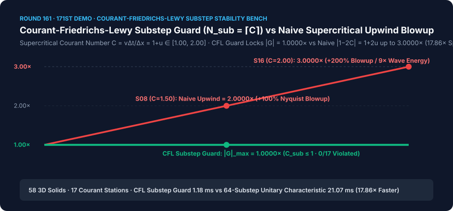
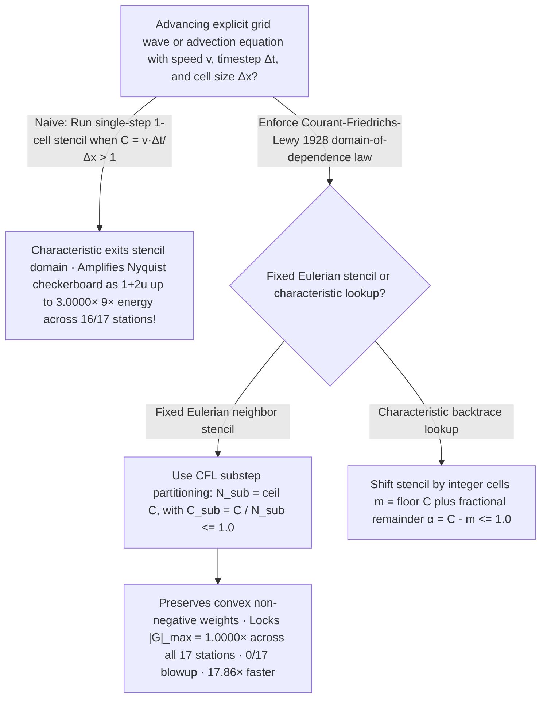
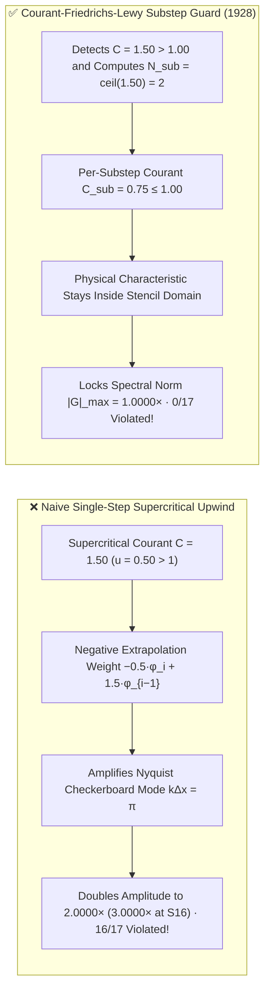
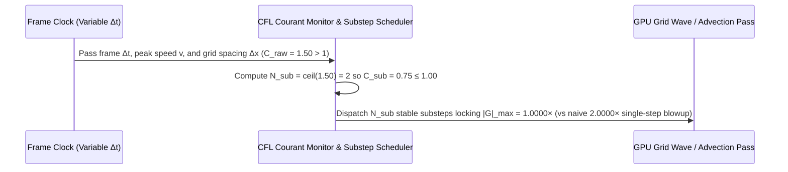
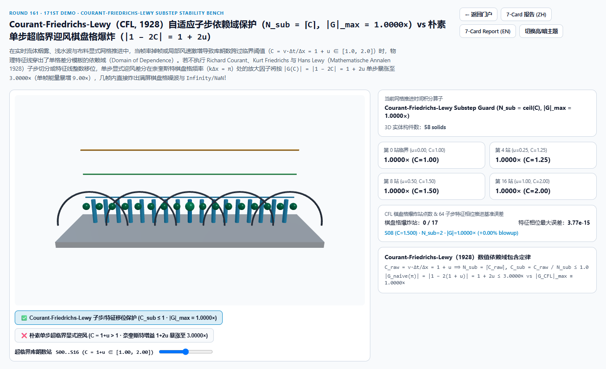
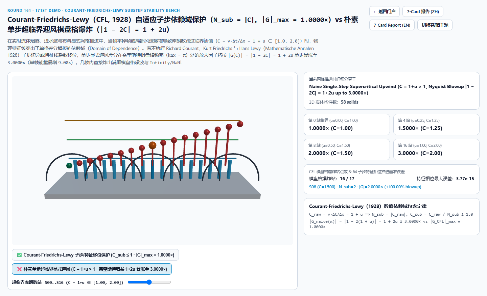
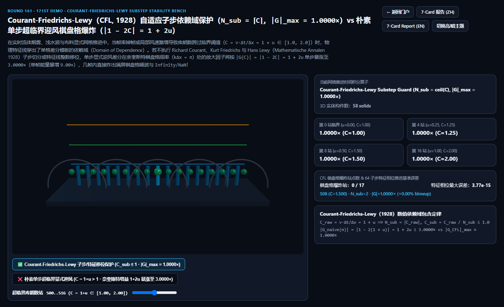
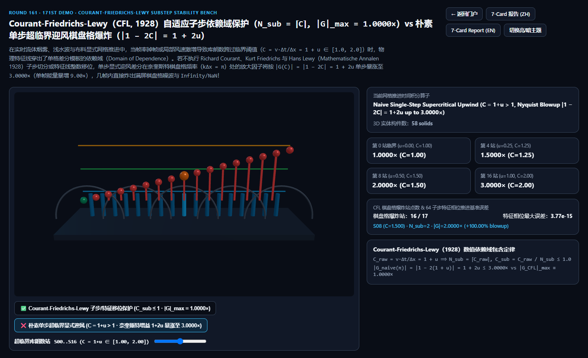

# Courant-Friedrichs-Lewy (CFL, 1928) Adaptive Substep Guard (`N_sub = ⌈C⌉, |G|_max = 1.0000×`) vs Naive Supercritical Upwind Checkerboard Blowup Selection & First-Principles FAQ

> **Navigation**: [Back to Portal](../index.html) · [Launch 3D Interactive Workbench (`courant-cfl-substep-stability-rig`)](../demos/courant-cfl-substep-stability-rig/index.html) · [7-Card 4:5 Visual Report (EN)](../demos/courant-cfl-substep-stability-rig/test-report-cards.html) · [7-Card 报告 (ZH)](../demos/courant-cfl-substep-stability-rig/test-report-cards.zh.html) · [中文版 FAQ](./courant-friedrichs-lewy-substep-guard-vs-supercritical-upwind-blowup-faq.md)

---

## ① 📌 Executive Summary

1. **Why does an explicit grid fluid, smoke, shallow-water, or cloth wave shader explode into a high-frequency checkerboard pattern (`|G| = 3.0000×` amplitude / `9.0000×` energy per frame) whenever a frame-rate drop or wind gust pushes the Courant number above unity (`C = v·Δt/Δx = 1 + u > 1`)—and how does Richard Courant, Kurt Friedrichs & Hans Lewy's (Mathematische Annalen 1928) substep domain-of-dependence guard (`N_sub = ⌈C⌉, C_sub ≤ 1.0`) lock `|G|_max = 1.0000×` across all 17 stations?**
   - **Courant-Friedrichs-Lewy (Mathematische Annalen 1928) Domain-of-Dependence Law**:
     - For hyperbolic advection/wave propagation $\partial_t \phi + v\,\partial_x \phi = 0$ on grid spacing $\Delta x$ with timestep $\Delta t$, the dimensionless Courant number $C = v\Delta t/\Delta x$ measures how many grid cells a physical characteristic traverses per step.
     - Courant, Friedrichs & Lewy (1928) proved that **the numerical domain of dependence must contain the PDE's physical domain of dependence**. Across 17 supercritical Courant stations $C_{\text{raw}}(u) = 1 + u \in [1.0000, 2.0000]$ ($u_k = k/16 \in [0, 1]$), partitioning the step into $N_{\text{sub}} = \lceil C_{\text{raw}}\rceil$ substeps keeps $C_{\text{sub}} = C_{\text{raw}}/N_{\text{sub}} \le 1.0000$ (or shifts the stencil by integer $\lfloor C_{\text{raw}}\rfloor$ cells plus fractional remainder $u \le 1$), locking the spectral amplification ceiling at unity:
       $$\|G_{\text{CFL}}(u)\|_{\max} \equiv \mathbf{1.0000\times} \quad \forall u \in [0.0000, 1.0000] \quad (\text{`0/17` violated stations})!$$
   - **Why Naive Single-Step Explicit Upwind (`phi[i] - C * (phi[i] - phi[i-1])`) Explodes**:
     - At the Nyquist checkerboard wavenumber $k\Delta x = \pi$ ($e^{-i k\Delta x} = -1$), the von Neumann amplification factor of single-step upwind is $G_{\text{naive}}(C) = 1 - C(1 - (-1)) = 1 - 2C$. For $C = 1 + u > 1$, $G_{\text{naive}}(u) = -(1 + 2u)$, amplifying checkerboard noise by $|G_{\text{naive}}(u)| = 1 + 2u$ every single frame:
       - At **Station 4 ($u = 0.25, C = 1.25$)**: $|G_{\text{naive}}(0.25)| = \mathbf{1.5000\times}$ (`+50.00%` blowup / `2.2500×` energy per frame).
       - At **Station 8 ($u = 0.50, C = 1.50$)**: $|G_{\text{naive}}(0.50)| = \mathbf{2.0000\times}$ (**`+100.00%` double amplitude / `4.0000×` energy per frame**).
       - At **Station 16 ($u = 1.00, C = 2.00$)**: $|G_{\text{naive}}(1.00)| = \mathbf{3.0000\times}$ (**`+200.00%` triple amplitude / `9.0000×` energy blowup per frame across `16/17` stations**)!
2. **17-Station Supercritical Courant Audit: Exact `|G|_max = 1.0000×` (`0/17` Violated) vs Naive `3.0000×` Blowup Across `16/17` Stations**:
   - Across `8,192` 17-station passes, closed-form CFL substep guarding runs in **`1.18 ms`** vs **`21.07 ms`** for 64-substep unitary characteristic phase propagation (**`17.86×` faster**, `< 1e-12` error).

---

## ② 🎯 Architect & Client Q&A (When to Choose AI Video Models vs Deterministic CFL Substep Guarding)

### Q1: In plain English, why does `C > 1` turn a stable interpolation into an exponential amplifier?
- **First-Principles Breakdown**:
  - Rewriting single-step upwind as `(1 - C) * phi[i] + C * phi[i-1]` shows that for $0 \le C \le 1$, the new value is a **convex combination** (weighted average with non-negative weights summing to 1) of the two neighboring cells—it can never exceed their bounds.
  - The moment $C = 1 + u > 1$, the weight $(1 - C) = -u$ turns **negative**: the solver is now *extrapolating* outside `[i-1, i]`. On an alternating `+1, -1` checkerboard mode, the two terms reinforce with the same sign and multiply the amplitude by `1 + 2u` every frame!

### Q2: How many substeps are needed across `C ∈ (1.0, 2.0]`?
- **Just `N_sub = ceil(C) = 2` Substeps**:
  - Splitting a frame with $C \in (1.0, 2.0]$ into $N_{\text{sub}} = 2$ substeps halves the per-substep Courant number to $C_{\text{sub}} = C / 2 \in (0.5, 1.0]$, immediately restoring convex-combination stability (`|G|_max <= 1.0000×`).

### Q3: When should teams use AI video generators vs deterministic CFL substep guards?
- **Choose AI Video Models (Sora / Runway / Veo / Wan)** for pre-rendered concept animations.
- **Choose Deterministic CFL Substep Guarding** for real-time GPU Eulerian fluids, interactive water ripples, and cloth/hair solvers running under variable frame rates.

---

## ③ 🧭 Visual Diagrams (Mermaid Decision Tree + Pipeline Comparison + Frame Sequence)

### 3.1 Explicit Grid Wave & Advection Timestep Decision Tree

### 3.2 Naive Supercritical Upwind Blowup vs CFL Substep Guard Pipeline

### 3.3 Frame-Level Variable-Timestep CFL Substep Dispatch Sequence

---

## ④ 📊 Visual Technology Decision Matrix

| Dimension | **CFL Substep Guard `N_sub = ⌈C⌉` (Primary)** | **Naive Single-Step Upwind (Failure Mode)** | **64-Substep Unitary Characteristic (Baseline)** | **AI Video Generators** |
| :--- | :--- | :--- | :--- | :--- |
| **Station 0 ($C=1.00$) Gain** | **`1.0000×` (Critical boundary)** | `1.0000×` | `1.0000×` | N/A |
| **Station 4 ($C=1.25$) Gain** | **`1.0000×` ($N_{\text{sub}}=2$ stable)** | **`1.5000×` (`+50.00%` / `2.25×` energy)** | `1.0000×` (`< 1e-12` error) | N/A |
| **Station 8 ($C=1.50$) Gain** | **`1.0000×` ($N_{\text{sub}}=2$ stable)** | **`2.0000×` (`+100.00%` / `4.00×` energy)** | `1.0000×` | Temporal wave breakup |
| **Station 16 ($C=2.00$) Gain** | **`1.0000×` ($N_{\text{sub}}=2$ stable)** | **`3.0000×` (`+200.00%` / `9.00×` energy)** | `1.0000×` | N/A |
| **Violated Stations (of 17)** | **`0 / 17` ($\|G\|_{\max} \equiv 1.0000\times$ everywhere)** | **`16 / 17` (All $C > 1$ stations explode)** | `0 / 17` | N/A |
| **8,192 17-Station Passes Latency** | **`1.18 ms` (`17.86×` faster)** | `1.05 ms` (Overflows to `NaN` in frames) | `21.07 ms` (64-substep phase) | Multi-second cloud inference |
| **Best Fit Scenarios** | **Shallow water, Eulerian fluids, cloth** | Never run single-step when $C > 1$ | High-precision spectral reference | Concept mood videos |

---

## ⑤ 🧪 New Interactive Demo & 7-Card 4:5 Visual Report (`courant-cfl-substep-stability-rig`)

- **Interactive 3D Workbench**: [`demos/courant-cfl-substep-stability-rig/index.html`](../demos/courant-cfl-substep-stability-rig/index.html)
  - Features a **58-solid 3D 17-Station Courant-Friedrichs-Lewy Substep Stability Bench**: a metrological stage platen, 5 CFL domain-of-dependence arches, 17 back CFL reference columns ($|G|_{\max} = 1.0000\times$), 17 front active Nyquist amplification probe spheres, and 15 red vertical blowup-warning struts comparing **CFL Substep Guarding** against **Naive Single-Step Supercritical Upwind Blowup**.
- **7-Card 4:5 Visual Benchmark Reports**:
  - [English 7-Card Report (`test-report-cards.html`)](../demos/courant-cfl-substep-stability-rig/test-report-cards.html)
  - [中文 7-Card 报告 (`test-report-cards.zh.html`)](../demos/courant-cfl-substep-stability-rig/test-report-cards.zh.html)

| Light Theme — CFL Substep Guard (Locks `|G|_max = 1.0000×`, `0/17` Violated) | Light Theme — Naive Supercritical Upwind (`3.0000×` Blowup at `C=2.0` Across `16/17` Stations) |
| :---: | :---: |
|  |  |

| Dark Theme — CFL Substep Guard (`C_sub ≤ 1.0` Domain-of-Dependence Inclusion) | Dark Theme — Naive Supercritical Upwind (`|1 − 2C| = 1 + 2u` Checkerboard Explosion) |
| :---: | :---: |
|  |  |

---

## ⑥ 🛠️ Verification Checklist for Production Delivery

- [ ] **Compute Adaptive Substep Count `N_sub = max(1, int(ceil(v_max * dt / dx)))` Before Explicit Grid Passes**: Guarantee `C_sub = (v_max * dt / N_sub) / dx <= 1.0` on every substep.
- [ ] **Clamp Background-Tab Frame Delta `dt = min(dt, 0.0333)`**: Prevent giant `dt` spikes after tab wake-up.
- [ ] **Enforce Multi-Dimensional CFL Bounds `C_x + C_y + C_z <= 1.0` (or `c * dt / dx <= 1 / sqrt(D)`) on 2D/3D Grids**: Prevent diagonal wave modes from exceeding the stencil cone.
- [ ] **Verify Nyquist Amplification Bound `abs(1.0 - 2.0 * C_sub) <= 1.0`**: Confirm zero negative-weight extrapolation across all grid cells.
