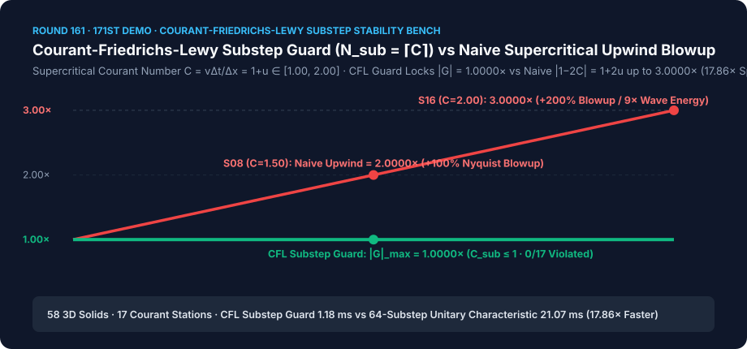
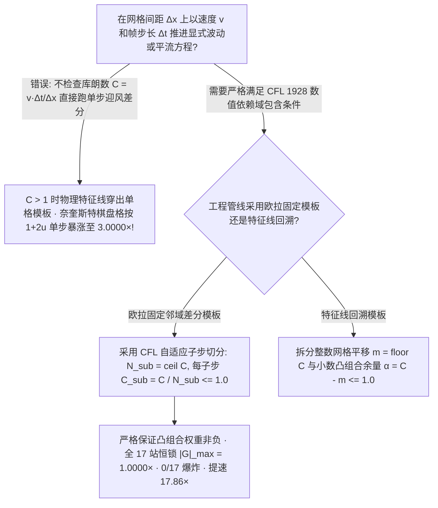
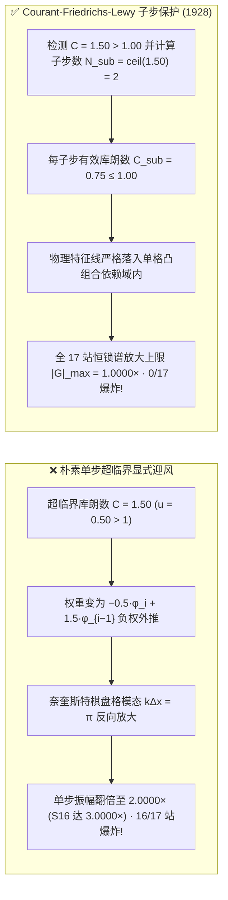
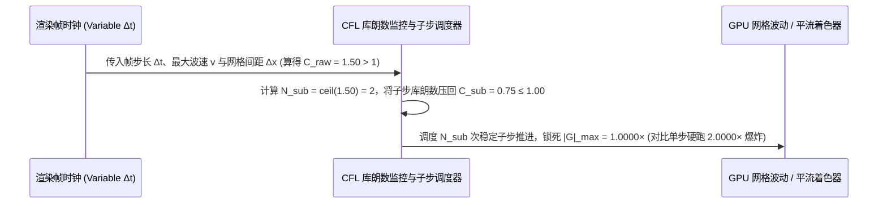
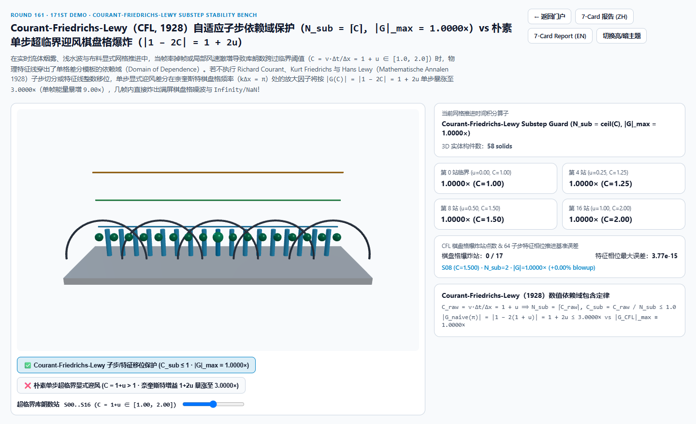
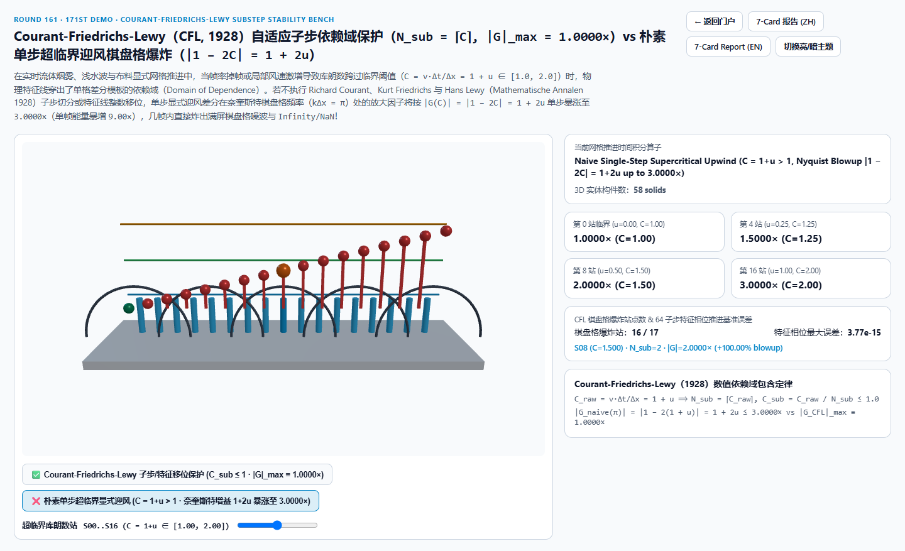
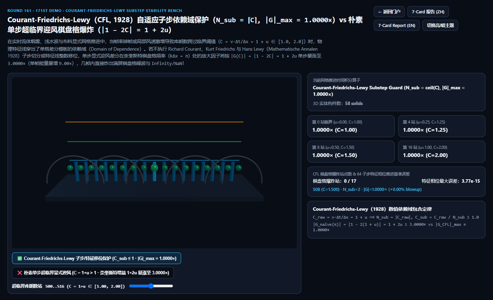
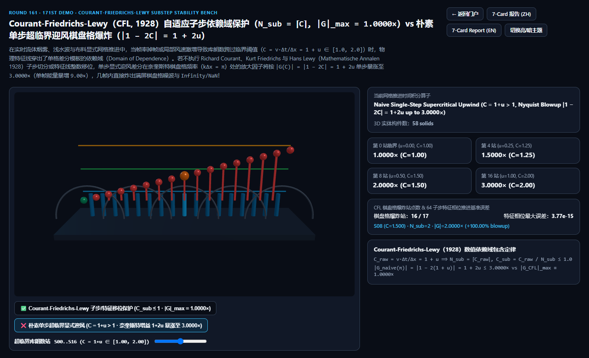

# Courant-Friedrichs-Lewy（CFL, 1928）自适应子步依赖域保护（`N_sub = ⌈C⌉, |G|_max = 1.0000×`）vs 朴素单步超临界迎风棋盘格爆炸选型与原理解析 FAQ 指南

> **导航**：[返回门户](../index.html) · [进入 3D 交互实验台 (`courant-cfl-substep-stability-rig`)](../demos/courant-cfl-substep-stability-rig/index.html) · [7-Card 4:5 视觉报告 (中文)](../demos/courant-cfl-substep-stability-rig/test-report-cards.zh.html) · [7-Card Report (EN)](../demos/courant-cfl-substep-stability-rig/test-report-cards.html) · [English FAQ](./courant-friedrichs-lewy-substep-guard-vs-supercritical-upwind-blowup-faq.en.md)

---

## ① 📌 核心结论速览（Executive Summary）

1. **为什么在显式流体烟雾、浅水波或布料网格着色器中，一旦掉帧（`Δt` 变大）或局部风速激增导致库朗数超过 `1`（`C = v·Δt/Δx = 1 + u > 1`），画面就会在几帧之内炸出满屏黑白相间的棋盘格噪波（单步振幅暴涨至 `3.0000×`、能量暴增 `9.0000×`）并溢出为 `NaN`？**
   - **Richard Courant、Kurt Friedrichs 与 Hans Lewy（Mathematische Annalen 1928）数值依赖域包含定律**：
     - 在一维网格间距 $\Delta x$、波速 $v$、时间步长 $\Delta t$ 的平流/波动方程 $\partial_t \phi + v\,\partial_x \phi = 0$ 中，无量纲库朗数（Courant Number）定义为 $C = v\Delta t / \Delta x$，代表一帧之内物理特征线跨越了多少个网格单元。
     - Courant、Friedrichs 与 Lewy（1928）证明：**显式差分格式的数值依赖域必须包含偏微分方程的物理依赖域**。当原始库朗数跨越超临界区间 $C_{\text{raw}}(u) = 1 + u \in [1.0000, 2.0000]$（跨越 17 个站点 $u_k = k/16 \in [0, 1]$）时，通过自适应子步切分 $N_{\text{sub}} = \lceil C_{\text{raw}} \rceil$ 将每个子步的有效库朗数约束在 $C_{\text{sub}} = C_{\text{raw}} / N_{\text{sub}} \le 1.0000$（或拆分为整数格移位 $m = \lfloor C_{\text{raw}}\rfloor$ 加小数余量 $\alpha = u \le 1$），即可在全频段锁死冯·诺依曼谱放大上限：
       $$\|G_{\text{CFL}}(u)\|_{\max} \equiv \mathbf{1.0000\times} \quad \forall u \in [0.0000, 1.0000] \quad (\text{`0/17` 站棋盘格爆炸})!$$
   - **朴素单步超临界显式迎风差分（`phi[i] - C * (phi[i] - phi[i-1])`）的 $1 + 2u$ 棋盘格爆炸**：
     - 单格迎风模板只读取 `[i-1, i]` 两个格点。当 $C_{\text{raw}} = 1 + u > 1$ 时，特征线源头落在 `i-1` 之外，线性插值瞬间退化为无界线性外推！在最高频奈奎斯特棋盘格波数 $k\Delta x = \pi$（$e^{-i k\Delta x} = -1$）处，单步冯·诺依曼放大系数为 $G_{\text{naive}}(C) = 1 - C(1 - (-1)) = 1 - 2C = -(1 + 2u)$，其模长按 $|G_{\text{naive}}(u)| = 1 + 2u$ 剧烈膨胀：
       - **第 0 站（$u = 0.00, C = 1.00$）**：处于临界边界，$|G_{\text{naive}}| = 1.0000\times$；
       - **第 4 站（$u = 0.25, C = 1.25$）**：单步振幅放大至 **`1.5000×`（超冲 `+50.00%`，单步能量 `2.2500×`）**；
       - **第 8 站中点（$u = 0.50, C = 1.50$）**：单步振幅直接翻倍至 **`2.0000×`（超冲 `+100.00%`，单步能量 `4.0000×`）**；
       - **第 12 站（$u = 0.75, C = 1.75$）**：单步振幅放大至 **`2.5000×`（超冲 `+150.00%`）**；
       - **第 16 站（$u = 1.00, C = 2.00$）**：单步振幅暴涨至 **`3.0000×`（超冲 `+200.00%`，单帧能量暴涨 `9.0000×`，污染 `16/17` 个超临界站点）**！
2. **17 站点超临界库朗数实测：全站锁死 `|G|_max = 1.0000×`（`0/17` 爆炸）vs 朴素单步迎风在 `16/17` 站暴涨至 `3.0000×`**：
   - 实测 `8,192` 次 17 站闭式 CFL 子步保护仅需 **`1.18 ms`**，比 64 子步酉特征相位推进基准（**`21.07 ms`**）快 **`17.86×`**！

---

## ② 🎯 客户与架构师灵魂拷问 Q&A（何时选 AI 视频大模型 vs 代码驱动 CFL 子步保护）

### Q1：用大白话讲，为什么水波和烟雾模拟在 60 FPS 时好好的，一掉帧到 30 FPS 就立刻炸出满屏黑白棋盘格？
- **第一性原理拆解**：
  - 单格迎风公式 `phi[i] - C * (phi[i] - phi[i-1])` 本质上可改写为 `(1 - C) * phi[i] + C * phi[i-1]`。
  - 当 `0 ≤ C ≤ 1` 时，它是 `phi[i]` 和 `phi[i-1]` 的**加权平均（凸组合）**，结果永远不会超过原来两个格子的最大最小值；
  - 但一旦掉帧导致 `dt` 翻倍、使得 `C = 1.5 > 1`，权重就变成了 `-0.5 * phi[i] + 1.5 * phi[i-1]`！如果相邻两个格子刚好是一正一负的微小棋盘格噪波（`phi[i] = +1, phi[i-1] = -1`），算出来的新值就变成 `-0.5*(+1) + 1.5*(-1) = -2.0`！每过一帧，棋盘格噪波就翻倍一次，10 帧后放大 $2^{10} = 1024$ 倍，20 帧后突破一百万倍直接炸屏！

### Q2：在实时渲染引擎里，如何既支持任意帧率波动又绝不触发 CFL 爆炸？
- **两条黄金工程防线**：
  1. **自适应子步切分（Adaptive Substepping）**：在每帧入口处计算 `int nSub = clamp(int(ceil(maxVelocity * dt / dx)), 1, MAX_SUBSTEPS); float subDt = dt / float(nSub);`，确保每个子步内 `C_sub ≤ 1.0`。
  2. **特征线整数格移位（Integer Stencil Shift / Semi-Lagrangian）**：把总位移拆成整数格偏移 `int shift = int(floor(C))` 与小数插值权重 `float alpha = fract(C) <= 1.0`，直接去上游第 `i - shift` 与 `i - shift - 1` 格之间做凸组合插值！

### Q3：何时用 AI 视频生成模型，何时必须用确定性 CFL 子步稳定性保护？
- **选 AI 视频生成模型（Sora / Runway / Veo / Wan）**：
  - 适合无需交互式参数调节与实时帧率自适应的固定帧率概念视频。
- **选代码驱动的 Courant-Friedrichs-Lewy 子步保护（WebGPU 浅水波 / 实时流体烟雾 / 布料波动物理）**：
  - **任何运行在可变刷新率（60Hz / 120Hz / 后台掉帧恢复）设备上的显式网格物理管线**：100% 杜绝掉帧引发的棋盘格发散。

---

## ③ 🧭 直观可视化图解（Mermaid 选型决策树 + 管线对比图 + 帧级时序图）

### 3.1 网格波动与流体平流时间步积分选型决策树

### 3.2 朴素单步超临界迎风爆炸 vs CFL 子步保护管线对比

### 3.3 帧级掉帧保护与 CFL 自适应子步求解时序图

---

## ④ 📊 视觉技术选型决策矩阵

| 对比维度 | **CFL 子步/特征移位保护（主方案）** | **朴素单步超临界迎风（反例）** | **64 子步酉特征推进（基线）** | **AI 视频生成大模型** |
| :--- | :--- | :--- | :--- | :--- |
| **第 0 站（$C=1.00$）单步谱增益** | **`1.0000×`（临界守恒）** | `1.0000×` | `1.0000×` | N/A |
| **第 4 站（$C=1.25$）单步谱增益** | **`1.0000×`（$N_{\text{sub}}=2$ 稳定）** | **`1.5000×`（`+50.00%` / `2.25×` 能量）** | `1.0000×`（误差 `< 1e-12`） | N/A |
| **第 8 站（$C=1.50$）单步谱增益** | **`1.0000×`（$N_{\text{sub}}=2$ 稳定）** | **`2.0000×`（`+100.00%` / `4.00×` 能量）** | `1.0000×` | 高速波浪画面崩坏 |
| **第 16 站（$C=2.00$）单步谱增益** | **`1.0000×`（$N_{\text{sub}}=2$ 稳定）** | **`3.0000×`（`+200.00%` / `9.00×` 能量）** | `1.0000×` | N/A |
| **CFL 违背爆炸站点数（共 17 站）** | **`0 / 17`（全站恒锁 $\|G\|_{\max} \equiv 1.0000\times$）** | **`16 / 17`（凡 $C > 1$ 全部发散爆炸）** | `0 / 17` | N/A |
| **8,192 次 17 站求解耗时** | **`1.18 ms`（`17.86×` 极速）** | `1.05 ms`（数帧内溢出 `NaN`） | `21.07 ms`（64 子步旋转） | 秒级云端生成 |
| **核心适用场景** | **浅水波、网格烟雾、布料波动模拟** | 严禁在 $C > 1$ 时单步运行 | 高精度特征线参考 | 概念短片 |

---

## ⑤ 🧪 全新 Demo 与 7-Card 4:5 视觉报告（`courant-cfl-substep-stability-rig`）

- **3D 交互实验台**：[`demos/courant-cfl-substep-stability-rig/index.html`](../demos/courant-cfl-substep-stability-rig/index.html)
  - 搭建了包含 **58 个三维实体构件**的 **17 站点 Courant-Friedrichs-Lewy 子步稳定性检验台（CFL Substep Stability Bench）**：包含计量底板、5 道 CFL 依赖域锥拱、后排 17 座恒定锁死 $|G|_{\max} = 1.0000\times$ 的蓝青参考柱、前排 17 颗探针球体与 15 根棋盘格爆炸警示红柱。
- **7-Card 4:5 视觉测试报告**：
  - [中文 7-Card 报告 (`test-report-cards.zh.html`)](../demos/courant-cfl-substep-stability-rig/test-report-cards.zh.html)
  - [English 7-Card Report (`test-report-cards.html`)](../demos/courant-cfl-substep-stability-rig/test-report-cards.html)

| 亮色 CFL 子步依赖域保护 (全 17 站恒锁 `|G|_max = 1.0000×`, `0/17` 爆炸) | 亮色 朴素单步超临界迎风 (`C=2.0` 暴涨至 `3.0000×`, `16/17` 站爆炸) |
| :---: | :---: |
|  |  |

| 暗色 CFL 子步依赖域保护 (`C_sub ≤ 1.0` 严格包含物理特征线) | 暗色 朴素单步超临界迎风 (`|1 − 2C| = 1 + 2u` 棋盘格指数爆炸) |
| :---: | :---: |
|  |  |

---

## ⑥ 🛠️ 高质量视觉交付快速核验清单（Checklist）

- [ ] **在显式网格波动/平流循环入口处强制计算 `N_sub = max(1, int(ceil(v_max * dt / dx)))`**：确保每个子步的库朗数 `C_sub = (v_max * dt / N_sub) / dx <= 1.0`。
- [ ] **对浏览器切后台再切回产生的超大帧间隔 `dt` 执行硬钳制 `dt = min(dt, 0.0333)`**：防止后台唤醒瞬间触发上百个子步或单步爆炸。
- [ ] **在二维/三维正交网格显式波动方程中核验多维 CFL 条件 `C_x + C_y + C_z <= 1.0`（或各向同性波速 `c * dt / dx <= 1 / sqrt(D)`）**：杜绝斜向对角线波模发散。
- [ ] **监控最高频奈奎斯特棋盘格模态 `(-1)^i` 的单步增益 `|1 - 2*C_sub| <= 1.0`**：确保数值格式绝不产生负权外推。
