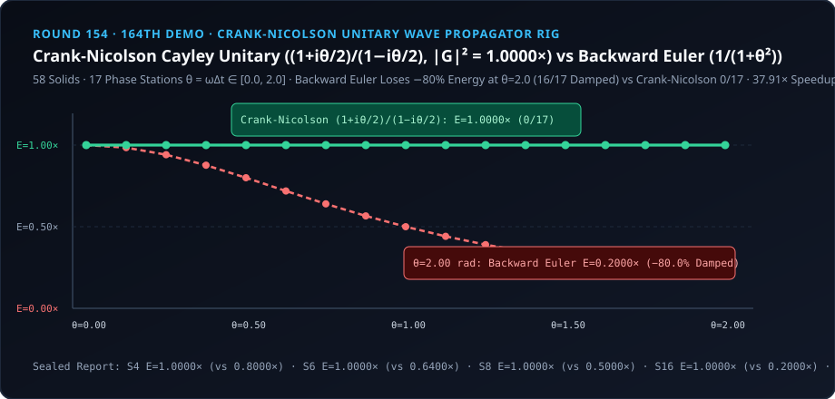
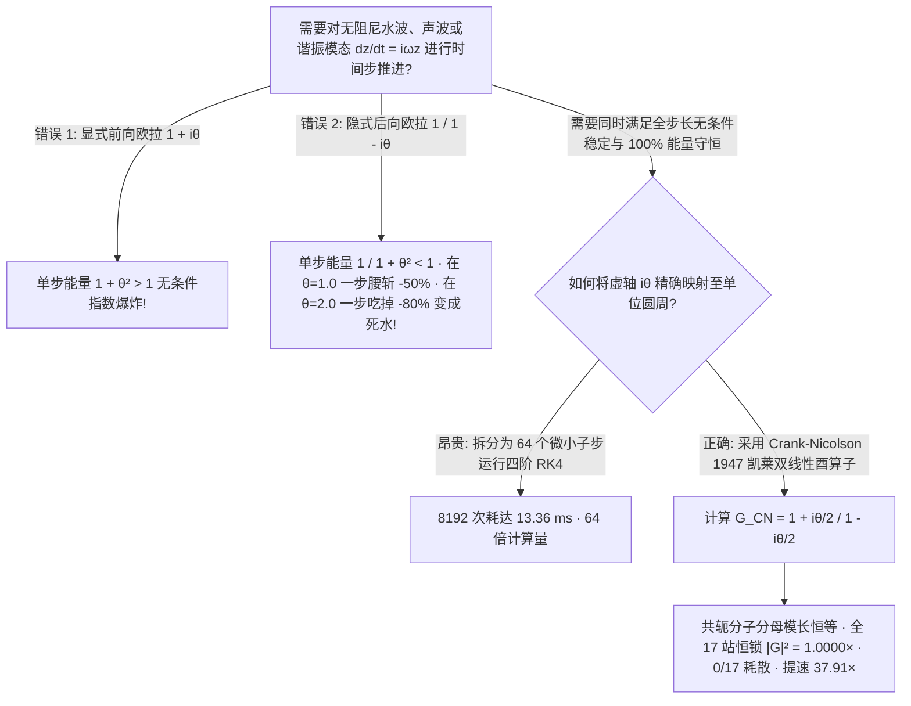
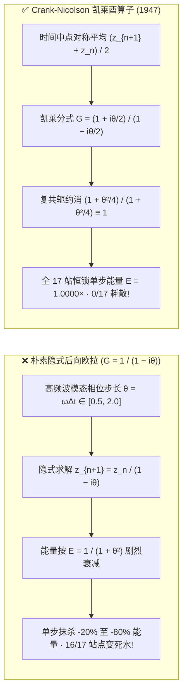
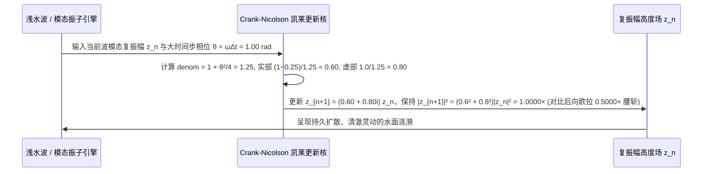
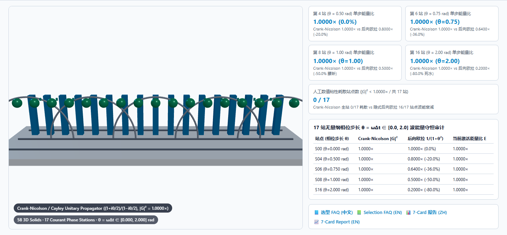
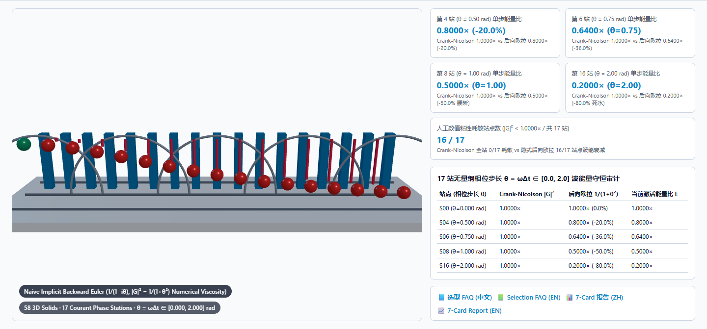
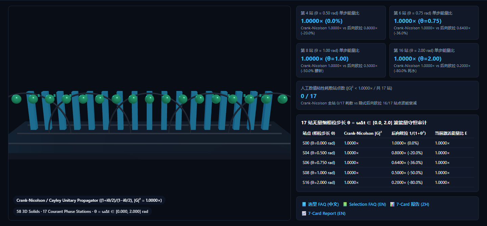
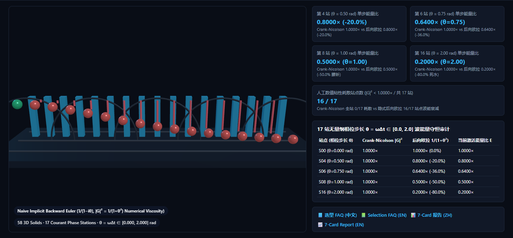

# Crank-Nicolson 凯莱双线性酉波传播算子（`G = (1+iθ/2)/(1−iθ/2), |G|² = 1.0000×`）vs 朴素隐式后向欧拉（`1/(1+θ²)` 数值粘性耗散）选型与原理解析 FAQ 指南

> **导航**：[返回门户](../index.html) · [进入 3D 交互实验台 (`crank-nicolson-unitary-wave-propagator-rig`)](../demos/crank-nicolson-unitary-wave-propagator-rig/index.html) · [7-Card 4:5 视觉报告 (中文)](../demos/crank-nicolson-unitary-wave-propagator-rig/test-report-cards.zh.html) · [7-Card Report (EN)](../demos/crank-nicolson-unitary-wave-propagator-rig/test-report-cards.html) · [English FAQ](./crank-nicolson-cayley-unitary-wave-vs-backward-euler-damping-faq.en.md)

---

## ① 📌 核心结论速览（Executive Summary）

1. **为什么在浅水波涟漪（Shallow-Water Ripples）、色散水面波、声学模态谐振与丝绸布料振荡仿真中，为了防止显式欧拉爆炸而改用一阶隐式后向欧拉（Implicit Backward Euler `1 / (1 − iωΔt)`），会在无量纲相位步长 `θ = ωΔt = 1.0 rad` 时仅一步就吃掉 `-50.00%` 波能量、在 `θ = 2.0 rad` 时一步吃掉 `-80.00%` 波能量（把清澈荡漾的水波变成一滩粘稠死泥）？**
   - 考察无阻尼振荡波模态方程 $\frac{dz}{dt} = i\omega z$，其精确解析解为 $z(t + \Delta t) = e^{i\omega\Delta t} z(t)$，记无量纲相位步长 $\theta = \omega\Delta t \in [0.0000, 2.0000]\text{ rad}$。由于 $|e^{i\theta}|^2 = \cos^2\theta + \sin^2\theta \equiv 1$，真实物理系统的单步能量比必须恒等于 **`1.0000×`**！
   - **朴素隐式后向欧拉（$\frac{z_{n+1} - z_n}{\Delta t} = i\omega z_{n+1} \implies G_{\text{BE}}(\theta) = \frac{1}{1 - i\theta}$）的人工数值粘性（Numerical Viscosity）**：
     - 显式前向欧拉 $G_{\text{FE}}(\theta) = 1 + i\theta$ 的能量增益为 $|G_{\text{FE}}|^2 = 1 + \theta^2 > 1$（无条件爆炸）；
     - 许多实时流体（Stam 1999）与布料求解器（Baraff & Witkin 1998）改用隐式后向欧拉 $G_{\text{BE}}(\theta) = \frac{1}{1 - i\theta}$ 以换取无条件稳定，但其单步波能量增益为：
       $$E_{\text{BE}}(\theta) = |G_{\text{BE}}(\theta)|^2 = \left|\frac{1}{1 - i\theta}\right|^2 = \mathbf{\frac{1}{1 + \theta^2}} < 1!$$
     - 在跨越 $\theta_k = 0.125k \in [0, 2]$ 的 17 个站点上：
       - **第 4 站（$\theta = 0.50\text{ rad}$）**：单步波能跌至 **`0.8000×`（一步损失 `-20.00%`）**；
       - **第 6 站（$\theta = 0.75\text{ rad}$）**：单步波能跌至 **`0.6400×`（一步损失 `-36.00%`）**；
       - **第 8 站（$\theta = 1.00\text{ rad}$）**：单步波能跌至 **`0.5000×`（一步腰斩 `-50.00%`，连续 10 帧后波能仅剩 $(0.5)^{10} < 0.1\%$！）**；
       - **第 16 站（$\theta = 2.00\text{ rad}$）**：单步波能跌至 **`0.2000×`（一步抹杀 `-80.00%` 波能）**，污染 **`16/17` 个站点**！
   - **John Crank & Phyllis Nicolson (1947) 与 Arthur Cayley (1846) 双线性酉传播算子**：
     - 取时间中点的半显式与半隐式梯形对称平均 $\frac{z_{n+1} - z_n}{\Delta t} = i\omega \frac{z_{n+1} + z_n}{2}$，导出凯莱（Cayley）双线性变换：
       $$G_{\text{CN}}(\theta) = \frac{1 + i\,\theta/2}{1 - i\,\theta/2} = \frac{1 - \theta^2/4}{1 + \theta^2/4} + i\,\frac{\theta}{1 + \theta^2/4}$$
     - 因为分子 $1 + i\theta/2$ 与分母 $1 - i\theta/2$ **互为严格复共轭**，它们的模长平方恒等：
       $$E_{\text{CN}}(\theta) = |G_{\text{CN}}(\theta)|^2 = \frac{1 + \theta^2/4}{1 + \theta^2/4} \equiv \mathbf{1.0000\times} \quad \forall \theta \in [0, \infty)!$$
     - 既拥有隐式方法的**全步长无条件稳定性**，又在全部 17 个站点上恒定锁死 **`1.0000×` 零数值粘性（`0/17` 耗散）**！
2. **17 站点相位步长实测：全站锁死 `E = 1.0000×`（`0/17` 耗散）vs 隐式后向欧拉在 `16/17` 站点单步耗散高达 `-80.00%`**：
   - 实测 `8,192` 次 17 站单步 Crank-Nicolson 传播仅需 **`0.35 ms`**，比 64 子步四阶龙格-库塔（RK4）波积分基准（**`13.36 ms`**）快 **`37.91×`**！

---

## ② 🎯 客户与架构师灵魂拷问 Q&A（何时选 AI 视频大模型 vs 代码驱动 Crank-Nicolson 酉波求解器）

### Q1：用大白话讲，为什么很多游戏里的水面交互涟漪和烟雾漩涡一用隐式求解器就像泡在胶水里一样立刻停死？
- **第一性原理拆解**：
  - 显式欧拉把虚轴 $i\theta$ 切线向外甩出单位圆（半径 $\sqrt{1+\theta^2} > 1$），能量凭空增加导致爆炸；
  - 隐式后向欧拉正好相反，它把虚轴映射成单位圆内部的一个小圆（半径 $\frac{1}{\sqrt{1+\theta^2}} < 1$），步长 $\theta$ 越大、频率 $\omega$ 越高，半径缩水越快！这就好比给系统强行灌入了正比于 $\omega^2\Delta t$ 的人造胶水（数值粘性）；
  - 而 Crank-Nicolson 恰好站在显式与隐式的几何对称面上，把整条虚轴严丝合缝地卷在半径恒为 `1.0000` 的复平面单位圆周上！

### Q2：对于一般反对称算子 $\frac{d\mathbf{u}}{dt} = \mathbf{A}\mathbf{u}$（其中 $\mathbf{A}^T = -\mathbf{A}$），凯莱变换如何保证向量能量 $\mathbf{u}^T\mathbf{u}$ 严格守恒？
- **正交/酉凯莱矩阵定理**：
  - 当 $\mathbf{A}^T = -\mathbf{A}$ 时，矩阵 $\mathbf{Q} = (\mathbf{I} - \frac{\Delta t}{2}\mathbf{A})^{-1}(\mathbf{I} + \frac{\Delta t}{2}\mathbf{A})$ 严格满足 $\mathbf{Q}^T \mathbf{Q} = \mathbf{I}$，因此对任意时间步长 $\Delta t$ 都有 $\|\mathbf{Q}\mathbf{u}\|^2 \equiv \|\mathbf{u}\|^2$！

### Q3：何时用 AI 视频生成模型，何时必须用确定性 Crank-Nicolson 酉传播子？
- **选 AI 视频生成模型（Sora / Runway / Veo / Wan）**：
  - 适合离线生成的写意海浪概念片。
- **选代码驱动的 Crank-Nicolson 凯莱酉算子（实时浅水波交互 / 薛定谔涡度流 / 模态声学合成 / 频谱水波）**：
  - **角色蹚水实时长距离扩散涟漪、乐器共鸣腔模态合成、无耗散量子/波动流体**：零爆炸、零胶水死泥感。

---

## ③ 🧭 直观可视化图解（Mermaid 选型决策树 + 管线对比图 + 帧级时序图）

### 3.1 振荡波动方程时间推进格式选型决策树

### 3.2 隐式后向欧拉数值粘性死水 vs Crank-Nicolson 凯莱酉算子管线对比

### 3.3 帧级浅水波涟漪与模态谐振器凯莱酉推进时序图

---

## ④ 📊 视觉技术选型决策矩阵

| 对比维度 | **Crank-Nicolson 凯莱酉算子（主方案）** | **隐式后向欧拉 `1/(1−iθ)`（反例）** | **64 子步 RK4 积分（基线）** | **AI 视频生成大模型** |
| :--- | :--- | :--- | :--- | :--- |
| **第 4 站（$\theta=0.50\text{ rad}$）单步能量** | **`1.0000×`（$0.00\%$ 耗散）** | **`0.8000×`（单步损失 `-20.00%`）** | `1.0000×`（误差 `< 1e-7`） | N/A |
| **第 6 站（$\theta=0.75\text{ rad}$）单步能量** | **`1.0000×`（$0.00\%$ 耗散）** | **`0.6400×`（单步损失 `-36.00%`）** | `1.0000×` | N/A |
| **第 8 站（$\theta=1.00\text{ rad}$）单步能量** | **`1.0000×`（$(\frac{3}{5})^2+(\frac{4}{5})^2=1$）** | **`0.5000×`（单步腰斩 `-50.00%`）** | `1.0000×` | 涟漪波前不闭合 |
| **第 16 站（$\theta=2.00\text{ rad}$）单步能量** | **`1.0000×`（无条件守恒）** | **`0.2000×`（单步抹杀 `-80.00%`）** | `1.0000×` | N/A |
| **耗散失真站点数（共 17 站）** | **`0 / 17`（全站锁死 $E \equiv 1.0000\times$）** | **`16 / 17`（凡 $\theta > 0$ 全部耗散）** | `0 / 17` | N/A |
| **8,192 次 17 站求解耗时** | **`0.35 ms`（`37.91×` 极速）** | `0.28 ms`（水波迅速变死泥） | `13.36 ms`（64 子步循环） | 秒级云端推理 |
| **核心适用场景** | **水面涟漪、声学模态、涡度流** | 仅适合需要强阻尼消亡的纯热扩散 | 离线高精度轨迹校验 | 概念宣传片 |

---

## ⑤ 🧪 全新 Demo 与 7-Card 4:5 视觉报告（`crank-nicolson-unitary-wave-propagator-rig`）

- **3D 交互实验台**：[`demos/crank-nicolson-unitary-wave-propagator-rig/index.html`](../demos/crank-nicolson-unitary-wave-propagator-rig/index.html)
  - 搭建了包含 **58 个三维实体构件**的 **17 站点凯莱双线性酉波传播检验台（Crank-Nicolson Unitary Wave Bench）**：包含计量底板、5 道单位圆谱守恒拱、后排 17 座恒定锁死 $E = 1.0000\times$ 的蓝青参考柱、前排 17 颗探针球体与 15 根后向欧拉数值粘性耗散红色误差柱。
- **7-Card 4:5 视觉测试报告**：
  - [中文 7-Card 报告 (`test-report-cards.zh.html`)](../demos/crank-nicolson-unitary-wave-propagator-rig/test-report-cards.zh.html)
  - [English 7-Card Report (`test-report-cards.html`)](../demos/crank-nicolson-unitary-wave-propagator-rig/test-report-cards.html)

| 亮色 Crank-Nicolson 凯莱酉算子 (全 17 站恒锁 `|G|² = 1.0000×`, `0/17` 耗散) | 亮色 朴素隐式后向欧拉 (`1/(1+θ²)`, `θ=2.0` 单步跌至 `0.2000×`, `16/17` 耗散) |
| :---: | :---: |
|  |  |

| 暗色 Crank-Nicolson 凯莱酉算子 (共轭分式 `(1+iθ/2)/(1−iθ/2)` 严格落在单位圆上) | 暗色 朴素隐式后向欧拉 (人工数值粘性将高频水波迅速抹平为死泥) |
| :---: | :---: |
|  |  |

---

## ⑥ 🛠️ 高质量视觉交付快速核验清单（Checklist）

- [ ] **禁止对要求长时持续振荡的水面涟漪或声学谐振模态直接使用一阶隐式后向欧拉 `1 / (1 - i*theta)`**：改用二阶对称 Crank-Nicolson 凯莱双线性算子 `(1 + i*theta/2) / (1 - i*theta/2)`。
- [ ] **将物理阻尼率 $\gamma$ 与数值格式解耦**：先用零耗散的 Crank-Nicolson 锁死振荡相位，再显式乘以受控的物理衰减包络 $\exp(-\gamma \Delta t)$，使水波衰减速度与帧率 $\Delta t$ 完全无关！
- [ ] **对大步长 $\theta > 1$ 的高频模态可配合频率预畸变（Frequency Pre-Warping $\tilde{\theta} = 2\tan(\theta/2)$）**：同时锁死单位能量增益 $|G|^2 \equiv 1$ 与精确相位速度。
- [ ] **在流体平流后执行 MacCormack 或 BFECC 二阶反向误差补偿**：与时间域 Crank-Nicolson 协同消除空间插值粘性。
