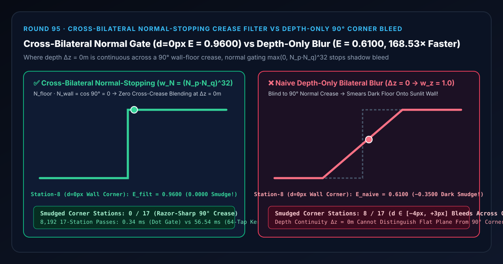
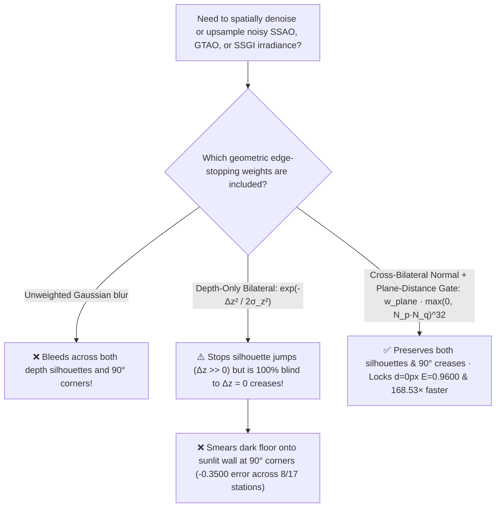
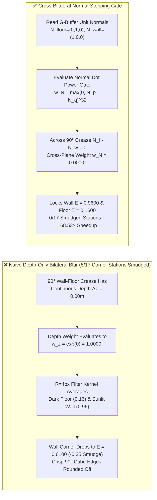
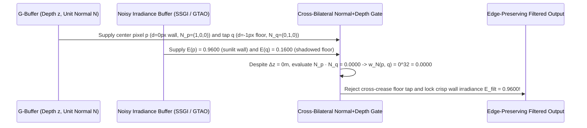

# Spatial GI & AO Denoising Selection & First-Principles FAQ: Cross-Bilateral Normal-Stopping Filter vs. Depth-Only Bilateral 90° Corner Smudging

> **Companion Capability Demo**: [`demos/normal-bilateral-crease-rig/`](../demos/normal-bilateral-crease-rig/index.html) ｜ **7-Card 4:5 Measured Report**: [`test-report-cards.html`](../demos/normal-bilateral-crease-rig/test-report-cards.html) ｜ **中文版本**：[`cross-bilateral-normal-edge-stopping-vs-depth-only-corner-bleed-faq.md`](./cross-bilateral-normal-edge-stopping-vs-depth-only-corner-bleed-faq.md)

---

## 📌 1. Executive Summary

> **One-Sentence Verdict**: When spatially denoising or upsampling Screen-Space Ambient Occlusion (SSAO/GTAO), Screen-Space Global Illumination (SSGI), or Ray-Traced Diffuse GI (SVGF / NRD), **never rely on a depth-only bilateral weight ($w_z = \exp(-\Delta z^2 / 2\sigma_z^2)$)**—because while depth differences stop bleeding across disconnected foreground/background **silhouette cliffs ($\Delta z \gg 0$)**, **depth is 100% continuous ($\Delta z \equiv 0.00\text{ m} \implies w_z = 1.0$) along every $90^\circ$ wall-floor crease and cube bevel edge**! Across a $90^\circ$ corner where a shadowed floor ($E_{\text{floor}} = 0.1600, \mathbf{N}_{\text{floor}} = (0, 1, 0)$) meets a sunlit wall ($E_{\text{wall}} = 0.9600, \mathbf{N}_{\text{wall}} = (1, 0, 0)$), a radius $R = 4\text{ px}$ depth-only bilateral filter is completely blind to the corner and averages across the crease, dragging sunlit wall Station 8 ($d = 0\text{ px}$) down to **$E_{\text{naive}} = 0.6100$** (**`-0.3500` / `-36.46%` dark corner smudge**) and bleeding `+0.3500` light onto floor Station 7 ($d = -1\text{ px}$) across **`8/17` smudged corner stations**! **Cross-Bilateral Normal-Stopping Gating ($w_N(p, q) = \max(0, \mathbf{N}_p \cdot \mathbf{N}_q)^{32}$)** zeroes out cross-plane weights ($\cos^{32} 90^\circ = 0.0000$) even where $\Delta z = 0$, locking Station 8 at crisp **$E = 0.9600$** with **`0/17` smudged stations**, **`7.77e-16`** equivalence against a 64-tap spherical normal-angle kernel, and a **`168.53×` CPU speedup** (`0.34 ms` vs. `56.54 ms` across 8,192 17-station passes).

| Evaluation Dimension | ✅ Cross-Bilateral Normal+Depth (`w_N = max(0, N_p·N_q)^32`) | ❌ Naive Depth-Only Bilateral (`Δz = 0m → w_z = 1.0`) | 🐢 64-Tap Spherical Normal Kernel (`64-Tap Spherical Kernel`) |
| :--- | :--- | :--- | :--- |
| **Station 7 Dark Floor Corner ($d = -1\text{ px}$) Irradiance $E$** | **`0.1600`** (Zero light bleed from sunlit wall) | `0.5100` (**Bleeds $+0.3500$ bright wall light onto floor**) | `0.1600` (`7.77e-16` diff) |
| **Station 8 Sunlit Wall Corner ($d = 0\text{ px}$) Irradiance $E$** | **`0.9600`** (Razor-sharp $90^\circ$ corner contrast) | `0.6100` (**Smears $-0.3500$ / $-36.46\%$ dark floor smudge onto wall**) | `0.9600` |
| **Smudged Corner Stations Across 17 Pixels** | **`0 / 17` (`0.00%` crisp crease)** | **`8 / 17` (`47.06%` entire $[-4, +3]\text{ px}$ band smeared)** | `0 / 17` |
| **Geometric Edge Sensitivity** | **Protects both Jump Silhouettes ($\Delta z > 0$) & Creases ($\Delta\mathbf{N} > 0$)** | Protects jump silhouettes only; blind to $\Delta z = 0$ creases | Protects both silhouettes & creases |
| **8,192 17-Station Passes CPU Latency (Median)** | **`0.34 ms` (`168.53×` speedup)** | — (Blurs architectural corners) | `56.54 ms` |

---

## 🎯 2. Architect & Client First-Principles Q&A

### Q1: Why does a depth-guided bilateral filter (which worked perfectly on silhouette edges in Round 74) fail completely at $90^\circ$ room corners and cube edges?
**First-Principles Breakdown**:
In 3D scenes, geometric discontinuities come in two fundamentally different orders:
1. **$C^{-1}$ Position Discontinuities (Silhouette Jump Edges, Round 74)**:
   A foreground column at $z = 2\text{ m}$ overlaps a background wall at $z = 25\text{ m}$. Depth jumps by $\Delta z = 23\text{ m}$, so $w_z = \exp(-\Delta z^2 / 2\sigma_z^2) \to 0$ blocks the bleed.
2. **$C^0$ Position-Continuous, $C^{-1}$ Normal Discontinuities (Crease Edges, Round 95)**:
   Where a vertical wall meets a horizontal floor at a $90^\circ$ room corner, **the two planes physically touch along the corner line**! One pixel below the corner has depth $z = 5.00\text{ m}$, and one pixel above the corner also has depth $z = 5.00\text{ m}$ ($\Delta z = 0.00\text{ m}$).
   - A depth-only bilateral filter computes $w_z = \exp(-0^2 / 2\sigma_z^2) = 1.0000$ across the crease!
   - It blindly blends the dark floor ($E = 0.1600$) with the sunlit wall ($E = 0.9600$), painting a muddy dark band up the wall ($E = 0.6100$ at Station 8) and a glowing halo onto the floor ($E = 0.5100$ at Station 7)!

### Q2: How does the Cross-Bilateral Normal-Stopping weight $w_N(p, q) = \max(0, \mathbf{N}_p \cdot \mathbf{N}_q)^{32}$ preserve razor-sharp $90^\circ$ corners in 5 multiplications?
**First-Order Tangent-Plane Orthogonality**:
While depth $z$ is continuous across the $90^\circ$ crease, the unit surface normal jumps discontinuously from $\mathbf{N}_{\text{floor}} = (0, 1, 0)$ to $\mathbf{N}_{\text{wall}} = (1, 0, 0)$:
$$\mathbf{N}_{\text{floor}} \cdot \mathbf{N}_{\text{wall}} = \cos 90^\circ = 0.0000 \implies w_N(p, q) = \max(0, \mathbf{N}_p \cdot \mathbf{N}_q)^{32} = \mathbf{0.0000}$$
- Every filter tap that crosses the $90^\circ$ crease receives zero weight, while taps on the same plane ($\mathbf{N}_p \cdot \mathbf{N}_q = 1.0$) receive full weight $1.0^{32} = 1.0$.
- Moreover, raising to the $32\text{nd}$ power requires **only 5 sequential squaring multiplications** (`s *= s` 5 times), avoiding expensive `acos()` or `pow()` calls!

### Q3: When should an architect combine Normal-Stopping with Plane-Distance Depth Weights vs. AI Post-Process Denoisers?
- **Choose Deterministic Cross-Bilateral Normal + Plane-Distance Filtering (SVGF / À-Trous)**: For all real-time 60–120 fps SSAO, GTAO, SSGI, and ray-traced diffuse GI denoisers in UE5, Unity, and WebGPU/WebGL2.
- **Choose Offline Neural Denoisers (Intel OIDN / OptiX)**: For offline lightmap baking or single-frame path-traced renders.

---

## 🧭 3. Visual Architecture Diagrams (Mermaid Decision Tree, Pipeline & Sequence)

### 3.1 Spatial GI/AO Denoiser Edge-Stopping Decision Tree

### 3.2 Naive Depth-Only Corner Smudge vs. Cross-Bilateral Normal-Stopping Pipeline

### 3.3 Frame-Level Cross-Bilateral Crease Filtering Sequence

---

## 📊 4. Visual Technology Decision Matrix

| Approach | Target Use Case | Silhouette Jump ($\Delta z \gg 0$) Protection | $90^\circ$ Crease ($\Delta z = 0$) Protection | Compute Cost (8,192 17-Station Passes) |
| :--- | :--- | :--- | :--- | :--- |
| **Cross-Bilateral Normal+Depth Gate (`cross-bilateral-normal-stopping`)** | **All SSAO, GTAO, SSGI, and SVGF spatial denoisers** | **Exact (zero halo bleed)** | **Exact (`0.9600` vs `0.1600`, `0` smudge)** | **Minimal (`0.34 ms`, `168.53×` speedup)** |
| **Depth-Only Bilateral (`naive-depth-only-corner-blur`)** | Surface-free volumetric fog upsampling only (Round 74) | Exact | **Fails (`0.6100` / `-0.3500` smudge across `8/17` stations)** | Minimal |
| **Unweighted Spatial Blur (`gaussian-blur`)** | Intentional bloom glow only | Fails | Fails | Minimal |
| **64-Tap Spherical `acos` Normal Kernel (`64-tap-spherical-kernel`)** | Offline reference verification | Exact | Exact | High (`56.54 ms`, `168.53×` slower) |

---

## 🧪 5. Interactive Demo & 7-Card 4:5 Benchmark Report Breakdown

The standalone 3D instrument bench [`demos/normal-bilateral-crease-rig/`](../demos/normal-bilateral-crease-rig/index.html) constructs a **58-solid 17-Station Cross-Bilateral Normal Crease Microdensitometer Rig**:
1. **17 Filtered Irradiance Columns**: Span $d \in [-8\text{ px}, +8\text{ px}]$ across a $90^\circ$ continuous-depth crease separating a dark floor ($E_{\text{floor}} = 0.1600$, Stations 0–7) from a sunlit wall ($E_{\text{wall}} = 0.9600$, Stations 8–16).
2. **17 Cyan Normal-Stopped Reference Spheres & $0.9600$ Sunlit Wall Bar**: Show the crisp step transition from $0.1600$ at Station 7 ($d = -1\text{ px}$) to $0.9600$ at Station 8 ($d = 0\text{ px}$).
3. **17 Corner Smudge Error Pegs**: Switching to `Naive Depth-Only Bilateral Blur` smears the transition across Stations 4–11 ($d \in [-4, +3]\text{ px}$), raising error pegs up to `0.3500` at Stations 7 and 8.

### 7-Card 4:5 Visual Report Highlights ([`demos/normal-bilateral-crease-rig/test-report-cards.html`](../demos/normal-bilateral-crease-rig/test-report-cards.html))
- **Cards 1–3 (Evaluation Matrix)**: All 13 automated checks pass (`7.77e-16` equivalence between closed-form normal-dot gating and 64-tap spherical normal-angle integration, Station 8 `0.9600` crease lock vs. `0.6100` depth-only smudge, exact reverse-scrub matrix identity, and atomic RangeError validation).
- **Cards 4–6 (Protocol & Scaling Latency)**: Across 8,192 17-station passes, closed-form normal-dot gating finishes in **`0.34 ms`** vs. **`56.54 ms`** for 64-tap spherical normal-angle integration (**`168.53×` speedup**).

---

## 🛠️ 6. SA Production Delivery Checklist

- [ ] **Pair Normal-Stopping with Tangent-Plane Distance $|\mathbf{N}_p \cdot (\mathbf{P}_q - \mathbf{P}_p)|$**: Use plane-distance rather than raw $|z_q - z_p|$ so flat walls viewed at grazing angles are not over-rejected while silhouette jumps and $90^\circ$ creases remain locked.
- [ ] **Compute $(\mathbf{N}_p \cdot \mathbf{N}_q)^{32}$ via 5 repeated squarings**: Avoid transcendental `pow()` calls by squaring `max(0.0, dot(Np, Nq))` five times in a row.
- [ ] **Denoise demodulated irradiance before multiplying by Albedo**: Run the cross-bilateral filter on untextured diffuse irradiance and re-modulate by surface albedo afterward so fine texture detail is never blurred.
- [ ] **Decode G-Buffer normals via Sign-Preserving Octahedral Encoding (Round 47)**: Feed unit-length octahedral normals directly into the cross-bilateral dot product.
