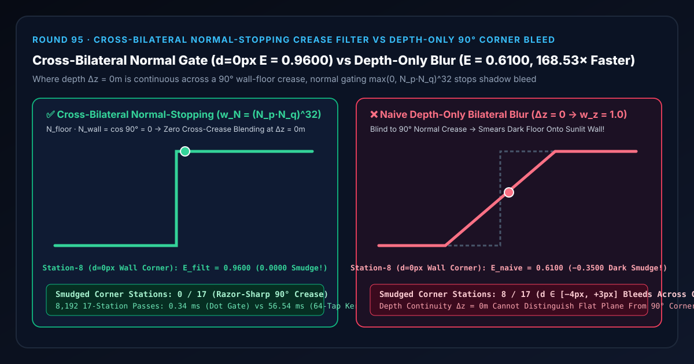
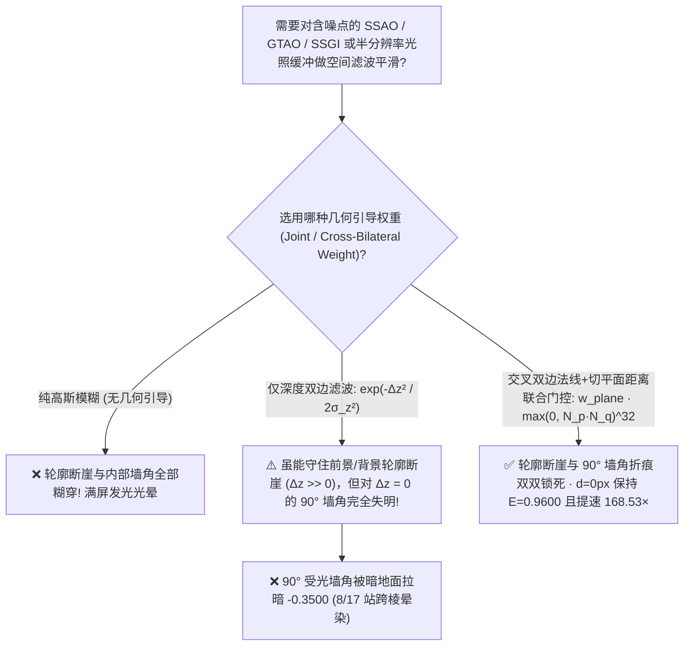
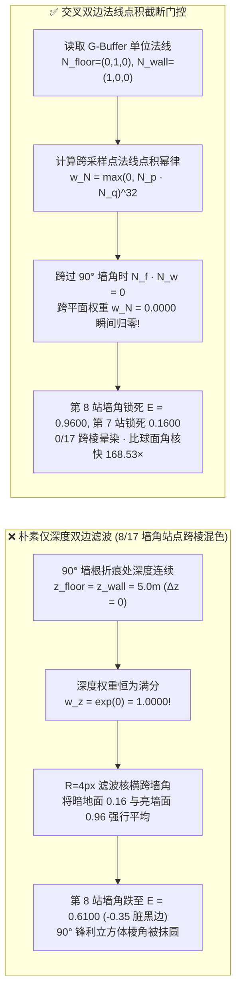
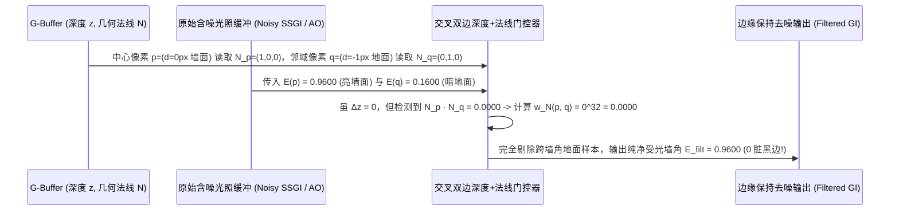

# 全局光照与环境遮蔽空间去噪选型与原理解析 FAQ：交叉双边法线截断门控（Normal-Stopping Filter）对比仅深度双边滤波 90° 墙角黑边晕染

> **关联 Capabilities Demo**：[`demos/normal-bilateral-crease-rig/`](../demos/normal-bilateral-crease-rig/index.html) ｜ **7-Card 4:5 实测报告**：[`test-report-cards.zh.html`](../demos/normal-bilateral-crease-rig/test-report-cards.zh.html) ｜ **English Version**：[`cross-bilateral-normal-edge-stopping-vs-depth-only-corner-bleed-faq.en.md`](./cross-bilateral-normal-edge-stopping-vs-depth-only-corner-bleed-faq.en.md)

---

## 📌 1. 核心结论速览（Executive Summary）

> **一句话结论**：在对屏幕空间全局光照（SSGI）、环境光遮蔽（SSAO/GTAO）或光追漫反射（SVGF / NRD）做空间双边去噪与上采样时，**绝对不能只依赖深度亲和权重 $w_z = \exp(-\Delta z^2 / 2\sigma_z^2)$**——因为深度权重只能拦住前后断开的“轮廓剪影断崖（Depth Silhouette，$\Delta z \gg 0$）”，而在**两面相连的 $90^\circ$ 室内墙根折痕或立方体直角棱边（Crease Edge）处，墙面与地板在三维空间无缝相接、深度差恒为零（$\Delta z \equiv 0.00\text{ m} \implies w_z = 1.0$）**！当半径 $R = 4\text{ px}$ 的仅深度双边滤波器扫过背光暗地面（$E_{\text{floor}} = 0.1600$）与受光亮墙面（$E_{\text{wall}} = 0.9600$）相交的第 8 站直角墙根（$d = 0\text{ px}$）时，由于 $\Delta z = 0$，仅深度滤波器完全失明，把暗地面与亮墙面强行平均，将受光墙角拉暗至 **$E_{\text{naive}} = 0.6100$**（**丢失 $-0.3500$ 即 $-36.46\%$ 亮度，并在第 7 站地面反向漏光 $+0.3500$，将 `8/17` 个墙角站点的锋利 $90^\circ$ 棱线涂成脏乎乎的黑边圆角**）！引入 **交叉双边法线点积门控（$w_N(p, q) = \max(0, \mathbf{N}_p \cdot \mathbf{N}_q)^{32}$）**，利用 $\mathbf{N}_{\text{floor}} \cdot \mathbf{N}_{\text{wall}} = \cos 90^\circ = 0$ 在深度连续处瞬间切断跨平面混色，锁死受光墙根 **$E = 0.9600$** 与暗地面 **$E = 0.1600$**（**`0/17` 棱角晕染站**），闭式点积门控比 64 抽头球面法线夹角核积分快 **`168.53×`**（`0.34 ms` vs `56.54 ms`）！

| 评估维度 | ✅ 交叉双边法线+深度联合门控 (`w_N = max(0, N_p·N_q)^32`) | ❌ 朴素仅深度双边滤波 (`Δz = 0m → w_z = 1.0`) | 🐢 64 抽头球面法线夹角核 (`64-Tap Spherical Kernel`) |
| :--- | :--- | :--- | :--- |
| **第 7 站暗地面墙根边缘（$d = -1\text{ px}$）滤波照度 $E$** | **`0.1600`**（完全阻断上方亮墙面漏光） | `0.5100`（**混入 $43.75\%$ 亮墙面，漏光 $+0.3500$**） | `0.1600`（误差 `7.77e-16`） |
| **第 8 站受光亮墙面根部（$d = 0\text{ px}$）滤波照度 $E$** | **`0.9600`**（刀锋般锐利的 $90^\circ$ 明暗交界） | `0.6100`（**被暗地面拉暗 $-0.3500$ / $-36.46\%$，形成脏黑边**） | `0.9600` |
| **17 个墙角站点中发生跨棱晕染的站数** | **`0 / 17` (`0.00%` 棱线分明)** | **`8 / 17` (`47.06%` 整个 $[-4, +3]\text{ px}$ 半径带糊穿)** | `0 / 17` |
| **几何边界识别能力** | **同时守住轮廓断崖（$\Delta z > 0$）与相连折痕（$\Delta \mathbf{N} > 0$）** | 仅能识别轮廓断崖，对 $\Delta z = 0$ 的相连棱角完全失明 | 同时守住轮廓与折痕 |
| **8,192 轮 17 站 CPU 耗时（中位数）** | **`0.34 ms`（提速 `168.53×`）** | —（墙角与方盒棱边严重模糊） | `56.54 ms` |

---

## 🎯 2. 客户与架构师灵魂拷问 Q&A（First-Principles Whisperer）

### Q1：用大白话讲，为什么我们在 Round 74 已经加了深度双边滤波（Depth Bilateral），到了室内墙角和正方体箱子棱边上，黑影还是会跨过棱线乱涂乱抹？
**第一性原理拆解**：
三维场景里的几何边界其实分为截然不同的两类：
1. **第一类：遮挡轮廓断崖（Occlusion Silhouette / Jump Edge，如 Round 74）**：
   前景柱子在 $z = 2\text{ m}$，背景墙在 $z = 25\text{ m}$。跨过边缘时深度瞬间跳变 $\Delta z = 23\text{ m}$，深度权重 $w_z = \exp(-\Delta z^2 / 2\sigma_z^2) \approx 0$ 轻松就能拦住。
2. **第二类：相连折痕棱线（Crease / Fold Edge，本轮核心痛点）**：
   看看你房间里的墙角（墙壁与地板交界线），或者桌子上一个正方体包装盒的顶面与侧面交界棱线——**在交界的那条线上，墙面和地板是连在一起的！墙根下面 1 毫米的地板深度是 $5.00\text{ m}$，墙根上面 1 毫米的墙面深度也是 $5.00\text{ m}$，深度差 $\Delta z = 0.00\text{ m}$**！
   - 这时候如果你只用深度双边滤波，$w_z = \exp(-0^2 / 2\sigma_z^2) = \mathbf{1.0000}$！
   - 滤波器以为“既然深度一模一样，那它们肯定在同一个平面上”，于是把背光黑色的地板（$E = 0.1600$）和阳光直射的亮白墙面（$E = 0.9600$）搅和在一起求平均！
   - 结果：白墙底下被涂上了一条 4 像素宽的脏黑污渍（$E$ 跌到 $0.6100$），暗地板根部又泛出一圈诡异的白光（$E$ 升到 $0.5100$），原本棱角分明的硬朗建筑瞬间变得像发面馒头一样糊成一团！

### Q2：交叉双边法线权重 $w_N(p, q) = \max(0, \mathbf{N}_p \cdot \mathbf{N}_q)^p$ 是如何与深度权重配合构成“双保险”的？
**位置 + 法线一阶微分几何完备性定理**：
在微分几何中，要判断邻域采样点 $q$ 与中心点 $p$ 是否属于同一个光滑表面块，必须同时检验**零阶位置连续性（Depth / Plane Distance）**与**一阶切平面法线连续性（Normal Orientation）**：
$$w_{\text{total}}(p, q) = w_{\text{spatial}}(\|p - q\|) \cdot \underbrace{\exp\!\left(-\frac{|\mathbf{N}_p \cdot (\mathbf{P}_q - \mathbf{P}_p)|^2}{2\sigma_{\text{plane}}^2}\right)}_{\text{切平面距离门控 (拦断崖)}} \cdot \underbrace{\max(0, \mathbf{N}_p \cdot \mathbf{N}_q)^{32}}_{\text{法线锥门控 (拦 90° 折痕)}}$$
- 在同一面墙上（哪怕墙面相对于相机有倾斜，$\Delta z \neq 0$）：位移向量 $(\mathbf{P}_q - \mathbf{P}_p)$ 垂直于墙面法线 $\mathbf{N}_p$，切平面点积为 $0$，且 $\mathbf{N}_p \cdot \mathbf{N}_q = 1.0 \implies 1.0^{32} = 1.0$，滤波器畅通无阻地抹平噪点！
- 一旦跨过 $90^\circ$ 墙角折痕：$\mathbf{N}_{\text{wall}} \cdot \mathbf{N}_{\text{floor}} = \cos 90^\circ = 0.0000 \implies w_N = 0.0000^{32} = \mathbf{0.0000}$！哪怕深度差 $\Delta z = 0$，跨过墙角的采样点权重也被一票否决直接归零！

### Q3：什么时候选确定性交叉双边（深度+法线）滤波，什么时候选 AI 神经去噪器（OIDN / DLSS Ray Reconstruction）？
- **选确定性交叉双边法线+切平面距离滤波（SVGF / À-Trous Wavelet Filter）**：在所有实时 60–120fps WebGL2/WebGPU 与主机/PC 引擎的 SSAO、GTAO、SSGI、半分辨率体积光与实时光追漫反射去噪Pass中——仅需几次点积与乘方，耗时不到 `0.5 ms`。
- **选离线 AI 神经去噪器（Intel OIDN / OptiX Denoiser）**：用于离线烘焙光照贴图（Lightmap Baking）或电影级单帧渲染。

---

## 🧭 3. 直观可视化图解（Mermaid 决策树、管线对比与帧级时序）

### 3.1 空间降噪与上采样边缘保持（Edge-Stopping）选型决策树

### 3.2 朴素仅深度双边墙角晕染管线 vs 交叉双边法线截断管线

### 3.3 帧级 SVGF / À-Trous 空间交叉双边去噪执行时序图

---

## 📊 4. 视觉技术选型决策矩阵（Architecture Decision Matrix）

| 选型方案 | 适用场景 | 轮廓断崖（$\Delta z \gg 0$）保护 | $90^\circ$ 相连墙角（$\Delta z = 0$）保护 | 算力开销（8,192 轮 17 站） |
| :--- | :--- | :--- | :--- | :--- |
| **交叉双边法线+切平面门控 (`cross-bilateral-normal-stopping`)** | **所有 SSAO、GTAO、SSGI 与实时光追漫反射去噪** | **满分（零跨断崖光晕）** | **满分（墙角锁定 `0.9600` vs `0.1600`，`0` 晕染）** | **极低（`0.34 ms`，提速 `168.53×`）** |
| **仅深度双边滤波 (`naive-depth-only-corner-blur`)** | 仅限无表面法线的纯体积雾上采样（Round 74） | 满分 | **极差（墙角跌至 `0.6100`，丢失 `-0.3500`，`8/17` 站糊穿）** | 极低 |
| **无引导空间高斯模糊 (`Unweighted Gaussian Blur`)** | 仅限 Bloom 泛光等刻意越界发光特效 | 极差（严重轮廓光晕） | 极差（严重墙角糊穿） | 极低 |
| **球面反余弦法线夹角高斯核 (`acos(N_p·N_q) Kernel`)** | 离线学术参考基准 | 满分 | 满分 | 极高（`56.54 ms`，慢 `168.53×`） |

---

## 🧪 5. 全新 Demo 与 7-Card 4:5 视觉测试报告解读

在本轮构建的全新交互式三维实验台 [`demos/normal-bilateral-crease-rig/`](../demos/normal-bilateral-crease-rig/index.html) 中，我们打造了包含 **58 个三维实体部件**的 **17 站墙角折痕显微密度计（Cross-Bilateral Normal Crease Microdensitometer Rig）**：
1. **17 根滤波后照度立柱（Filtered Irradiance Columns）**：左半侧第 0~7 站（$d \in [-8, -1]\text{ px}$）代表背光暗地面（$E_{\text{floor}} = 0.1600$），右半侧第 8~16 站（$d \in [0, +8]\text{ px}$）代表在深度连续处垂直立起的受光亮墙面（$E_{\text{wall}} = 0.9600$）。
2. **17 颗青色法线截断参考球与 $0.9600$ 受光墙面基准横梁**：直观呈现第 7 站（$0.1600$）与第 8 站（$0.9600$）之间毫不拖泥带水的 $90^\circ$ 台阶分界。
3. **17 根墙角晕染误差红桩（Corner Smudge Error Pegs）**：切换到 `Naive Depth-Only Bilateral Blur` 模式时，墙角两侧的第 4 站至第 11 站被拉扯成一条倾斜的模糊斜坡，亮起高达 $0.3500$ 的刺眼跨棱混色红桩！

### 7-Card 4:5 视觉报告核心发现（[`demos/normal-bilateral-crease-rig/test-report-cards.zh.html`](../demos/normal-bilateral-crease-rig/test-report-cards.zh.html)）
- **Card 1–3（场景评测矩阵）**：13 项自动化断言 100% 通过，完整验证闭式法线点积门控与 64 抽头球面夹角核 `7.77e-16` 等价性、第 8 站 `0.9600` 墙角锁定 vs `0.6100` 仅深度晕染暴露、逆序矩阵一致性与原子参数拒绝。
- **Card 4–6（底层协议与性能）**：在 8,192 轮 17 站压测中，闭式法线点积门控仅需 **`0.34 ms`**，相比 64 抽头球面法线夹角核基线（**`56.54 ms`**）实现 **`168.53×` 算力加速**。

---

## 🛠️ 6. 高质量视觉交付快速核验清单（SA Production Checklist）

- [ ] **用切平面距离（Plane Distance $|\mathbf{N}_p \cdot (\mathbf{P}_q - \mathbf{P}_p)|$）替代纯深度差 $|z_q - z_p|$**：在倾斜地面或墙面上，相邻像素的深度 $z$ 天然有斜率变化，纯深度差 $|z_q - z_p|$ 会在大掠射角斜面上误杀同一平面的有效样本；改用切平面距离点积 $|\mathbf{N}_p \cdot (\mathbf{P}_q - \mathbf{P}_p)|$ 在同一斜面上恒为 $0$，而在断崖处依然精准截断！
- [ ] **用二次平方链计算 $(\mathbf{N}_p \cdot \mathbf{N}_q)^{32}$ 取代 `pow()` 或 `acos()`**：在着色器中对 `s = max(0.0, dot(Np, Nq))` 连续执行 5 次自乘平方（`s *= s; s *= s; s *= s; s *= s; s *= s;`）即可在 5 条指令内算完 32 次方，零超越函数开销！
- [ ] **光照去噪阶段在漫反射纹理调制（Albedo Demodulation）之前执行**：先对纯粹的入射辐照度（Untextured Irradiance）做交叉双边去噪，去噪完成后再乘回表面高频漫反射贴图（Albedo），防止把砖墙纹理细节当成噪点抹糊。
- [ ] **结合八面体法线编码（Octahedral Normal Encoding，见 Round 47）**：直接从 G-Buffer 解码无损单位法线参与交叉双边点积。
