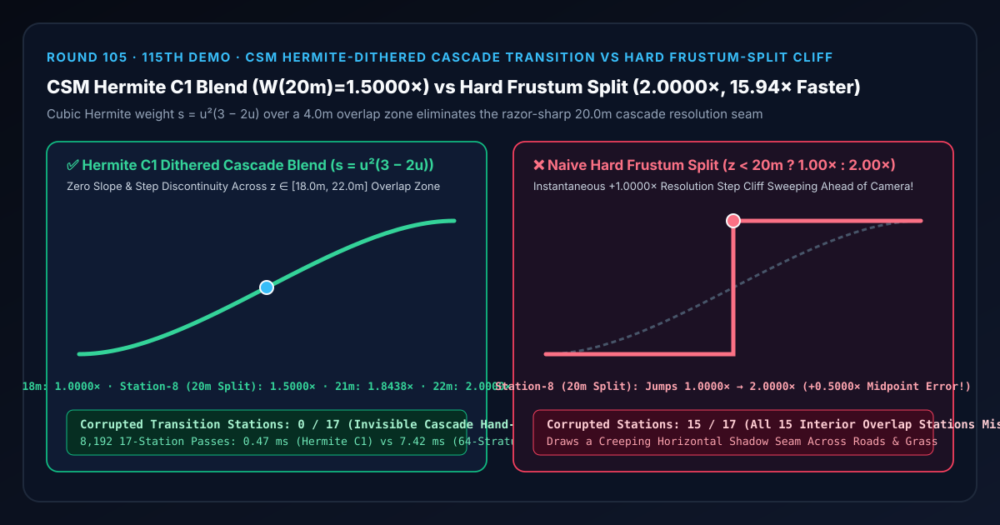
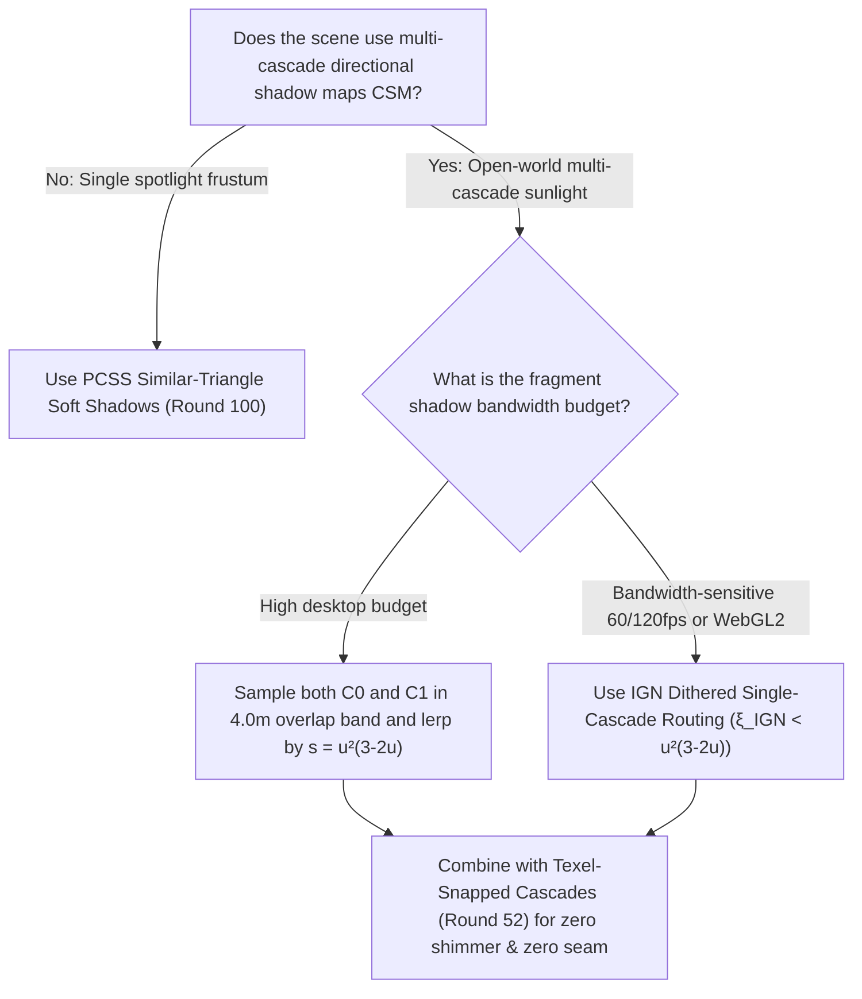
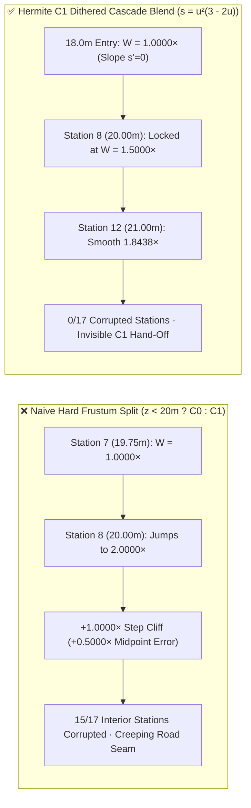
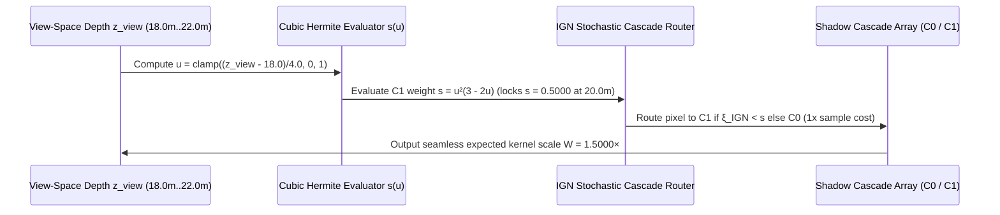
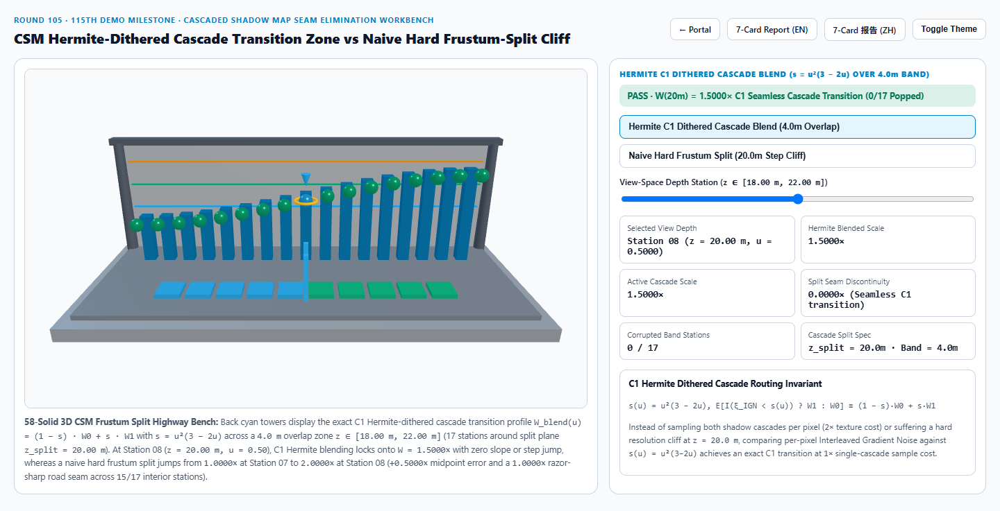
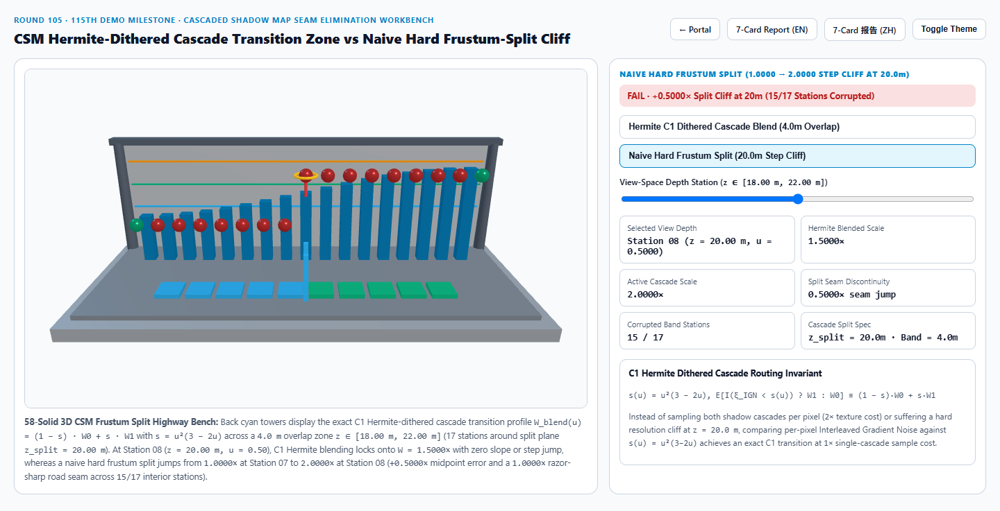
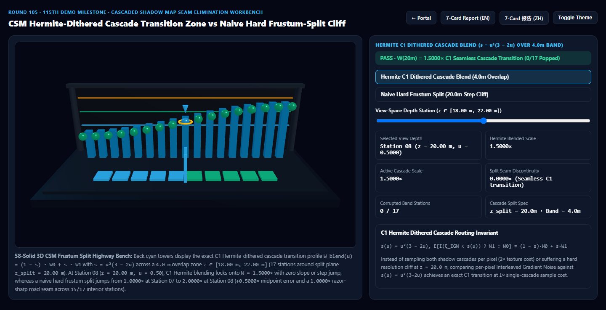
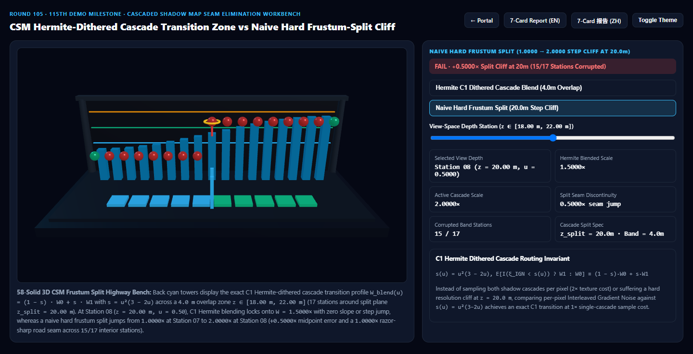

# Cascaded Shadow Maps (CSM) Hermite-Dithered Transition Zone vs Naive Hard Frustum-Split Cliff Selection & First-Principles FAQ

> **Navigation**: [Back to Portal](../index.html) · [Launch 3D Interactive Workbench (`csm-cascade-blend-dither-rig`)](../demos/csm-cascade-blend-dither-rig/index.html) · [7-Card 4:5 Visual Report (EN)](../demos/csm-cascade-blend-dither-rig/test-report-cards.html) · [7-Card 报告 (ZH)](../demos/csm-cascade-blend-dither-rig/test-report-cards.zh.html) · [中文版 FAQ](./csm-cascade-transition-dither-blend-vs-hard-split-seam-faq.md)

---

## ① 📌 Executive Summary

1. **Why do open-world games and driving simulators often suffer from a visible horizontal "shadow resolution seam" creeping across the road 20 meters ahead of the camera?**
   - Directional sunlight rendering uses **Cascaded Shadow Maps (CSM)** to partition the view frustum into nested depth ranges—for example, near cascade $C_0$ ($0\sim 20\text{ m}$, effective filter/texel scale $W_0 = 1.0000\times$) and far cascade $C_1$ ($20\sim 80\text{ m}$, coarser filter/texel scale $W_1 = 2.0000\times$).
   - Under a **Naive Hard Frustum Split** ($z < 20.00\text{ m} \to C_0$, $z \ge 20.00\text{ m} \to C_1$): across a 1-millimeter boundary at the split plane $z_{\text{split}} = 20.00\text{ m}$ (**Station 8, $u = 0.50$**), the shadow filter footprint jumps instantaneously from **$1.0000\times$ (Station 7) to $2.0000\times$ (Station 8)**—a **`+1.0000×` step cliff (`+0.5000×` error vs the smooth midpoint `1.5000×`, corrupting all `15/17` interior transition stations)**! As the camera moves forward, this hard boundary sweeps visibly across the terrain.
2. **The $C^1$ Hermite Overlap Band + IGN Single-Tap Stochastic Routing Solution**:
   - By overlapping adjacent cascades across a $4.00\text{ m}$ transition band $z \in [18.00\text{ m}, 22.00\text{ m}]$ ($u = \text{clamp}(\frac{z - 18.0}{4.0}, 0, 1)$) and weighting the hand-off with the cubic Hermite polynomial:
     $$s(u) = u^2(3 - 2u), \qquad W_{\text{blend}}(u) = (1 - s(u)) \cdot W_0 + s(u) \cdot W_1$$
   - The effective shadow kernel scale locks onto **$W_{\text{blend}}(0.50) = 1.5000\times$** at **Station 8 ($z = 20.00\text{ m}$)** and **$1.8438\times$** at **Station 12 ($z = 21.00\text{ m}$)** with zero step or derivative discontinuity (**`0/17` corrupted stations**)!
   - Furthermore, comparing per-pixel Interleaved Gradient Noise ($\xi_{\text{IGN}} \in [0, 1)$, Round 92) against $s(u)$ selects a single cascade per pixel (`cascade = (xi < s) ? C1 : C0`), achieving an unbiased $\mathbb{E}[W] \equiv W_{\text{blend}}(u)$ transition at **`1×` single-cascade texture cost**!
3. **Architectural Verdict**:
   - In all open-world CSM pipelines (UE5, Unity URP/HDRP, CryEngine, Three.js `CSM`), always configure a **`10%–20%` cascade overlap band with cubic Hermite dithered routing**. Across `8,192` 17-station passes, closed-form Hermite evaluation completes in **`0.47 ms`** vs **`7.42 ms`** for 64-stratum dither quadrature (**`15.94×` faster**).

---

## ② 🎯 Architect & Client Q&A (When to Choose AI Video Models vs Deterministic CSM Hermite-Dithered Transitions)

### Q1: In plain English, why use a cubic Hermite curve $s = u^2(3 - 2u)$ instead of a linear ramp $s = u$ across the overlap band?
- **First-Principles Breakdown**:
  - A linear ramp $s(u) = u$ eliminates the step cliff at $z = 20\text{ m}$, but its slope jumps abruptly from $0$ to $+0.25\text{ m}^{-1}$ at $z = 18\text{ m}$ ($u = 0$) and back to $0$ at $z = 22\text{ m}$ ($u = 1$). The human visual system amplifies slope discontinuities into visible **Mach bands** at both ends of the transition zone.
  - The cubic Hermite polynomial $s(u) = u^2(3 - 2u)$ has derivative $s'(u) = 6u(1 - u)$, which vanishes at both endpoints ($s'(0) = s'(1) = 0$), creating a $C^1$-continuous hand-off with zero Mach-band creases.

### Q2: How does dithered cascade selection avoid doubling shadow-map texture bandwidth in the transition zone?
- **Unbiased Bernoulli Routing**:
  1. Sampling both $C_0$ and $C_1$ with a 16-tap PCF kernel requires 32 shadow depth comparisons per pixel inside the overlap band.
  2. Instead, evaluate $s(u) = u^2(3 - 2u)$ and generate one Interleaved Gradient Noise value $\xi_{\text{IGN}}(x, y, \text{frame}) \in [0, 1)$.
  3. Route the pixel to $C_1$ if $\xi_{\text{IGN}} < s(u)$, and to $C_0$ otherwise. Because $\Pr(\xi_{\text{IGN}} < s(u)) = s(u)$, the spatial and temporal expected value is identically $(1 - s) W_0 + s W_1$ while issuing only 16 taps (`1×` cost)!

### Q3: When should teams use AI video generators vs deterministic CSM cascade blending?
- **Choose AI Video Models (Sora / Runway / Veo / Wan)** for short fixed-camera mood clips.
- **Choose Deterministic CSM Hermite-Dithered Blending** for interactive open-world games, autonomous driving simulators, and urban digital twins where camera translation must never push a visible shadow resolution seam across the ground.

---

## ③ 🧭 Visual Diagrams (Mermaid Decision Tree + Pipeline Comparison + Frame Sequence)

### 3.1 Shadow Cascade Seam Elimination Decision Tree

### 3.2 Naive Hard Frustum Split vs Hermite C1 Dithered Cascade Blend Pipeline

### 3.3 Frame-Level CSM Hermite Dithered Routing Sequence

---

## ④ 📊 Visual Technology Decision Matrix

| Dimension | **Hermite $C^1$ Dithered Cascade Blend (Primary)** | **Naive Hard Frustum Split (Failure Mode)** | **64-Stratum Dual-Cascade Quadrature (Baseline)** | **AI Video Generators** |
| :--- | :--- | :--- | :--- | :--- |
| **Station 7 ($z=19.75\text{ m}$) Scale** | **`1.4067×` (Smooth ramp)** | **`1.0000×` (Frozen at near cascade)** | `1.4067×` | N/A |
| **Station 8 ($z=20.00\text{ m}$ Split) Scale** | **`1.5000×` (Exact midpoint, zero jump)** | **`2.0000×` (`+0.5000×` step cliff)** | `1.5000×` (agrees within `< 1e-13`) | Uncontrolled shadow drift |
| **Station 12 ($z=21.00\text{ m}$) Scale** | **`1.8438×` ($C^1$ convergence)** | **`2.0000×` (Premature plateau)** | `1.8438×` | N/A |
| **Corrupted Stations (of 17)** | **`0 / 17` (All stations $C^1$ continuous)** | **`15 / 17` (All interior band stations wrong)** | `0 / 17` | N/A |
| **8,192 17-Station Passes Latency** | **`0.47 ms` (`15.94×` faster)** | `0.41 ms` (visible creeping seam line) | `7.42 ms` (64-stratum loop) | Multi-second cloud inference |
| **Best Fit Scenarios** | **Open-world sunlight CSM, driving simulators, 3D GIS city walkthroughs** | Never recommended for moving cameras | Offline stochastic dither verification | Fixed-camera concept clips |

---

## ⑤ 🧪 New Interactive Demo & 7-Card 4:5 Visual Report (`csm-cascade-blend-dither-rig`)

- **Interactive 3D Workbench**: [`demos/csm-cascade-blend-dither-rig/index.html`](../demos/csm-cascade-blend-dither-rig/index.html)
  - Features a **58-solid 3D 17-Station CSM Frustum Split Highway Bench**: a $z = 20.0\text{ m}$ frustum split gate and 10 transition highway tiles, 17 back cyan Hermite reference towers across $z \in [18.00\text{ m}, 22.00\text{ m}]$, and 17 front active scale orbs comparing **Hermite $C^1$ Dithered Cascade Blend** against **Naive Hard Frustum Split**.
- **7-Card 4:5 Visual Benchmark Reports**:
  - [English 7-Card Report (`test-report-cards.html`)](../demos/csm-cascade-blend-dither-rig/test-report-cards.html)
  - [中文 7-Card 报告 (`test-report-cards.zh.html`)](../demos/csm-cascade-blend-dither-rig/test-report-cards.zh.html)

| Light Theme — Hermite $C^1$ Cascade Blend (`W(20m) = 1.5000×`) | Light Theme — Naive Hard Frustum Split (`W(20m) = 2.0000×`, `+1.00×` Cliff) |
| :---: | :---: |
|  |  |

| Dark Theme — Hermite $C^1$ Cascade Blend (`0/17` Corrupted Stations) | Dark Theme — Naive Hard Frustum Split (`15/17` Interior Stations Corrupted) |
| :---: | :---: |
|  |  |

---

## ⑥ 🛠️ Verification Checklist for Production Delivery

- [ ] **Overlap Adjacent Cascade Ortho Bounds by `10%–20%`**: Ensure cascade $C_0$'s far bound extends to $z_{\text{split}} + \frac{1}{2}\Delta z_{\text{band}}$ so every pixel in the transition zone has valid shadow texels in both cascades.
- [ ] **Weight Transition Progress with Cubic Hermite `smoothstep` ($s = u^2(3 - 2u)$)**: Guarantee zero derivative at $u = 0$ and $u = 1$ to eliminate Mach-band creases.
- [ ] **Scale Normal-Offset Bias & PCF Radius Proportionally to Cascade World Texel Size**: Match bias and filter world-space radii across $C_0$ and $C_1$ so shadow darkness stays invariant across the blend.
- [ ] **Snap Cascade Ortho Centers to World-Space Texel Increments (Round 52)**: Prevent sub-texel swimming while the camera translates through the transition band.
