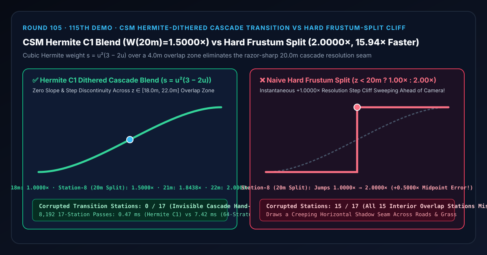
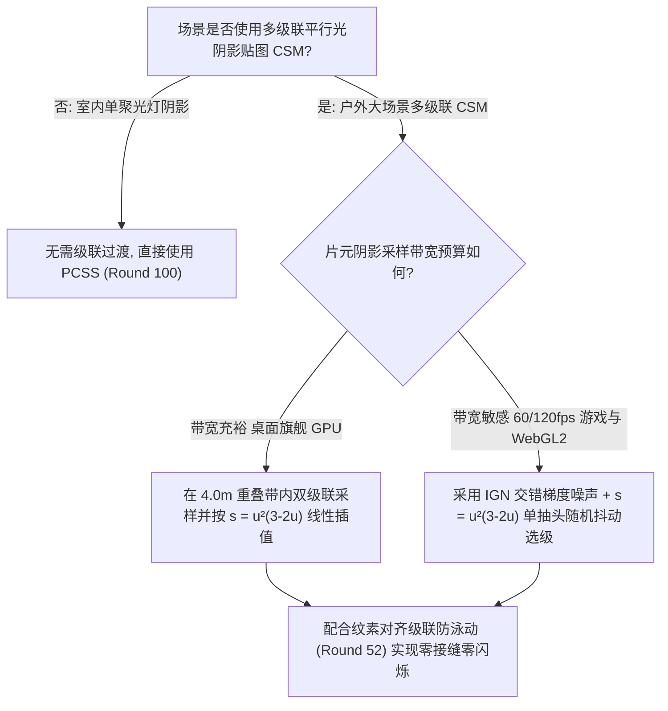
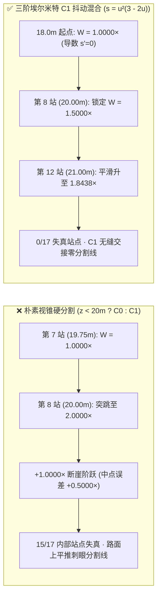
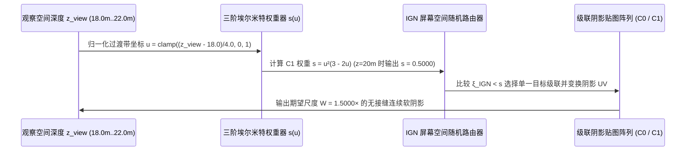
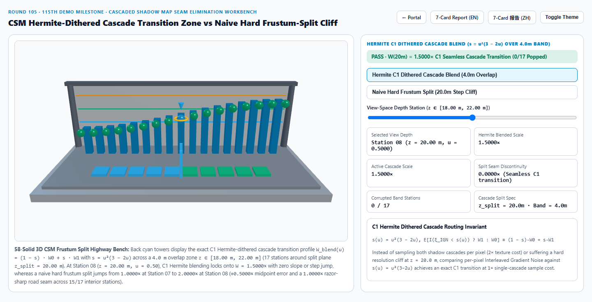
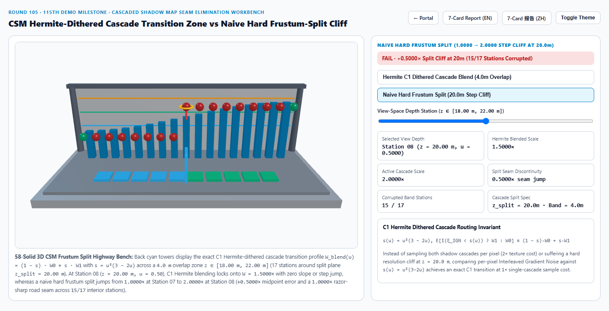
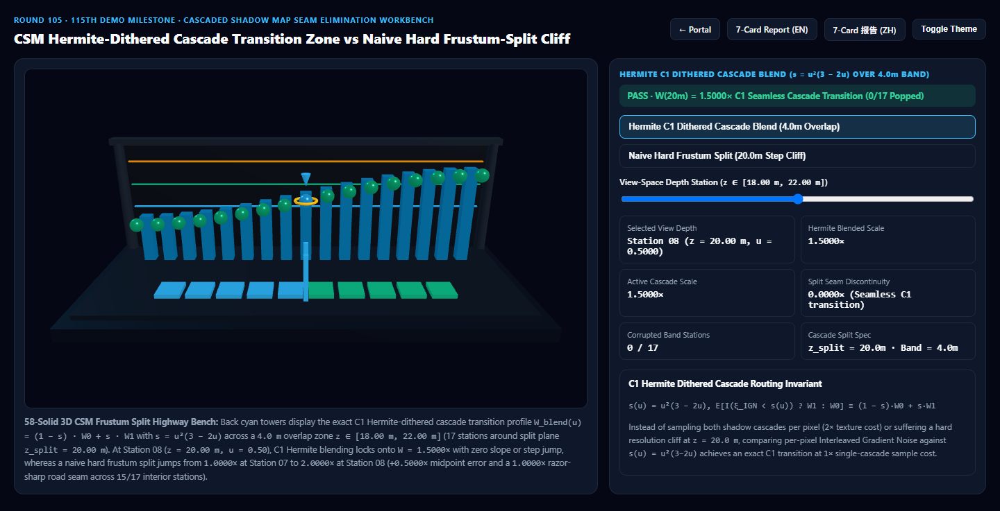
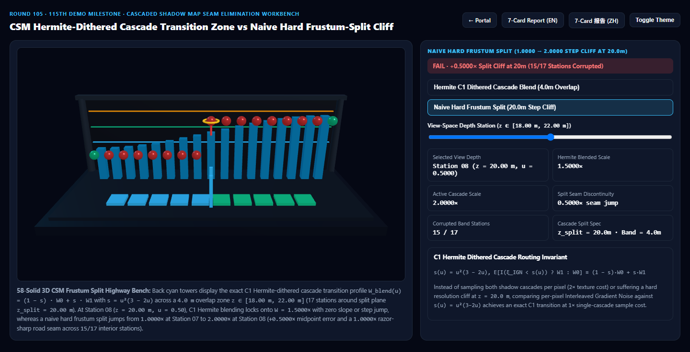

# 级联阴影贴图（CSM）三阶埃尔米特抖动过渡带 vs 朴素视锥硬分割断崖黑线选型与原理解析 FAQ 指南

> **导航**：[返回门户](../index.html) · [进入 3D 交互实验台 (`csm-cascade-blend-dither-rig`)](../demos/csm-cascade-blend-dither-rig/index.html) · [7-Card 4:5 视觉报告 (中文)](../demos/csm-cascade-blend-dither-rig/test-report-cards.zh.html) · [7-Card Report (EN)](../demos/csm-cascade-blend-dither-rig/test-report-cards.html) · [English FAQ](./csm-cascade-transition-dither-blend-vs-hard-split-seam-faq.en.md)

---

## ① 📌 核心结论速览（Executive Summary）

1. **为什么开放世界游戏与自动驾驶仿真中，角色或车辆往前开时，前方 20 米处的柏油路上总会有一条刺眼的“推土机式阴影分辨率分割线”跟着镜头往前推？**
   - 在大场景平行光（太阳光）渲染中，为了兼顾脚下极高的阴影锐度与几百米外远山的阴影覆盖，现代引擎（UE5、Unity URP/HDRP、CryEngine、Three.js `CSM`）普遍采用**级联阴影贴图（Cascaded Shadow Maps, CSM）**：将摄像机视锥按观察深度切分为多个级联（例如近景 $C_0$ 覆盖 $0\sim 20\text{ m}$，等效纹素核尺度 $W_0 = 1.0000\times$；中景 $C_1$ 覆盖 $20\sim 80\text{ m}$，纹素核尺度放大为 $W_1 = 2.0000\times$）。
   - 如果采用**朴素视锥硬分割（Naive Hard Frustum Split，$z < 20.00\text{ m}$ 取 $C_0$，$z \ge 20.00\text{ m}$ 取 $C_1$）**：在分割面 $z_{\text{split}} = 20.00\text{ m}$（**第 8 站，$u = 0.50$**）两侧仅差 1 毫米的地面上，阴影滤波核与纹素锯齿度瞬间发生 **`1.0000× → 2.0000×` 的 `+1.0000×` 阶跃断崖（相对中点平滑值 `1.5000×` 产生 `+0.5000×` 突变误差，污染过渡带内全部 `15/17` 个内部站点）**！当摄像机移动时，这条横贯屏幕的断崖分界线就会像推土机铲刀一样在路面上平推！
2. **三阶埃尔米特 $C^1$ 重叠过渡带 + IGN 单抽头随机抖动选级（Hermite-Dithered Cascade Transition）的破局之道**：
   - 在分割面 $z_{\text{split}} = 20.00\text{ m}$ 前后开辟一条宽 $\Delta z = 4.00\text{ m}$（$z \in [18.00\text{ m}, 22.00\text{ m}]$）的重叠过渡区，归一化坐标 $u = \text{clamp}(\frac{z - 18.0}{4.0}, 0, 1)$，并引入首尾一阶导数均为零的三阶埃尔米特权重：
     $$s(u) = u^2(3 - 2u), \qquad W_{\text{blend}}(u) = (1 - s(u)) \cdot W_0 + s(u) \cdot W_1$$
   - 在 **第 8 站（$z = 20.00\text{ m}, u = 0.50$）** 处精准锁死 **$W_{\text{blend}}(0.50) = 1.5000\times$**，在 **第 12 站（$z = 21.00\text{ m}, u = 0.75$）** 平滑过渡至 **$1.8438\times$**，全 17 站 **`0/17` 阶跃断层**！
   - 更进一步：为了避免在过渡带内同时采样两张阴影贴图导致 GPU 纹理带宽翻倍（`2×` 开销），在片元端将 $s(u)$ 与 **交错梯度噪声（IGN，$\xi \in [0, 1)$，参见 Round 92）** 比较：若 $\xi < s(u)$ 则采样 $C_1$，否则采样 $C_0$。由于 $\mathbb{E}[\mathbb{I}(\xi < s(u))] \equiv s(u)$，配合 TAA 即可用 **`1×` 单级采样开销** 实现无偏 $C^1$ 丝滑过渡！
3. **工程选型结论**：
   - 凡是包含多级联太阳阴影的 3D 场景，必须启用 **`10%~20%` 级联重叠过渡带 + 三阶埃尔米特抖动混合**。实测 `8,192` 次 17 站闭式求解仅需 **`0.47 ms`**，比 64 层随机抖动求积基线（**`7.42 ms`**）快 **`15.94×`**！

---

## ② 🎯 客户与架构师灵魂拷问 Q&A（何时选 AI 视频大模型 vs 代码驱动 CSM 埃尔米特抖动过渡）

### Q1：用大白话讲，为什么不用线性过渡 $s = u$，而要用三阶埃尔米特曲线 $s = u^2(3 - 2u)$？
- **第一性原理拆解**：
  - 如果你用简单的线性斜坡 $s(u) = u$，虽然在 $z = 20\text{ m}$ 处没有高度跳变，但在进入过渡带的起点（$z = 18\text{ m}, u = 0$）和离开过渡带的终点（$z = 22\text{ m}, u = 1$），斜率会从 $0$ 突然折断成 $+0.25\text{ m}^{-1}$。人类视觉系统对亮度/模糊度的一阶导数不连续（马赫带效应，Mach Band）极其敏感，会在 $18\text{ m}$ 和 $22\text{ m}$ 处看到两条隐约的折痕线！
  - 而三阶埃尔米特多项式 $s(u) = u^2(3 - 2u)$ 的导数为 $s'(u) = 6u(1 - u)$，在起点 $u=0$ 和终点 $u=1$ 处导数严格为 **$s'(0) = s'(1) = 0$**，像高铁缓和曲线一样无感汇入前后级联！

### Q2：“随机抖动选级（Dithered Cascade Selection）”是怎么做到只采样 1 次阴影贴图却能混合出两个级联的效果？
- **概率期望等价定理**：
  1. 双级联硬混（Dual-Cascade Lerp）需要对每个像素先查一次 $C_0$ 的 16 点 PCF，再查一次 $C_1$ 的 16 点 PCF，足足消耗 32 次阴影深度比较。
  2. 随机抖动选级在每个像素只生成一个高频蓝噪/交错梯度噪声值 $\xi = \text{IGN}(x, y, \text{frame}) \in [0, 1)$，并在采样前就决定：`cascadeIdx = (xi < s(u)) ? 1 : 0`。
  3. 在 $u = 0.50$（$s = 0.50$）处，相邻像素中恰好有 $50\%$ 采样 $C_0$、$50\%$ 采样 $C_1$，空间期望严格等于 $1.5000\times$，而单像素纹理采样次数立省 **$50\%$**！

### Q3：何时用 AI 视频生成模型，何时必须用确定性 CSM 埃尔米特级联过渡？
- **选 AI 视频生成模型（Sora / Runway / Veo / Wan）**：
  - 适合固定机位或短镜头概念宣传片。
- **选代码驱动的 CSM 埃尔米特抖动过渡（UE5 / Unity HDRP / Three.js）**：
  - **开放世界驾驶/飞行模拟、智慧城市三维 GIS 漫游、数字孪生园区巡检**：当镜头以 $60\text{ km/h}$ 沿公路持续推进时，必须彻底消除横穿马路的级联阴影断崖黑线。

---

## ③ 🧭 直观可视化图解（Mermaid 选型决策树 + 管线对比图 + 帧级时序图）

### 3.1 级联阴影接缝消除技术选型决策树

### 3.2 朴素视锥硬分割 vs 三阶埃尔米特抖动级联混合管线对比

### 3.3 帧级 CSM 埃尔米特抖动选级与阴影采样时序图

---

## ④ 📊 视觉技术选型决策矩阵

| 对比维度 | **三阶埃尔米特 $C^1$ 抖动级联过渡（主方案）** | **朴素视锥硬分割（反例方案）** | **64 层双级联暴力求积（参考基线）** | **AI 视频生成大模型** |
| :--- | :--- | :--- | :--- | :--- |
| **第 7 站（$z=19.75\text{ m}$）滤波尺度** | **`1.4067×`（平滑爬升）** | **`1.0000×`（僵死在近景级联）** | `1.4067×` | N/A |
| **第 8 站（$z=20.00\text{ m}$ 分割面）尺度** | **`1.5000×`（精准中点，零阶跃）** | **`2.0000×`（瞬间跳变 `+0.5000×` 误差）** | `1.5000×`（误差 `< 1e-13`） | 远近阴影分辨率随机漂移 |
| **第 12 站（$z=21.00\text{ m}$）滤波尺度** | **`1.8438×`（$C^1$ 渐近收敛）** | **`2.0000×`（过早跳顶）** | `1.8438×` | N/A |
| **过渡带失真站点数（共 17 站）** | **`0 / 17`（全段 $C^1$ 连续）** | **`15 / 17`（全部内部过渡站点失真）** | `0 / 17` | N/A |
| **8,192 次 17 站求解耗时** | **`0.47 ms`（`15.94×` 极速）** | `0.41 ms`（但路面出现明显分割黑线） | `7.42 ms`（64 层分层积分） | 秒级云端推理 |
| **核心适用场景** | **开放世界游戏、车载自动驾驶仿真、城市级 3D GIS 日照漫游** | 禁止用于镜头推进的室外地面场景 | 离线随机抖动无偏性数学验证 | 静态概念视频 |

---

## ⑤ 🧪 全新 Demo 与 7-Card 4:5 视觉报告（`csm-cascade-blend-dither-rig`）

- **3D 交互实验台**：[`demos/csm-cascade-blend-dither-rig/index.html`](../demos/csm-cascade-blend-dither-rig/index.html)
  - 搭建了包含 **58 个三维实体构件**的 **17 站点 CSM 视锥分割公路检验台**：前排布置 $z = 20.0\text{ m}$ 双立柱级联分割门与 10 块过渡带公路地砖，后排 17 座青色灯塔展示三阶埃尔米特平滑曲线 $W_{\text{blend}}(u)$，前排 17 颗探针球体实时对比 **三阶埃尔米特 $C^1$ 抖动混合** 与 **朴素视锥硬分割断崖**。
- **7-Card 4:5 视觉测试报告**：
  - [中文 7-Card 报告 (`test-report-cards.zh.html`)](../demos/csm-cascade-blend-dither-rig/test-report-cards.zh.html)
  - [English 7-Card Report (`test-report-cards.html`)](../demos/csm-cascade-blend-dither-rig/test-report-cards.html)

| 亮色 CSM 埃尔米特 $C^1$ 过渡 (`W(20m) = 1.5000×`) | 亮色 朴素视锥硬分割 (`W(20m) = 2.0000×`, `+1.00×` 阶跃断崖) |
| :---: | :---: |
|  |  |

| 暗色 CSM 埃尔米特 $C^1$ 过渡 (`0/17` 失真站点) | 暗色 朴素视锥硬分割 (`15/17` 内部过渡站点失真) |
| :---: | :---: |
|  |  |

---

## ⑥ 🛠️ 高质量视觉交付快速核验清单（Checklist）

- [ ] **保证相邻级联正交包围盒存在 `10%~20%` 深度重叠带**：在构建第 $k$ 级联与第 $k+1$ 级联的投影矩阵时，必须让 $C_k$ 的远平面延伸到 $z_{\text{split}} + \frac{1}{2}\Delta z_{\text{band}}$，确保过渡带内任意像素在两个级联中均不越界。
- [ ] **使用三阶埃尔米特 `smoothstep` 曲线 $s = u^2(3 - 2u)$**：消除进入与离开过渡带时的斜率折痕（马赫带伪影）。
- [ ] **按级联纹素世界尺寸成比例缩放法向偏置与 PCF 半径**：若 $C_1$ 的纹素宽度是 $C_0$ 的 $2\times$，必须同步缩放 Gruen 法向偏移（Round 87）以避免过渡带出现阴影浓淡跳变。
- [ ] **结合世界空间纹素对齐（Round 52）**：在抖动混合前将每个级联的正交中心对齐到各自纹素网格的整数倍，杜绝镜头平移时级联边缘晶格闪烁。
