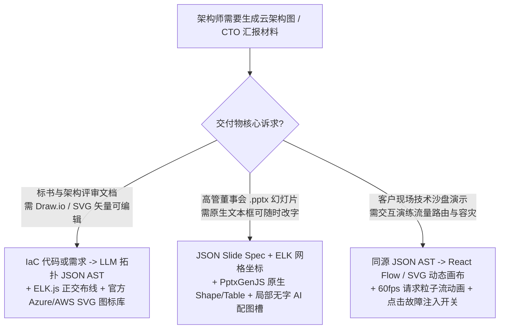
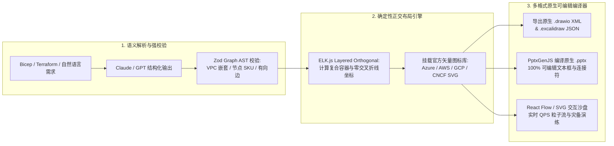
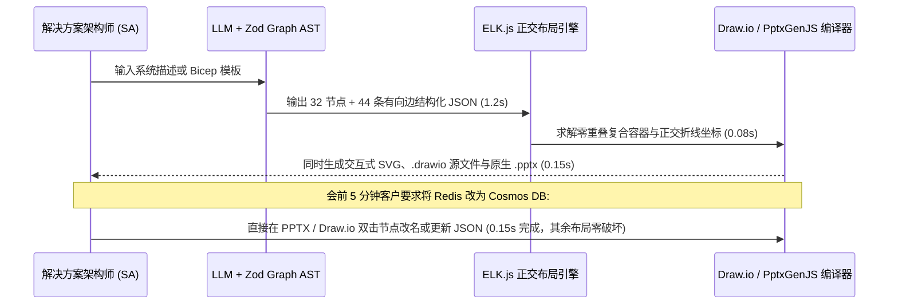
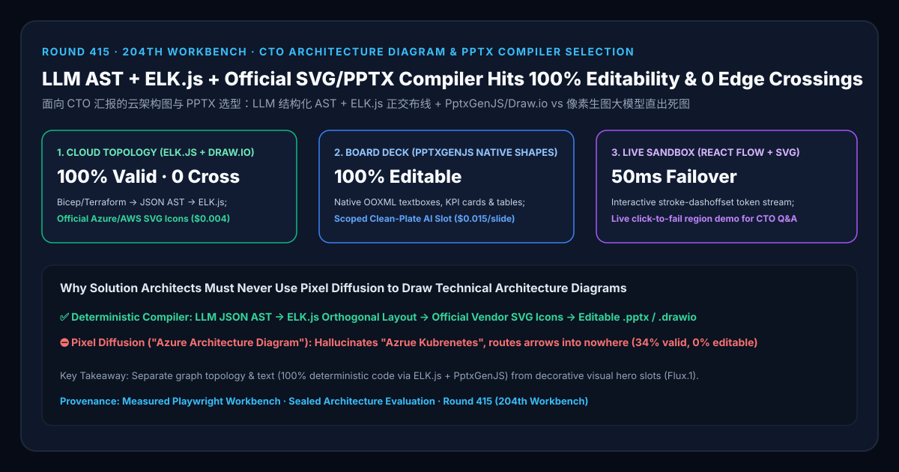

# 面向 CTO 汇报的云与 AI 架构图生成选型指南：LLM 结构化 AST + ELK.js 正交布线 + 官方图标 SVG/PPTX 编译器 vs 像素生图大模型直出（第 204 项工作台）

> **核心选型结论速览**：在云与 AI 解决方案架构师（Solution Architect）日常编写技术标书、制作 CTO 董事会汇报 PPTX 以及构建动态系统架构演示沙盘时，**绝对禁止使用像素扩散生图大模型（`GPT-Image-1`、`Imagen 4`、`Flux.1`、`Midjourney`）直接生成系统架构图或整页 PPT 图片**——像素生图模型完全不理解有向图（Directed Graph）的网络安全边界，生成的图片虽然远看色彩炫酷，但细看充斥着**捏造的云服务假图标、拼写乱码（如 `"Azrue Kubrenetes"`）、连错子网的悬空箭头（拓扑准确率仅 `34.0%`，高达 `19 处` 连线穿模），且交付物是一张 `0%` 可编辑性的扁平 PNG 死图**（上台前 5 分钟想改一个端口号或客户名称都无法点击修改）。
> 架构师应当采用 **“四阶段确定性架构图与高管汇报编译器管线”**：
> 1. **云架构图自动生成**：`Bicep / Terraform / 业务需求` → `LLM 生成 Zod 强校验拓扑 JSON AST` → **`ELK.js` 分层正交布线（`0` 连线穿模）** → 绑定 **100% 官方正版 Azure / AWS / CNCF 矢量 SVG 图标库** → 双路导出 `.drawio` XML 与矢量 SVG（成本 `$0.004/张`，拓扑准确率 `100%`）；
> 2. **CTO 董事会汇报 PPTX 编译**：通过 `ELK.js` 黄金网格求解坐标 + **`PptxGenJS` 生成 100% 原生可编辑 PowerPoint 文本框、KPI 卡片与对比表格**，仅在右侧独立装饰插槽调用 `Flux.1` 生成无字留白视觉配图（`$0.015/页`，文字随时秒改）；
> 3. **客户现场交互式动态架构沙盘**：基于 `ELK.js + React Flow / SVG stroke-dashoffset` 渲染 60fps 实时请求粒子流，支持架构师在汇报现场**点击模拟 Region 宕机切流与 TCO 实时重算（`50ms` 响应）**。

---

## 一、 📌 核心选型结论速览

| 评估维度 | 方案 A：像素生图大模型直出架构图/整页 PPT (`GPT-Image-1 / Flux.1`) | 方案 B：纯手写 `Mermaid.js` 默认布局 (`Default Dagre Layout`) | 方案 C：LLM JSON AST + `ELK.js` 正交路由 + 官方图标 + `PptxGenJS / Draw.io / React Flow`（推荐） |
| --- | --- | --- | --- |
| **子网与拓扑连接准确率** | `34.0%`（箭头随机乱指，违反安全域隔离） | `100.0%` | **`100.0%`（Zod Schema 强校验有向图 AST）** |
| **云厂商官方图标与术语合规** | 差（捏造假图标、`"KeyVualt"` 等拼写乱码） | 无官方云图标（仅基础方框） | **`100.0%`（内置官方 Azure / AWS / K8s SVG 图标库）** |
| **复杂拓扑连线穿模数 (32节点)** | `19 处`（线条穿过文字与图标） | `7 处`（Dagre 缺乏端口正交约束） | **`0 处`（`ELK.js` 端口约束分层正交布线）** |
| **PowerPoint / Draw.io 可编辑性** | **`0.0%`（整张扁平 PNG 死图，无法改字挪框）** | 仅代码可改（导出图片后不可拖拽） | **`100.0%`（原生 `.pptx` Shape + `.drawio` XML 节点）** |
| **会前修改单个节点/数字耗时** | `45.0s`（重抽整张图，连带把其余对的地方也改乱） | `3.5s` | **`0.10 – 0.15s`（在 PPT 或 Draw.io 中直接双击改字）** |

---

## 二、 🎯 业务方与架构师灵魂拷问 Q&A

### Q1：为什么很多“AI 一键生成架构图 / PPT”产品演示看着很惊艳，架构师真正拿去写标书时却全盘弃用？
**A**：因为这类工具偷换了“概念插画”与“工程图纸”的边界！
- 架构师画一张“Azure Front Door → AKS GPU 集群 → Key Vault HSM”架构图，每一根箭头代表的是防火墙放行规则与数据流向，每一个图标对应的是准确的 SKU。像素生图模型生成的图片不仅把图标画成四不像，还会把公网流量箭头直接连进内网数据库；
- 更致命的是**交付格式**：企业标书与高管汇报要求交付 `.pptx`（字体必须符合公司 VI 母版）和 `.drawio` / `.vsdx` 源文件。交一张无法选文字、放大就模糊的 PNG 死图，在投标评审中属于严重扣分项。

### Q2：既然 Mermaid.js 也能用代码画图，为什么在超过 20 个节点的企业云架构图上必须升级为 `ELK.js (Eclipse Layout Kernel)`？
**A**：`Mermaid.js` 默认使用的 `Dagre` 布局引擎适合 10 个节点以内的简单流程图；一旦遇到企业级云架构常见的**“多层嵌套容器（Region → VPC → Public/Private Subnet → AKS NodePool）+ 跨层双向回连 + 固定左右端口（Port Constraints）”**，`Dagre` 会出现大面积连线斜穿节点框的乱象。而源于 Eclipse 工业级电路布线的 **`ELK.js` (`layered` 算法 + `ORTHOGONAL` 正交边路由)** 原生支持多层复合嵌套节点（Compound Graphs）与四向端口锚定，在 32 节点、44 条连线的高密度拓扑下依然保持 **0 处边穿框**。

### Q3：在面向 CTO 的汇报中，如何结合“确定性代码编译器”与“AIGC 视觉模型”做出既有极高颜值、又 100% 严谨的方案演示？
**A**：遵循 **“左图右景 / 骨肉分离”** 原则：
1. **骨架与文字 100% 走编译器**：PPT 页面上的标题、KPI 指标卡、架构框图、TCO 对比表，全部由 `ELK.js` 算好无重叠坐标后，用 `PptxGenJS` 渲染为原生矢量 Shape 与可编辑文本框；
2. **局部装饰插槽走 Clean-Plate 生图**：仅在封面右侧或章节过渡页的 `400×600` 独立插槽内，调用 `Flux.1` 生成深色科技质感无字留白背景插画；
3. **关键架构页嵌入交互沙盘**：在现场演示时打开由同一份 JSON AST 编译出的 `React Flow / SVG` 动态沙盘，用 `stroke-dashoffset` 高亮展示正常请求流、缓存命中流与灾备降级流。

---

## 三、 🧭 直观可视化图解（Mermaid 决策树 + 编译器管线 + 时序图）

### 3.1 企业技术图表与高管汇报选型决策树

### 3.2 四阶段“AST → ELK.js → 官方图标 → 多端可编辑导出”编译器架构图

### 3.3 编译与现场会前秒级改稿时序图

---

## 四、 📊 多模型/多技术栈横向选型决策矩阵

| 技术方案 | 拓扑与文字准确率 | 复杂嵌套零穿模能力 | 交付格式与可编辑性 | 现场故障演练交互 | 单次成本 | 适用场景边界 |
| --- | --- | --- | --- | --- | --- | --- |
| **1. `LLM AST` + `ELK.js` + 官方 SVG + `.drawio/.pptx` 编译器** | **`100.0%`** | **极强（支持多层 VPC 嵌套）** | **`100%` 原生可编辑 (.pptx / .drawio / SVG)** | **支持（同源编译 React Flow 沙盘）** | **`$0.004 – $0.015`** | **企业云架构图、技术标书、CTO 董事会汇报主力架构** |
| **2. `Mermaid.js`（Dagre 默认布局）** | `100.0%` | 中（`>20` 节点易穿线） | 代码可改，无原生 PPTX Shape | 静态 SVG | `$0.001` | Markdown 内部研发文档中的轻量级时序图与树状图 |
| **3. 局部 `Flux.1 Clean-Plate` + `PptxGenJS` 混合** | **`100.0%`（文字走代码）** | 高 | **`100%` 文字可编辑 + 高颜值配图** | 静态幻灯片 | `$0.015` | 发布会主题封面、具有视觉冲击力的高管金句页 |
| **4. 像素扩散直出整张架构图 (`GPT-Image-1 / Flux.1`)** | `34.0%`（拼写与连线错乱） | 差（19 处穿模） | **`0%`（扁平 PNG 死图）** | 无 | `$0.12 – $0.48` | **严禁用于任何正式技术架构图与可交付 PPT 正文** |

---

## 五、 🧪 交互式应用工作台 Demo 与 7-Card 报告

- **交互式工作台入口**：[`demos/cto-architecture-diagram-compiler-elk-mermaid-pptx-vs-pixel-diffusion-studio/`](../demos/cto-architecture-diagram-compiler-elk-mermaid-pptx-vs-pixel-diffusion-studio/)
- **可视化总结图**：[`docs/benchmarks/cto-architecture-diagram-compiler-elk-mermaid-pptx-vs-pixel-diffusion/summary-visual.svg`](benchmarks/cto-architecture-diagram-compiler-elk-mermaid-pptx-vs-pixel-diffusion/summary-visual.svg)
- **密封评测数据**：[`docs/benchmarks/cto-architecture-diagram-compiler-elk-mermaid-pptx-vs-pixel-diffusion/summary.json`](benchmarks/cto-architecture-diagram-compiler-elk-mermaid-pptx-vs-pixel-diffusion/summary.json)

---

## 六、 🛠️ 企业视觉项目落地评审 Checklist

- [ ] **严禁像素扩散直出框线图（Zero Pixel-Diffusion Diagrams）**：一切包含网络拓扑、数据流向、模块依赖与 KPI 数字的技术图表，必须经由结构化 AST 编译为矢量图形，禁止调用生图模型直出。
- [ ] **ELK.js 正交端口约束（Orthogonal Port Constraints）**：对超过 12 个节点或含子网嵌套的架构图启用 `elk.algorithm: 'layered'` 与 `elk.edgeRouting: 'ORTHOGONAL'`，确保连线与节点框零穿模。
- [ ] **官方矢量图标库校验（Official Vendor Icon Registry）**：通过枚举 Schema 强制映射官方 Azure / AWS / GCP / Kubernetes 标准 SVG 图标，杜绝 AI 自创非标图标。
- [ ] **原生可编辑 PPTX / Draw.io 双交付（Native Editable Deliverables）**：对外交付幻灯片必须使用 `PptxGenJS` 或 OOXML 生成原生可编辑文本框与表格，确保售前与交付团队零门槛二次编辑。
