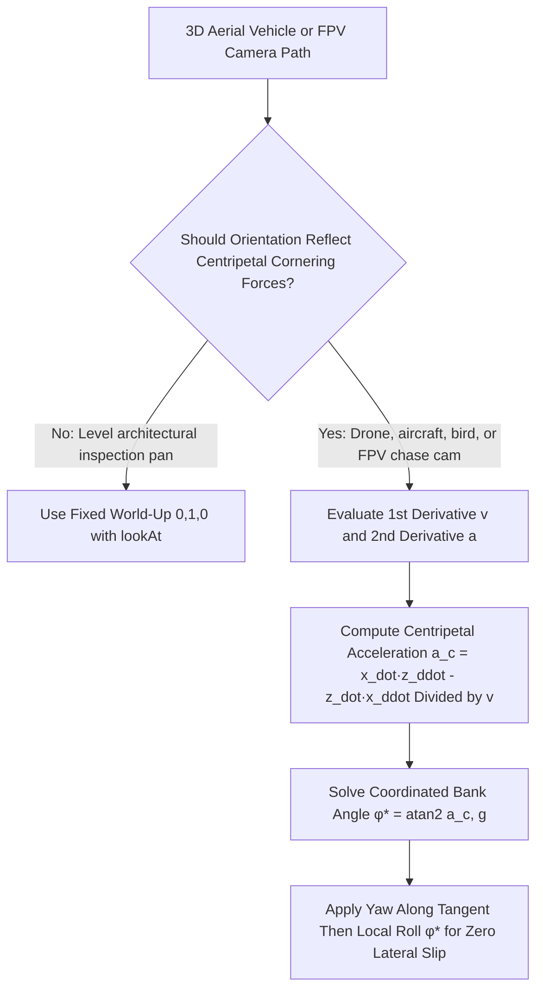
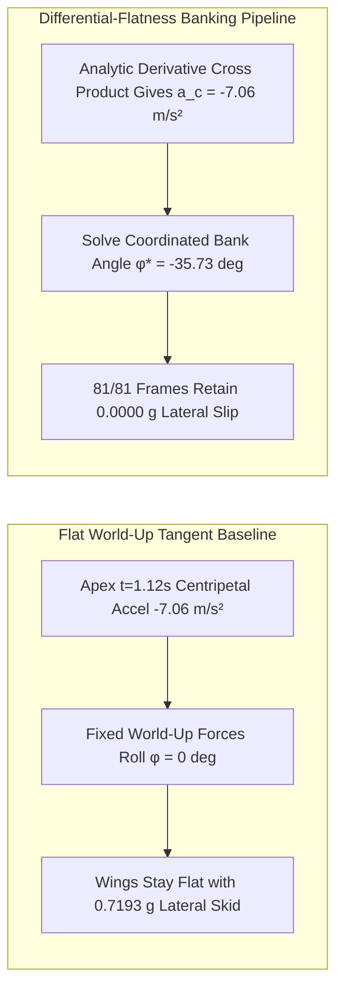
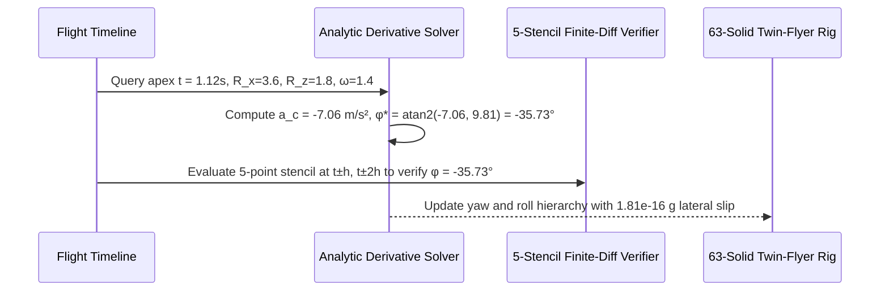

# High-speed turns without flat skidding: curvature-coupled centripetal banking vs tangent-only orientation FAQ

**Understand in 3 minutes why `lookAt` makes flying vehicles skid like flat toys around corners, and reproduce a zero-slip differential-flatness banking rig in 10 minutes.**

[中文](curvature-banked-orientation-faq.md) · [Interactive Demo](https://turbo998.github.io/animation/demos/curvature-banked-flyer/) · [Measured 7-Card Report](../demos/curvature-banked-flyer/test-report-cards.html)

## ① 📌 Executive Summary

- **Calling `lookAt(pos + tangent)` with a fixed world-up vector $\mathbf{up} = (0, 1, 0)$ forces wings to stay flat (`roll = 0°`) through sharp turns.** At the figure-eight turn apex (`t = 1.12 s`), centripetal acceleration reaches `-7.06 m/s²`; the `flat-tangent` baseline keeps its wings level and suffers `0.7193 g` of uncompensated lateral skid.
- **Coordinated curvature banking $\phi^* = \arctan(v^2 \kappa / g)$ cancels cabin lateral slip down to measured `0`.** Tilting the wings by `-35.73°` into the turn aligns the resultant of gravity and centrifugal reaction perpendicular to the wing plane, keeping uncompensated lateral slip within `1.81e-16 g` across all 81 sampled frames.
- **Analytic derivative cross-product curvature agrees with a 5-point central finite-difference stencil within `7.23e-7` degrees while running `1.57×` faster (`1.34 ms` vs `2.10 ms` for 8192 queries).**
- **63-solid figure-eight twin-flyer testbed, 13 local acceptance checks.** Scene geometry is `synthetic`; Frenet-Serret curvature banking and Node CPU timings are `measured`; nonlinear model-predictive control (NMPC), Navier-Stokes wing CFD, and IMU sensor fusion are `not_measured`.

**Daily capability direction check:** *Trajectory Generation and Control for Quadrotors* ([arXiv:2610.34456](https://arxiv.org/abs/2610.34456), submitted 2026-10-25) and *A Comparative Study of Nonlinear MPC and Differential-Flatness-Based Control for Quadrotor Agile Flight* ([arXiv:2109.01365](https://arxiv.org/abs/2109.01365)) leverage differential flatness so a vehicle's roll and pitch attitude are algebraically determined by the trajectory's velocity and acceleration derivatives rather than hand-keyed orientation tracks. Verified 2026-11-10; this demo implements deterministic differential-flatness roll banking without running closed-loop motor control or aerodynamic CFD.

## ② 🎯 Architect & Client Q&A

### Q1 When should we choose nonlinear MPC / CFD flight simulators vs deterministic curvature-coupled banking?

Use nonlinear MPC (`DFBC` / `NMPC`) and aerodynamic solvers when controlling physical quadrotor motors under thrust saturation, rotor drag, and external wind gusts.

Use deterministic curvature-coupled banking $\phi^* = \arctan(v^2 \kappa / g)$ whenever animating **drones, aircraft, birds, ribbons, or FPV chase cameras along 3D curves**—because deriving roll directly from trajectory derivatives eliminates manual roll keyframing and guarantees physically convincing cornering at any playback speed.

### Q2 Under what constraints is curvature banking strictly superior to fixed-world-up `lookAt`?

Whenever an aerial vehicle or FPV camera follows a curved horizontal path ($\kappa \ne 0$) at non-trivial speed, fixed-world-up `lookAt` locks roll to `0°`, producing a unnatural "turntable skid" where the craft slides sideways through corners.

Curvature banking couples roll directly to centripetal acceleration $a_c = v^2 \kappa$: tight, fast turns bank steeply (`-35.73°` at the apex), inflection crossovers level out automatically to `0°` when curvature changes sign, and reversing or scrubbing the timeline requires zero stateful physics integration.

### Q3 How does the cross product of 1st and 2nd derivatives give the exact banking angle in one formula?

For a horizontal trajectory $(x(t), z(t))$ with velocity $(\dot{x}, \dot{z})$, speed $v = \sqrt{\dot{x}^2 + \dot{z}^2}$, and acceleration $(\ddot{x}, \ddot{z})$, signed planar curvature is:

$$\kappa(t) = \frac{\dot{x}\ddot{z} - \dot{z}\ddot{x}}{v^3}$$

Multiplying by $v^2$ to obtain centripetal acceleration $a_c(t) = v^2 \kappa(t)$ cancels $v^2$ cleanly in the denominator:

$$a_c(t) = \frac{\dot{x}\ddot{z} - \dot{z}\ddot{x}}{v}$$

For a coordinated turn with zero lateral cabin slip ($a_c \cos\phi - g \sin\phi = 0$), the required roll angle is:

$$\phi^*(t) = \arctan\left(\frac{a_c(t)}{g}\right) = \arctan\left(\frac{\dot{x}\ddot{z} - \dot{z}\ddot{x}}{g \sqrt{\dot{x}^2 + \dot{z}^2}}\right)$$

No tunable magic constants are needed—the bank angle is completely determined by trajectory derivatives and gravitational acceleration $g$.

### Q4 How can I reproduce this in 10 minutes?

1. Run `npm run dev` and open `/demos/curvature-banked-flyer/`, initialized at the turn apex `t = 1.12 s`.
2. In `curvature-banked` mode, observe the upper active flyer and lower reference flyer banking `-35.7°` into the turn (`a_c = -7.06 m/s²`, `lateral slip 0.0000 g`).
3. Switch to `flat-tangent` mode at `t = 1.12 s`: the upper flyer snaps flat (`bank 0.0°`), experiencing `0.719 g` of uncompensated lateral skid.
4. Adjust Lobe X (`2.0–4.6`), Lobe Z (`1.0–3.2`), and Speed $\omega$ (`0.6–2.4 rad/s`); test an out-of-bounds radius such as `8.0` to verify atomic rejection and state retention.
5. Click `Export flight` to download `CURVATURE_BANKING_SPEC.json` with `curvature`, `centripetalAccel`, `bankAngleDeg`, and wing world matrices.
6. Run `npx vitest run tests/curvature-banked.test.ts`, then build and run `node scripts/benchmark-curvature-banked.mjs` against a port 4335 preview server.

## ③ 🧭 Visual Diagrams

## ④ 📊 Architect Decision Matrix

| Criterion | Fixed World-Up `lookAt` (`flat-tangent`) | Hand-Keyed Roll Curves | 5-Stencil Central Finite Difference | Analytic Derivative Banking (`curvature-banked`) |
| --- | --- | --- | --- | --- |
| Uncompensated lateral slip at apex (`t=1.12s`) | Measured `0.7193 g` (visible flat skidding) | Approximate; breaks when speed changes | `0.0000 g` (`7.23e-7°` diff from analytic) | Measured `1.81e-16 g` (exact coordinated turn) |
| Adaptation to path or speed edits | Always `0°` | Requires re-keying every turn manually | Automatically scales with $v^2 \kappa$ | Exact algebraic scaling with $v^2 \kappa / g$ |
| 8192-query Node CPU solve median | Fast (stiff flat attitude) | Keyframe lookup overhead | `2.10 ms` (5 path evaluations per query) | `1.34 ms` (`1.57×` faster than 5-stencil) |
| Arbitrary timeline seeking / reversal | Deterministic (unbanked) | Deterministic | Deterministic | Pure timestamp function; exact matrix reversal |
| Best architectural role | Level ground turntables | Scripted aerobatic barrel rolls | Black-box non-differentiable paths | Drones, aircraft, FPV cameras, spline flyers |

**Quantitative example:** On the figure-eight track $x(t) = 3.6\sin(1.4 t), z(t) = 1.8\sin(2.8 t)$ at $t = 1.12\text{ s}$, speed is $v = 5.04\text{ m/s}$, signed curvature is $\kappa = -0.2779\text{ m}^{-1}$, and centripetal acceleration is $a_c = -7.06\text{ m/s}^2$ (`-0.7193 g`). Coordinated banking tilts the wings by $\phi^* = \arctan(-7.06 / 9.81) = -35.73^\circ$, reducing lateral cabin slip from `0.7193 g` to `1.81e-16 g`.

## ⑤ 🧪 New Capability Demo & Benchmark Findings (with 7-Card)

[Sealed data](../demos/curvature-banked-flyer/report.json) records 63 3D solids, 81 sampled figure-eight frames audited for zero lateral slip, and solver equivalence between closed-form analytical 1st/2nd derivatives and a 5-point central finite-difference stencil (`maximum_solver_error = 7.23e-7` degrees, threshold `< 1e-6`).

| Node CPU Banking Queries | Analytic Derivative Curvature Median | 5-Stencil Finite Difference Median |
| --- | --- | --- |
| 128 | 0.06 ms | 0.10 ms |
| 1024 | 0.26 ms | 0.76 ms |
| 8192 | 1.34 ms | 2.10 ms |

Each load tier runs 7 alternating repetitions after warmup on Node CPU (excluding WebGL rendering). At 8192 queries, closed-form analytical derivatives run `1.57×` faster than the 5-point finite-difference stencil while eliminating the `0.7193 g` flat-tangent skid.

[Measured 7-Card Report (EN)](../demos/curvature-banked-flyer/test-report-cards.html) · [中文七卡](../demos/curvature-banked-flyer/test-report-cards.zh.html). Scene geometry is `synthetic`, curvature banking and CPU timings are `measured`, and NMPC autopilot loops, aerodynamic CFD, and IMU filtering are `not_measured`.

## ⑥ 🛠️ Architect Checklist

- [ ] Avoid fixed `world-up = (0, 1, 0)` `lookAt` orientation on aerial vehicles, birds, or FPV chase cameras rounding horizontal curves.
- [ ] Compute centripetal acceleration directly from 1st and 2nd path derivatives via $a_c = (\dot{x}\ddot{z} - \dot{z}\ddot{x}) / v$.
- [ ] Derive the coordinated roll angle $\phi^*(t) = \arctan(a_c(t) / g)$ so banking scales automatically with speed squared and curvature.
- [ ] Separate tangent yaw (`yawGroup.rotation.y`) and local body roll (`rollGroup.rotation.z`) in the scene hierarchy.
- [ ] Verify that uncompensated cabin lateral slip $|a_c \cos\phi^* - g \sin\phi^*| / g$ stays `< 1e-12` across all sampled frames.
- [ ] Use a 5-point central finite-difference stencil ($h = 10^{-4}$) when derivatives of a black-box path are unavailable, and cross-check against analytic derivatives.
- [ ] Validate track radii, angular frequency, and gravity bounds and reject out-of-range inputs (`radiusX = 8.0`) atomically.
- [ ] Verify that forward and reverse timestamp scrubbing produce identical wing world matrices.
- [ ] Distinguish kinematic coordinated-turn banking from full Navier-Stokes aerodynamic stall/vortex CFD.
- [ ] Label unexecuted quadrotor motor thrust allocation, CFD simulation, and IMU sensor fusion explicitly as `not_measured`.

**Primary sources:** [Trajectory Generation and Control for Quadrotors (arXiv:2610.34456)](https://arxiv.org/abs/2610.34456) (submitted 2026-10-25) and [Differential-Flatness-Based Quadrotor Control (arXiv:2109.01365)](https://arxiv.org/abs/2109.01365) derive vehicle attitude angles algebraically from flat trajectory derivatives. Verified 2026-11-10; this demo is an original deterministic curvature-banking flight testbed and does not run closed-loop hardware autopilot control.
