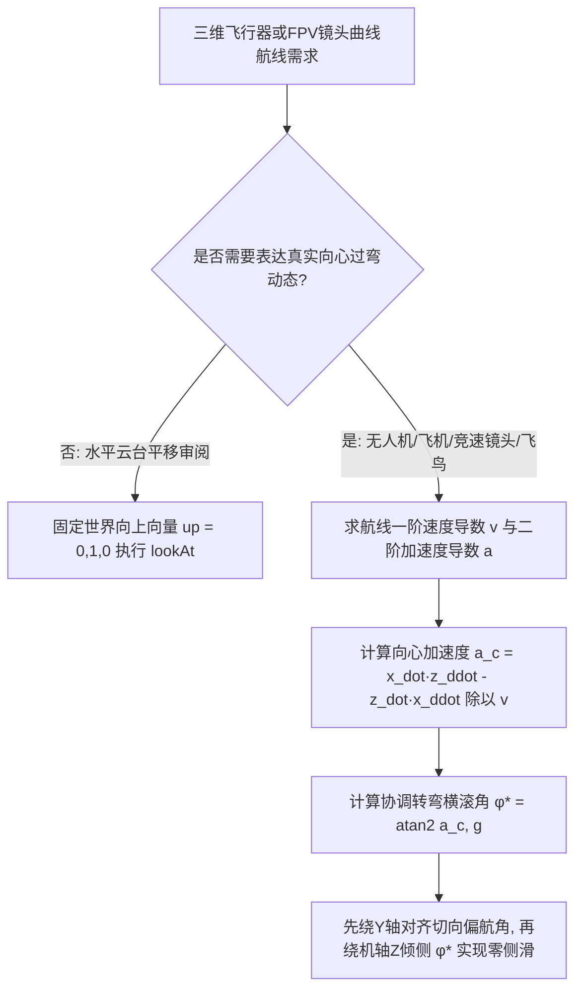
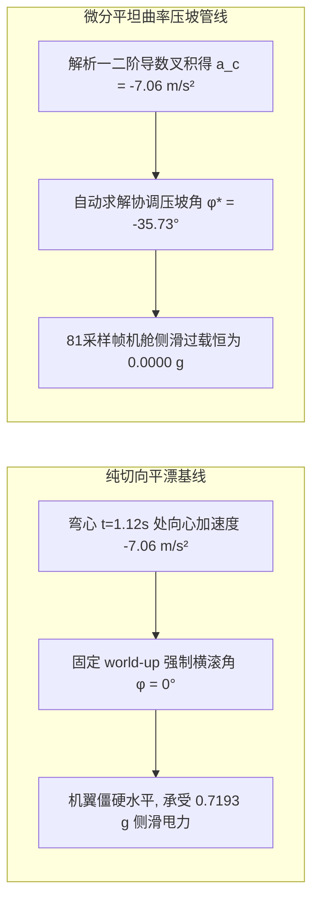
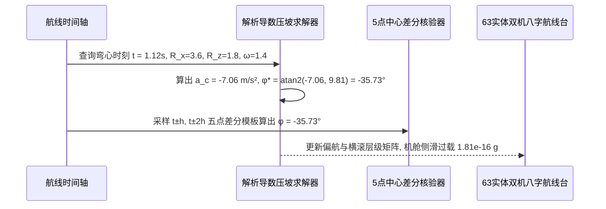

# 高速过弯不僵硬平漂：路径曲率向心倾角与纯切向朝向选型 FAQ

**3 分钟看懂为什么无人机和飞行动画过弯像在桌面上横着滑，10 分钟复刻零侧滑过载的微分平坦向心压坡飞行台。**

[English](curvature-banked-orientation-faq.en.md) · [交互 Demo](https://turbo998.github.io/animation/demos/curvature-banked-flyer/) · [中文七卡](../demos/curvature-banked-flyer/test-report-cards.zh.html)

## ① 📌 核心结论速览

- **只用 `lookAt(pos + tangent)` 并固定世界向上向量 $\mathbf{up} = (0, 1, 0)$，会让飞行器在急弯中保持 `0°` 横滚死板平漂。** 在八字航线弯心 `t = 1.12 s` 处，法向向心加速度达到 `7.06 m/s²`；纯切向平漂基线（`flat-tangent`）的机翼完全水平，机舱承受 `0.7193 g` 的未补偿横向甩力。
- **由路径曲率导出的协调转弯压坡角 $\phi^* = \arctan(v^2 \kappa / g)$ 将机舱侧滑过载降为实测 `0`。** 机翼自动向弯心倾侧 `-35.73°`，使重力与离心惯性力的合力严格垂直于机翼平面；在全部 81 个采样帧中，机舱侧滑过载最大仅 `1.81e-16 g`（浮点舍入级）。
- **解析导数叉积直接消去曲率分母中的高次方，与 5 点中心差分模板在 `7.23e-7` 度内一致。** 在 8192 次压坡姿态求值中，解析导数路径中位数耗时为 `1.34 ms` 对比 5 点差分模板 `2.10 ms`（快 `1.57×`）。
- **63 实体八字航线双机测试台，13 项本机实测验收。** 场景为 `synthetic`；Frenet-Serret 曲率压坡与 Node CPU 耗时为 `measured`；非线性模型预测控制（NMPC）、机翼涡流 CFD 与硬件飞控 IMU 滤波为 `not_measured`。

**每日能力方向核验：** *Trajectory Generation and Control for Quadrotors*（[arXiv:2610.34456](https://arxiv.org/abs/2610.34456)，2026-10-25 提交）与 *A Comparative Study of Nonlinear MPC and Differential-Flatness-Based Control for Quadrotor Agile Flight*（[arXiv:2109.01365](https://arxiv.org/abs/2109.01365)）阐述了四旋翼与敏捷飞行器的微分平坦性（Differential Flatness）：飞行器的三维位置轨迹及其二阶导数（加速度）直接代数决定了机体横滚与俯仰姿态角，无需为横滚角单独手K关键帧。2026-11-10 核验原文；本例仅实现确定性微分平坦横滚压坡映射，未运行闭环电机控制或气动 CFD。

## ② 🎯 客户与架构师灵魂拷问 Q&A

### Q1 何时选微分平坦物理飞控/轨迹优化，何时选确定性曲率压坡公式？

当开发真实四旋翼无人机飞控、需要在电机推力上限与风阻扰动下实时求解最小加加速度（Minimum-Snap）控制律时，应采用基于微分平坦的非线性模型预测控制（NMPC / DFBC）。

当我们在三维可视化、游戏过场、无人机航拍预演或跟随镜头（FPV Camera Rig）中让飞行器或镜头沿样条曲线飞行时，直接用路径一阶与二阶导数计算协调压坡角 $\phi^* = \arctan(v^2 \kappa / g)$，就能自动生成符合直觉的压弯倾侧姿态，彻底告别手调 Roll 关键帧。

### Q2 在什么约束下曲率耦合压坡比固定 `world-up` 的 `lookAt` 严格更优？

只要运动主体是**飞机、无人机、飞鸟、飞天飘带、摩托艇、过山车或 FPV 穿越机镜头**，且路径包含水平弯曲（$\kappa \ne 0$），固定 `world-up` 的 `lookAt` 都会显得像“把模型插在竖直棍子上平推”。

人类视觉对“转弯速度越快、半径越小，身体/机翼向内倾斜越深”有极强的物理直觉。曲率耦合压坡无需任何状态累积或物理引擎碰撞，直接把路径几何曲率与速率转化为精确的横滚角 $\phi^*(t)$，在可逆拖拽时间轴下严格更优。

### Q3 底层管线如何用叉积公式一步算出压坡角？

设水平面 $(x, z)$ 航线为 $(x(t), z(t))$，一阶导数（速度）为 $(\dot{x}, \dot{z})$，速率为 $v = \sqrt{\dot{x}^2 + \dot{z}^2}$；二阶导数（加速度）为 $(\ddot{x}, \ddot{z})$。

平面曲线的有向曲率定义为：

$$\kappa(t) = \frac{\dot{x}\ddot{z} - \dot{z}\ddot{x}}{(\dot{x}^2 + \dot{z}^2)^{3/2}} = \frac{\dot{x}\ddot{z} - \dot{z}\ddot{x}}{v^3}$$

而过弯所需的向心加速度为 $a_c(t) = v^2 \kappa(t)$。把 $\kappa(t)$ 代入，分母中的 $v^2$ 自动约分消去：

$$a_c(t) = v^2 \cdot \frac{\dot{x}\ddot{z} - \dot{z}\ddot{x}}{v^3} = \frac{\dot{x}\ddot{z} - \dot{z}\ddot{x}}{v}$$

为使向心加速度 $a_c \cos\phi$ 与重力在机翼平面的投影 $g \sin\phi$ 完全平衡（即机舱内乘客或吊舱感受不到横向侧滑力 $a_{\text{lat}} = a_c \cos\phi - g \sin\phi = 0$），唯一解即为：

$$\phi^*(t) = \arctan\left(\frac{a_c(t)}{g}\right) = \arctan\left(\frac{\dot{x}\ddot{z} - \dot{z}\ddot{x}}{g \sqrt{\dot{x}^2 + \dot{z}^2}}\right)$$

整个推导没有自由魔法参数，机翼倾角完全由航线几何导数与重力常数决定！

### Q4 十分钟如何复刻？

1. `npm run dev` 后打开 `/demos/curvature-banked-flyer/`，默认停在八字航线弯心 `t = 1.12 s`。
2. 在向心曲率压坡模式（`curvature-banked`）下观察：上方橙翼测试机与下方参考机同步向弯心内侧倾侧 `-35.7°`，向心加速度为 `-7.06 m/s²`，机舱侧滑过载为 `0.0000 g`。
3. 切换到纯切向平漂基线（`flat-tangent`）：上方飞机机翼瞬间变平（`bank 0.0°`），像僵硬玩具一样贴着弯道横漂，侧滑过载飙升至 `0.7193 g`。
4. 修改八字航线长轴（`2.0–4.6`）、短轴（`1.0–3.2`）与角频率（`0.6–2.4 rad/s`）；若输入越界长轴 `8.0`，系统原子拒绝并保留有效航线。
5. 点击导出 `CURVATURE_BANKING_SPEC.json`，检查 `curvature`、`centripetalAccel`、`bankAngleDeg` 与机翼世界矩阵。
6. 运行 `npx vitest run tests\curvature-banked.test.ts`；构建并在 4335 端口预览后执行 `node scripts\benchmark-curvature-banked.mjs`。

## ③ 🧭 直观可视化图解

## ④ 📊 Architect Decision Matrix

| 评估维度 | 固定 `world-up` 切向 `lookAt` (`flat-tangent`) | 手工逐帧打横滚关键帧 (Manual Roll Keyframes) | 5 点中心有限差分曲率 (`5-stencil`) | 本例解析导数曲率压坡 (`curvature-banked`) |
| --- | --- | --- | --- | --- |
| 弯心 `t=1.12s` 未补偿侧滑过载 | 实测 `0.7193 g`（明显横向平漂感） | 凭肉眼估计，难以精确抵消离心力 | `0.0000 g`（与解析解差 `7.23e-7°`） | 实测 `1.81e-16 g`（严格协调转弯零侧滑） |
| 航线参数或速度修改后的自适应性 | 始终为 `0°` | 改航线或改速度后所有横滚关键帧作废 | 自动随速度平方与曲率缩放 | 解析随 $v^2 \kappa / g$ 实时重算，零维护成本 |
| 8192 次查询 Node CPU 耗时中位数 | 快（但姿态僵硬） | 需关键帧查表插值 | `2.10 ms`（每帧 5 次路径采样） | `1.34 ms`（单次解析导数，快 `1.57×`） |
| 任意时间轴拖拽与逆序重访 | 确定性（无横滚） | 确定性 | 确定性 | 纯时间戳代数函数，正逆序矩阵完全一致 |
| 适用工程场景 | 地面全向移动平台 | 特殊花式特技翻滚镜头 | 黑盒不可微路径曲率近似 | 飞行器、FPV 穿越机镜头、竞速过弯动画 |

**定量算例：** 对于利萨如八字航线 $x(t) = 3.6\sin(1.4 t), z(t) = 1.8\sin(2.8 t)$，在弯心 $t = 1.12\text{ s}$ 处，速率 $v = 5.04\text{ m/s}$，有向曲率 $\kappa = -0.2779\text{ m}^{-1}$，向心加速度 $a_c = v^2 \kappa = -7.06\text{ m/s}^2$。除以 $g = 9.81\text{ m/s}^2$ 得无量纲横向过载 `-0.7193 g`，反正切给出协调横滚压坡角 $\phi^* = \arctan(-0.7193) = -35.73^\circ$。

## ⑤ 🧪 全新 Demo 与 Benchmark 核心发现（含 7-Card）

[封存数据](../demos/curvature-banked-flyer/report.json)记录了 63 个三维实体、81 个八字航线采样帧的侧滑过载核验，以及解析一二阶导数叉积与 5 点中心有限差分模板的等价性与耗时对照。两种曲率求解方式在全部负载下的最大倾侧角误差仅 `7.23e-7` 度（门限 `< 1e-6`）。

| Node CPU 压坡姿态查询数 | 解析导数叉积曲率中位数 | 5 点中心差分曲率中位数 |
| --- | --- | --- |
| 128 | 0.06 ms | 0.10 ms |
| 1024 | 0.26 ms | 0.76 ms |
| 8192 | 1.34 ms | 2.10 ms |

每档负载在预热后按交替顺序重复 7 次，记录 Node CPU 耗时中位数（不含 WebGL 渲染）。在 8192 次压坡姿态计算中，直接解析导数比 5 点中心差分快约 `1.57×`，同时消除了纯切向平漂基线在弯心处的 `0.7193 g` 侧滑甩力。

[中文七卡](../demos/curvature-banked-flyer/test-report-cards.zh.html) · [English](../demos/curvature-banked-flyer/test-report-cards.html)。画面为 `synthetic`，曲率压坡与 CPU 计时为 `measured`；非线性模型预测控制（NMPC）、机翼涡流 CFD 与硬件 IMU 闭环为 `not_measured`。

## ⑥ 🛠️ Architect Checklist

- [ ] 对飞行器、鸟类、FPV 镜头等曲线运动主体，避免使用固定 `world-up = (0, 1, 0)` 的纯切向 `lookAt`。
- [ ] 从参数化曲线的一阶导数 $\dot{\mathbf{p}}$ 与二阶导数 $\ddot{\mathbf{p}}$ 计算向心加速度 $a_c = (\dot{x}\ddot{z} - \dot{z}\ddot{x}) / v$。
- [ ] 使用协调转弯公式 $\phi^*(t) = \arctan(a_c(t) / g)$ 自动导出随速率平方与曲率自适应缩放的横滚角。
- [ ] 在三维层级中将偏航旋转（`yawGroup.rotation.y`）与机身局部横滚旋转（`rollGroup.rotation.z`）分层挂载，避免欧拉角顺序混叠。
- [ ] 核验全航线采样帧的机舱未补偿侧滑过载 $|a_c \cos\phi^* - g \sin\phi^*| / g < 1e-12$。
- [ ] 当航线为黑盒函数时，可用 5 点中心差分模板（步长 $h = 10^{-4}$）近似二阶导数，并与解析导数交叉核验。
- [ ] 对航线半径、角频率与重力参数执行输入边界校验，对越界参数执行原子拒绝。
- [ ] 验证正序播放与逆序拖拽时间滑块到同一时刻时，导出的机翼世界矩阵完全一致。
- [ ] 区分视觉协调转弯压坡与含机翼失速、阵风扰动的真实气动动力学（CFD / NMPC）。
- [ ] 未执行的四旋翼电调推力分配、CFD 流场仿真与 IMU 滤波统一标注为 `not_measured`。

**一手来源：** [Trajectory Generation and Control for Quadrotors (arXiv:2610.34456)](https://arxiv.org/abs/2610.34456)（2026-10-25 提交）与 [Differential-Flatness-Based Quadrotor Control (arXiv:2109.01365)](https://arxiv.org/abs/2109.01365) 利用微分平坦性从轨迹导数代数导出飞行器姿态倾角。2026-11-10 核验；本例为原创确定性曲率压坡飞行测试台，未运行闭环硬件飞控。
