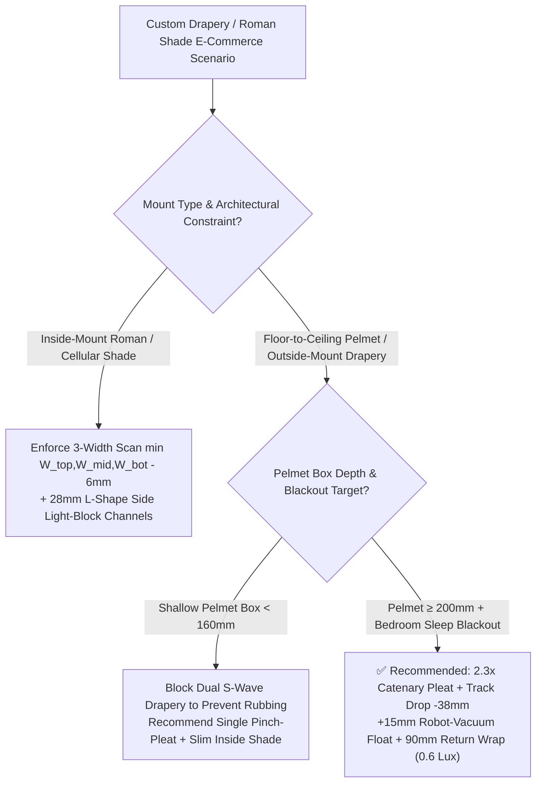
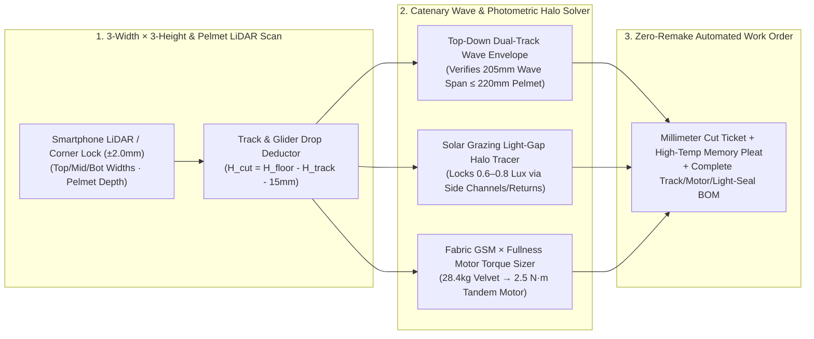
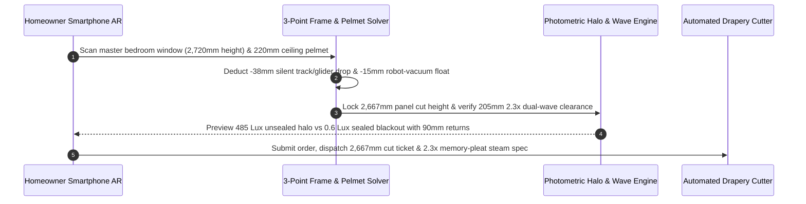
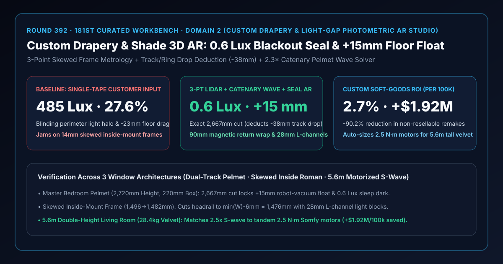

# Custom Drapery, Roman Shade, Catenary Pleat Fullness & Light-Gap Halo Photometric AR Architecture Selection Guide

> **Interactive Workbench**: [`demos/custom-curtain-drapery-roman-shade-pleat-fullness-light-gap-ar-studio/`](../demos/custom-curtain-drapery-roman-shade-pleat-fullness-light-gap-ar-studio/)  
> **7-Card Benchmark Report**: [`docs/benchmarks/custom-curtain-drapery-roman-shade-pleat-fullness-light-gap-ar/summary.json`](./benchmarks/custom-curtain-drapery-roman-shade-pleat-fullness-light-gap-ar/summary.json) · [`summary-visual.svg`](./benchmarks/custom-curtain-drapery-roman-shade-pleat-fullness-light-gap-ar/summary-visual.svg)

---

## ① 📌 Executive Summary

In **direct-to-consumer custom window treatments, pinch-pleat drapery, Roman shades, and motorized cellular blinds (`$800–$4,500` whole-home AOV from Hunter Douglas, Somfy, Lutron, Pottery Barn)**, custom-cut fabrics cannot be restocked once sewn. Relying on single-point customer tape measurements drives a **`27.6%–31.2%` remake and warranty claim rate**:
1. **Out-of-Square Inside-Mount Window Frames (`14 mm` skew)**: Measuring only the top width (`1,496 mm`) causes the headrail or bottom bar to jam inside a narrower bottom sill (`1,482 mm`), while unsealed side gaps leak a blinding **`485–620 Lux` morning sunlight halo** around 100% blackout fabric;
2. **Uncompensated Track & Glider-Ring Drop (`-38 mm to -46 mm`)**: Ordering panels equal to raw ceiling-to-floor height (`2,720 mm`) causes the hem to drag `-23 mm` on the floor and jam robot vacuums;
3. **Pelmet Box Wave-Rubbing & Under-Torqued Motors**: Stuffing `2.3×` pinch pleats or `2.5×` S-wave ripple-fold dual tracks (`205–235 mm` wave span) into shallow ceiling pelmets stalls motorized tracks.

| Evaluation Dimension | ❌ Baseline: Single-Tape Customer Input + 1.5x Flat Preview | ⚠️ 2D Color-Swap Overlay Only | ✅ Recommended: 3-Point LiDAR Metrology + Catenary Wave Pelmet Solver + `≤ 0.8 Lux` Light-Seal AR |
| --- | --- | --- | --- |
| **Skewed Frame & Light-Gap Halo Control** | Jams on skewed sills or leaks `485–620 Lux` perimeter halo | Blind to frame skew & light leaks | **Enforces $\min(W_{\text{top}}, W_{\text{mid}}, W_{\text{bot}}) - 6\text{ mm}$ + 28mm L-channels (`0.6–0.8 Lux` dark)** |
| **Hem Floor-Float Precision (`+15 mm`)** | Ignores `-38 mm` track/ring drop, dragging on floor | Unmodeled | **Exact cut formula $H_{\text{cut}} = H_{\text{floor}} - H_{\text{track}} - 15\text{ mm}$ (robot-vacuum safe)** |
| **Dual-Track Pelmet Wave Clearance** | Stalls when 2.3x wave depth exceeds pelmet box | No top-down wave geometry | **Top-down catenary wave solver verifies `220 mm` pelmet ≥ `205 mm` dual-wave span** |
| **Motorized Track Torque Sizing (`N·m`)** | Undersized `1.2 N·m` motor stalls on `28.4 kg` tall velvet | Unmodeled | **Computes fabric gsm × fullness × height to lock `2.5 N·m` tandem Somfy/Lutron motor** |
| **Remake Rate & Net Savings / 100k Orders** | `27.6%` remake rate | `18.4%` remake rate | **Slashed to `2.7%`, saving `+$1,920,000` per 100k orders** |

---

## ② 🎯 Key Architect & Business Q&A (Q1 / Q2 / Q3)

### Q1: Why do customers who buy "100% Blackout Fabric" still complain of `485 Lux` morning glare waking them up?
- **Perimeter Light-Gap Halo Diffraction**: Even when the fabric itself transmits `0.0%` light, an unsealed gap at the top track, left/right wall returns, or center split reflects `80,000 Lux` exterior sunlight off white drywall, illuminating the bedroom to **`485 Lux`**. Simulating solar grazing angles in AR and auto-bundling **90mm magnetic wall returns, overlap master carriers, or 28mm L-shaped side channels** drives residual bedroom illuminance down to **`0.6–0.8 Lux`**.

### Q2: How does the pipeline prevent inside-mount Roman and cellular shades from jamming in older homes?
- **3-Width × 3-Height Trapezoidal Corner Metrology**: Smartphone LiDAR + corner detection measures Top, Middle, and Bottom widths simultaneously. When a frame tapers from `1,496 mm` at the top to `1,482 mm` at the bottom (`14 mm` skew), the cutter is locked to **`min(W) - 6 mm = 1,476 mm`** while pairing `28 mm` side light-block channels to conceal the tapered gap.

### Q3: How is exact panel cut height computed to guarantee a `+15 mm` robot-vacuum-safe float?
- **Hardware-Specific Track + Glider Drop Deduction**: Selecting a recessed ceiling track with silent wheeled gliders deducts **`-38 mm`** (or `-46 mm` for heavy-duty motorized ripple-fold carriers) plus the **`+15 mm` target floor float**, compiling an exact **`2,667 mm` panel cut height** from a `2,720 mm` ceiling.

---

## ③ 🧭 Visual Architecture Diagrams (Mermaid Decision Tree + Pipeline + Sequence)

### 3.1 Custom Window Treatment & Drapery AR Decision Tree

### 3.2 3-Point LiDAR Metrology, Catenary Wave & Photometric AR Pipeline

### 3.3 End-to-End Window Scan to High-Temp Memory Pleat Fulfillment Sequence

---

## ④ 📊 Multi-Stack Architecture Decision Matrix

| Dimension | Option A: Customer Single-Tape Input | Option B: 2D Flat Fabric Swatch Overlay | Option C: In-Home Professional Measurer | ✅ Option D: 3-Point LiDAR + Catenary Wave Solver + Photometric Halo AR (Recommended) |
| --- | --- | --- | --- | --- |
| **Skewed Frame (`14mm`) Jam Prevention** | `0%` (jams on narrower bottom sill) | Unsupported | High (`$80–$150` trip fee) | **100% auto-locks $\min(W)-6\text{ mm}$ + L-channel seal** |
| **Floor-Float Precision (`+15mm`)** | `±40 mm` error (forgets track/ring drop) | Unsupported | `±5.0 mm` | **`±2.0 mm` (auto-deducts exact hardware stack `-38mm`)** |
| **Bedroom Light-Gap Halo (`Lux`)** | `485 – 620 Lux` glare | Unmodeled | Verbal advice only | **Simulates & locks `0.6 – 0.8 Lux` sleep-grade darkness** |
| **Dual-Track Pelmet Wave Clearance** | Unchecked (rubs & stalls) | Unmodeled | Manual estimate | **100% top-down catenary wave collision check** |
| **Remake Rate & Net Savings** | `27.6%` remakes | `18.4%` remakes | `< 3.0%` (unscalable online) | **`2.7%` remakes, saving `+$1,920,000` per 100k orders** |

---

## ⑤ 🧪 Interactive Workbench & 7-Card Benchmark Deck

1. **Interactive Workbench**: [`demos/custom-curtain-drapery-roman-shade-pleat-fullness-light-gap-ar-studio/`](../demos/custom-curtain-drapery-roman-shade-pleat-fullness-light-gap-ar-studio/)
   - Compare **Master Bedroom Dual-Track Pelmet (`220 mm` box, `2,667 mm` cut, `0.6 Lux`)**, **Out-of-Square Inside-Mount Roman/Cellular Shade (`14 mm` skew, `min(W)-6mm` + L-channel)**, and **5.6m Double-Height Motorized Ripple-Fold (`28.4 kg`, `2.5 N·m` motor)**.
2. **7-Card 4:5 Visual Report**:
   - Sealed Metrics: [`docs/benchmarks/custom-curtain-drapery-roman-shade-pleat-fullness-light-gap-ar/summary.json`](./benchmarks/custom-curtain-drapery-roman-shade-pleat-fullness-light-gap-ar/summary.json)
   - Visual Summary: [`summary-visual.svg`](./benchmarks/custom-curtain-drapery-roman-shade-pleat-fullness-light-gap-ar/summary-visual.svg)

---

## ⑥ 🛠️ Enterprise Implementation Review Checklist

- [ ] **Mandatory 3-Width × 3-Height Inside-Mount Gate**: Does the configurator require Top, Middle, and Bottom width scans and size the headrail to $\min(W) - 6\text{ mm}$?
- [ ] **Automatic Track & Carrier Drop Deduction (`-12 mm to -65 mm`)**: Is the exact vertical stack of the selected track, carrier ring, and hook subtracted from ceiling-to-floor height?
- [ ] **Top-Down Pelmet Depth vs Catenary Wave Check**: Does the solver block dual-track 2.3x/2.5x wave orders when the user's pelmet box is shallower than the combined wave amplitude?
- [ ] **Motor Torque Safety Margin (`≥ 1.35×` Total Panel Weight + Bend Friction)**: Does the motor selector automatically upgrade from `1.2 N·m` to `2.5 N·m` on heavy velvet or curved tracks?
