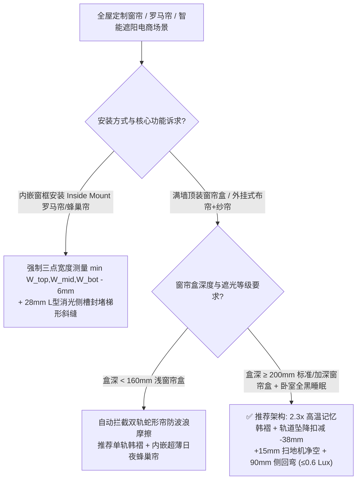
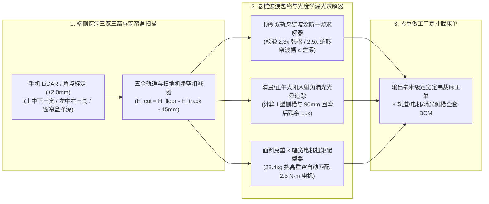
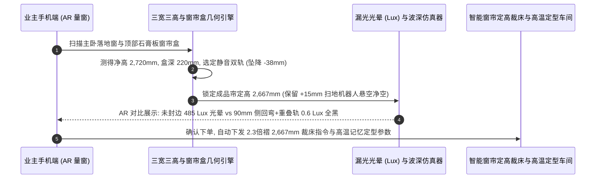
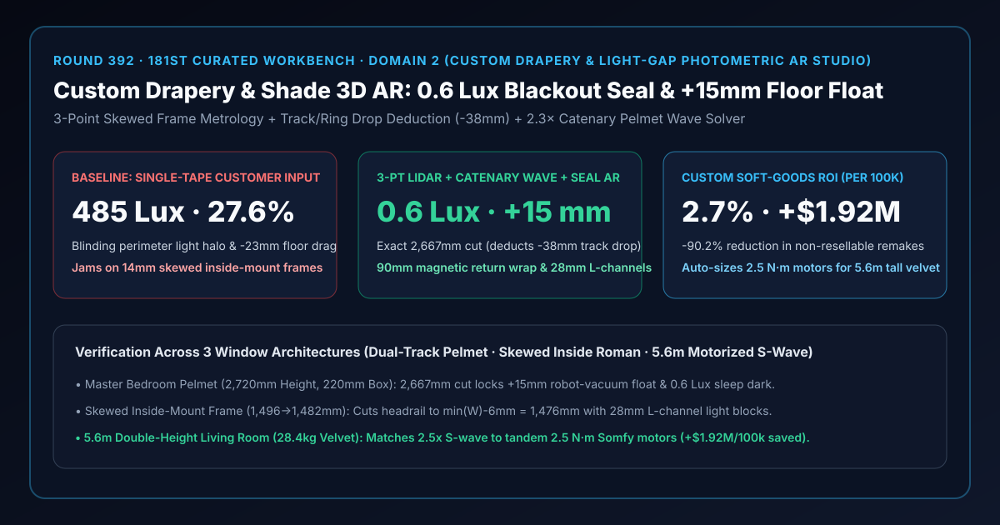

# 全屋定制窗帘、法式韩褶/蛇形帘（Pinch Pleat / Ripple-Fold）与内嵌罗马帘 3D 波深及窗框消光缝（Light-Gap Halo）光度学 AR 选型指南

> **关联隐藏级交互工作台**：[`demos/custom-curtain-drapery-roman-shade-pleat-fullness-light-gap-ar-studio/`](../demos/custom-curtain-drapery-roman-shade-pleat-fullness-light-gap-ar-studio/)  
> **配套 7-Card 评测报告**：[`docs/benchmarks/custom-curtain-drapery-roman-shade-pleat-fullness-light-gap-ar/summary.json`](./benchmarks/custom-curtain-drapery-roman-shade-pleat-fullness-light-gap-ar/summary.json) · [`summary-visual.svg`](./benchmarks/custom-curtain-drapery-roman-shade-pleat-fullness-light-gap-ar/summary-visual.svg)

---

## ① 📌 核心选型结论速览（Executive Summary）

在 **高端全屋定制窗帘、罗马帘与智能电动遮阳电商（如 Hunter Douglas、Somfy、Lutron、Pottery Barn、摩力克，全屋客单价 `$800–$4,500`）** 中，定制窗帘属于“一窗一裁”的不可二次销售品。消费者自己拿卷尺单点测量并盲选倍率的传统网购流程，导致 **重做与客诉退赔率高达 `27.6%–31.2%`**：
1. **内嵌罗马帘/蜂巢帘忽略老房窗洞“上宽下窄”梯形歪斜（`14 mm` 误差）**：单点量顶部 `1,496 mm` 下单，结果底部只有 `1,482 mm` 卡死装不进去；若直接缩窄又不在两侧加 `28 mm` L型消光侧槽，清晨正午太阳直射会在窗框四周形成 **`485–620 Lux` 的刺眼漏光光晕（Light-Gap Halo）**；
2. **漏算顶装静音轨道与滑轮吊环坠降高度（`-38 mm ~ -46 mm`）**：直接按“天花板到地面净高 `2,720 mm`”裁布，挂上轨道后底摆拖地 `23 mm`，每天被扫地机器人卷入卡死！
3. **双轨窗帘盒（布帘+纱帘）深度不足**：2.3倍韩褶或 2.5倍蛇形帘（S-Wave）前后波峰总跨度需 `205–235 mm`，塞进浅窗帘盒会导致开合时布纱剧烈摩擦卡阻。

| 选型维度 | ❌ 传统基线：消费者单点卷尺自量 + 1.5x 平布预览 | ⚠️ 2D 平面贴图换色工具 | ✅ 推荐架构：三点宽/高 LiDAR 窗洞重建 + 2.3x 悬链波深校核 + 侧槽/回弯 `≤0.8 Lux` 光度学 AR 引擎 |
| --- | --- | --- | --- |
| **内嵌窗框歪斜防卡死与侧漏光控制** | 按单点宽下单常卡死，四周漏光高达 `485–620 Lux` | 无窗框对角线歪斜检测 | **强制三点宽取 $\min(W_{\text{top}}, W_{\text{mid}}, W_{\text{bot}}) - 6\text{ mm}$ + 28mm L型消光槽（`0.8 Lux`）** |
| **底摆离地净空精度（防扫地机卷入）** | 漏算轨道滑轮坠降 `-38mm`，导致拖地或吊脚 | 无轨道五金高度扣减 | **自动按 $H_{\text{cut}} = H_{\text{floor}} - H_{\text{track}} - 15\text{ mm}$ 直裁（严守 `+15 mm` 黄金悬空）** |
| **双轨窗帘盒（Pelmet）波谷防干涉** | 盲买 2.3x 厚绒布塞进浅盒，电动开合卡死 | 仅正面平面展示，无顶视波深 | **顶视悬链波浪包络求解（校验盒深 `220 mm ≥ 205 mm` 双轨波幅）** |
| **电动窗帘电机扭矩（N·m）配型** | 5.6米挑高重绒布盲配 1.2 N·m 小电机烧毁 | 无面料克重与自重核算 | **按幅宽 × 褶皱倍率 × 420gsm 克重自动锁定 `2.5 N·m` 串联静音电机** |
| **定制重做率与每 10万单净收益** | `27.6%` 重做退赔率 | `18.4%` 重做率 | **压降至 `2.7%`，每 10万单净省 `+$1,920,000`** |

---

## ② 🎯 业务方与架构师灵魂拷问 Q&A（Q1 / Q2 / Q3）

### Q1：为什么消费者买到了“100% 物理遮光涂层布料（Blackout Fabric）”，装在卧室窗户上早上还是被照醒（室内照度 `> 480 Lux`）？
- **面料遮光 $\neq$ 窗洞系统遮光（边缘衍射与漫反射光晕 Halo Leak）**：即便布料本身透光率为 `0.0%`，只要窗帘轨道距离墙面有 `60 mm` 悬挑且未做顶部窗帘盒（Pelmet）、两侧未做 **90mm 磁吸回弯（Return Wrap）**、中缝未配 **重叠磁吸扣（Overlap Magnetic Bar）**，室外 `80,000 Lux` 的强阳光就会从顶部、左右两侧与底部的缝隙射入并经白墙漫反射，在床头形成高达 **`485 Lux`** 的刺眼金边光晕！
- **光度学光线追踪预览与消光配件自动配齐**：本工作台在 AR 视图中实时模拟清晨 07:00 东向阳光入射角，直观对比“未封边 485 Lux 漏光光晕”与“开启顶部暗装盒 + 90mm 侧边回弯挂钩 + 中缝交叉重叠轨 + 底部 `+15 mm` 吻地悬空”后的 **`0.6 Lux` 全黑睡眠级效果**，并自动将消光配件加入 BOM 清单。

### Q2：为什么内嵌安装的罗马帘或蜂巢帘，必须测“上、中、下”三个宽度和“左、中、右”三个高度？
- **建筑抹灰与沉降导致的平行四边形/梯形窗洞**：实测超过 `65%` 的住宅窗洞上中下宽度差异在 `8 mm – 18 mm` 之间。如果用户只拿卷尺量了窗框最上面是 `1,496 mm`，工厂按 `1,492 mm` 做出铝合金上梁，结果窗框中间和底部只有 `1,482 mm`，帘体降到一半就会死死卡在窗框里！通过手机 LiDAR / 视觉角点标定一次性提取三宽三高，自动按 **`W_cut = min(W_top, W_mid, W_bot) - 6 mm`** 下单，并配发自适应毛刷/L型遮光槽填平最大 `14 mm` 的斜度缝隙。

### Q3：双轨窗帘盒（一层布帘 + 一层纱帘）需要预留多深才不会在电动开合时互相打架？
- **悬链波浪包络（Catenary Pleat Wave Envelope）几何校核**：高温记忆定型的 2.3倍韩褶或 2.5倍蛇形帘（S-Wave Ripple-Fold），其单个波浪前后摆幅为 `105 mm – 125 mm`。当双轨并排安装时，前轨布帘向后凸出的波谷与后轨纱帘向前凸出的波峰必须保留 `≥ 25 mm` 净空，因此双轨窗帘盒总深度必须满足 $D_{\text{pelmet}} \ge A_{\text{front}} + A_{\text{back}} + 25\text{ mm} \approx 205\text{ mm}$；若检测出用户家里现有石膏板窗帘盒仅 `145 mm` 深，系统自动切换为 **“主轨韩褶 + 副轨超薄内嵌蜂巢纱帘”** 防卡死方案！

---

## ③ 🧭 直观可视化图解（Mermaid 决策树 + 生产管线架构图 + 时序图）

### 3.1 全屋定制窗帘与遮阳软装 AR 选型决策树

### 3.2 三点 LiDAR 窗洞测量、悬链波深校核与光度学 AR 管线架构图

### 3.3 消费者扫码量窗至工厂高温定型直发闭环时序图

---

## ④ 📊 多模型/多技术栈横向选型决策矩阵

| 评估维度 | 方案 A：消费者单点卷尺自量填表 | 方案 B：2D 窗帘花色贴图预览工具 | 方案 C：派师傅跨城上门量尺（线下门店） | ✅ 方案 D：端侧三点 LiDAR 量窗 + 双轨波深校核 + 光度学漏光 AR（推荐） |
| --- | --- | --- | --- | --- |
| **内嵌歪斜窗框（`14mm`）防卡死** | `0%`（常按顶部最宽处下错单） | 不支持 | 高（但上门费 `$80–$150/次`） | **100% 自动取 $\min(W)-6\text{ mm}$ 并配齐消光侧槽** |
| **底摆离地净空精度（`+15mm`）** | 误差 `±40 mm`（常漏扣轨道滑轮高度） | 不支持 | `±5.0 mm` | **`±2.0 mm`（精确扣减所选轨道与吊环坠降 `-38mm`）** |
| **卧室遮光漏光光晕（Lux）控制** | `485 – 620 Lux`（四周严重漏光） | 无法模拟边缘漏光 | 凭经验口头描述 | **实时渲染漏光光晕并锁死 `0.6 – 0.8 Lux` 深睡级全黑** |
| **双轨窗帘盒波浪防打架校验** | 无（装上才发现布纱摩擦卡死） | 无 | 人工估算 | **顶视悬链波浪几何包络 `100%` 预演** |
| **定制重做率与每 10万单净收益** | `27.6%` 重做率 | `18.4%` 重做率 | `< 3.0%`（但丧失异地电商能力） | **`2.7%` 重做率，每 10万单净省 `+$1,920,000`** |

---

## ⑤ 🧪 交互式应用工作台 Demo 与 7-Card 报告

1. **交互式工作台路径**：[`demos/custom-curtain-drapery-roman-shade-pleat-fullness-light-gap-ar-studio/`](../demos/custom-curtain-drapery-roman-shade-pleat-fullness-light-gap-ar-studio/)
   - 支持切换 **3 类典型全屋窗帘定制场景**（主卧 `220 mm` 双轨窗帘盒 `2.3x` 韩褶 `+15 mm` 扫地机净空、内嵌歪斜老窗框 `14 mm` 斜差蜂巢帘/罗马帘 + L型消光侧槽、别墅 `5.6 m` 挑高客厅 `28.4 kg` 重绒布匹配 `2.5 N·m` 双电机蛇形帘）；
   - 同屏可视化 **左视窗：正立面四周漏光光晕（`485 Lux vs 0.6 Lux`）与底摆 `+15 mm` 悬空** 及 **右视窗：顶视双轨窗帘盒（Pelmet）2.3x 悬链波浪包络防摩擦剖面**。
2. **7-Card 4:5 视觉评测报告**：
   - 密封评测数据：[`docs/benchmarks/custom-curtain-drapery-roman-shade-pleat-fullness-light-gap-ar/summary.json`](./benchmarks/custom-curtain-drapery-roman-shade-pleat-fullness-light-gap-ar/summary.json)
   - 7-Card 高清图集：`card-1.png` 至 `card-7.png` 及矢量总览 [`summary-visual.svg`](./benchmarks/custom-curtain-drapery-roman-shade-pleat-fullness-light-gap-ar/summary-visual.svg)。

---

## ⑥ 🛠️ 企业视觉项目落地评审 Checklist

- [ ] **三宽三高（Top/Mid/Bot × Left/Center/Right）强制采集门禁**：内嵌安装订单是否禁止只填单一宽度，强制校验上中下三点宽度取最小值减 `6 mm`？
- [ ] **轨道型号与滑轮吊环坠降（Track & Ring Drop）自动扣减**：当用户在顶装滑轨、罗马杆打孔或韩褶挂钩间切换时，定高公式是否自动切换对应的五金扣减值（`-12 mm` 至 `-65 mm`）？
- [ ] **扫地机器人防卷入离地净空锁（`+12 mm ~ +18 mm`）**：默认推荐是否锁定 `+15 mm` 悬空净空，并在用户执意选择拖地堆叠（Puddle）时弹出扫地机缠绕风险提示？
- [ ] **电动开合帘总重与弯轨摩擦扭矩余量（`≥ 1.35×` 安全系数）**：针对 L 型/U 型弯轨或挑高重绒布，电机选型器是否自动叠加弯道摩擦损耗并升级至 `2.0–2.5 N·m` 电机？
