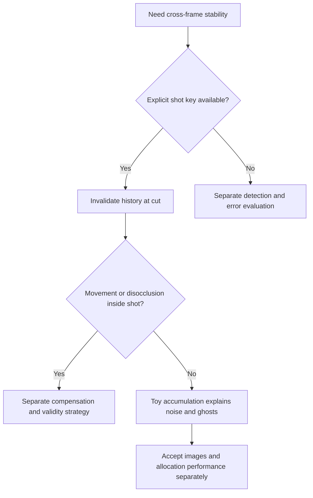
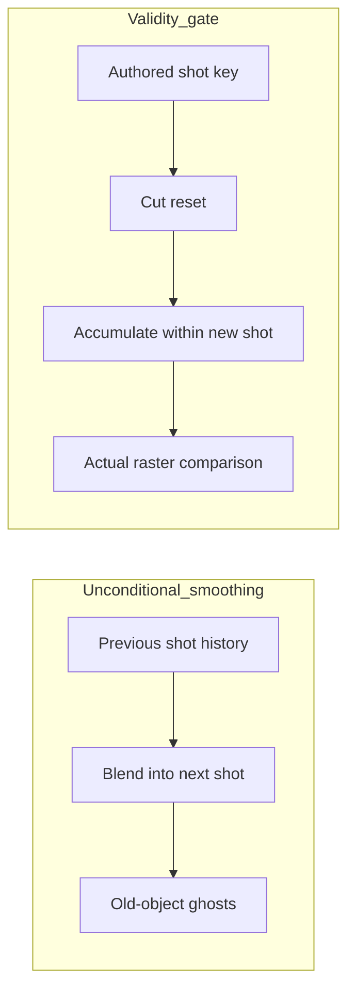
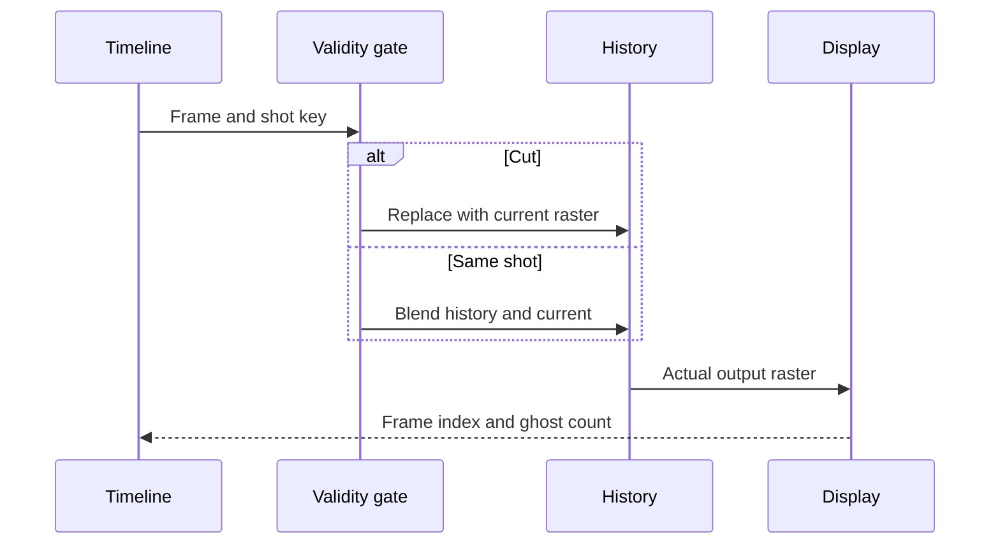

# Stable is not cross-shot smearing: temporal history invalidation FAQ

**Three minutes for ghosting; ten minutes to reproduce an explicit history gate.**

[中文](cut-aware-temporal-stability-faq.md) · [Interactive demo](https://turbo998.github.io/animation/demos/temporal-history-console/) · [Measured cards](../demos/temporal-history-console/test-report-cards.html)

## ① 📌 Executive Summary

- **History helps only while it remains valid for the current shot.** Multiframe blending can reduce noise; importing the previous shot can retain objects no longer present.
- **Reset on a known cut before accumulating again.** At frame 60 in a synthetic 48×32 raster, persistent history leaves 306 old-object pixels above the 0.35 threshold. The measured reset count is zero.
- **Authored metadata, not automatic detection.** The creator supplies the shot boundary. No neural cut detector, motion reprojection, full TAA or generated-video scoring is implemented.
- **Separate quality and performance baselines.** Visual comparison is reset versus persistent history. CPU comparison is reused versus reallocated history buffers with the same reset and exact outputs.
- **Original 59-solid console, twelve checks.** Scene/noise: `synthetic`; code/raster/Node CPU: `measured`; models/GPU/photographic quality: `not_measured`.

**Verified daily direction:** NVIDIA's July 20, 2026 SIGGRAPH material identifies preserving artistic intent, cross-frame temporal stability and realtime 4K as neural-rendering challenges. Primary text checked November 9, 2026. This small inspectable pipeline explains when history expires—not NVIDIA-model reproduction or a daily popularity ranking.

## ② 🎯 Customer and architect Q&A

### Q1 When should I choose AI video versus interactive code?

Photographic performances, materials and natural movement can favor generation. Inspecting which history frame 60 used, testing wrong shot metadata and verifying resets favors explicit code.

Use generation for appearance and code for boundaries when useful. **Temporal stability is not simply stronger smoothing.** No generated-video quality is scored here.

### Q2 Which constraints make deterministic code strictly better?

Explicit timelines, inspectable frames, mandatory reset on known cuts and output-preserving optimizations can be directly exposed and tested without inspecting model weights.

Actual movement, disocclusion and changing illumination within a shot need more validity handling or motion compensation. Static toy subjects do not solve those problems. Without shot metadata, genuine detection and error-rate evaluation are separate work.

Useful for rendering education, technical videos with shot contracts and diagnostic prototypes—not claims of complete TAA, optical flow, neural rendering or photographic denoising.

### Q3 Why does history stabilize—and sometimes corrupt—the picture?

Layer several noisy drafts of the same page: structure becomes clearer and random speckles weaken. Turn the page while retaining the previous draft, and old text persists.

This prototype retains 90% history and adds 10% current grayscale signal. The first shot has a left rectangle; the next has a right rectangle. Without invalidation, the left object slowly fades instead of being absent at the cut.

A known shot-key change replaces history with the current raster, then resumes accumulation. **This does not infer cuts from pixels.** There are no motion vectors, optical flow or calibrated cameras.

Reusing history buffers reduces repeated output allocation, but current source rasters still allocate—this is not allocation-free. Both performance paths reset, avoiding a speed comparison between differently correct images.

### Q4 How can I reproduce it in ten minutes?

1. Run `npm run dev`, open `/demos/temporal-history-console/` and inspect frame 60.
2. Left is current input, middle reset and right persistent history. Actual left/middle PNGs match; right retains the old object.
3. At frame 59 both history policies match. The old object is genuinely present, so ghost metrics are explicitly inapplicable, not filled with zero.
4. Move the authored cut to 70 and inspect frame 70. Metadata drives the gate; there is no detection.
5. Cut0 is visibly rejected. Export actual rasters as `TEMPORAL_HISTORY.json`.
6. Run `npx vitest run tests\temporal-history.test.ts`; after build/preview at 4335 run `node scripts\benchmark-temporal-history.mjs`.

## ③ 🧭 Visual explanations

## ④ 📊 Architect Decision Matrix

| Requirement | Unconditional accumulation | Known-cut reset | Full motion compensation | Neural video |
| --- | --- | --- | --- | --- |
| No old subject at explicit cut | Ghosts here | Testable with correct metadata | Still needs boundary rules | Evaluate separately |
| Within-shot motion/occlusion | Insufficient | Not solved here | Appropriate but complex | Test quality/consistency |
| Exact revisits | Preserve order/state | Rebuild from zero here | Pipeline/cache-dependent | Model conditions matter |
| Automatic cut detection | Absent | Absent | Not necessarily included | Do not assume it |
| Allocation optimization | Not a quality fix | Independent comparison possible | Implementation-dependent | Cannot borrow this CPU score |

**Raster example:** 48×32 is 1,536 synthetic pixels, with a 306-pixel old-subject region. Persistent history puts those pixels above an arbitrary 0.35 intensity threshold at the cut. This is not a human silhouette, real-video metric or model accuracy.

## ⑤ 🧪 New demo and measured findings, including seven cards

The [sealed report](../demos/temporal-history-console/report.json) records actual arrays, screen-PNG equality, authored reset and reverse visits. Twelve local checks do not certify photographic quality.

| Raster / 120-frame reconstruction | Reused history median | Reallocated history median |
| --- | --- | --- |
| 16×12 | 0.364 ms | 0.429 ms |
| 48×32 | 1.300 ms | 1.930 ms |
| 96×64 | 4.186 ms | 7.256 ms |

Seven alternating warmed Node CPU runs per path, identical cut policy and exact pixel outputs. This excludes browser drawing, GPU, models and display latency; source rasters still allocate. Persistent-history quality comparison is not the performance baseline.

[English cards](../demos/temporal-history-console/test-report-cards.html) · [中文七卡](../demos/temporal-history-console/test-report-cards.zh.html). Known cuts are not inferred detections; unexecuted capabilities stay `not_measured`.

## ⑥ 🛠️ Architect Checklist

- [ ] Define the shot key and history's valid time range.
- [ ] Specify invalidation on cuts, dimensions and pipeline changes.
- [ ] Do not call supplied metadata automatic detection.
- [ ] Address within-shot motion, occlusion and light changes separately.
- [ ] Separate quality and performance baselines.
- [ ] Require exact optimized/reference output, not just faster timing.
- [ ] Mark pre-cut ghost metrics inapplicable instead of zero.
- [ ] Retain noise rules, frame indices, thresholds and input ranges.
- [ ] Check reduced motion, offscreen freezing, invalid contracts and exports.
- [ ] Accept toy rasters, GPU rendering and model quality separately.

**Primary source:** [NVIDIA SIGGRAPH 2026](https://blogs.nvidia.com/blog/siggraph-news-2026/), July 20, 2026 official neural-rendering intent/stability/realtime-4K challenges; checked November 9, 2026. This prototype explains history validity, not NVIDIA-model reproduction or vendor metrics.
