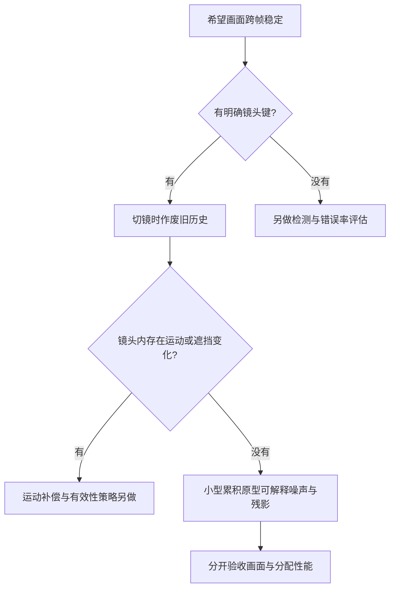
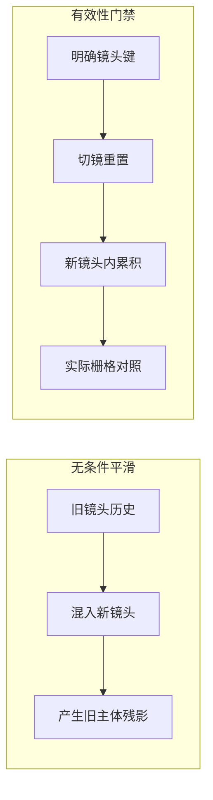
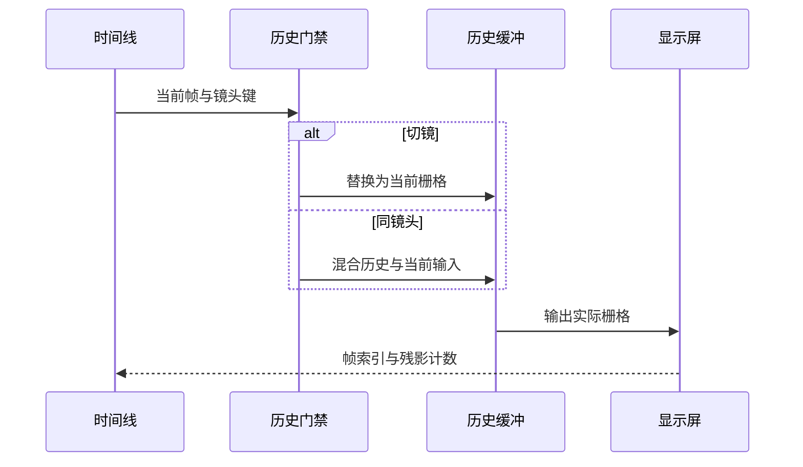

# 稳定不是跨镜头糊在一起：切镜历史重置与时序管线选型 FAQ

**3 分钟看懂残影来源，10 分钟复刻历史有效性门禁。**

[English](cut-aware-temporal-stability-faq.en.md) · [交互 Demo](https://turbo998.github.io/animation/demos/temporal-history-console/) · [中文七卡](../demos/temporal-history-console/test-report-cards.zh.html)

## ① 📌 核心结论速览

- **旧帧有用，前提是仍属于当前镜头。** 多帧混合能缓和噪声，但把前一镜头混入下一镜头会产生不存在的旧主体残影。
- **已知切镜时，先重置再继续累积。** 本例 48×32 合成灰度栅格，在第 60 帧切镜；不重置产生 306 个旧主体像素超过 0.35 阈值，重置后实测为 0。
- **这是明确时间线元数据，不是自动检测。** 镜头键由创作者提供。没有神经切镜检测、运动矢量重投影、完整 TAA 或生成模型画质评分。
- **质量基线与性能基线是两套比较。** 画面比较重置/不重置；CPU 比较同样重置的复用/重分配历史缓冲，两条计时路径输出精确相同。
- **59 实体原创控制台，12 项验收。** 示意场景与噪声 `synthetic`；代码、栅格与 Node CPU `measured`；模型/GPU/摄影画质 `not_measured`。

**每日能力方向核验：** NVIDIA 在 2026-07-20 SIGGRAPH 官方材料中明确将保持创作意图、跨帧时序稳定与实时 4K 作为神经渲染研究挑战。2026-11-09 核验一手材料。本轮以可检查的小型管线解释“历史什么时候该作废”，没有复现 NVIDIA 神经渲染或今天热度排名。

## ② 🎯 客户与架构师灵魂拷问 Q&A

### Q1 何时选 AI 视频大模型，何时选代码交互动画？

摄影级人物、材质和自然运动适合评估生成视频。想要检查第 60 帧用了哪份历史、比较镜头元数据错误、自动验证重置规则，则显式代码管线更便于交互与定位。

可以用生成技术做外观，用代码管理镜头边界与验收。**“时序稳定”不能只等同于更强的平滑。** 本例不测生成视频质量。

### Q2 什么约束下代码驱动严格更优？

当合同要求明确时间线、可重访帧、已知切镜必须重置、优化不能改变结果，代码可以直接暴露并测试这些规则。无需知道模型内部权重。

但真实镜头内的物体运动、遮挡变化与光照变化，需要运动补偿或其他历史有效性处理；我们的静态主体玩具输入并未解决。没有明确镜头元数据时，还需真正的检测与评估，而不是假装这个门禁会自动知道切镜。

适合 SA 的渲染原理教学、带分镜元数据的技术视频、故障定位工具原型。不适合声称完整 TAA、光流、神经渲染或摄影级去噪。

### Q3 多帧历史为什么会稳，也为什么会错？

像把同一页上的多张有噪声草稿叠起来看：一致结构更清楚，随机斑点相互缓和。问题是翻到了下一页还叠着上一页，旧文字也会残留。

本例每帧保留 90% 历史、加入 10% 当前灰度信号。第一镜的矩形在左，切镜后新的矩形在右。如果不作废历史，左侧矩形会慢慢消退，而不是马上不存在。

已知镜头键变化时直接用当前栅格替换历史，再在新镜头内累积。**这不是从像素猜切镜**；已知事件是外部契约。也没有运动矢量、光流或真实相机标定。

复用缓冲减少历史输出的重复分配，但当前源栅格仍然分配；不能宣传“零分配”。性能比较两条都重置，避免把“更快但错了”的不同质量路径混成一张速度图。

### Q4 十分钟如何复刻？

1. `npm run dev` 后打开 `/demos/temporal-history-console/`，查看第 60 帧。
2. 左屏是当前输入，中屏是切镜重置，右屏是不重置历史；左/中实际 PNG 相同，右屏有旧主体残影。
3. 查看第 59 帧，两条历史相同。此时旧主体确实存在，“残影指标”应标不适用，不能填零误导。
4. 把切镜改到 70，查看第 70 帧；门禁跟随明确元数据，不是自动检测。
5. 输入切镜 0，应明确拒绝并保留有效参数。导出 `TEMPORAL_HISTORY.json` 留下实际栅格。
6. 执行 `npx vitest run tests\temporal-history.test.ts`；构建并在 4335 预览后执行 `node scripts\benchmark-temporal-history.mjs`。

## ③ 🧭 直观可视化图解

## ④ 📊 Architect Decision Matrix

| 要求 | 无条件累积 | 已知切镜重置 | 完整运动补偿 | 神经视频生成 |
| --- | --- | --- | --- | --- |
| 明确切镜无旧主体 | 本例产生残影 | 元数据正确时可验收 | 仍需镜头边界规则 | 单独评估 |
| 镜头内运动与遮挡 | 不够 | 本例未解决 | 合适但复杂 | 需质量与一致性验证 |
| 精确状态重访 | 需保留访问顺序 | 本例从帧零重建 | 依缓存与管线 | 模型条件决定 |
| 自动切镜检测 | 没有 | 没有 | 不一定包含 | 不能默认具备 |
| 分配成本优化 | 不是质量修复 | 可独立比较 | 依实现 | 不能借用本例 CPU 数据 |

**栅格算例：** 48×32 共 1,536 个合成像素；本例旧主体区域 306 个像素。切镜后不重置时，这 306 个像素高于 0.35 的任意强度阈值。它不是人体轮廓、视频真实像素指标或模型准确率。

## ⑤ 🧪 全新 Demo 与 Benchmark 核心发现（含 7-Card）

[封存数据](../demos/temporal-history-console/report.json)记录实际灰度数组、屏幕 PNG 一致性、已知切镜重置与逆序重访。12 项本机检查不是摄影画质认证。

| 栅格 / 重建 120 帧 | 复用历史缓冲中位数 | 重分配历史缓冲中位数 |
| --- | --- | --- |
| 16×12 | 0.364 ms | 0.429 ms |
| 48×32 | 1.300 ms | 1.930 ms |
| 96×64 | 4.186 ms | 7.256 ms |

每路径预热后交替七次 Node CPU 测量，两条都在同一切镜重置，输出逐值相同。这里没有浏览器绘制、GPU、神经模型或屏幕时延；源栅格仍有分配。质量“不重置”基线不参与这张性能表。

[中文七卡](../demos/temporal-history-console/test-report-cards.zh.html) · [English](../demos/temporal-history-console/test-report-cards.html)。已知切镜不等于检测成功；未测能力保持 `not_measured`。

## ⑥ 🛠️ Architect Checklist

- [ ] 明确历史适用的镜头键与时间范围。
- [ ] 切镜、尺寸变化或管线配置变化时定义作废规则。
- [ ] 不把提供的切镜元数据称为自动检测。
- [ ] 镜头内运动、遮挡与光照变化另做有效性策略。
- [ ] 分开质量基线与性能基线。
- [ ] 优化前后输出逐项相同，不仅比较耗时。
- [ ] 切镜前指标不适用时明确标注，不填零。
- [ ] 保存种子/噪声规则、帧索引、阈值与输入范围。
- [ ] 检查减少动态、离屏停帧、非法参数与导出。
- [ ] 本机玩具栅格、GPU渲染与模型画质分别验收。

**一手来源：** [NVIDIA SIGGRAPH 2026](https://blogs.nvidia.com/blog/siggraph-news-2026/)，2026-07-20 官方材料说明神经渲染的创作意图、时序稳定与实时 4K 研究挑战；2026-11-09 核验。本例仅解释历史有效性基础，不复现其神经实现或借用厂商指标。
