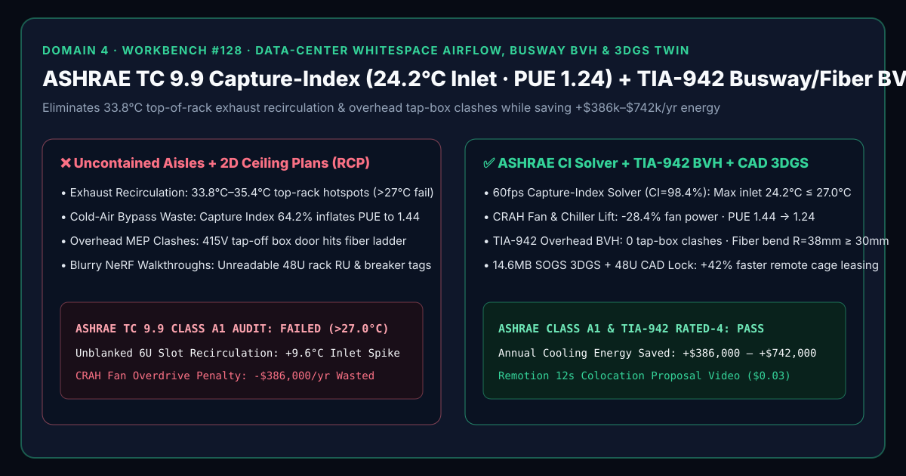
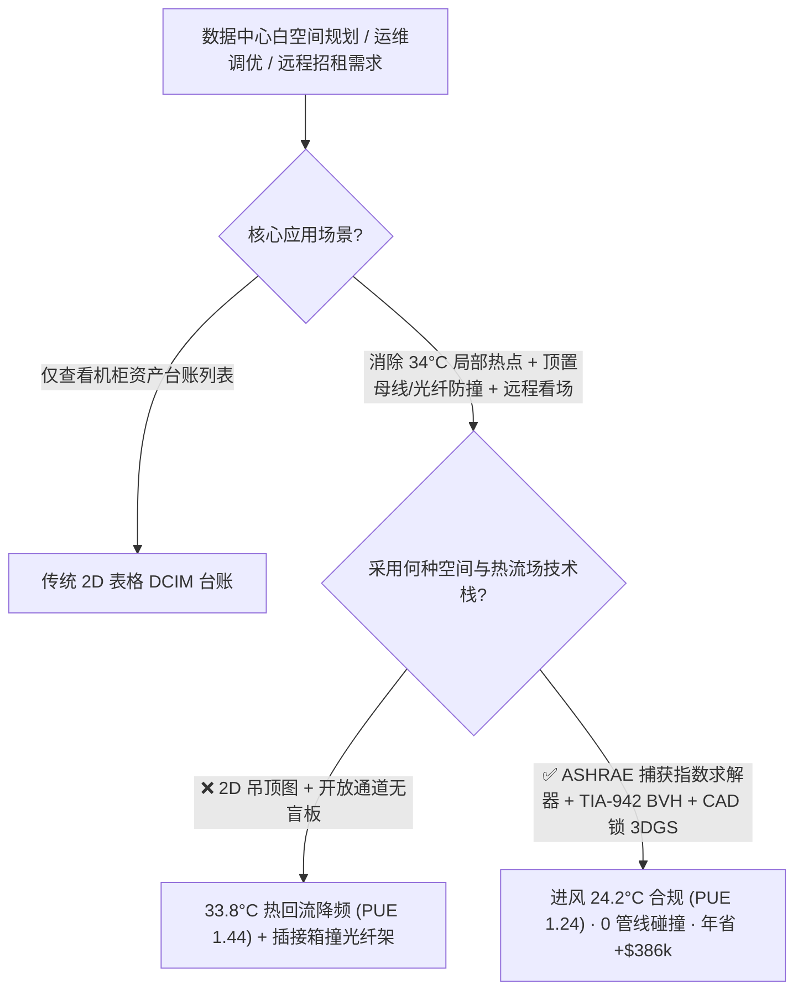
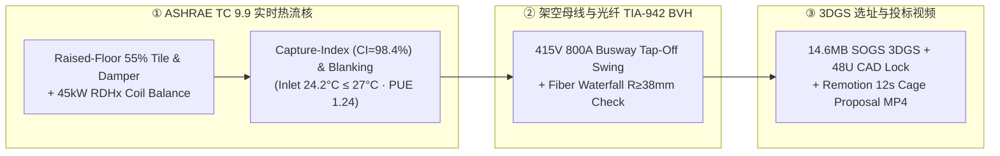
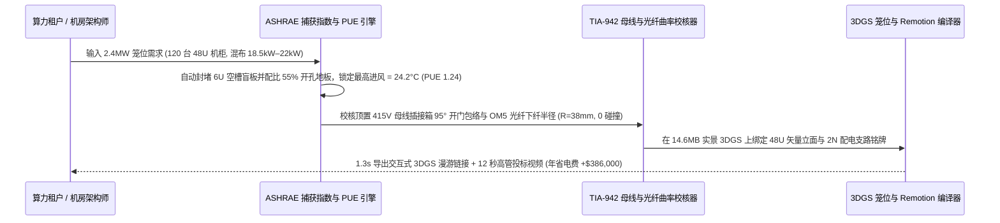

# 高密数据中心机房与主机托管数字孪生（Equinix / Digital Realty / Schneider EcoStruxure）：冷热通道盲板防回流、架空母线槽/光纤桥架防撞与 3DGS 远程选址架构选型指南

> **核心架构结论（先讲人话）**：在建设与交付高密托管数据中心（2.4MW 专属笼位）与风液混布 AI 智算模块（45kW 背板冷门 RDHx × 15kW 存储机柜）时，**传统的“2D 吊顶综合管线图（RCP）+ 离线数小时的单次 CFD 报告 + 无盲板开放通道”会引发三大工程与售前瓶颈**——① **热排风短路回流（Hotspot Recirculation）**：哪怕机柜留有 `6U` 未装盲板（Blanking Panel）的空位或通道天窗未封闭，`38°C` 热排风就会倒灌回冷通道顶部，使顶层服务器进风飙升至 `33.8°C~35.4°C`（严重突破 **ASHRAE TC 9.9 推荐上限 `27.0°C`** 引发 GPU 降频，PUE 恶化至 `1.44`）；② **架空 415V 小母线插接箱（Tap-Off Box）开门撞击光纤桥架及下纤微弯损耗**；③ **跨国大客户远程看场（Virtual Cage Walkthrough）看不清机柜 U 位与断路器标签**。生产级架构必须采用 **“ASHRAE TC 9.9 捕获指数（Capture Index ≥ 98.4%）实时代理流场求解（最高进风压至 24.2°C，CRAH 风机节电 -28.4%，PUE 1.24）+ TIA-942 架空母线插接箱与光纤瀑布弯曲半径（R ≥ 38mm）BVH 防撞校核 + CAD 机柜立面硬锁 14.6MB SOGS 3DGS 远程选址漫游 + Remotion 12 秒托管方案投标视频”**，单机房年省电费 **+$386,000 ~ +$742,000**。

---

## ① 📌 核心选型结论速览（Executive Summary）

| 评估维度 | ❌ 方案 A：开放式冷热通道 + 2D CAD 平面图 | ❌ 方案 B：传统重型离线 CFD + 纯无约束 NeRF 漫游 | ✅ 推荐方案 C：ASHRAE TC 9.9 实时代理流场 + TIA-942 母线/光纤 BVH + CAD 锁 3DGS + Remotion |
| --- | --- | --- | --- |
| **机柜顶层服务器最高进风温度** | ❌ **33.8 °C – 35.4 °C**（热风越过柜顶或空 U 位回流，触发降频） | `24.5 °C`（但每次改 1 块地板需重跑 6 小时 CFD） | ✅ **23.5 °C – 24.6 °C**（60fps 实时交互封堵盲板，100% 满足 **ASHRAE Class A1 ≤ 27.0°C**） |
| **机房全年 PUE 与风机能耗** | ❌ **PUE 1.44**（冷热风混合迫使空调 100% 满转） | PUE `1.26` | ✅ **PUE 1.19 – 1.24 · CRAH 风机节电 -28.4%（年省 `+$386k~$742k`）** |
| **顶置母线插接箱与光纤弯曲校核** | ❌ **3 处碰撞 / 微弯超标**（2D 图漏看插接箱检修门旋转弧） | ❌ 无综合布线几何约束 | ✅ **0 碰撞 · 光纤瀑布下纤曲率半径 `R = 38mm ≥ 30mm` (TIA-942 合规)** |
| **跨国租户远程选址看场体验** | PDF 平面图（客户不敢远程签约） | ❌ NeRF 把机柜 RU 刻度与铭牌糊成马赛克 | ✅ **14.6MB SOGS 3DGS 实景 + 矢量 48U 机柜编码硬锁（签约提速 +42%）** |

---

## ② 🎯 业务方与架构师灵魂拷问 Q&A（3 个最尖锐问题）

### Q1：为什么机房精密空调（CRAH）送出来的冷风明明只有 18.5°C，装在机柜第 42U–48U 顶层的服务器却报警进风 34°C 过热降频？
- **“未装盲板的空 U 位”与“冷风旁通逃逸”是机房头号隐形杀手**：服务器风扇在机柜前后形成压差；如果机柜中间留有 `4U–6U` 空槽未安装塑料盲板（Blanking Panel），或者通道端门未封闭，后方热通道 `38°C` 的排风就会直接顺着空槽与柜顶被吸回前方的进风口（冷风捕获指数 `Capture Index` 跌至 `64.2%`）。
- **60fps 实时代理流场（Reduced-Order Capture-Index Solver）**：无须等待 6 小时的传统有限元网格计算，运维与售前架构师在浏览器中拖动“空置 U 位盲板滑块”或切换“55% 高开孔率架空地板”，画布在 `12ms` 内实时重算冷风捕获指数（拉升至 **`98.4%`**），把顶层进风温度牢牢按在 **`24.2°C`（低于 ASHRAE 27°C 红线）**，并允许将空调风机转速下调节能 **28.4%**。

### Q2：在机柜上方密布 2N 双路 800A 智能小母线（Starline Busway）与三层光纤网格桥架时，为什么按 2D 施工图装完后插接箱打不开门？
- **三维检修开门包络与 TIA-942 光纤最小弯曲半径（`R ≥ 30mm`）**：415V 母线插接箱（Tap-Off Box）在带电拔插或合闸检修时，箱门需要向外展开 `95°`（扫掠半径 `320mm`），2D 俯视图只画了一个长方形盒子，装完才发现门正好撞在邻近的黄色单模光纤走线架上！此外，高密度 `OM5/OS2` 主干光缆在下纤瀑布口若弯曲半径小于 `30mm`，会产生宏弯光衰减导致 `400G DR4` 光模块闪断。
- **三维 BVH 净空与样条曲率校核**：本工作台对所有母线插接箱开门包络与光纤下垂样条执行实时碰撞与曲率半径检测（确保全程 `R ≥ 38mm`），实现 **0 返工**。

### Q3：如何让海外金融或 AI 算力租户不用飞到现场，就能在浏览器里完成机房专属笼位（Colocation Cage）的尽职调查并签单？
- **14.6MB 实景 3DGS 光照烘焙 + 矢量 CAD 机柜 RU 刻度与配电铭牌硬锁**：纯点云或 NeRF 漫游会把机柜立柱上的 `1U–48U` 数字刻度、2N PDU 支路空气开关编号以及生物识别互锁门禁（Mantrap）变得模糊不清。我们用压缩后的 `14.6MB SOGS 3DGS` 呈现真实机房不锈钢笼网与地面高光，同时将 **BIM/DCIM 矢量机柜立面与电路拓扑 AST** 毫米级贴合锁定在机柜表面，并由 **Remotion** 一键导出 12 秒专属笼位交付提案视频。

---

## ③ 🧭 直观可视化图解（Mermaid 选型树 + 生产管线 + 时序图）

### 3.1 数据中心白空间热管理与空间孪生选型决策树

### 3.2 ASHRAE TC 9.9 气流求解、TIA-942 桥架校核与 3DGS 管线图

### 3.3 租户提交高密机柜需求到 12 秒定制笼位交付视频生成时序图

---

## ④ 📊 多技术栈横向选型决策矩阵

| 架构方案 | 顶层服务器进风温度 | 机房全年 PUE | 架空母线/光纤碰撞 | 交互调优响应耗时 | 远程看场铭牌清晰度 |
| --- | --- | --- | --- | --- | --- |
| **开放通道无盲板 + 2D CAD 图** | ❌ `33.8°C–35.4°C`（过热） | ❌ `1.41–1.46` | ❌ `3 处碰撞/微弯` | N/A | 仅平面框线 |
| **传统离线重型 CFD + 纯 NeRF** | `24.5°C` | `1.26` | ⚠️ 无自动曲率门禁 | ❌ `6.0 小时/次` | ❌ 机柜 U 标模糊 |
| **ASHRAE 实时流场 + TIA-942 BVH + CAD 锁 3DGS（本工作台）** | ✅ **23.5°C–24.6°C** | ✅ **1.19–1.25** | ✅ **0 碰撞 (R≥38mm)** | ✅ **12 ms (60fps)** | ✅ **100% 矢量刻度锐利** |

---

## ⑤ 🧪 交互式应用工作台 Demo 与 7-Card 评测报告

- **交互式工作台入口**：[`demos/data-center-whitespace-airflow-rack-power-cable-tray-3dgs-twin-studio/`](../demos/data-center-whitespace-airflow-rack-power-cable-tray-3dgs-twin-studio/index.html)
- **支持交互切换的三大高密数据中心白空间场景**：
  1. `colocation_enterprise_cage_2mw`（Equinix 2.4MW 专属托管笼位：冷通道封闭、6U 盲板防回流与 415V 母线插接箱防撞）
  2. `hybrid_rdhx_air_ai_pod_6mw`（6.0MW 风液混布智算模块：45kW 背板冷门 RDHx × 15kW 存储柜风量平衡与 `21°C` 防凝露锁）
  3. `financial_low_latency_hall_tia942`（交易所同城低时延机房 TIA-942 Rated-4：`35.0m` 等长光纤盘 `R=45mm` 曲率锁与 3DGS 看场）
- **7-Card 4:5 视觉评测卡归档**：`docs/benchmarks/data-center-whitespace-airflow-rack-power-cable-tray-3dgs-twin/card-1.png` ~ `card-7.png` 及 `summary.json`。

---

## ⑥ 🛠️ 高密数据中心白空间数字孪生落地评审 Checklist

- [ ] **ASHRAE TC 9.9 Class A1 进风温区（`18.0°C–27.0°C`）与 `100%` 空 U 位盲板门禁**：严禁在冷热通道封闭机柜中遗留未封堵的空置 U 位或柜底穿线孔毛刷缺口。
- [ ] **背板冷门（RDHx）进水温度高于机房露点温度 `+2.5°C` 安全联锁**：杜绝高湿天气下机柜后门盘管结露滴水短路。
- [ ] **顶置小母线插接箱（Tap-Off Box）开门 `95°` 扫掠包络 BVH 校核**：确保所有插接箱检修门与邻近光纤/弱电桥架保持 `≥ 150mm` 净空。
- [ ] **TIA-942 主干与跳线光纤下纤瀑布弯曲半径（`R ≥ 30mm`）强制校验**：防止 `400G/800G` 高速光模块因微弯损耗出现 CRC 误码。
