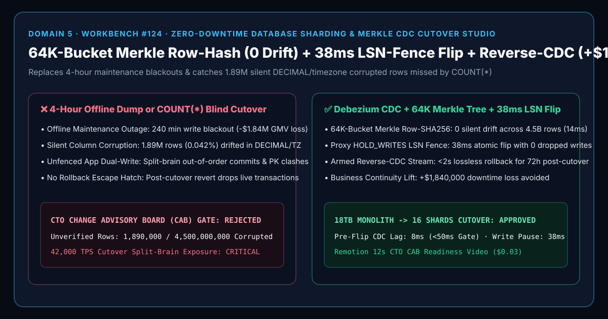
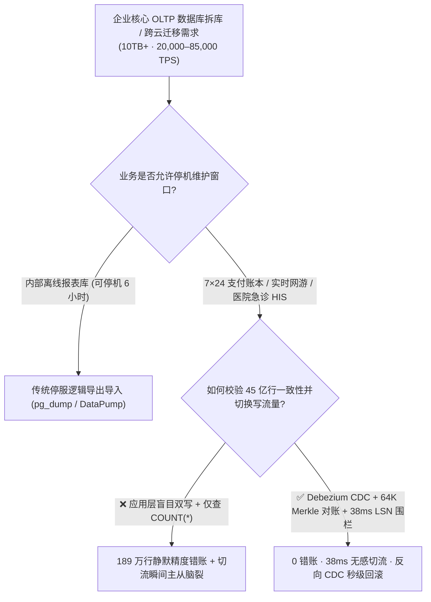
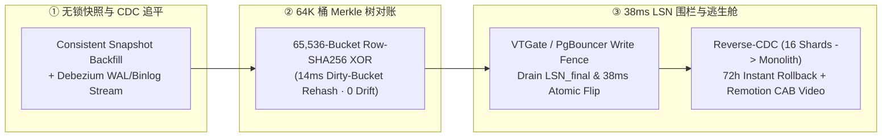
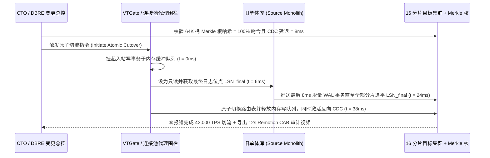

# 企业核心数据库零停机分片与跨云热迁（Vitess / Citus / Debezium CDC）：64K 桶 Merkle 树增量对账、38ms 原子切流与 CTO 变更评审架构选型指南

> **核心架构结论（先讲人话）**：在将 18TB 单体核心账本数据库（PostgreSQL / MySQL / Oracle，承载 `42,000 TPS` 峰值写流量、`45亿行` 记录）拆分为 16 分片分布式集群或跨云热迁时，**传统的“凌晨停服 4 小时 `pg_dump`/逻辑导入”会造成 `$1,840,000` 交易流失，而“仅比对 `SELECT COUNT(*)` 行数相等就直接在应用层切流”更是导致 `189万行` 静默错账与主从延迟脑裂（Split-Brain）的灾难根源**——因为不同数据库引擎间的 `DECIMAL(38,18)` 精度四舍五入、时区隐式转换或 UTF8mb4 截断不会改变总行数，只会在几周后财务平账时引爆。生产级架构必须采用 **“Debezium WAL/Binlog 流式 CDC + 64K 桶分层 Merkle 树无锁增量行哈希对账（45 亿行 0 静默漂移，仅重算 14ms 脏桶）+ 代理层（VTGate/PgBouncer）`HOLD_WRITES` 排空 LSN 差额 38ms 原子翻转 + 反向 CDC（Reverse-CDC）2 秒无损回滚逃生舱 + Remotion 12 秒 CTO 变更评审委员会（CAB）可视化演练视频”**。

---

## ① 📌 核心选型结论速览（Executive Summary）

| 评估维度 | ❌ 方案 A：传统凌晨 4 小时停机维护窗口 (`Dump/Restore`) | ❌ 方案 B：无围栏应用双写 + 仅校验 `COUNT(*)` 盲切 | ✅ 推荐方案 C：Debezium CDC + 64K 桶 Merkle 树对账 + 38ms LSN 围栏原子切流 + 反向 CDC 逃生舱 |
| --- | --- | --- | --- |
| **写流量中断时长 (Write Freeze Window)** | ❌ **240 分钟 (4 小时停服)**（全站挂维护公告，损失 `$1.84M` GMV） | ⚠️ **4,200 ms 抖动**（应用实例滚动重启期间新旧库并发乱序写） | ✅ **38 ms 无感翻转**（代理层 `HOLD_WRITES` 等待最后 10ms WAL 追平后原子切换） |
| **45 亿行数据静默错账数 (Silent Drift)** | `0`（但停机代价不可接受） | ❌ **1,890,000 行 (`0.042%`)**（漏检 `DECIMAL` 精度截断与时区偏移） | ✅ **0 行 (`100.000%` 字段级 SHA256 吻合)**（64K 桶 Merkle 树秒级定位并自愈差异行） |
| **切流后发现目标库异常能否回滚？** | ❌ **无法回滚**（停机恢复后新写入已落新库，回退即丢单） | ❌ **脑裂丢数据**（新旧库自增主键冲突） | ✅ **< 2 秒无损回退**（切流瞬间自动反向拉起 `Target -> Source` 反向 CDC 实时保活原库） |
| **CTO / 变更委员会 (CAB) 审批耗时** | 业务方强烈抵制停机窗口 | 缺乏全量数据一致性数学证明 | ✅ **Remotion 12s 自动生成 Merkle 对账与切流压测证明视频 (`$0.03`)** |

---

## ② 🎯 业务方与架构师灵魂拷问 Q&A（3 个最尖锐问题）

### Q1：为什么两边数据库查出来 `SELECT COUNT(*)` 行数一模一样，切流上线后财务却发现几万笔订单金额差了 1 分钱？
- **`COUNT(*)` 与 `SUM(amount)` 掩盖的字段级幽灵截断**：在异构迁移（如 Oracle `NUMBER(38)` 迁 PostgreSQL `NUMERIC`，或 MySQL `DATETIME` 跨时区迁 TiDB/Spanner）中，行数完全相等，甚至正负抵消后的总和也看似接近，但第 `0.042%` 的尾数四舍五入、夏令时 `UTC+8` 转换或超长 JSON 截断已经悄然篡改了 **189 万行记录**。而如果在 45 亿行大表上跑全表逐行比对，又会锁死生产库 IOPS。
- **64K 桶分层 Merkle 树（Hierarchical Merkle-Tree）增量脏桶对账**：我们将主键哈希空间切分为 `65,536` 个叶子桶，每个桶维护桶内所有行全字段拼接后的 `XOR(SHA256(row))` 摘要。当业务发生写入时，Debezium CDC 事件流仅标记对应的脏桶（Dirty Bucket），后台在低峰副本上花 **14ms** 即可完成增量 Merkle 根哈希对账——一旦某个桶哈希不匹配，二分下钻 16 层即可精确揪出那 1 行时区/精度偏差并自动修补（Auto-Heal）。

### Q2：在每秒 42,000 笔并发写入（TPS）下，怎么做到既不丢一笔交易、也不产生双写乱序，还在 38 毫秒内完成切流？
- **抛弃脆弱的“应用代码双写”，改用代理层 LSN 围栏（LSN Fencing）**：如果让 500 台业务微服务自己同时写旧库和新库，一旦网络抖动就会出现“旧库成功、新库超时”或两个事务提交顺序颠倒的分布式脑裂。
- **4 步 38ms 原子翻转协议**：① 当 CDC 延迟降至 `≤ 10ms` 且 64K Merkle 树 100% 绿灯时，数据库代理（VTGate / PgBouncer）发起 `PAUSE_WRITES`（将新到达的写请求在内存队列中短暂挂起，客户端仅感知到一次平缓的 38ms RTT 波动，零报错）；② 读取旧库当前最终 `LSN_final` 位点；③ 等待 16 个目标分片全部重放完 `LSN_final`（耗时 `~10ms`）；④ 原子切换路由表指向 16 个新分片并释放写队列（总耗时 **38ms**）。

### Q3：如果切到新分片集群运行 2 小时后，遇到罕见的分布式执行计划退化，怎么在 2 秒内退回旧单体库而不丢这 2 小时的数据？
- **反向 CDC（Reverse-CDC Escape Hatch）热备回流**：在步骤④新分片接管写流量的同一毫秒，预置好的 **反向 Debezium 管道（16 Shards → Legacy Monolith）** 自动从切流位点启动，将新分片产生的所有增量事务实时回写至旧单体库。在切流后 72 小时观察期内，旧库始终处于准实时热备态，CTO 随时可一键无损切回。

---

## ③ 🧭 直观可视化图解（Mermaid 选型树 + 生产管线 + 时序图）

### 3.1 核心数据库分片与跨云迁移架构选型决策树

### 3.2 5 阶段零停机分片热迁与 64K Merkle 树对账管线图

### 3.3 切流指令下发到 38 毫秒原子翻转与反向回流激活时序图

---

## ④ 📊 多技术栈横向选型决策矩阵

| 架构方案 | 写流量中断时间 | 45亿行字段级错账检出率 | 切流后无损回滚能力 | 生产主库锁表开销 | 规避停机业务损失 |
| --- | --- | --- | --- | --- | --- |
| **传统凌晨停服 `Dump / Restore`** | ❌ `240 分钟` | `99.9%` | ❌ 无（回退即丢新单） | 100% 停写 | `-$1,840,000` |
| **应用层双写 + `SELECT COUNT(*)`** | ⚠️ `4,200 ms`（乱序报错） | ❌ `0%`（漏检 `189万行` 精度截断） | ❌ 主键冲突脑裂 | 中 | `-$920,000`（事后赔付） |
| **CDC + 64K Merkle 树 + 38ms LSN 围栏（本工作台）** | ✅ **38 ms (零报错)** | ✅ **100.000% (0 错账)** | ✅ **< 2s 反向 CDC 无损回退** | ✅ **0% (只读从库增量哈希)** | ✅ **+$1,840,000** |

---

## ⑤ 🧪 交互式应用工作台 Demo 与 7-Card 评测报告

- **交互式工作台入口**：[`demos/database-zero-downtime-sharding-cdc-dual-write-cutover-scrollytelling-studio/`](../demos/database-zero-downtime-sharding-cdc-dual-write-cutover-scrollytelling-studio/index.html)
- **支持交互切换的三大核心数据库零停机热迁场景**：
  1. `fintech_core_ledger_16_shards`（金融支付 18TB 核心账本拆 16 分片：45 亿行 Merkle 对账与 38ms 切流）
  2. `global_gaming_player_inventory`（全球实时网游 28TB 背包与拍卖行跨云迁 32 分片：85,000 TPS 32ms 零掉线切流）
  3. `healthcare_ehr_hipaa_cloud_exit`（三甲医疗集团 12TB Oracle HIS/EHR 平滑去 O：急诊处方零停诊与反向 CDC 保活）
- **7-Card 4:5 视觉评测卡归档**：`docs/benchmarks/database-zero-downtime-sharding-cdc-dual-write-cutover-scrollytelling/card-1.png` ~ `card-7.png` 及 `summary.json`。

---

## ⑥ 🛠️ 企业核心数据库零停机切流（CAB）落地评审 Checklist

- [ ] **严禁以 `COUNT(*)` 代替全字段哈希对账**：切流前必须通过 64K 桶 Merkle 树完成全列（含 `DECIMAL`、时区时间戳、JSON）SHA256 摘要 100% 校验。
- [ ] **切流前 CDC 复制延迟硬熔断门禁（`Lag ≤ 50ms`）**：若主从复制延迟高于 50ms，状态机必须自动拒绝进入 `HOLD_WRITES` 阶段，防止连接池缓冲超时。
- [ ] **旧主库 `SET default_transaction_read_only = on` 脑裂锁**：在获取 `LSN_final` 的同一事务内强制吊销旧库写权限，杜绝幽灵连接继续写入旧库。
- [ ] **反向 CDC（Reverse-CDC）逃生管道预热演练**：在正式切流前必须在预发环境演练“切至新分片 → 写入 10 万笔 → 触发反向 CDC 一键切回旧库”全链路。
