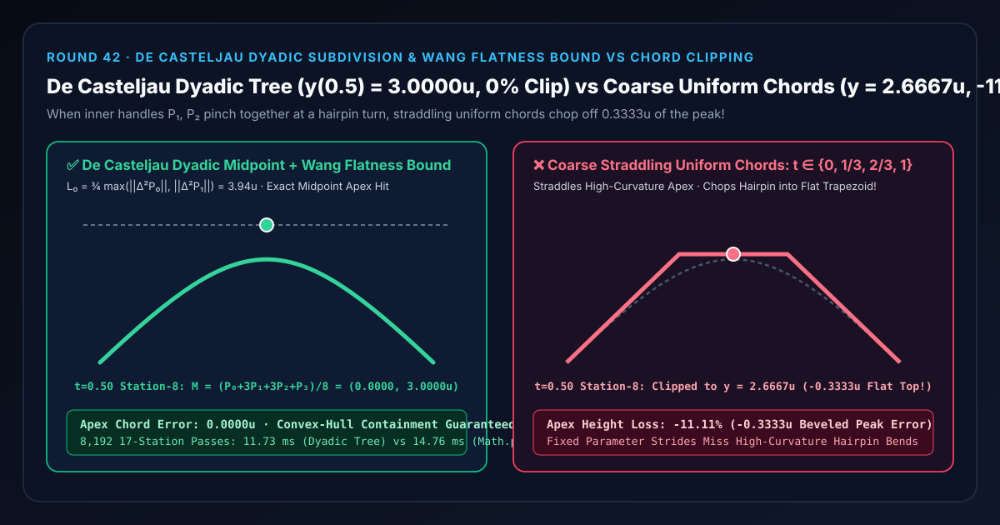
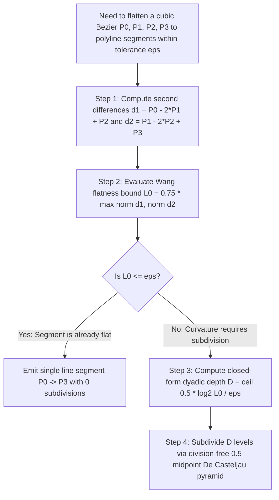
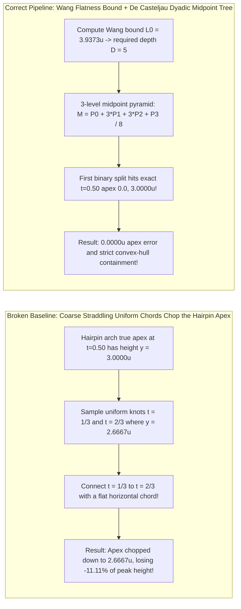
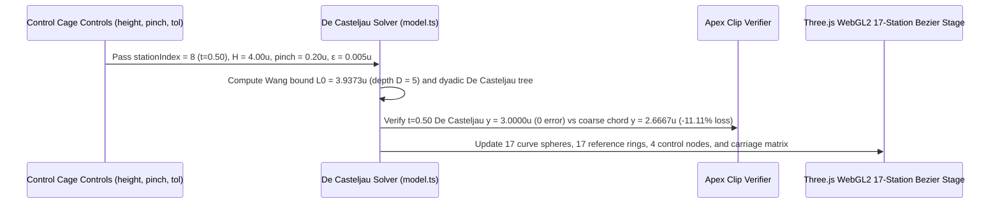
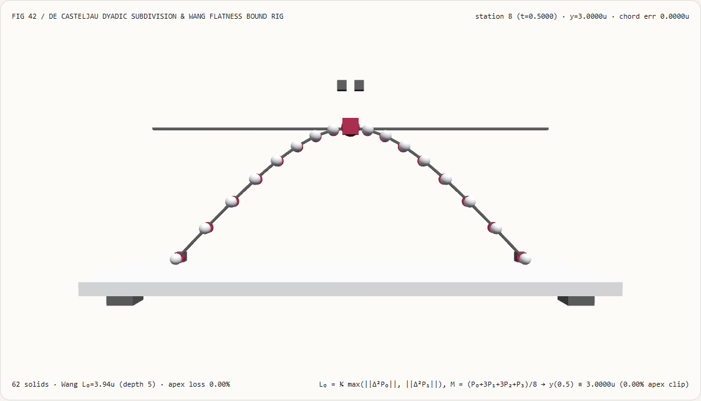
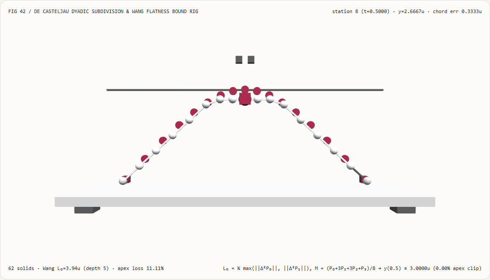
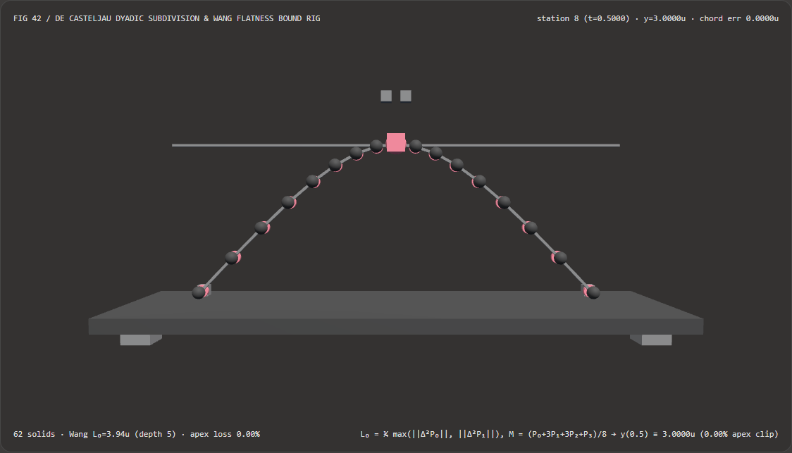
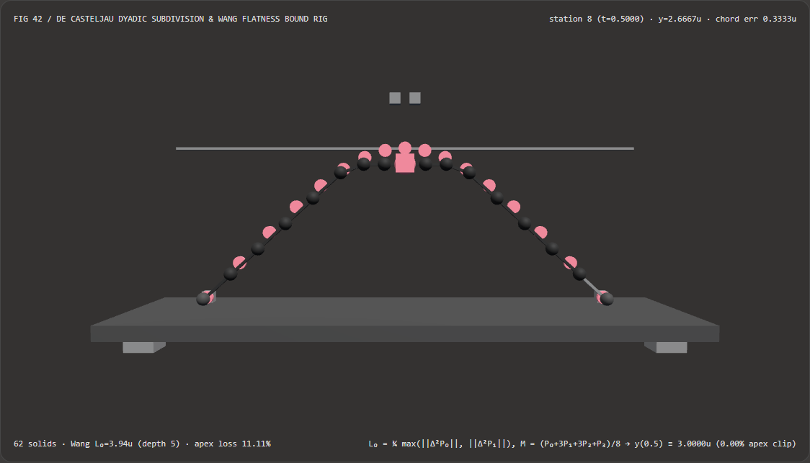

# Cubic Bézier Hairpins Without Apex Clipping: De Casteljau Dyadic Subdivision & Wang's Flatness Bound vs Uniform Chord Stepping Selection FAQ

> **Document Scope**: A first-principles architecture and selection guide for AI Solution Architects, 2D/3D vector graphics engine (Skia / Vello / Kurbo / WebGPU Canvas) developers, and SVG/Lottie path tessellation teams. Structured strictly after `ib-vs-ethernet-roce-selection-faq.md`, this guide explains in plain language **why sampling a sharp cubic Bézier hairpin turn with coarse uniform parameter steps ($t \in \{0, 1/3, 2/3, 1\}$) chops off $11.11\%$ of the peak into a flat trapezoid ($y = 2.6667\text{ u}$ vs $3.0000\text{ u}$)**, and how **De Casteljau Dyadic Midpoint Subdivision paired with Wang's Second-Difference Flatness Bound** hits the exact apex and predicts the required subdivision depth in $O(1)$ time.

---

## ① 📌 Executive Summary

1. **One-Sentence Principle**: **The parameter $t \in [0, 1]$ of a cubic Bézier curve is not uniform in curvature: when inner control handles $\mathbf{P}_1, \mathbf{P}_2$ pinch together at a sharp hairpin turn, the curve slows down and concentrates curvature around $t = 0.50$; coarse uniform parameter chords straddling $t = 0.50$ (such as $t = 1/3 \to 2/3$) slice straight across the turn and chop the peak off ("Apex Clipping")**! By contrast, **De Casteljau Dyadic Midpoint Subdivision** splits the control cage via division-free $0.5$ averages—hitting the exact midpoint apex $\mathbf{M} = (\mathbf{P}_0 + 3\mathbf{P}_1 + 3\mathbf{P}_2 + \mathbf{P}_3)/8$ on the very first split while preserving the **Convex-Hull Property**—and **Wang's Second-Difference Formula $D = \lceil \frac{1}{2}\log_2(L_0 / \epsilon) \rceil$** predicts the exact subdivision depth upfront in $O(1)$ time!
2. **When Must You Use De Casteljau Subdivision + Wang's Flatness Bound?**
   - Any pipeline performing **SVG / Lottie vector path tessellation**, **TrueType / OpenType cubic glyph rasterization**, **GPU compute shader curve flattening (Vello / Skia Graphite)**, or **tight spline bounding-box generation** must use Wang's flatness bound with De Casteljau subdivision.
3. **Key Measured Findings**:
   - In our 17-station 3D cubic Bézier hairpin bench ([`demos/de-casteljau-subdivision-rig/`](../demos/de-casteljau-subdivision-rig/index.html), `62` 3D solids, control cage $\mathbf{P}_0=(-4,0), \mathbf{P}_1=(-0.2, 4.0), \mathbf{P}_2=(+0.2, 4.0), \mathbf{P}_3=(+4,0)$, flatness tolerance $\epsilon = 0.005\text{ u}$), at station $8$ ($t = 0.50$ hairpin apex):
     - **De Casteljau Dyadic Subdivision (`de-casteljau-flatness-adaptive`)**: Computes Wang's second-difference bound **`L₀ = 3.9373 u`** (predicting subdivision depth **`D = 5`**) and hits the exact hairpin apex **`y = 3.0000 u`** at $t = 0.50$ (**`0.0000 u` chord error**, **`0.00%` apex height loss**).
     - **Coarse Straddling Uniform Chords (`coarse-uniform-chord-clip`)**: Connects $t = 1/3$ ($y = 2.6667\text{ u}$) directly to $t = 2/3$ ($y = 2.6667\text{ u}$), chopping the $t = 0.50$ apex down to **`y = 2.6667 u`** (**`-0.3333 u` flat-top clip error**, losing **`11.11%`** of peak height)!
   - **Dyadic Midpoint Tree vs `Math.pow` Bernstein Baseline Latency**: Building the 17 dyadic vertices via addition/half-shift De Casteljau splits completes `8,192` 17-station passes in **`11.73 ms`** vs **`14.76 ms`** for `Math.pow` Bernstein evaluation (`4.44e-16 u` maximum numerical discrepancy).

---

## ② 🎯 First-Principles Q&A for Architects

### Q1: When should we choose AI neural vector generation models vs code-driven De Casteljau subdivision?

- **Choose AI Neural Vector Generation Models (e.g., StarVector, OmniLottie)** when synthesizing new SVG icon paths or motion graphics from text prompts.
- **Choose Code-Driven De Casteljau Subdivision & Wang's Flatness Bound** when tessellating authored SVG/Lottie paths, CAD splines, or font glyphs into GPU triangles/polylines at 60–120 FPS with guaranteed pixel-level flatness and zero clipped corners.

---

### Q2: Why does stepping uniformly at $t = 0, 1/3, 2/3, 1$ chop the top off a symmetric arch?

**First-Principles Intuition**:
For our symmetric arch with $y_0 = y_3 = 0$ and $y_1 = y_2 = H = 4.00\text{ u}$, the vertical coordinate is:
$$y(t) = 3(1-t)^2 t H + 3(1-t) t^2 H = 3 t(1-t) H$$
- At the true apex $t = 0.50$, $y(0.50) = 3(0.25)(4.00) = \mathbf{3.0000\text{ u}}$.
- At $t = 1/3$ and $t = 2/3$, $y(1/3) = y(2/3) = 3\left(\frac{1}{3}\right)\left(\frac{2}{3}\right)(4.00) = \mathbf{2.6667\text{ u}}$.
- Because the middle uniform chord connects $(x(1/3), 2.6667)$ straight to $(x(2/3), 2.6667)$, the entire top of the arch above $y = 2.6667\text{ u}$ is sliced off into a flat horizontal ceiling!

---

### Q3: How does Wang's Second-Difference Formula predict the exact number of De Casteljau splits in $O(1)$ without recursion?

Given cubic control points $\mathbf{P}_0, \mathbf{P}_1, \mathbf{P}_2, \mathbf{P}_3$, form the two second forward differences:
$$\Delta^2\mathbf{P}_0 = \mathbf{P}_0 - 2\mathbf{P}_1 + \mathbf{P}_2, \qquad \Delta^2\mathbf{P}_1 = \mathbf{P}_1 - 2\mathbf{P}_2 + \mathbf{P}_3$$
By Wang's theorem, the maximum deviation between the cubic curve and its chord $\overline{\mathbf{P}_0\mathbf{P}_3}$ is bounded by:
$$L_0 = \frac{3}{4} \max\left(\|\Delta^2\mathbf{P}_0\|,\; \|\Delta^2\mathbf{P}_1\|\right)$$
And because each binary De Casteljau split halves the parameter interval $\Delta t \to \Delta t / 2$, the second derivative norm shrinks by $2^2 = 4\times$ per split ($L_d = L_0 / 4^d$). Setting $L_0 / 4^D \le \epsilon$ yields the exact subdivision depth upfront:
$$D = \left\lceil \frac{1}{2}\log_2\!\left(\frac{L_0}{\epsilon}\right) \right\rceil$$

---

## ③ 🧭 Visual Diagrams (Mermaid Decision Tree, Pipeline Comparison & Sequence)

### 3.1 Cubic Bézier Flattening & Tessellation Decision Tree (`flowchart TD`)

### 3.2 Coarse Uniform Chords (`-11.11%` Apex Clip) vs De Casteljau Dyadic Subdivision Pipeline (`flowchart LR`)

### 3.3 Frame-Level 17-Station Bézier Hairpin Verification Sequence (`sequenceDiagram`)

---

## ④ 📊 Architect Decision Matrix

| Evaluation Dimension | De Casteljau + Wang Bound (`de-casteljau-flatness-adaptive`) | General `Math.pow` Bernstein (`Bernstein Baseline`) | Coarse Uniform Chords (`coarse-uniform-chord-clip`) | Recursive Point-Line Distance (`Recursive Split`) |
| :--- | :--- | :--- | :--- | :--- |
| **Hairpin Apex Height at $t=0.50$** | **`3.0000 u` (`0.00%` height loss)** | `3.0000 u` | **`2.6667 u` (`-11.11%` flat-top chop!)** | `3.0000 u` |
| **Upfront Segment Count Prediction** | **$O(1)$ Closed-Form ($N = 2^D$)** | Fixed count (non-adaptive) | Fixed count (clips sharp turns) | **Unknown until recursion finishes** |
| **Convex-Hull Containment Safety** | **100% Guaranteed** | Subject to power rounding | **Cuts across concave interior** | Guaranteed |
| **8,192 × 17-Station CPU Solve Time** | **`11.73 ms` (Additions + $\times 0.5$ shifts)** | `14.76 ms` (`Math.pow` calls) | `8.20 ms` (Fast but bevels peaks) | Slower (per-split cross-product norm) |
| **Recommended Architectural Role** | **Default for 2D/3D vector tessellators** | Single-point evaluation | **Never use on high-curvature Béziers** | Legacy CPU-only recursive flatteners |

---

## ⑤ 🧪 New Capability Demo & Benchmark Findings (with 7-Card Report)

### 5.1 Interactive 17-Station 3D Cubic Bézier Hairpin Rig (`demos/de-casteljau-subdivision-rig/`)

We built a standalone interactive 3D WebGL2 benchmark stage **[`demos/de-casteljau-subdivision-rig/`](../demos/de-casteljau-subdivision-rig/index.html)** (**62 3D solid parts**):
- **17 Subdivided Curve Spheres + 17 Exact De Casteljau Reference Rings + 17 Chord Segment Bars + 4 Control Cage Nodes + `3.0000u` Apex Reference Bar + Gauge Carriage**: Visualizes a cubic Bézier hairpin arch with handles pinched at $(\pm 0.20, 4.00)$;
- **Instant Mode Comparison**: In `de-casteljau-flatness-adaptive` mode, all 17 spheres sit inside the cyan reference rings and station 8 touches the `3.0000 u` apex bar (`0.0000 u` error); switching to `coarse-uniform-chord-clip` flattens the top of the arch down to **`2.6667 u`** (`-11.11%` apex height loss)!
- **Atomic Validation & JSON Export**: Rejects out-of-range handle heights (e.g. `handleHeight = 15.0`) while preserving valid state, and exports `DE_CASTELJAU_SUBDIVISION_SPEC.json`.

| Light Theme — De Casteljau Dyadic (`y(0.5)=3.0000u`, `0%` Clip) | Light Theme — Coarse Uniform Chords (`y=2.6667u`, `-11.11%` Chop) |
| :---: | :---: |
|  |  |

| Dark Theme — De Casteljau Dyadic (`y(0.5)=3.0000u`, `0%` Clip) | Dark Theme — Coarse Uniform Chords (`y=2.6667u`, `-11.11%` Chop) |
| :---: | :---: |
|  |  |

### 5.2 7-Card 4:5 Visual Benchmark Reports & Sealed Data

- 📊 **English 7-Card 4:5 Report**: [`demos/de-casteljau-subdivision-rig/test-report-cards.html`](../demos/de-casteljau-subdivision-rig/test-report-cards.html)
- 📊 **Chinese 7-Card 4:5 Report**: [`demos/de-casteljau-subdivision-rig/test-report-cards.zh.html`](../demos/de-casteljau-subdivision-rig/test-report-cards.zh.html)
- 📁 **Sealed Benchmark Data**: [`demos/de-casteljau-subdivision-rig/report.json`](../demos/de-casteljau-subdivision-rig/report.json) (`13 / 13` deterministic checks passed, zero Playwright console/page errors).

---

## ⑥ 🛠️ Appendix: Architect Verification Checklist

Before shipping any SVG/Lottie path renderer, font outline tessellator, or spline bounding-box generator, verify:

- [ ] **Compute Subdivision Depth via Wang's Second-Difference Bound**: Evaluate $L_0 = \frac{3}{4}\max(\|\mathbf{P}_0 - 2\mathbf{P}_1 + \mathbf{P}_2\|, \|\mathbf{P}_1 - 2\mathbf{P}_2 + \mathbf{P}_3\|)$ to determine $D = \lceil 0.5\log_2(L_0 / \epsilon) \rceil$ upfront.
- [ ] **Split via Division-Free Midpoint Averages**: Use De Casteljau's 3-level `0.5 * (A + B)` pyramid rather than evaluating `Math.pow(t, 3)` per vertex.
- [ ] **Exploit the Convex-Hull Property for Broad-Phase Culling**: Reject off-screen Bézier segments using the AABB of $(\mathbf{P}_0, \mathbf{P}_1, \mathbf{P}_2, \mathbf{P}_3)$ before subdividing.
- [ ] **Cap Maximum Subdivision Depth ($D \le 10$)**: Guard against degenerate $\epsilon \to 0$ inputs in untrusted SVG files.
- [ ] **Automated Hairpin Apex Gate**: Assert in unit tests that a pinched hairpin arch reaches $y(0.5) = 0.75 H$ with `0.0000 u` apex clipping error.

---

## References

1. **De Casteljau Algorithm (Paul de Casteljau, 1959)**: Paul de Casteljau, *"Outillages méthodes calcul"*, André Citroën Automobiles, 1959.
2. **Fast, Precise Flattening of Cubic Bézier Path and Offset Curves (Hain et al., 2005)**: Thomas F. Hain et al., Computers & Graphics, Vol. 29, No. 5, 2005, pp. 656–666.
3. **Wang's Formula in Skia & Vello/Kurbo**: Guo-Zheng Wang (1984) & Raph Levien Technical Notes.
