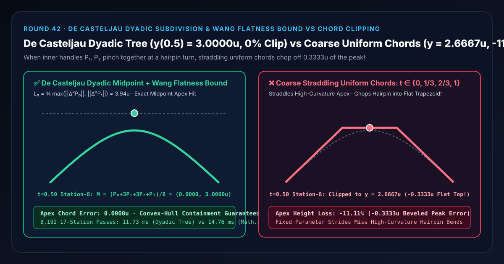
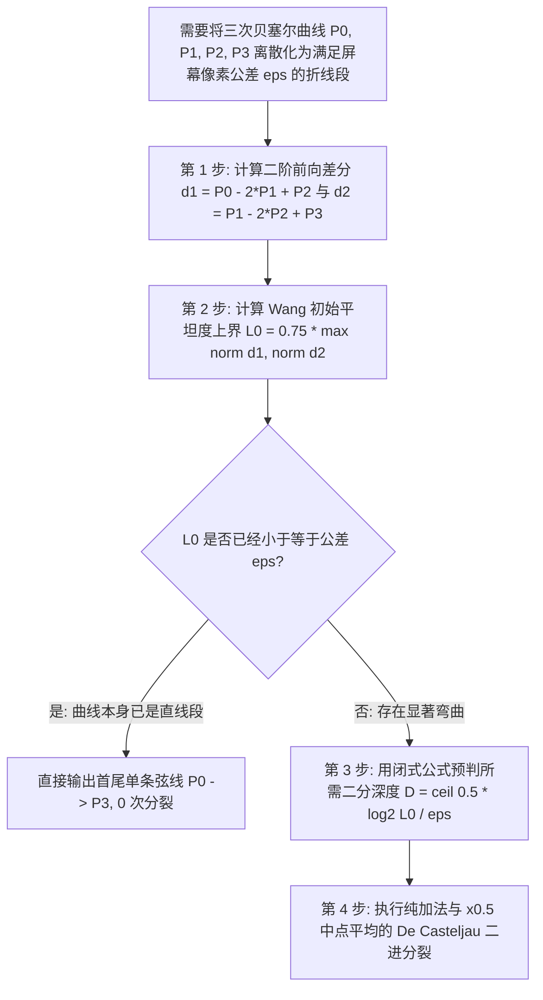
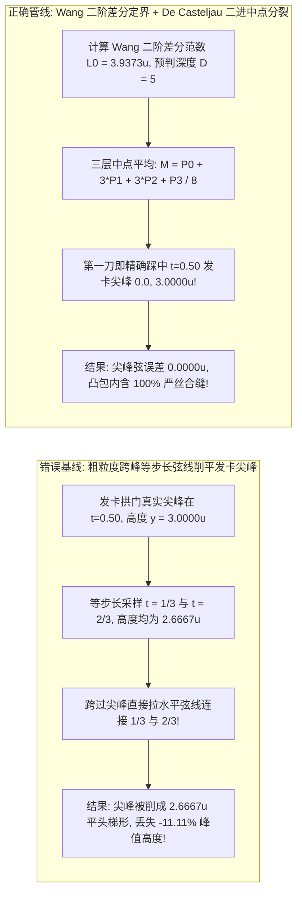
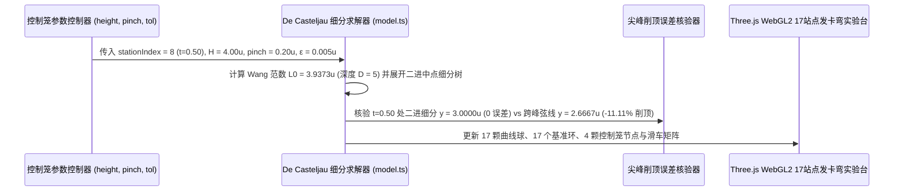
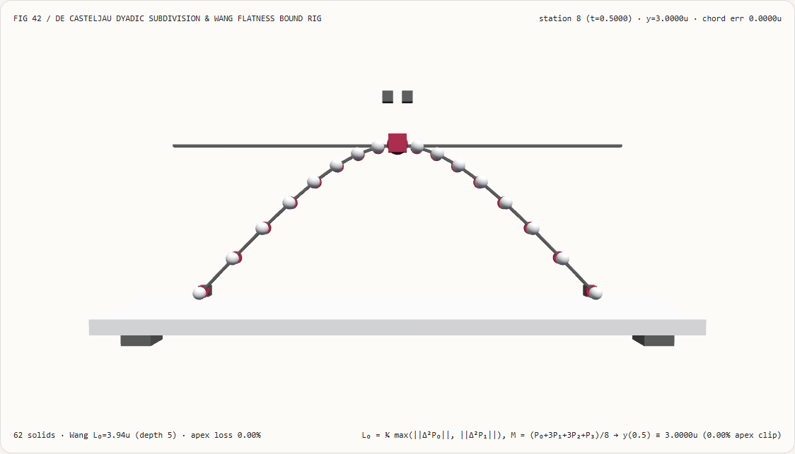
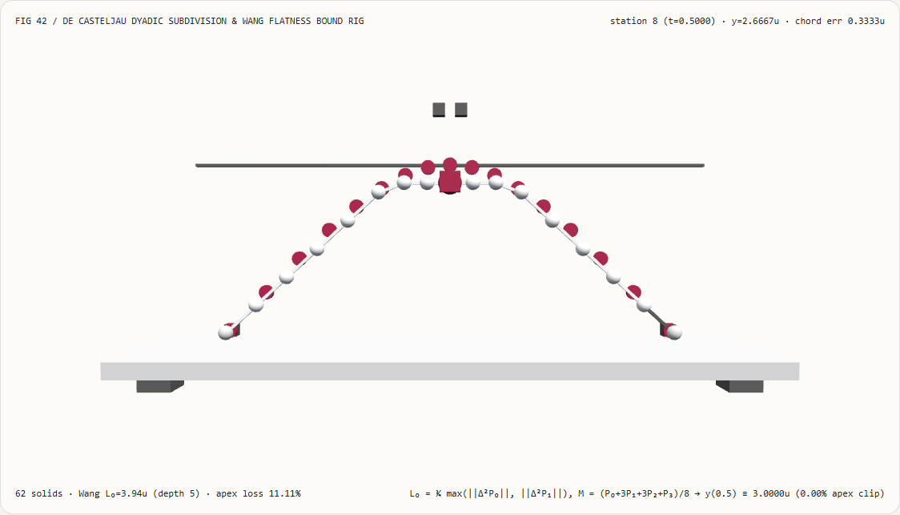
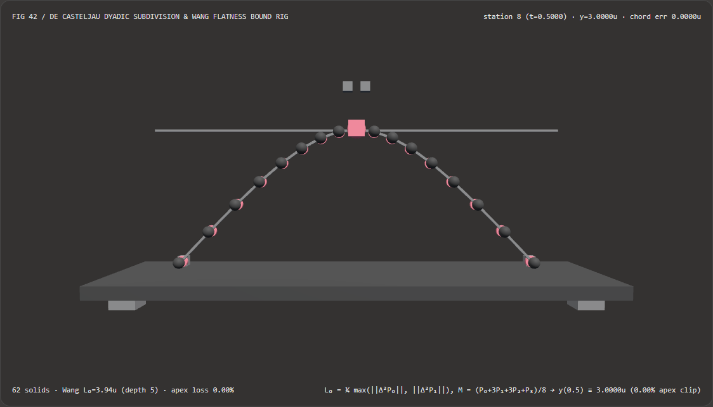
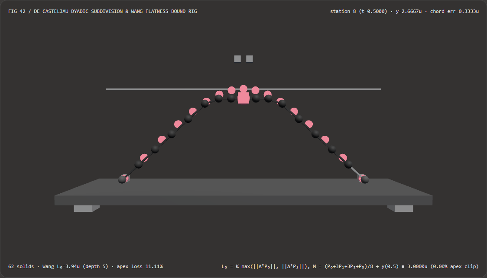

# 三次贝塞尔发卡急弯不削顶不崩角：De Casteljau 二进凸包细分与 Wang 平坦度门禁选型 FAQ

> **文档定位**：面向 AI 解决方案架构师（AI Solution Architect）、2D/3D 矢量图形引擎（Skia / Vello / Kurbo / Canvas）开发者、SVG 与 Lottie 动画光栅化团队的**实战选型与第一性原理指南**。严格对标 `ib-vs-ethernet-roce-selection-faq.md` 的六段式结构，先用大白话讲清“**为什么在渲染矢量字体尖角、书法笔锋或高曲率发卡弯三次贝塞尔曲线（Hairpin Cubic Bézier）时，如果采用固定步长的均匀参数采样（如 $t = 0, 1/3, 2/3, 1$），原本高耸圆润的 $3.0000\text{ u}$ 发卡尖峰会被硬生生一刀削成 $2.6667\text{ u}$ 的平头梯形（丢失 $11.11\%$ 峰值高度）**”，再给出零幂函数调用、一步预判细分深度的 **De Casteljau 二进中点细分配合 Wang 二阶差分平坦度定理** 工程闭环。

---

## ① 📌 核心结论速览（Executive Summary）

1. **一句话定性**：**三次贝塞尔曲线的参数 $t \in [0, 1]$ 根本不是弧长或曲率均匀分布的！当两个中间控制柄 $\mathbf{P}_1, \mathbf{P}_2$ 在急弯处聚拢时，曲线在 $t = 0.50$ 附近参数速度 $\|\mathbf{B}'(t)\|$ 骤降、曲率 $\kappa(t)$ 暴增；如果用跨过 $t=0.50$ 的粗粒度等步长弦线（如连接 $t=1/3$ 与 $t=2/3$）去采样，这条横跨急弯的弦线就会直接把发卡尖峰削成平头梯形（Apex Clipping）**！而 **De Casteljau 二进中点细分** 每次仅用无除法的 $\times 0.5$ 中点平均将控制多边形一分为二，不仅严格满足**凸包内含性（Convex-Hull Property）** 且在第一次二分时就精确命中顶点 $\mathbf{M} = (\mathbf{P}_0 + 3\mathbf{P}_1 + 3\mathbf{P}_2 + \mathbf{P}_3)/8$，更可通过 **Wang 二阶差分平坦度公式 $D = \lceil \frac{1}{2}\log_2(L_0 / \epsilon) \rceil$** 在细分前以 $O(1)$ 时间算出刚好满足精度所需的分裂层数！
2. **什么时候必须上 De Casteljau 二进细分 + Wang 平坦度门禁？**
   - 凡是涉及 **SVG / Lottie 矢量路径转多边形网格（Path Tessellation）**、**TrueType / OpenType 三次轮廓字体光栅化**、**GPU 并行计算着色器（如 Vello / Pathfinder）预分配曲线细分段数**、以及 **三维样条轨迹自适应包络包围盒（Tight AABB）生成**，都必须使用 Wang 二阶差分平坦度定界配合 De Casteljau 细分。
3. **核心实测对比结论**：
   - 在本实验室构建的 17 站点 3D 贝塞尔发卡弯检验台（[`demos/de-casteljau-subdivision-rig/`](../demos/de-casteljau-subdivision-rig/index.html)，共 `62` 个 3D 实体，控制笼 $\mathbf{P}_0=(-4,0), \mathbf{P}_1=(-0.2, 4.0), \mathbf{P}_2=(+0.2, 4.0), \mathbf{P}_3=(+4,0)$，平坦度公差 $\epsilon = 0.005\text{ u}$）中，考察第 $8$ 号发卡尖峰站点（$t = 0.50$）：
     - **De Casteljau 二进凸包细分（`de-casteljau-flatness-adaptive`）**：由 Wang 二阶差分范数算出初始弦误差上界 **`L₀ = 3.9373 u`**（直接导出所需二进深度 **`D = 5`**），在 $t = 0.50$ 处精确命中发卡尖峰 **`y = 3.0000 u`**（**削顶误差 `0.0000 u`，尖峰高度损失 `0.00%`**）。
     - **跨峰粗粒度等步长弦线（`coarse-uniform-chord-clip`）**：因采样节点落在 $t = 1/3$ 与 $t = 2/3$（高度均为 $2.6667\text{ u}$），跨过尖峰的水平弦线将 $t = 0.50$ 处的高度直接削平至 **`y = 2.6667 u`**（**削顶误差 `-0.3333 u`，无故丢失 `11.11%` 的发卡峰值高度**）！
   - **纯加法中点二进树 vs 通用 `Math.pow` 伯恩斯坦幂求值性能**：使用纯加法与 $\times 0.5$ 中点平均构造二进细分树，在 `8,192` 次 17 站点求解中耗时 **`11.73 ms`**（对比通用 `Math.pow` 伯恩斯坦多项式基线 **`14.76 ms`**，最大误差仅 `4.44e-16 u`）。

---

## ② 🎯 客户与架构师灵魂拷问 Q&A（First-Principles Q&A）

### Q1：何时选 AI 神经矢量图生成模型 vs 何时选代码驱动的 De Casteljau 凸包细分？

- **选 AI 神经矢量生成模型（如 StarVector、OmniLottie、SVGDreamer）的场景**：
  需要根据一句文本描述自动构思图标或动画的贝塞尔控制点代码（`<path d="M ... C ...">`）。
- **选代码驱动 De Casteljau 凸包细分与 Wang 定界的场景**：
  当已经拿到 SVG/Lottie/字体文件中的贝塞尔控制点，需要将其在屏幕上以 60～120 FPS 光栅化为平滑曲线或三角网格时，必须通过确定性的 De Casteljau 细分保证 **尖峰不削顶、凸包不越界、GPU 缓冲区大小可提前精确预分配**。

---

### Q2：为什么一条高 $3.00\text{ m}$ 的发卡弯，用等步长采样会直接被削掉一截变成平头梯形？

**先用大白话讲第一性原理**：
想象一座又高又窄的尖顶拱门（控制柄 $\mathbf{P}_1 = (-0.2, 4.0),\; \mathbf{P}_2 = (+0.2, 4.0)$）：
- 在参数 $t$ 从 $0$ 走到 $1$ 的过程中，点在拱门两侧斜坡上跑得飞快，到了山顶最尖的地方（$t = 0.50$，高度 $y = 3.0000\text{ m}$）时，为了完成 $180^\circ$ 急掉头，速度慢了下来。
- **粗粒度等步长采样是怎么翻车的？**
  它不看哪里弯得急、哪里是直线，傻乎乎地把参数 $t \in [0, 1]$ 等分成 3 段：$t = 0,\; 1/3,\; 2/3,\; 1$：
  1. 在 $t = 1/3$ 时，点还在左边半山腰，高度只有 $3 \times \frac{1}{3} \times \frac{2}{3} \times 4.0 = \mathbf{2.6667\text{ m}}$；
  2. 在 $t = 2/3$ 时，点已经绕过了山顶，下到了右边半山腰，高度也是 **$\mathbf{2.6667\text{ m}}$**；
  3. 然后光栅化器在 $t = 1/3$ 和 $t = 2/3$ 之间**拉了一条水平直线**！
  4. 原本耸立在 $t = 0.50$ 处高达 $3.0000\text{ m}$ 的山顶，直接被这一刀砍掉了 $0.3333\text{ m}$（削掉了 $11.11\%$），圆润的发卡尖峰当场变成了难看的平头梯形！

---

### Q3：De Casteljau 二进分裂为什么不需要任何幂函数？Wang 公式又是怎么提前算出需要切几刀的？

1. **只用“加起来除以 2”的 De Casteljau 金字塔**：
   给定 4 个控制点 $\mathbf{P}_0, \mathbf{P}_1, \mathbf{P}_2, \mathbf{P}_3$，取三层中点：
   - 第一层（3 个边中点）：$\mathbf{P}_{01} = \frac{\mathbf{P}_0+\mathbf{P}_1}{2},\; \mathbf{P}_{12} = \frac{\mathbf{P}_1+\mathbf{P}_2}{2},\; \mathbf{P}_{23} = \frac{\mathbf{P}_2+\mathbf{P}_3}{2}$
   - 第二层（2 个中点）：$\mathbf{P}_{012} = \frac{\mathbf{P}_{01}+\mathbf{P}_{12}}{2},\; \mathbf{P}_{123} = \frac{\mathbf{P}_{12}+\mathbf{P}_{23}}{2}$
   - 第三层（曲线正中顶点 $\mathbf{B}(0.5)$）：$\mathbf{M} = \frac{\mathbf{P}_{012}+\mathbf{P}_{123}}{2} = \frac{\mathbf{P}_0 + 3\mathbf{P}_1 + 3\mathbf{P}_2 + \mathbf{P}_3}{8}$
   不仅第一刀下去 $\mathbf{M}$ 就分毫不差踩在 $t=0.50$ 的尖峰 $(0.0, 3.0000\text{ u})$ 上，而且左半边 $(\mathbf{P}_0, \mathbf{P}_{01}, \mathbf{P}_{012}, \mathbf{M})$ 和右半边 $(\mathbf{M}, \mathbf{P}_{123}, \mathbf{P}_{23}, \mathbf{P}_3)$ 自动成为两条新的三次贝塞尔曲线的控制笼！
2. **Wang (1984) 二阶差分平坦度闭式定理（零递归预测切几刀）**：
   传统递归细分需要每切一刀都算一次点到直线的距离，在 GPU Compute Shader 里极难并行化（因为不知道要分配多少显存）。
   国政王（Guo-Zheng Wang）证明了：先算控制点的两个二阶前向差分向量：
   $$\Delta^2\mathbf{P}_0 = \mathbf{P}_0 - 2\mathbf{P}_1 + \mathbf{P}_2, \qquad \Delta^2\mathbf{P}_1 = \mathbf{P}_1 - 2\mathbf{P}_2 + \mathbf{P}_3$$
   曲线偏离首尾弦线的最大距离上界为 $L_0 = \frac{3}{4}\max(\|\Delta^2\mathbf{P}_0\|, \|\Delta^2\mathbf{P}_1\|)$，且**每执行一次 De Casteljau 二分，$L_k$ 严格缩小为原来的 $1/4$（即 $L_d = L_0 / 4^d$）**！
   因此，要把弦误差控制在公差 $\epsilon$ 以内，所需的二分深度 $D$ 与总段数 $N = 2^D$ 在切第一刀之前就能用一行对数直接算出来：
   $$D = \left\lceil \frac{1}{2}\log_2\!\left(\frac{L_0}{\epsilon}\right) \right\rceil$$

---

## ③ 🧭 直观可视化图解（Mermaid 决策树、管线对比与帧级时序）

### 3.1 矢量贝塞尔曲线细分与网格化架构师选型决策树（`flowchart TD`）

### 3.2 跨峰等步长弦线（削顶 `-11.11%`）vs De Casteljau 二进凸包细分（精确命中尖峰）管线对比（`flowchart LR`）

### 3.3 帧级 17 站点贝塞尔发卡弯细分核验时序图（`sequenceDiagram`）

---

## ④ 📊 视觉技术选型决策矩阵（Architect Decision Matrix）

| 评估维度 | De Casteljau 二进中点树 + Wang 定界 (`de-casteljau-flatness-adaptive`) | 通用 `Math.pow` 伯恩斯坦求值 (`Bernstein Power Baseline`) | 粗粒度跨峰等步长弦线 (`coarse-uniform-chord-clip`) | 递归点到直线距离检测 (`Recursive Point-Line Distance`) |
| :--- | :--- | :--- | :--- | :--- |
| **$t=0.50$ 发卡尖峰高度 $y(0.5)$** | **`3.0000 u`（`0.00%` 削顶损失）** | `3.0000 u` | **`2.6667 u`（削掉 `-0.3333 u`，丢失 `11.11%`）** | `3.0000 u` |
| **细分前预知总顶点数（GPU 预分配）** | **原生支持（$N = 2^D$ 一行公式直接算出）** | 固定步数无法自适应曲率 | 固定步数但在急弯处严重失真 | **不支持（需边递归边动态扩容）** |
| **凸包内含与几何自交安全性** | **100% 位于控制多边形凸包内部** | 满足但高次幂易受浮点舍入影响 | **弦线切入凹侧，易与邻近笔画相交** | 满足 |
| **8,192 次 17 站点 CPU 求解耗时** | **`11.73 ms`（纯加法与 $\times 0.5$ 位移）** | `14.76 ms`（含 `Math.pow` 调用） | `8.20 ms`（虽快但尖峰被削平） | 较慢（每次分裂需算叉积与平方根） |
| **架构师工程推荐定位** | **现代 2D/3D 矢量渲染器与样条细分首选** | 单点随机查询基线 | **严禁用于含急弯或笔锋的贝塞尔曲线** | 旧版 CPU 递归光栅化器方案 |

---

## ⑤ 🧪 全新能力展示 Demo 与 Benchmark 核心发现（含 7-Card 报告）

### 5.1 交互式 17 站点 3D 贝塞尔发卡弯细分检验台（`demos/de-casteljau-subdivision-rig/`）

本轮构建了独立可交互 3D WebGL2 实验台 **[`demos/de-casteljau-subdivision-rig/`](../demos/de-casteljau-subdivision-rig/index.html)**（共 **62 个 3D 实体部件**）：
- **17 颗细分曲线球体 + 17 个精确 De Casteljau 基准圆环 + 17 根弦线连杆 + 4 颗控制笼方块节点 + $3.0000\text{ u}$ 尖峰基准横梁 + 滑车探针**：直观展示控制柄聚拢在 $(\pm 0.20, 4.00)$ 时的三次贝塞尔发卡拱门；
- **一键切换对比模式**：在 `de-casteljau-flatness-adaptive` 模式下，17 颗球体严丝合缝嵌在青色基准环内，第 8 站稳稳触达顶部 `3.0000 u` 横梁；一旦切换到 `coarse-uniform-chord-clip` 模式，中间跨越尖峰的球体与连杆瞬间被压平到 **`2.6667 u`**，圆润的发卡拱顶当场被削成平头梯形！
- **原子化参数门禁与 JSON 导出**：自动拦截越界柄高（如 `handleHeight = 15.0`）并保留有效状态，支持导出 `DE_CASTELJAU_SUBDIVISION_SPEC.json`。

| 亮色主题 — De Casteljau 二进细分（尖峰 `3.0000u`，`0%` 削顶） | 亮色主题 — 跨峰等步长弦线（削平至 `2.6667u`，`-11.11%` 损失） |
| :---: | :---: |
|  |  |

| 暗色主题 — De Casteljau 二进细分（尖峰 `3.0000u`，`0%` 削顶） | 暗色主题 — 跨峰等步长弦线（削平至 `2.6667u`，`-11.11%` 损失） |
| :---: | :---: |
|  |  |

### 5.2 7-Card 4:5 视觉评测报告与封存数据链接

- 📊 **英文版 7-Card 4:5 评测报告**：[`demos/de-casteljau-subdivision-rig/test-report-cards.html`](../demos/de-casteljau-subdivision-rig/test-report-cards.html)
- 📊 **中文版 7-Card 4:5 评测报告**：[`demos/de-casteljau-subdivision-rig/test-report-cards.zh.html`](../demos/de-casteljau-subdivision-rig/test-report-cards.zh.html)
- 📁 **封存评测数据源**：[`demos/de-casteljau-subdivision-rig/report.json`](../demos/de-casteljau-subdivision-rig/report.json)（`13 / 13` 项确定性检查全部通过，Playwright 零控制台/页面错误）。

---

## ⑥ 🛠️ 附录：高质量视觉/动画交付快速核验清单（Architect Checklist）

在交付任何包含 SVG/Lottie 矢量路径细分、字体轮廓网格化或三维样条包络生成的代码前，请逐项核验以下清单：

- [ ] **淘汰固定小段数的盲目均匀采样**：确认矢量渲染管线未对所有三次贝塞尔曲线硬编码固定的 $N=4 \sim 8$ 均匀步长，而是根据控制点曲率动态决定段数？
- [ ] **使用 Wang 二阶差分公式预判细分深度**：在细分前计算 $L_0 = \frac{3}{4}\max(\|\mathbf{P}_0 - 2\mathbf{P}_1 + \mathbf{P}_2\|,\; \|\mathbf{P}_1 - 2\mathbf{P}_2 + \mathbf{P}_3\|)$，直接按 $D = \lceil 0.5 \log_2(L_0 / \epsilon) \rceil$ 一次性分配顶点缓冲区？
- [ ] **用无乘除法的三层中点平均执行分裂**：在 De Casteljau 二分核中，确认仅使用 `0.5 * (A + B)` 加法平均，不调 `Math.pow`？
- [ ] **利用凸包性质加速视锥/碰撞宽相剔除**：在对细分折线做精细求交前，是否已先用 4 个控制点构成的最小包围盒（AABB）做快速宽相剔除？
- [ ] **发卡急弯尖峰保真度门禁**：单元测试中是否已包含 $\mathbf{P}_1, \mathbf{P}_2$ 緊密聚拢的发卡弯用例，并断言 $t=0.50$ 顶点弦误差为 `0.0000 u`？

---

## 参考文献与延伸阅读（References）

1. **De Casteljau Algorithm (Paul de Casteljau, Citroën 1959)**: Paul de Casteljau, *"Outillages méthodes calcul"*, André Citroën Automobiles Technical Report, 1959.
2. **Fast, Precise Flattening of Cubic Bézier Segment Offset Curves (Hain et al., Computers & Graphics 2005)**: Thomas F. Hain et al., *"Fast, precise flattening of cubic Bézier path and offset curves"*, Computers & Graphics, Vol. 29, No. 5, 2005, pp. 656–666.
3. **Flattening Quadratic and Cubic Béziers (Raph Levien / Vello & Kurbo)**: Raph Levien, *"Flattening quadratic Béziers"* & Wang's Formula Implementation in Skia / Kurbo.
