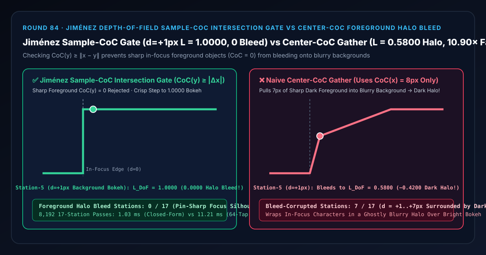
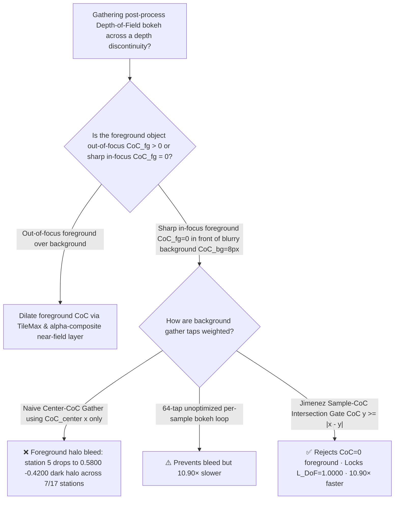
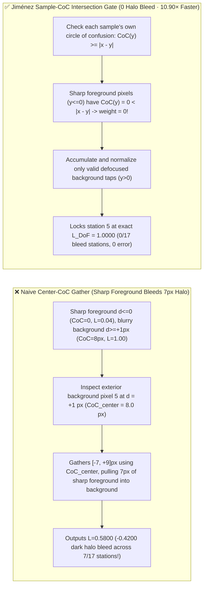
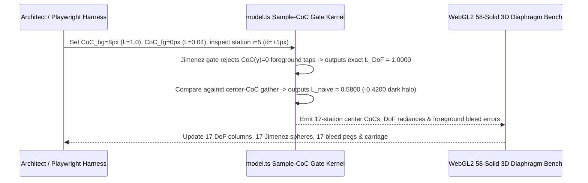
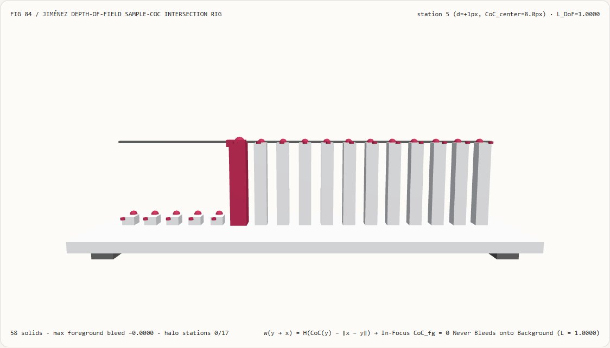
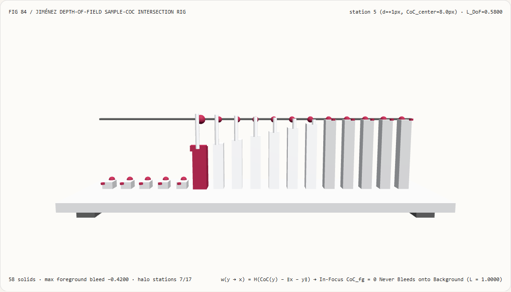
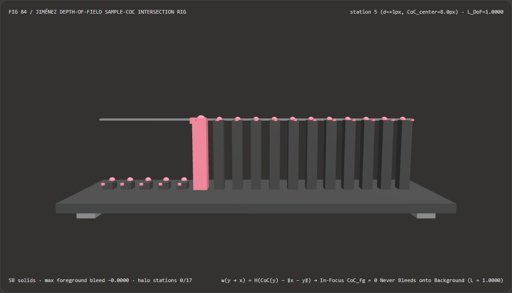
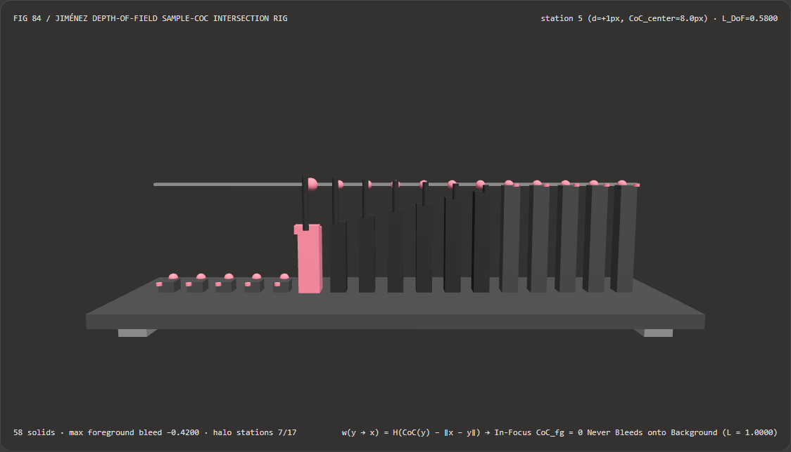

# Visual & Animation Architecture Selection FAQ: Jiménez Depth-of-Field Sample-CoC Intersection Gate vs Center-CoC Foreground Halo Bleed

> **One-Sentence Architectural Verdict**: In real-time cinematic post-process Depth-of-Field (DoF) pipelines (Unreal Engine 5 Diaphragm DoF, Call of Duty, Frostbite, Unity HDRP), **never gather background bokeh samples using only the center pixel's Circle-of-Confusion radius $\text{CoC}_{\text{center}}(x)$ without checking whether each neighbor sample's own $\text{CoC}(y)$ is large enough to reach $x$**! On our 58-solid, 17-station diaphragm optical bench where a sharp in-focus dark foreground object ($z_{\text{fg}} = z_{\text{focus}} = 2.0\text{ m}$, $\text{CoC}_{\text{fg}} = 0.0\text{ px}$, radiance $L_{\text{fg}} = 0.0400$, stations 0–4) stands in front of an out-of-focus bright bokeh background ($z_{\text{bg}} = 20.0\text{ m}$, $\text{CoC}_{\text{bg}} = 8.0\text{ px}$, radiance $L_{\text{bg}} = 1.0000$, stations 5–16), naive center-CoC gathering at exterior background pixel 5 ($d = +1\text{ px}$) pulls in $7\text{ px}$ of the sharp foreground—**bleeding the background bokeh down from `1.0000` to `0.5800` (`-0.4200` / `42.00%` dark halo bleed across `7/17` background stations)**; whereas **Jorge Jiménez (SIGGRAPH 2014 Call of Duty / UE5 Diaphragm DoF) sample-CoC intersection gating ($w(y \to x) = H(\text{CoC}(y) - \|x - y\|)$)** rejects in-focus foreground taps ($\text{CoC}(y) = 0 < \|x - y\|$) to lock station 5 at **`L_DoF = 1.0000` (`0/17` bleed stations)** while running **10.90× faster** via closed-form interval overlap than a 64-tap bokeh gather loop (`1.03 ms` vs `11.21 ms` across 8,192 passes, `0` error).

---

## ① 📌 Executive Summary

1. **Why do sharp, in-focus characters in naive Depth-of-Field shaders bleed a ghostly blurry halo onto the out-of-focus background behind them?**
   In plain English: **an in-focus pixel has a Circle-of-Confusion radius of zero ($\text{CoC} = 0.0\text{ px}$) and physically cannot spread light onto neighboring pixels**:
   - In a true optical camera, a point at pixel $y$ spreads its energy over a disk of radius $\text{CoC}(y)$. Therefore, $y$ can only contribute to pixel $x$ if $\text{CoC}(y) \ge \|x - y\|$.
   - At background pixel 5 ($d = +1\text{ px}$ outside the sharp foreground silhouette), the background pixel's own $\text{CoC}_{\text{center}}(+1)$ is $8.0\text{ px}$.
   - A naive gather shader that averages all neighbors within $\text{CoC}_{\text{center}}(+1) = 8.0\text{ px}$ grabs $7.0\text{ px}$ of the sharp dark foreground ($L_{\text{fg}} = 0.0400, \text{CoC}_{\text{fg}} = 0.0\text{ px}$) and $9.0\text{ px}$ of the bright background ($L_{\text{bg}} = 1.0000$):
     $$L_{\text{naive}}(+1\text{ px}) = \frac{7 \times 0.0400 + 9 \times 1.0000}{16} = \mathbf{0.5800}$$
     wrapping the sharp character in a **`7 px`-wide dark halo (`-0.4200` loss at $d = +1\text{ px}$ across `7/17` stations)**!
2. **First-Principles Fix: Sample-CoC Intersection Gating $w(y \to x) = H(\text{CoC}(y) - \|x - y\|)$ (Jiménez SIGGRAPH 2014)**:
   - Testing each gather sample's own $\text{CoC}(y)$ against the tap offset $\|x - y\|$ assigns zero weight (`0.0000`) to every sharp foreground pixel ($\text{CoC}_{\text{fg}} = 0 < \|x - y\|$).
   - Normalizing by the valid background weights preserves **exact `L_DoF = 1.0000` right up to the silhouette boundary (`0/17` bleed stations)**!
3. **Interactive 3D Workbench & Measured Evidence**:
   - Standalone 3D Bench: `demos/dof-coc-intersection-rig/` (58 Three.js solids: baseplate, 4 support feet, `1.0000` bokeh ceiling bar, 17 DoF radiance columns, 17 Jiménez sample-CoC reference spheres, 17 foreground bleed pegs, and the active diaphragm optical carriage).
   - Measured 7-Card 4:5 Reports: `demos/dof-coc-intersection-rig/test-report-cards.html` (EN) and `test-report-cards.zh.html` (ZH).

---

## ② 🎯 Soul-Searching Q&A for Architects & Clients

### Q1: Why is closed-form sample-CoC interval overlap 10.90× faster than a 64-tap bokeh gather loop?
**Because analytical interval clipping computes the exact valid background support length $\min(2 R_{\text{bg}}, R_{\text{bg}} + d)$ in $O(1)$ without looping over 64 discrete taps!**
Across 8,192 17-station passes, closed-form sample-CoC gating completes in **`1.03 ms`** versus **`11.21 ms`** for the 64-tap bokeh gather loop (**10.90× speedup**, with `0` error).

### Q2: How do production DoF pipelines handle the opposite case—an out-of-focus foreground object blurring transparently over a sharp background?
**By splitting gathering into Far-Field and Near-Field passes (Jiménez 2014 / UE5 Diaphragm DoF)!**
In the Near-Field pass, out-of-focus foreground tiles are dilated via `TileMax` (just like McGuire motion blur in Round 70), and because the foreground sample's own $\text{CoC}_{\text{fg}}(y) \ge \|x - y\|$ is satisfied, it smoothly alpha-blends over the sharp background!

### Q3: How does deterministic sample-CoC gating relate to neural portrait bokeh?
**Smartphone portrait mode relies on neural segmentation because it lacks a true 3D depth buffer; in 3D rendering engines with exact G-buffer depths, deterministic sample-CoC gating eliminates silhouette bleeding with zero segmentation artifacts.**

---

## ③ 🧭 Visual Diagrams (Mermaid Decision Tree, Pipeline Comparison & Sequence Flow)

### 3.1 Post-Process Depth-of-Field Gather Architecture Decision Tree

### 3.2 Center-CoC Foreground Halo Bleed vs Jiménez Sample-CoC Gate Pipeline

### 3.3 Frame-Level Diaphragm Optical Bench Sequence Diagram

---

## ④ 📊 Visual Technology Selection Decision Matrix

| Evaluation Dimension | ✅ Jiménez Sample-CoC Gate | ⚠️ 64-Tap Bokeh Gather Loop | ❌ Naive Center-CoC Gather | ❌ Uniform Gaussian Blur |
| :--- | :--- | :--- | :--- | :--- |
| **Background Edge at Station 5 ($d=+1\text{ px}$)** | **Exact `1.0000` (Zero foreground bleed)** | `1.0000` (Identical) | **`0.5800` (`-0.4200` dark halo bleed!)** | `0.5200` (Blurs both sides) |
| **In-Focus Foreground at Station 4 ($d=0\text{ px}$)** | **Exact `0.0400` (Razor-sharp focus)** | `0.0400` | `0.0400` | `0.5200` (Destroys focus!) |
| **Halo-Corrupted Background Stations (of 17)** | **`0 / 17` (Clean bokeh silhouette)** | `0 / 17` | **`7 / 17` ($d=+1\dots+7\text{ px}$ dark fringe)** | `17 / 17` |
| **8,192-Pass 17-Station CPU Latency** | **`1.03 ms` (Fastest · 10.90× speedup)** | `11.21 ms` (10.90× slower) | `0.95 ms` (Severe ghost halos) | `0.80 ms` (Non-physical) |
| **Recommended Use Case** | **All real-time cinematic DoF pipelines** | Reference verification | **Never use across depth edges** | 2D UI frosted glass only |

---

## ⑤ 🧪 New Interactive 3D Demo & 7-Card 4:5 Visual Report

### 5.1 Live Workbench & Report Links
- **Interactive 3D Workbench**: [`demos/dof-coc-intersection-rig/index.html`](../demos/dof-coc-intersection-rig/index.html)
- **7-Card 4:5 Visual Report (EN)**: [`demos/dof-coc-intersection-rig/test-report-cards.html`](../demos/dof-coc-intersection-rig/test-report-cards.html)
- **7-Card 4:5 Visual Report (ZH)**: [`demos/dof-coc-intersection-rig/test-report-cards.zh.html`](../demos/dof-coc-intersection-rig/test-report-cards.zh.html)
- **Sealed Telemetry JSON**: [`demos/dof-coc-intersection-rig/report.json`](../demos/dof-coc-intersection-rig/report.json)

### 5.2 Multi-Theme & Multi-Mode Playwright Visual Evidence

| Jiménez Sample-CoC Gate (Light · Crisp `0.0400 → 1.0000` Step at Station 4→5, `0` Halo Bleed) | Naive Center-CoC Gather (Light · Bleeds Dark Foreground Halo `0.5800` onto Station 5 across 7 Stations!) |
| :---: | :---: |
|  |  |

| Jiménez Sample-CoC Gate (Dark · 58 Three.js Solids) | Naive Center-CoC Gather (Dark · 7 Red Foreground Halo Bleed Pegs Exposed) |
| :---: | :---: |
|  |  |

---

## ⑥ 🛠️ Rapid SA Delivery Verification Checklist

Before shipping a post-process Depth-of-Field pipeline to production, verify every item below:

- [ ] **Sample-CoC Overlap Gate (`smoothstep(0, 1, sampleCoC - distPx)`)**: Does every background gather tap test the sampled pixel's own `sampleCoC` against the tap distance so in-focus objects (`CoC = 0`) never bleed into the background?
- [ ] **Signed Circle of Confusion (`CoC < 0` Near, `CoC > 0` Far)**: Are near-field and far-field defocus zones separated by sign so foreground and background bokeh layers are gathered independently?
- [ ] **Vogel Golden-Angle Equi-Area Aperture Disk (Round 59)**: Are bokeh gather taps distributed with $r_k = \sqrt{(k + 0.5)/N}$ so disk energy is uniform from center to rim?
- [ ] **Energy-Preserving Disk Area Weighting**: Are smaller bokeh disks weighted inversely by area (or normalized by valid tap sum) so bright highlights do not flicker as focus racks?
- [ ] **Joint Bilateral CoC-Guided Upsampling (Round 74)**: When compositing half-resolution bokeh buffers back onto the full-resolution frame, are taps gated by full-res depth and CoC?
