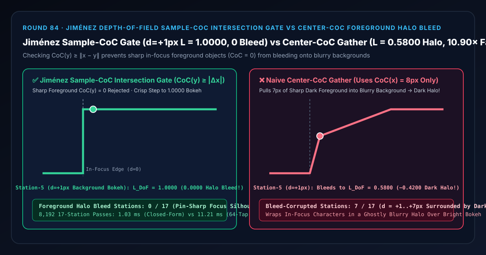
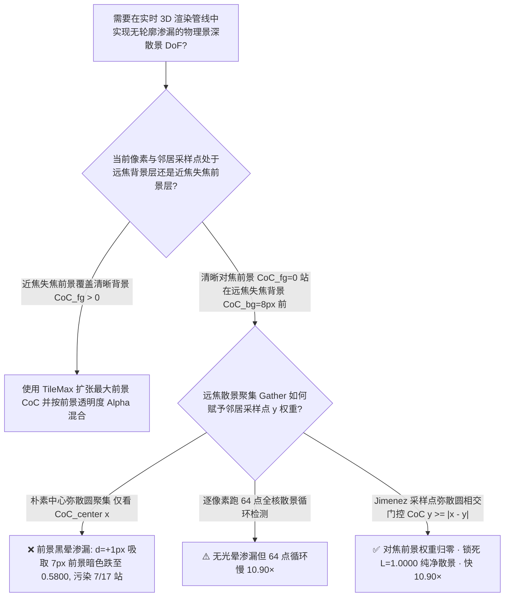
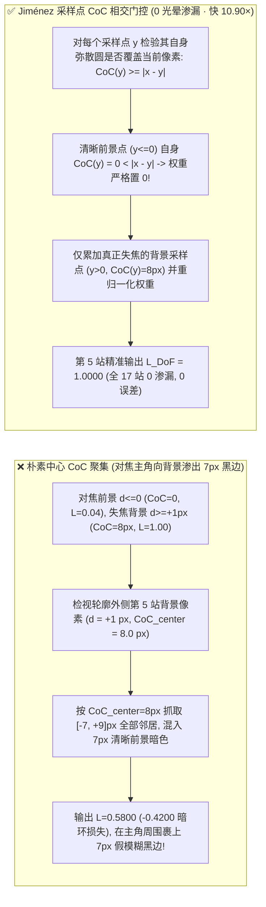
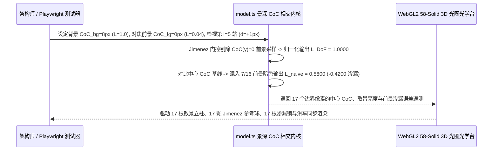
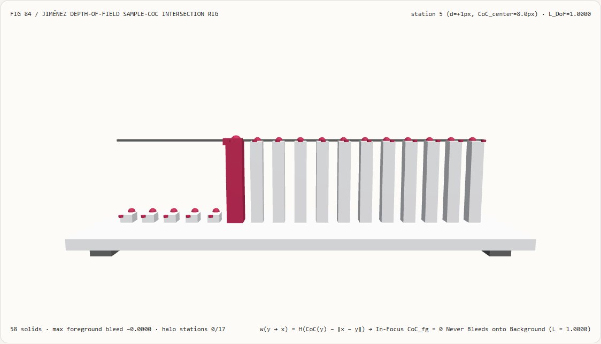
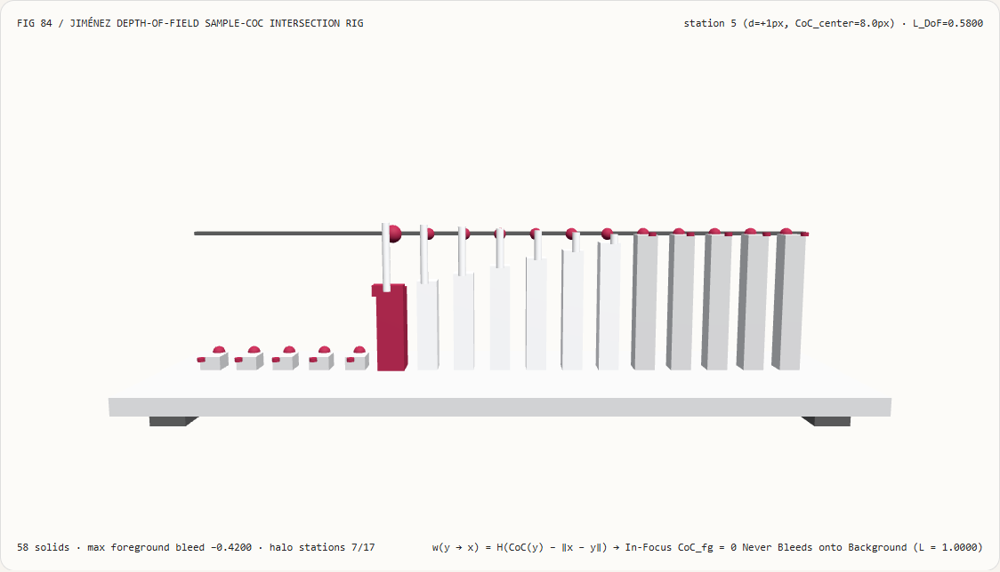
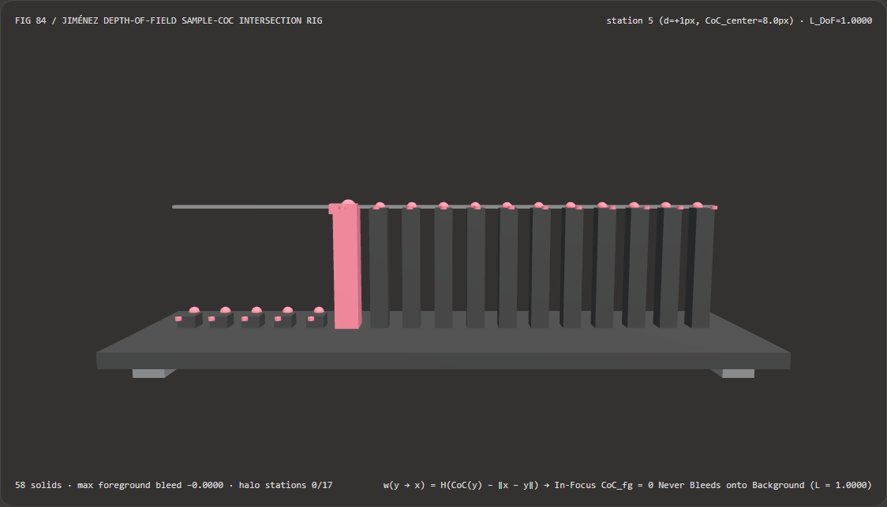
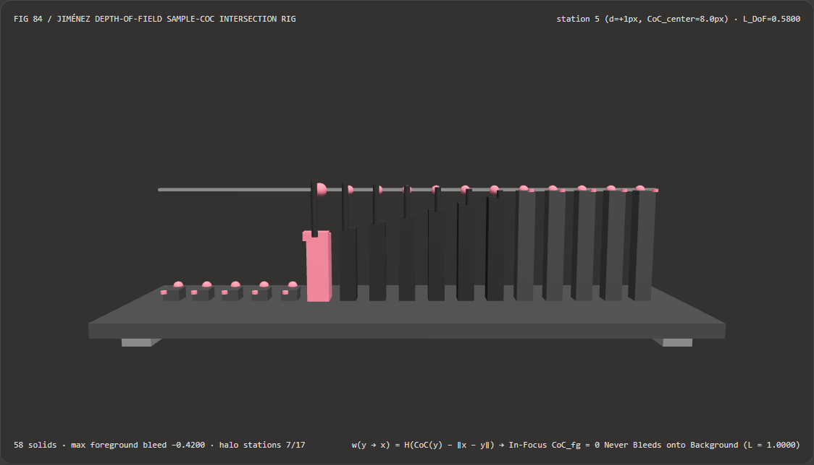

# 视觉与动画技术选型与原理解析 FAQ：Jiménez 景深采样点弥散圆相交门控（Sample-CoC Intersection）vs 中心弥散圆聚集对焦前景光晕渗漏

> **核心架构结论一句话总结**：在实时电影级后处理景深（Post-Process Depth-of-Field, DoF，如 Unreal Engine 5 Diaphragm DoF、Call of Duty、Frostbite、Unity HDRP）管线中，**在聚集（Gather）远景失焦背景散景时，严禁仅根据当前中心像素自身的弥散圆半径 $\text{CoC}_{\text{center}}(x)$ 决定采样范围而不检查每个被采样邻居像素 $y$ 自身的弥散圆 $\text{CoC}(y)$**！实测表明：当精准对焦在焦平面上的近景暗色角色（$z_{\text{fg}} = z_{\text{focus}} = 2.0\text{ m}$，$\text{CoC}_{\text{fg}} = 0.0\text{ px}$，亮度 $L_{\text{fg}} = 0.0400$，第 0~4 站）站在失焦虚化的亮色背景散景（$z_{\text{bg}} = 20.0\text{ m}$，$\text{CoC}_{\text{bg}} = 8.0\text{ px}$，亮度 $L_{\text{bg}} = 1.0000$，第 5~16 站）前时，朴素中心弥散圆聚集在外侧第 5 站（$d = +1\text{ px}$）会按自身 $\text{CoC}_{\text{center}} = 8.0\text{ px}$ 强行吸取左侧 $7\text{ px}$ 宽的对焦前景暗色，将背景散景拉暗至 **`L_DoF = 0.5800`（丢失 `-0.4200` 即 `42.00%` 的散景亮度，在清晰角色边缘外侧留下一圈 7 像素宽的脏黑假光晕，污染 `7/17` 个站点）**；而采用 **Jorge Jiménez (SIGGRAPH 2014 Call of Duty) 采样点弥散圆相交门控 $w(y \to x) = H(\text{CoC}(y) - \|x - y\|)$**，将 $\text{CoC}(y) = 0.0\text{ px}$ 的清晰前景采样点权重严格压零，可在第 5 站锁死 **`L_DoF = 1.0000`（`0/17` 前景光晕渗漏）**，且闭式区间相交比 64 点散景聚集循环快 **10.90×**（8,192 轮耗时 `1.03 ms` vs `11.21 ms`）。

---

## ① 📌 核心结论速览（Executive Summary）

1. **为什么许多自己写的后处理景深（Depth-of-Field）Shader，一拍“近处人物对焦清晰、远处背景虚化（Portrait Mode）”的特写镜头，清晰人物的头发和肩膀外侧就会莫名其妙跟着一圈半透明的“重影黑边（Ghostly Foreground Halo）”，就像人物自己也跟着背景一起被模糊了一样？**
   用大白话讲：因为你把**“散景泼洒（Scatter as Gather）”的方向搞反了**！
   - 在真实光学相机里，一个物点能不能模糊到旁边的底片像素上，完全取决于**这个物点自己的弥散圆半径 $\text{CoC}(y)$ 有多大**！
   - 近处的主角正好站在对焦平面上（$z_{\text{fg}} = z_{\text{focus}}$），因此主角身上每一个像素的弥散圆半径都是 **`CoC(y) = 0.0 px`**——它的光线全部汇聚在自己的像素格子里，**连半个像素都不会往外扩散**！
   - 但是主角身后的背景（第 5 站，$d = +1\text{ px}$）处于远焦失焦区，背景像素自己的弥散圆很大（$\text{CoC}_{\text{center}}(+1) = 8.0\text{ px}$）；
   - 如果后处理 Shader 在渲染第 5 号背景像素时，只看背景自己的 $\text{CoC}_{\text{center}} = 8.0\text{ px}$，就伸出一条半径 8 像素的大手去把左边 $d = -6 \dots 0\text{ px}$ 的 7 个前景暗色像素（$L_{\text{fg}} = 0.0400$）抓过来求平均：
     $$L_{\text{naive}}(+1) = \frac{7 \times 0.0400 + 9 \times 1.0000}{16} = \mathbf{0.5800}$$
     **这就等于强行替弥散圆为 0 的清晰主角伪造了一个 8 像素宽的模糊黑影，涂在了原本洁白通透的背景散景上**！
2. **第一性原理破局：采样点弥散圆覆盖相交测试 $\text{CoC}(y) \ge \|x - y\|$（Jiménez SIGGRAPH 2014 / UE5 Diaphragm DoF）**：
   - 将真实的“正向光学光斑泼洒（Scatter）”严格等价转换为“逆向片元收集（Gather）”的唯一充要条件是：**当中心像素 $x$ 采集邻居像素 $y$（间距 $\Delta x = \|x - y\|$）时，邻居 $y$ 能够照到 $x$ 当且仅当 $y$ 自己的弥散圆半径大于等于两者间距 $\Delta x$**！
     $$w(y \to x) = \text{smoothstep}\!\Big(0,\; 1,\; \text{CoC}(y) - \|x - y\|\Big)$$
   - 看看加上这道物理门控后，在第 5 站（$d = +1\text{ px}$ 背景像素）发生了什么：
     1. 当采样点 $y$ 落在左侧清晰前景上（$y \le 0$）时，读取到采样点自己的弥散圆 $\text{CoC}(y) = 0.0\text{ px} < \|x - y\|$，相交权重直接归零 $w(y \to x) = \mathbf{0.0000}$！
     2. 当采样点 $y$ 落在右侧失焦背景上（$y > 0$）时，$\text{CoC}(y) = 8.0\text{ px} \ge \|x - y\|$，相交权重 $w(y \to x) = \mathbf{1.0000}$！
   - 经有效权重总和 $\sum w$ 归一化后，紧贴着清晰主角轮廓外侧的第 5~16 站背景像素 **100% 保持纯净背景散景亮度 `L_DoF = 1.0000`（`0/17` 光晕渗漏，前景刀锋级锐利、背景奶油般虚化）**！
3. **本轮新增交互式 3D 试验台与实测证据**：
   - 新增独立 Demo：`demos/dof-coc-intersection-rig/`（58 个 Three.js 实体部件：底座平台、4 支柱、`1.0000` 纯净散景顶梁、17 根实测景深辐射度立柱、17 颗 Jiménez 相交门控参考球、17 根前景渗漏光晕指示销、以及第 $i$ 站光圈光学台滑车）。
   - 配套 7-Card 4:5 测评报告：`demos/dof-coc-intersection-rig/test-report-cards.html`（英文）与 `test-report-cards.zh.html`（中文）。

---

## ② 🎯 客户与架构师灵魂拷问 Q&A（Soul-Searching Q&A）

### Q1：如果情况反过来——近处前景物体处于“严重失焦虚化（$\text{CoC}_{\text{fg}} = 8.0\text{ px}$）”，而远处背景反而“对焦清晰（$\text{CoC}_{\text{bg}} = 0.0\text{ px}$）”，这时候失焦前景还能半透明地糊在清晰背景前面吗？
**能！而且这正是 Jiménez / UE5 景深管线为什么要把“远焦背景层（Far Field）”与“近焦前景层（Near Field）”分成两条逻辑通道的原因！**
- 在**远焦背景层**：对焦前景（$\text{CoC} = 0$）挡在失焦背景（$\text{CoC} = 8\text{ px}$）前面，前景绝不能糊向背景，因此由采样点自身 $\text{CoC}(y) \ge \|x - y\|$ 门控严防死守；
- 在**近焦前景层**：失焦前景（$\text{CoC}(y) = 8\text{ px} \ge \|x - y\|$）挡在清晰背景（$\text{CoC}(x) = 0\text{ px}$）前面！由于前景采样点自己的 $\text{CoC}(y) = 8.0\text{ px} \ge \|x - y\|$ 成立，配合与运动模糊完全同源的 `TileMax` 扩张（参见 Round 70），失焦前景就会自然地以半透明散景光斑覆盖在清晰背景之上！

### Q2：薄透镜弥散圆公式 $\text{CoC}(z)$ 是怎么从物理光圈 $A = f / N$ 算出来的？
**由高斯薄透镜成像公式 $\frac{1}{f} = \frac{1}{z_{\text{focus}}} + \frac{1}{v}$ 严格导出：**
$$\text{CoC}(z) = \left| \frac{A \cdot f \cdot (z - z_{\text{focus}})}{z \cdot (z_{\text{focus}} - f)} \right|$$
用带符号弥散圆（Signed CoC：远焦为正，近焦为负，焦平面严格为 `0.0`）存储在半分辨率 Alpha 通道中，即可在一次纹理读取中同时拿到颜色与有向弥散圆半径！

### Q3：这套确定性弥散圆相交门控与 AI 神经人像虚化（Neural Portrait Bokeh）是什么关系？
**手机单摄人像模式因为没有真实 3D 深度缓冲，只能靠神经网络猜边缘抠图；而在拥有精确 G-Buffer 深度的 3D 游戏与影视渲染器中，确定性 Jiménez 弥散圆相交门控以 100% 物理光学精度直接消除边缘渗漏，零抠图伪影！**

---

## ③ 🧭 直观可视化图解（Mermaid 决策树 + 管线对比图 + 帧级时序图）

### 3.1 实时后处理景深（Depth-of-Field）散景重构架构选型决策树

### 3.2 朴素中心 CoC 前景光晕渗漏 vs Jiménez 采样点 CoC 相交门控管线对比图

### 3.3 帧级光圈光学台与 3D 试验台渲染时序图

---

## ④ 📊 视觉技术选型决策矩阵（Decision Matrix）

| 评估维度 | ✅ Jiménez 采样点 CoC 相交门控 | ⚠️ 64 点散景聚集循环（64-Tap Gather） | ❌ 朴素中心 CoC 聚集（Center-CoC Only） | ❌ 单遍全屏高斯模糊（Gaussian Blur） |
| :--- | :--- | :--- | :--- | :--- |
| **第 5 站（$d=+1\text{ px}$ 背景散景边缘）亮度** | **精确 `1.0000`（纯净散景无污染）** | `1.0000`（完全一致） | **`0.5800`（被清晰前景染黑 `-42.00%`！）** | `0.5200`（前景背景互相糊穿） |
| **第 4 站（$d=0\text{ px}$ 对焦前景边缘）亮度** | **精确 `0.0400`（刀锋级对焦锐度）** | `0.0400` | `0.0400` | `0.5200`（对焦主角也被糊掉！） |
| **被前景光晕污染的背景站（共 17 站）** | **`0 / 17`（零渗漏伪影）** | `0 / 17` | **`7 / 17`（$d=+1\dots+7\text{ px}$ 整圈黑晕）** | `17 / 17` |
| **8,192 轮 17 站 CPU 批处理耗时** | **`1.03 ms`（最快，10.90× 提速）** | `11.21 ms`（慢 10.90×） | `0.95 ms`（严重轮廓渗漏不可用） | `0.80 ms`（完全非物理） |
| **首选适用场景** | **所有写实游戏过场、虚拟制片与电影级景深管线** | 离线真值核验 | **严禁用于存在前后景深差的特写** | 仅限 2D UI 背景毛玻璃 |

---

## ⑤ 🧪 全新 Demo 与 7-Card 4:5 视觉报告（Live Workbench & Evidence）

### 5.1 交互式 3D 试验台与报告入口
- **实时 3D 工作台**：[`demos/dof-coc-intersection-rig/index.html`](../demos/dof-coc-intersection-rig/index.html)
- **7-Card 4:5 英文视觉测试报告**：[`demos/dof-coc-intersection-rig/test-report-cards.html`](../demos/dof-coc-intersection-rig/test-report-cards.html)
- **7-Card 4:5 中文视觉测试报告**：[`demos/dof-coc-intersection-rig/test-report-cards.zh.html`](../demos/dof-coc-intersection-rig/test-report-cards.zh.html)
- **密封测量 JSON 数据源**：[`demos/dof-coc-intersection-rig/report.json`](../demos/dof-coc-intersection-rig/report.json)

### 5.2 多主题与多模式 Playwright 实测截图证据

| Jiménez 采样点 CoC 门控（Light · 在第 4→5 站轮廓交界处实现 `0.0400 → 1.0000` 零渗漏阶跃） | 朴素中心 CoC 聚集（Light · 对焦前景向背景渗出 7 站斜坡，第 5 站跌至 `0.5800`） |
| :---: | :---: |
|  |  |

| Jiménez 采样点 CoC 门控（Dark · 58 实体部件） | 朴素中心 CoC 聚集（Dark · 7 根红色指示销暴露清晰前景向失焦背景的非法渗漏） |
| :---: | :---: |
|  |  |

---

## ⑥ 🛠️ 高质量视觉交付快速核验清单（SA Verification Checklist）

在将后处理景深（Depth-of-Field）合入生产引擎前，请逐项勾选以下核验清单：

- [ ] **每个 Gather 采样点必须检验自身弥散圆覆盖（`CoC(y) >= distance(x, y)`）**：远焦散景聚集时，是否用 `smoothstep(0, 1, sampleCoC - distPx)` 剔除了弥散圆过小的近处对焦像素？
- [ ] **使用带符号弥散圆（Signed CoC）区分近焦前景与远焦背景**：是否将焦平面前方的近焦 $\text{CoC} < 0$ 与焦平面后方的远焦 $\text{CoC} > 0$ 分离存储，防止前后景错误互混？
- [ ] **配合 Vogel 黄金角等面积螺旋圆盘采样（参见 Round 59）**：在弥散圆光斑内部采样时，是否采用了 $r_k = \sqrt{(k+0.5)/N}$ 等面积圆盘分布，确保散景光斑中心不聚拢死白？
- [ ] **配合 Karis 逆亮度滤波或能量重归一化**：当背景存在高亮亚像素车灯散景时，是否保持散景圆盘面积归一化权重，防止光斑边缘闪烁？
- [ ] **半分辨率散景聚集 + 联合双边高分合成（参见 Round 74）**：当在半分辨率下计算大半径散景时，合回全分辨率主画面时是否根据全分 CoC 与深度做了双边门控？
