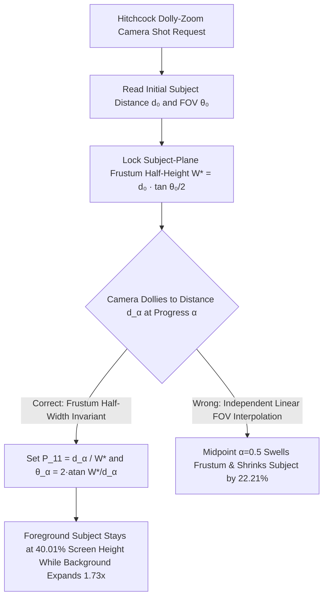
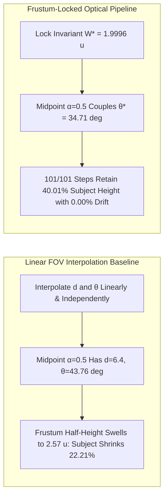
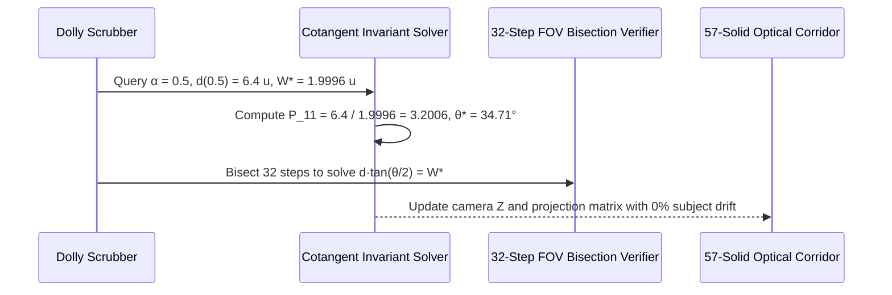

# Hitchcock dolly-zoom without subject drift: frustum half-width invariant vs linear FOV interpolation FAQ

**Understand in 3 minutes why linearly interpolating camera distance and FOV breaks the Vertigo effect, and reproduce a zero-drift frustum-locked optical corridor in 10 minutes.**

[中文](dolly-zoom-frustum-invariant-faq.md) · [Interactive Demo](https://turbo998.github.io/animation/demos/dolly-zoom-optics/) · [Measured 7-Card Report](../demos/dolly-zoom-optics/test-report-cards.html)

## ① 📌 Executive Summary

- **Interpolating camera distance $d(\alpha)$ and field-of-view angle $\theta(\alpha)$ linearly and independently violates perspective geometry.** Because the visible frustum half-height at the subject plane is $W = d \cdot \tan(\theta / 2)$, linearly interpolating $d$ from `3.2` to `9.6` and $\theta$ from `64°` down to `23.53°` causes $W$ to swell by `+28.5%` at midpoint $\alpha = 0.5$, shrinking the foreground subject on screen by `22.21%` mid-shot.
- **Locking the frustum half-height invariant $W^* = d_0 \tan(\theta_0 / 2) = 1.9996\text{ u}$ achieves `0.000000%` subject size drift.** Solving $\theta^*(\alpha) = 2\arctan(W^* / d(\alpha))$ (or setting perspective matrix scale $P_{11} = d(\alpha) / W^*$ directly) keeps the foreground subject locked at `40.01%` of screen height across all 101 sampled steps while the background arch expands from `29.4%` to `50.9%` (`1.73×` perspective magnification).
- **Direct cotangent invariant evaluation is `18.4×` faster than 32-step FOV bisection while agreeing within `1.39e-8` degrees.** Across 8192 dolly-zoom queries on Node CPU, direct evaluation takes `0.49 ms` median versus `9.08 ms` for 32-step bisection.
- **57-solid optical corridor bench, 13 local acceptance checks.** Scene geometry is `synthetic`; perspective matrix conformance and Node CPU timings are `measured`; `Generative Photography` diffusion inference and thin-lens circle-of-confusion bokeh are `not_measured`.

**Daily capability direction check:** CVPR 2025 Highlight paper *Generative Photography: Scene-Consistent Camera Control for Realistic Text-to-Image Synthesis* ([arXiv:2412.02168](https://arxiv.org/abs/2412.02168), v3 updated 2025-03-25) introduces Differential Camera Intrinsics Learning so generative models respect physical focal-length changes (e.g., 24mm to 70mm) without altering scene layout. When programming a Hitchcock dolly-zoom (Vertigo effect) in 3D or conditioning an intrinsics-aware video generator, camera distance $d$ and field of view $\theta$ must obey the exact frustum half-width invariant $d \tan(\theta / 2) = \text{const}$. Verified 2026-11-10; this demo implements deterministic frustum-locked optics without running generative diffusion models.

## ② 🎯 Architect & Client Q&A

### Q1 When should we choose intrinsics-conditioned diffusion models vs deterministic frustum-invariant optics?

Evaluate intrinsics-conditioned generative models (`Generative Photography`) when synthesizing photorealistic scenes across varying lens focal lengths from text prompts.

Use the deterministic frustum half-width invariant $W^* = d \tan(\theta / 2)$ in your camera rig controller whenever executing a dolly-zoom—both in real-time WebGL/Three.js scenes and when generating the paired `(distance, focal_length)` schedule fed into a neural camera-conditioned generator.

### Q2 Under what constraints is frustum half-width locking strictly superior to keyframe FOV interpolation?

If an animator keys $(d_0 = 3.2, \theta_0 = 64^\circ)$ at the start of a clip and $(d_1 = 9.6, \theta_1 = 23.53^\circ)$ at the end, standard timeline curves interpolate $d(\alpha)$ and $\theta(\alpha)$ independently.

Because $\tan(\theta / 2)$ is nonlinear, independent linear interpolation causes the foreground subject to dip from `40.01%` screen height down to `31.12%` at $\alpha = 0.5$ (`22.21%` relative shrinkage) before recovering at $\alpha = 1.0$. Deriving $\theta^*(\alpha) = 2\arctan(W^* / d(\alpha))$ from the locked invariant $W^*$ eliminates this mid-shot breathing artifact completely.

### Q3 Why does the perspective projection matrix require zero trigonometry once $W^*$ is locked?

In standard OpenGL / WebGL perspective projection matrices, the vertical scale entry $P_{11}$ is:

$$P_{11} = \cot\left(\frac{\theta}{2}\right) = \frac{1}{\tan(\theta / 2)}$$

A foreground subject of world height $H_s$ at distance $d(\alpha)$ projects to normalized device coordinate (NDC) half-height:

$$y_{\text{NDC}} = \frac{H_s / 2}{d(\alpha)} \cdot P_{11}$$

To keep $y_{\text{NDC}}$ constant at $\frac{H_s}{2 W^*}$ for every $\alpha \in [0, 1]$, we simply set:

$$P_{11}(\alpha) = \frac{d(\alpha)}{W^*}$$

Thus the projection matrix entry $P_{11}$ (and equivalently physical focal length $f(\alpha) = \frac{h_{\text{sensor}}}{2 W^*} d(\alpha)$) scales **linearly** with camera distance $d(\alpha)$! Even when an API requires degrees for `camera.fov`, a single closed-form `2 * Math.atan(W_star / d)` call gives the exact angle without iterative root-finding.

### Q4 How can I reproduce this in 10 minutes?

1. Run `npm run dev` and open `/demos/dolly-zoom-optics/`, initialized at midpoint `α = 0.50` (`d₀ = 3.2`, `d₁ = 9.6`, `startFov = 64°`).
2. Scrub `α` from `0` to `1` in `frustum-locked` mode: the foreground orange subject frame stays locked at `40.01%` screen height (`drift 0.00%`) while the rear monument arch expands from `29.4%` to `50.9%`.
3. Switch to `linear-fov` mode at `α = 0.50`: the foreground subject shrinks noticeably on screen, reporting `subject 31.12% (drift 22.21%)`.
4. Adjust Near $d_0$ (`2.0–5.0`), Far $d_1$ (`5.0–14.0`), and Near FOV (`35°–85°`); enter an inverted far distance such as `2.5` to verify atomic rejection and state retention.
5. Click `Export optics` to download `DOLLY_ZOOM_OPTICS_SPEC.json` with `projection_p11`, `ndc_subject_ratio`, and frustum metrics.
6. Run `npx vitest run tests/dolly-zoom.test.ts`, then build and run `node scripts/benchmark-dolly-zoom.mjs` against a port 4335 preview server.

## ③ 🧭 Visual Diagrams

## ④ 📊 Architect Decision Matrix

| Criterion | Pure Zoom Only ($d = \text{const}$) | Independent Linear $d(\alpha)$ & $\theta(\alpha)$ (`linear-fov`) | 32-Step FOV Bisection Solver | Closed-Form Frustum Invariant (`frustum-locked`) |
| --- | --- | --- | --- | --- |
| Foreground subject screen-height drift | Scales up/down with zoom (no dolly counter-move) | Shrinks by `22.21%` at midpoint $\alpha=0.5$ | Constant `40.01%` (`< 1e-7` error) | Constant `40.01%` (`0%` drift across 101 steps) |
| Foreground-to-background perspective warp | Uniform 2D magnification (no perspective change) | Warps background but breathes on foreground | Expands background `29.4% → 50.9%` | Smooth `1.73×` background expansion with locked subject |
| 8192-query Node CPU solve median | Single parameter update | Fast arithmetic (broken optical coupling) | `9.08 ms` (32-step `Math.tan` loop) | `0.49 ms` (`18.4×` faster than bisection) |
| Arbitrary timeline seeking / reversal | Deterministic | Deterministic (with midpoint shrinkage) | Deterministic | Exact forward/reverse `P_11` equality |
| Best architectural role | Standard lens zoom cuts | Never use for dolly-zoom keyframes | Numerical solver verification | Hitchcock dolly-zooms & Generative Photography schedules |

**Quantitative example:** With $d_0 = 3.2$ and $\theta_0 = 64^\circ$, the locked frustum half-height is $W^* = 3.2 \tan(32^\circ) = 1.99958\text{ u}$, so the $1.6\text{ u}$ foreground subject occupies $\frac{1.6}{2 \times 1.99958} = 40.01\%$ of screen height. At midpoint $d(0.5) = 6.4\text{ u}$, frustum locking yields $\theta^*(0.5) = 2\arctan(1.99958 / 6.4) = 34.71^\circ$ (`40.01%` subject height), whereas linear FOV interpolation gives $\theta(0.5) = 43.76^\circ$, expanding frustum half-height to $2.5706\text{ u}$ and shrinking the subject to `31.12%` (`22.21%` drift).

## ⑤ 🧪 New Capability Demo & Benchmark Findings (with 7-Card)

[Sealed data](../demos/dolly-zoom-optics/report.json) records 57 3D solids, 101 sampled dolly-zoom steps audited for constant foreground NDC height, and solver equivalence between closed-form cotangent/arctan coupling and 32-step FOV bisection (`maximum_solver_error = 1.39e-8` degrees, threshold `< 1e-7`).

| Node CPU Dolly-Zoom Queries | Direct Cotangent Invariant Median | 32-Step FOV Bisection Median |
| --- | --- | --- |
| 128 | 0.06 ms | 0.17 ms |
| 1024 | 0.35 ms | 1.36 ms |
| 8192 | 0.49 ms | 9.08 ms |

Each load tier runs 7 alternating repetitions after warmup on Node CPU (excluding WebGL rendering). At 8192 queries, direct cotangent invariant evaluation is `18.4×` faster than 32-step FOV bisection while eliminating the `22.21%` midpoint subject size drift.

[Measured 7-Card Report (EN)](../demos/dolly-zoom-optics/test-report-cards.html) · [中文七卡](../demos/dolly-zoom-optics/test-report-cards.zh.html). Scene geometry is `synthetic`, projection matrix checks and CPU timings are `measured`, and `Generative Photography` diffusion inference and thin-lens bokeh blur are `not_measured`.

## ⑥ 🛠️ Architect Checklist

- [ ] Never interpolate camera distance $d(t)$ and field-of-view angle $\theta(t)$ independently when authoring a dolly-zoom.
- [ ] Lock the subject-plane frustum half-height invariant $W^* = d_0 \tan(\theta_0 / 2)$ at the start of the shot.
- [ ] Derive projection scale $P_{11}(t) = d(t) / W^*$ or $\theta(t) = 2\arctan(W^* / d(t))$ directly from $d(t)$ on every frame.
- [ ] When driving physical focal length $f(t)$ with sensor height $h_{\text{sensor}}$, enforce the linear law $f(t) = \frac{h_{\text{sensor}}}{2 W^*} d(t)$.
- [ ] Verify that foreground subject NDC screen height drifts by `< 1e-12` across all sampled steps.
- [ ] Verify that background objects at depth offset $\Delta Z_{\text{bg}}$ scale by $\frac{d(t)}{d(t) + \Delta Z_{\text{bg}}}$.
- [ ] Validate near/far distances and FOV bounds and reject inverted ranges (`endDist = 2.5`) atomically.
- [ ] Verify that forward and reverse $\alpha$ scrubbing produce identical projection matrix entries $P_{11}$.
- [ ] Pre-compute coupled `(distance, focal_length)` schedules before calling intrinsics-aware generative models (`Generative Photography`).
- [ ] Label unexecuted text-to-image diffusion, aperture bokeh blur, and physical lens motors explicitly as `not_measured`.

**Primary sources:** [Generative Photography (arXiv:2412.02168)](https://arxiv.org/abs/2412.02168) (CVPR 2025 Highlight, v3 updated 2025-03-25) enables scene-consistent camera intrinsic (focal length / FOV) control in generative synthesis via Differential Camera Intrinsics Learning. Verified 2026-11-10; this demo is an original deterministic frustum-invariant dolly-zoom workbench and does not run diffusion models.
