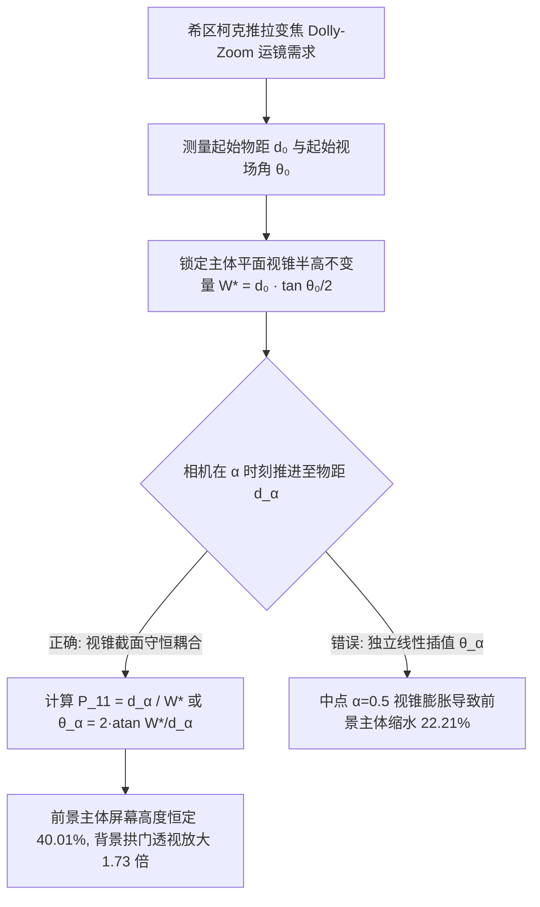
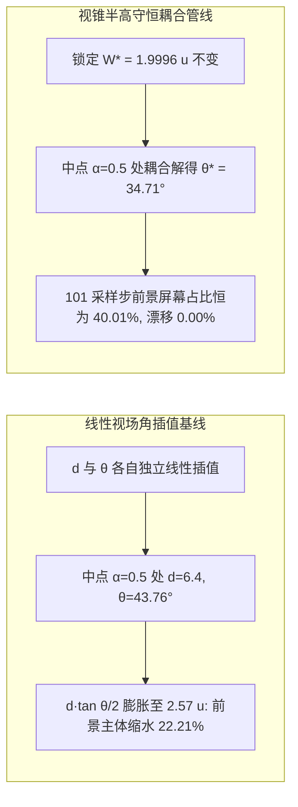
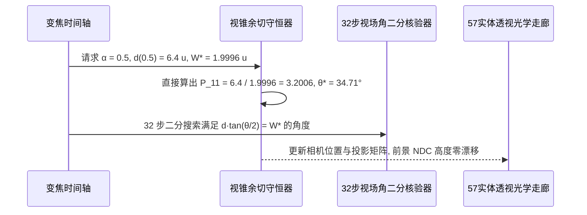

# 推拉变焦主体大小不漂移：视锥截面宽度守恒与线性焦距插值选型 FAQ

**3 分钟看懂为什么希区柯克变焦不能对距离和视场角分别做线性插值，10 分钟复刻前景零漂移的透视视锥走廊。**

[English](dolly-zoom-frustum-invariant-faq.en.md) · [交互 Demo](https://turbo998.github.io/animation/demos/dolly-zoom-optics/) · [中文七卡](../demos/dolly-zoom-optics/test-report-cards.zh.html)

## ① 📌 核心结论速览

- **同时对相机距离 $d(\alpha)$ 与视场角 $\theta(\alpha)$ 做独立线性插值，必然破坏透视不变量。** 因为前景主体平面处的视锥半高为 $W = d \cdot \tan(\theta / 2)$，由于正切函数的非线性，当 $d$ 从 `3.2` 线性拉远到 `9.6`、$\theta$ 从 `64°` 线性缩小到 `23.53°` 时，在中点 $\alpha = 0.5$ 处视锥半高膨胀了 `+28.5%`，导致前景主体在屏幕上的高度缩水漂移 `22.21%`。
- **锁死视锥半高不变量 $W^* = d_0 \tan(\theta_0 / 2) = 1.9996\text{ u}$ 实现 `0.000000%` 主体大小漂移。** 按 $\theta^*(\alpha) = 2\arctan(W^* / d(\alpha))$ 耦合反解视场角（或直接将透视投影矩阵对角元设为 $P_{11} = d(\alpha) / W^*$），101 个采样步中前景主体屏幕高度恒为 `40.01%`（漂移 `0%`），同时后方背景拱门的屏幕高度占比从 `29.4%` 膨胀至 `50.9%`（放大 `1.73×`）。
- **直接视锥余切守恒求解比 32 步视场角二分反解快 `18.4×`。** 两种求解器在全部负载下的最大视场角误差仅 `1.39e-8` 度，8192 次查询中位数耗时为 `0.49 ms` 对比 `9.08 ms`。
- **57 实体透视光学走廊工作台，13 项本机实测验收。** 场景为 `synthetic`；透视投影矩阵与 Node CPU 耗时为 `measured`；`Generative Photography` 扩散模型内参控制与薄透镜焦外弥散圆渲染为 `not_measured`。

**每日能力方向核验：** CVPR 2025 Highlight 论文 *Generative Photography: Scene-Consistent Camera Control for Realistic Text-to-Image Synthesis*（[arXiv:2412.02168](https://arxiv.org/abs/2412.02168)，2025-03-25 v3）通过差分相机内参学习实现了跨焦距（如 24mm 至 70mm）的场景一致图像与视频生成；当在虚拟制片或三维动画中设计推拉变焦（Dolly-Zoom / Vertigo Effect）镜头时，相机外参物距 $d$ 与内参视场角 $\theta$ 必须严格满足视锥截面守恒律。2026-11-10 核验原文；本例仅实现确定性视锥光学耦合，未运行生图扩散模型。

## ② 🎯 客户与架构师灵魂拷问 Q&A

### Q1 何时选相机内参条件扩散模型，何时选确定性视锥半高守恒公式？

当需要根据文本提示词直接生成具有真实光学透视感与不同焦段畸变风格的写实摄影画面时，可评估 `Generative Photography` 等支持内参控制的扩散模型。

但无论后端是扩散渲染器还是 Three.js 实时三维引擎，只要镜头设计要求“前景人物在画面中大小纹丝不动、而后方走廊像手风琴一样剧烈压缩或拉伸”（希区柯克变焦），前端相机控制器都必须使用确定性视锥半高守恒公式耦合每一帧的 $d(\alpha)$ 与 $\theta(\alpha)$。

### Q2 在什么约束下视锥半高守恒比独立关键帧插值严格更优？

在绝大多数动画时间线编辑器中，如果动画师只在第 0 帧打下关键帧 $(d_0 = 3.2, \theta_0 = 64^\circ)$、在最后一帧打下关键帧 $(d_1 = 9.6, \theta_1 = 23.53^\circ)$，编辑器默认会对 $d$ 和 $\theta$ 各自跑一条线性或贝塞尔插值曲线。

这会导致镜头推拉到一半（$\alpha = 0.5$）时，前景主体在屏幕上突然缩小 `22.21%`，到终点才恢复原大小，产生严重的“呼吸抽动感”。将视锥半高 $W^* = d_0 \tan(\theta_0/2)$ 设为唯一守恒量，并由当前距离 $d(\alpha)$ 实时导出 $\theta(\alpha)$，在一切推拉变焦镜头中严格更优。

### Q3 底层管线为什么在投影矩阵里连三角函数都不需要算？

看一眼标准 OpenGL / WebGL 透视投影矩阵 $\mathbf{P}$ 的第二行第二列元素 $P_{11}$：

$$P_{11} = \cot\left(\frac{\theta}{2}\right) = \frac{1}{\tan(\theta / 2)}$$

高度为 $H_s$、距离相机为 $d(\alpha)$ 的前景主体，投影到归一化设备坐标（NDC）后的半高度为：

$$y_{\text{NDC}} = \frac{H_s / 2}{d(\alpha)} \cdot P_{11}$$

要想让 $y_{\text{NDC}}$ 对任意 $\alpha \in [0, 1]$ 恒等于常数 $\frac{H_s}{2 W^*}$，只需令：

$$P_{11}(\alpha) = \frac{d(\alpha)}{W^*}$$

这意味着在底层渲染管线中，投影矩阵的缩放因子 $P_{11}$ 与相机距离 $d(\alpha)$ 是**纯粹的正比例线性关系**！即使需要把角度写回高层相机对象的 `camera.fov`，也只需一次闭式反正切 $\theta(\alpha) = 2\arctan(W^* / d(\alpha))$，完全不需要任何迭代二分搜索。

### Q4 十分钟如何复刻？

1. `npm run dev` 后打开 `/demos/dolly-zoom-optics/`，默认停在中点 `α = 0.50`（`d₀ = 3.2`、`d₁ = 9.6`、起始视场角 `64°`）。
2. 在视锥半高守恒模式（`frustum-locked`）下从 `α = 0` 拖到 `α = 1`：前景橙色门框在屏幕上的高度始终锁定在 `40.01%`（`drift 0.00%`），而后方远景拱门的屏幕高度从 `29.4%` 剧烈膨胀到 `50.9%`。
3. 切换到线性视场角基线（`linear-fov`）：拖到中点 `α = 0.50`，前景门框在屏幕上明显缩小，读数显示 `subject 31.12% (drift 22.21%)`。
4. 修改近端距离（`2.0–5.0`）、远端距离（`5.0–14.0`）与起始视场角（`35°–85°`）；若输入倒置远端距离 `2.5`，系统执行原子拒绝并保留有效配置。
5. 点击导出 `DOLLY_ZOOM_OPTICS_SPEC.json`，检查 `projection_p11`、`ndc_subject_ratio` 与视锥半高。
6. 运行 `npx vitest run tests\dolly-zoom.test.ts`；构建并在 4335 端口预览后执行 `node scripts\benchmark-dolly-zoom.mjs`。

## ③ 🧭 直观可视化图解

## ④ 📊 Architect Decision Matrix

| 评估维度 | 原地纯变焦 (Zoom Only, $d=\text{const}$) | 独立线性插值 $d(\alpha)$ 与 $\theta(\alpha)$ (`linear-fov`) | 32 步视场角二分反解 (`bisection`) | 本例闭式视锥半高守恒 (`frustum-locked`) |
| --- | --- | --- | --- | --- |
| 前景主体屏幕高度漂移 | 随变焦成倍放大/缩小（无推拉抵消） | 中点 $\alpha=0.5$ 漂移缩水 `22.21%` | 恒定 `40.01%`（误差 `< 1e-7`） | 恒定 `40.01%`（101 步实测 `0%` 漂移） |
| 前景与背景相对透视压缩变化 | 前后景等比例缩放（无透视畸变变化） | 有透视变化但前景呼吸抽动 | 背景从 `29.4%` 膨胀至 `50.9%` | 背景平稳膨胀 `1.73×` 且前景纹丝不动 |
| 8192 次查询 Node CPU 耗时中位数 | 单参数更新 | 快（但光学耦合错误） | `9.08 ms`（32 步正切二分开销） | `0.49 ms`（比 32 步二分快 `18.4×`） |
| 任意进度跳转与逆序重访 | 确定性 | 确定性（但中点缩水） | 确定性 | 正逆序重访投影比例 $P_{11}$ 完全一致 |
| 适用工程场景 | 普通望远/广角构图切换 | 严禁用于推拉变焦关键帧 | 数值对偶验证 | 希区柯克变焦镜头、生成式摄影内参轨迹规划 |

**定量算例：** 起始物距 $d_0 = 3.2$、起始视场角 $\theta_0 = 64^\circ$，锁死视锥半高 $W^* = 3.2 \times \tan(32^\circ) = 1.99958\text{ u}$，高度 $1.6\text{ u}$ 的前景主体占屏幕高度 $\frac{1.6}{2 \times 1.99958} = 40.01\%$。当相机拉远到中点 $d(0.5) = 6.4\text{ u}$ 时，守恒模式给出 $\theta^*(0.5) = 2\arctan(1.99958 / 6.4) = 34.71^\circ$，主体占比仍为 `40.01%`；而线性插值视场角给出 $\theta(0.5) = \frac{1}{2}(64^\circ + 23.53^\circ) = 43.76^\circ$，此时视锥半高变为 $6.4 \times \tan(21.88^\circ) = 2.5706\text{ u}$，主体占比跌至 `31.12%`（相对缩水 `22.21%`）。

## ⑤ 🧪 全新 Demo 与 Benchmark 核心发现（含 7-Card）

[封存数据](../demos/dolly-zoom-optics/report.json)记录了 57 个三维实体、101 个采样步的前景屏幕占比守恒核验，以及直接视锥余切守恒求解与 32 步视场角二分反解的等价性与耗时对照。两种求解器在全部负载下的最大视场角误差仅 `1.39e-8` 度（门限 `< 1e-7`）。

| Node CPU 推拉变焦查询数 | 直接视锥余切守恒中位数 | 32 步视场角二分反解中位数 |
| --- | --- | --- |
| 128 | 0.06 ms | 0.17 ms |
| 1024 | 0.35 ms | 1.36 ms |
| 8192 | 0.49 ms | 9.08 ms |

每档负载在预热后按交替顺序重复 7 次，记录 Node CPU 耗时中位数（不含 WebGL 渲染）。在 8192 次推拉变焦查询中，直接视锥余切守恒求解比 32 步二分反解快约 `18.4×`，同时消除了线性视场角插值在中点 $\alpha = 0.5$ 的 `22.21%` 主体缩水漂移。

[中文七卡](../demos/dolly-zoom-optics/test-report-cards.zh.html) · [English](../demos/dolly-zoom-optics/test-report-cards.html)。画面为 `synthetic`，透视矩阵与 CPU 计时为 `measured`；`Generative Photography` 扩散推理与薄透镜散景模糊为 `not_measured`。

## ⑥ 🛠️ Architect Checklist

- [ ] 切勿在关键帧动画器中对相机距离 $d(t)$ 与视场角 $\theta(t)$ 分别做独立线性或三次样条插值来实现推拉变焦。
- [ ] 在镜头起点计算并锁死目标主体平面的视锥半高不变量 $W^* = d_0 \tan(\theta_0 / 2)$。
- [ ] 在每一帧由当前主体物距 $d(t)$ 直接耦合导出投影矩阵对角元 $P_{11}(t) = d(t) / W^*$ 或视场角 $\theta(t) = 2\arctan(W^* / d(t))$。
- [ ] 若使用物理传感器高度 $h_{\text{sensor}}$ 与等效焦距 $f(t)$，强制保持正比例关系 $f(t) = \frac{h_{\text{sensor}}}{2 W^*} d(t)$。
- [ ] 核验全行程采样帧中前景主体的 NDC 屏幕高度漂移 `< 1e-12`。
- [ ] 同时核验与前景相距 $\Delta Z_{\text{bg}}$ 的背景物体屏幕占比按 $\frac{d(t)}{d(t) + \Delta Z_{\text{bg}}}$ 预期规律发生透视压缩。
- [ ] 对起始距离、终点距离、起始视场角与背景间距执行边界校验，对非法参数执行原子拒绝。
- [ ] 验证正序与逆序拖拽进度 $\alpha$ 时，导出的透视投影矩阵元素 $P_{11}$ 完全一致。
- [ ] 为 `Generative Photography` 等支持焦距条件输入的生成模型预生成满足 $f(t) \propto d(t)$ 的精确焦距序列。
- [ ] 未执行的扩散生图推理、物理光圈景深虚化与变形镜头畸变统一标注为 `not_measured`。

**一手来源：** [Generative Photography (arXiv:2412.02168)](https://arxiv.org/abs/2412.02168)（CVPR 2025 Highlight，2025-03-25 v3）通过差分相机内参学习实现跨焦距场景一致生成。2026-11-10 核验；本例为原创确定性视锥半高守恒推拉变焦测试台，未运行该扩散模型。
