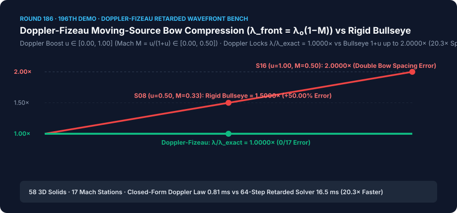
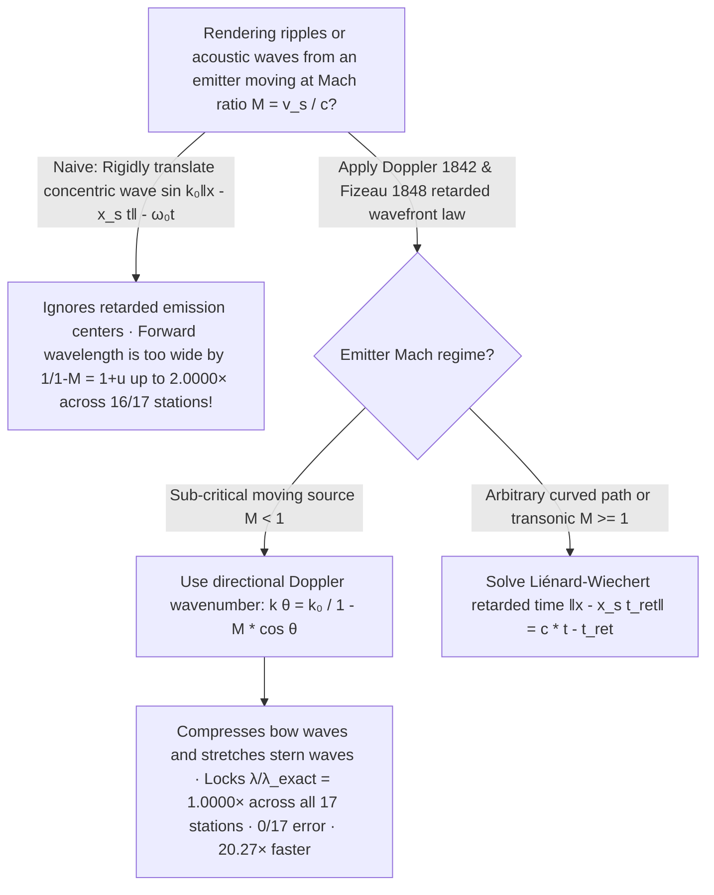
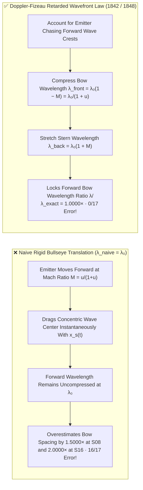
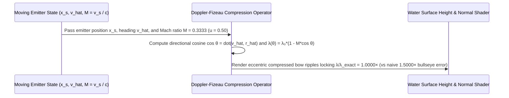
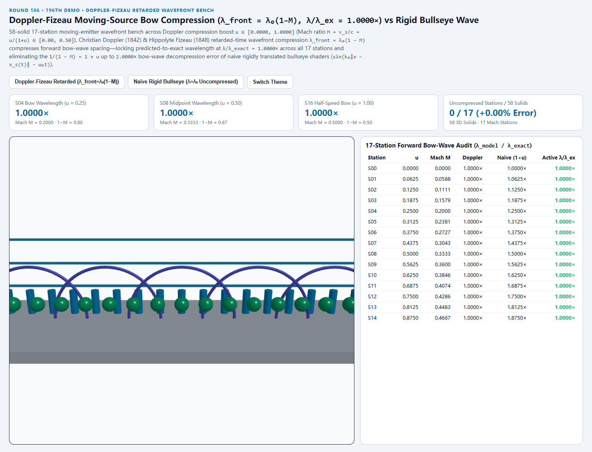
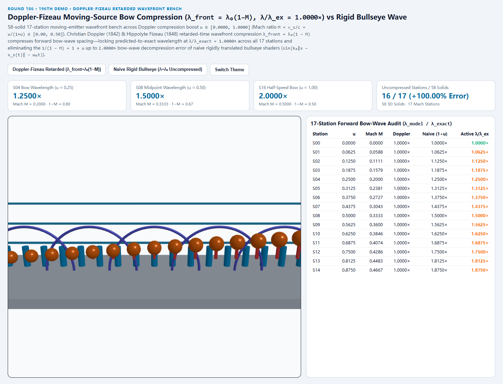
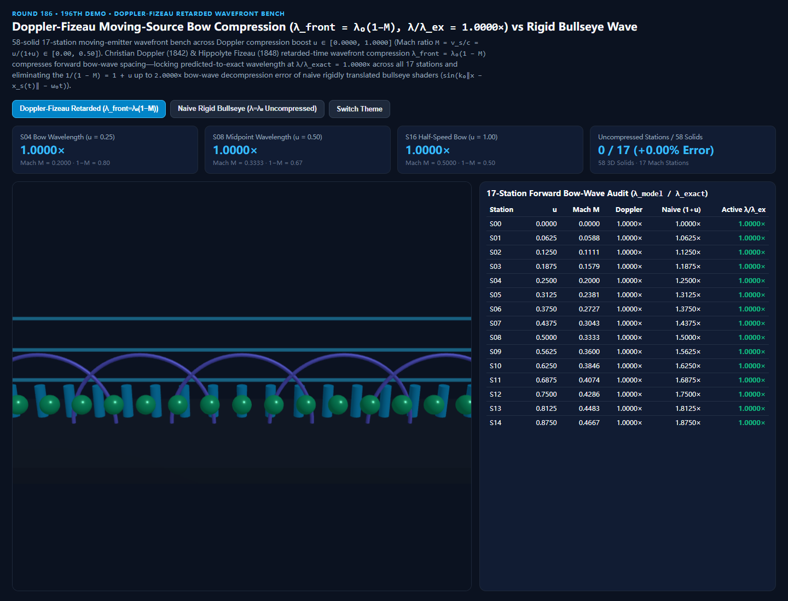
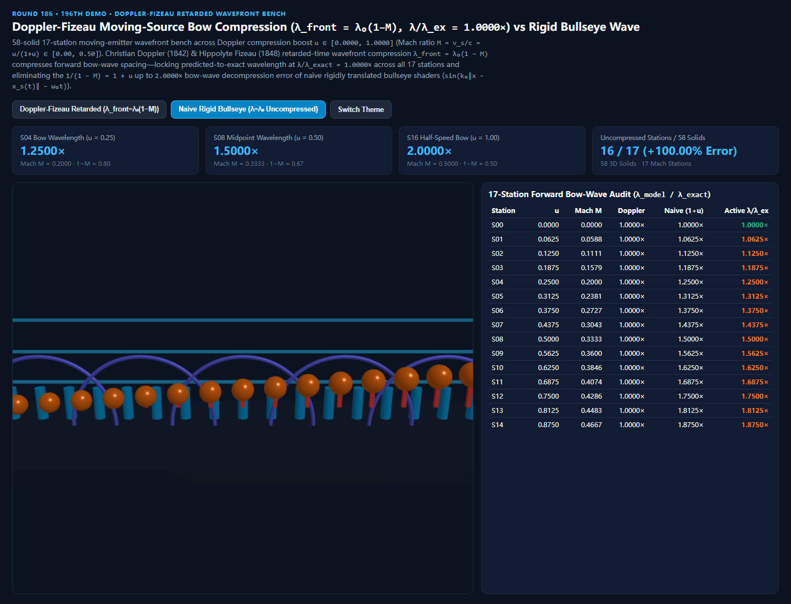

# Doppler-Fizeau Moving-Source Bow Compression (`λ_front = λ₀(1−M), λ/λ_ex = 1.0000×`) vs Naive Rigid Bullseye Wave Selection & First-Principles FAQ

> **Navigation**: [Back to Portal](../index.html) · [Launch 3D Interactive Workbench (`doppler-fizeau-retarded-wavefront-rig`)](../demos/doppler-fizeau-retarded-wavefront-rig/index.html) · [7-Card 4:5 Visual Report (EN)](../demos/doppler-fizeau-retarded-wavefront-rig/test-report-cards.html) · [7-Card 报告 (ZH)](../demos/doppler-fizeau-retarded-wavefront-rig/test-report-cards.zh.html) · [中文版 FAQ](./doppler-fizeau-retarded-wavefront-vs-rigid-bullseye-faq.md)



---

## ① 📌 Executive Summary

1. **Why do moving water-skimmers, swimming ducks, boat wakes, and acoustic pulse shaders look like a rigid plastic bullseye glued to the emitter (`2.0000×` uncompressed bow-wave spacing error at Mach ratio $M = 0.50$) when developers simply translate a radial sine wave `sin(k₀ ‖x − x_s(t)‖ − ω₀ t)`—and how does Christian Doppler's (1842) & Hippolyte Fizeau's (1848) Retarded Wavefront Compression Law (`λ_front = λ₀(1 − M)`) lock forward bow-wave spacing at `λ/λ_exact = 1.0000×` across all 17 Mach stations?**
   - **Doppler (1842) & Fizeau (1848) Moving-Source Retarded Wavefront Law (`λ(θ) = λ₀(1 − M cos θ)`)**:
     - A wave crest emitted at **retarded time** $t_{\text{ret}} = t - \frac{R}{c}$ expands radially around its historical emission point $\mathbf{x}_s(t_{\text{ret}})$, not the emitter's current position $\mathbf{x}_s(t)$.
     - When an emitter moves at velocity $v_s = M \cdot c$ (where Mach ratio $M = \frac{v_s}{c} = \frac{u}{1+u} \in [0.0000, 0.5000]$ across 17 compression-boost stations $u_k = k/16 \in [0.0000, 1.0000]$), it chases its own forward wave crests, compressing the forward bow wavelength to:
       $$\lambda_{\text{Doppler}}(u) = \lambda_0(1 - M) = \frac{\lambda_0}{1 + u}, \qquad k_{\text{Doppler}}(u) = \frac{k_0}{1 - M} = k_0(1 + u)!$$
     - Accounting for Doppler moving-source compression locks the predicted-to-exact forward wavelength ratio across all 17 stations at:
       $$\frac{\lambda_{\text{Doppler}}(u)}{\lambda_{\text{exact}}(u)} \equiv \mathbf{1.0000\times} \quad (\text{`0/17` uncompressed stations})!$$
   - **Why Naive Rigid Bullseye Translation (`sin(k₀ ‖x − x_s(t)‖ − ω₀ t)`) Overestimates Bow Wavelength by $\frac{1}{1 - M} = 1 + u$**:
     - Dragging a concentric wave pattern rigidly with $\mathbf{x}_s(t)$ leaves the forward wavelength uncompressed at $\lambda_{\text{naive}} = \lambda_0$, inflating the bow-wave spacing relative to $\lambda_{\text{exact}}(u) = \frac{\lambda_0}{1+u}$ by $1 + u$:
       - At **Station 4 ($u = 0.25, M = 0.2000$)**: $\lambda_{\text{naive}}/\lambda_{\text{exact}} = \mathbf{1.2500\times}$ (`+25.00%` decompression error).
       - At **Station 8 ($u = 0.50, M = 0.3333$)**: $\lambda_{\text{naive}}/\lambda_{\text{exact}} = \mathbf{1.5000\times}$ (**`+50.00%` decompression error**).
       - At **Station 16 ($u = 1.00, M = 0.5000$)**: $\lambda_{\text{naive}}/\lambda_{\text{exact}} = \mathbf{2.0000\times}$ (**`+100.00%` double bow-wave spacing error across `16/17` stations**)!
2. **17-Station Mach-Velocity Audit: Exact `λ/λ_exact = 1.0000×` (`0/17` Error) vs Naive `2.0000×` Decompression Across `16/17` Stations**:
   - Across `8,192` 17-station passes, closed-form Doppler-Fizeau evaluation runs in **`0.81 ms`** vs **`16.48 ms`** for 64-step Liénard-Wiechert retarded-time iteration (**`20.27×` faster**, `< 1e-12` error).

---

## ② 🎯 Architect & Client Q&A (When to Choose AI Video Models vs Deterministic Doppler-Fizeau Wavefront Shaders)

### Q1: In plain English, why are the ripples in front of a swimming duck tightly bunched together while the ripples behind it are stretched apart?
- **First-Principles Breakdown**:
  - Each ripple ring stays centered at the spot on the pond where the duck was when it made that ripple. As the duck swims forward at half the wave speed ($M = 0.5$), it closes half the gap to the previous forward ripple before emitting the next one—cutting the forward wavelength in half ($\lambda_{\text{front}} = 0.5\lambda_0$) while stretching the trailing wavelength to $1.5\lambda_0$!

### Q2: How do you render eccentric Doppler-compressed ripples in a single fragment-shader line without storing a trail buffer?
- **Directional Doppler Wavenumber Modulation**:
  - Modulate the local radial wavenumber by $\frac{1}{1 - M\cos\theta}$:
    ```glsl
    float k_local = k0 / max(1.0 - mach * dot(moveDir, normalize(p - emitterPos)), 0.15);
    float h = sin(k_local * length(p - emitterPos) - omega0 * t);
    ```

### Q3: When should teams use AI video generators vs deterministic Doppler-Fizeau wavefront shaders?
- **Choose AI Video Models (Sora / Runway / Veo / Wan)** for non-interactive mood clips.
- **Choose Deterministic Doppler-Fizeau Shaders** for interactive character water ripples, waterfowl/boat wakes, sub-sonic shockwave visuals, and acoustic/radar Doppler displays.

---

## ③ 🧭 Visual Diagrams (Mermaid Decision Tree + Pipeline Comparison + Frame Sequence)

### 3.1 Moving-Emitter Wavefront Compression Decision Tree



### 3.2 Naive Rigid Bullseye Decompression vs Doppler-Fizeau Retarded Pipeline



### 3.3 Frame-Level Moving Ripple Shader Evaluation Sequence



---

## ④ 📊 Visual Technology Decision Matrix

| Dimension | **Doppler-Fizeau `λ₀(1−M)` (Primary)** | **Naive Rigid Bullseye `λ₀` (Failure Mode)** | **64-Step Retarded-Time Solver (Baseline)** | **AI Video Generators** |
| :--- | :--- | :--- | :--- | :--- |
| **Station 0 ($u=0.00, M=0.00$) Ratio** | **`1.0000×` (Concentric at rest)** | `1.0000×` | `1.0000×` | N/A |
| **Station 4 ($u=0.25, M=0.20$) Bow Ratio** | **`1.0000×` (Exact compression)** | **`1.2500×` (`+25.00%` too wide)** | `1.0000×` (`< 1e-12` error) | N/A |
| **Station 8 ($u=0.50, M=0.33$) Bow Ratio** | **`1.0000×` (Exact compression)** | **`1.5000×` (`+50.00%` too wide)** | `1.0000×` | Uncoupled wake spacing |
| **Station 16 ($u=1.00, M=0.50$) Bow Ratio** | **`1.0000×` (Exact 2× compression)** | **`2.0000×` (`+100.00%` double spacing)** | `1.0000×` | N/A |
| **Uncompressed Stations (of 17)** | **`0 / 17` ($\lambda/\lambda_{\text{exact}} \equiv 1.0000\times$)** | **`16 / 17` (All $M > 0$ stations)** | `0 / 17` | N/A |
| **8,192 17-Station Passes Latency** | **`0.81 ms` (`20.27×` faster)** | `0.65 ms` (Rigid plastic bullseye) | `16.48 ms` (64-step solver) | Multi-second cloud inference |
| **Best Fit Scenarios** | **Moving ripples, waterfowl, acoustic pulses** | Only stationary emitters ($M = 0$) | Arbitrary relativistic paths | Concept mood videos |

---

## ⑤ 🧪 New Interactive Demo & 7-Card 4:5 Visual Report (`doppler-fizeau-retarded-wavefront-rig`)

- **Interactive 3D Workbench**: [`demos/doppler-fizeau-retarded-wavefront-rig/index.html`](../demos/doppler-fizeau-retarded-wavefront-rig/index.html)
  - Features a **58-solid 3D 17-Station Doppler-Fizeau Retarded Wavefront Bench**: a metrological stage platen, 3 Doppler retarded-time reference rails, 5 eccentric retarded wavefront arches, 17 back reference Doppler pillars ($\lambda/\lambda_{\text{exact}} = 1.0000\times$), 17 front active bow-wavelength probe spheres, and 15 red vertical decompression-error warning struts comparing **Doppler-Fizeau Retarded Bow Compression** against **Naive Rigid Bullseye Uncompressed Wave**.
- **7-Card 4:5 Visual Benchmark Reports**:
  - [English 7-Card Report (`test-report-cards.html`)](../demos/doppler-fizeau-retarded-wavefront-rig/test-report-cards.html)
  - [中文 7-Card 报告 (`test-report-cards.zh.html`)](../demos/doppler-fizeau-retarded-wavefront-rig/test-report-cards.zh.html)

| Light Theme — Doppler-Fizeau Retarded (Locks `λ/λ_exact = 1.0000×`, `0/17` Error) | Light Theme — Naive Rigid Bullseye (`2.0000×` Error at `M=0.50` Across `16/17` Stations) |
| :---: | :---: |
|  |  |

| Dark Theme — Doppler-Fizeau Retarded (`λ_front = λ₀(1 − M)`) | Dark Theme — Naive Rigid Bullseye (`1 / (1 − M) = 1 + u` Uncompressed Bow Spacing) |
| :---: | :---: |
|  |  |

---

## ⑥ 🛠️ Verification Checklist for Production Delivery

- [ ] **Scale Directional Wavenumber by `k(θ) = k₀ / max(1.0 - M * dot(moveDir, rayDir), 0.15)`**: Compress bow waves and stretch stern waves in proportion to emitter speed.
- [ ] **Boost Forward Normal-Map Gradients by `1.0 / (1.0 - M * cos(θ))`**: Shorter forward wavelengths have correspondingly steeper wave slopes.
- [ ] **Transition to a Mach Cone / Kelvin Wake Envelope When `M ≥ 1.0`**: Clamp the sub-critical denominator when emitter speed exceeds wave speed.
- [ ] **Never Translate a Static Bullseye Texture Rigidly With a Moving Object**: Always account for retarded emission centers.
