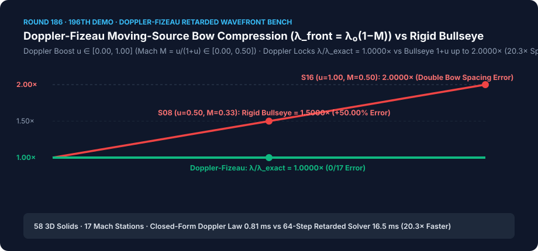
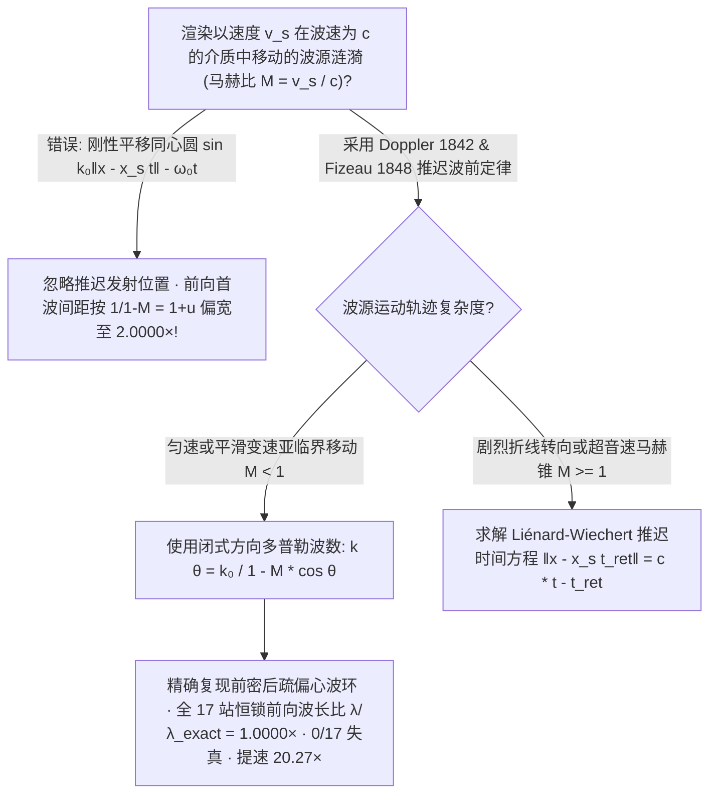
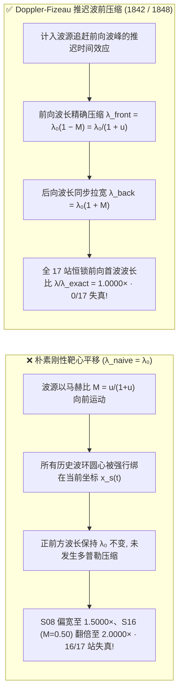
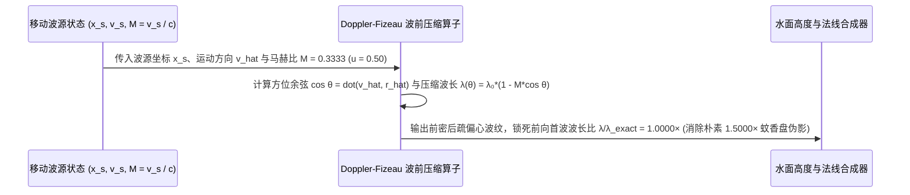
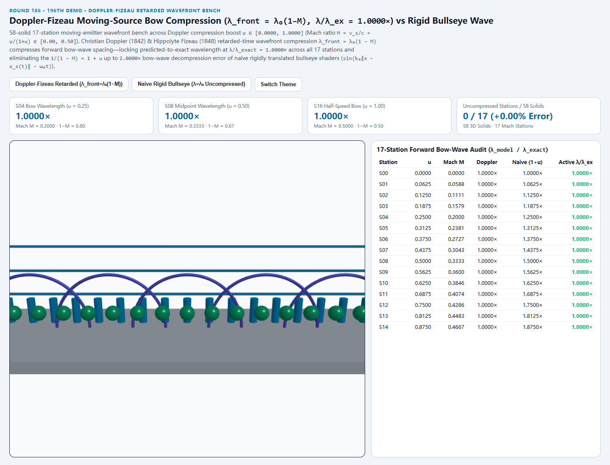
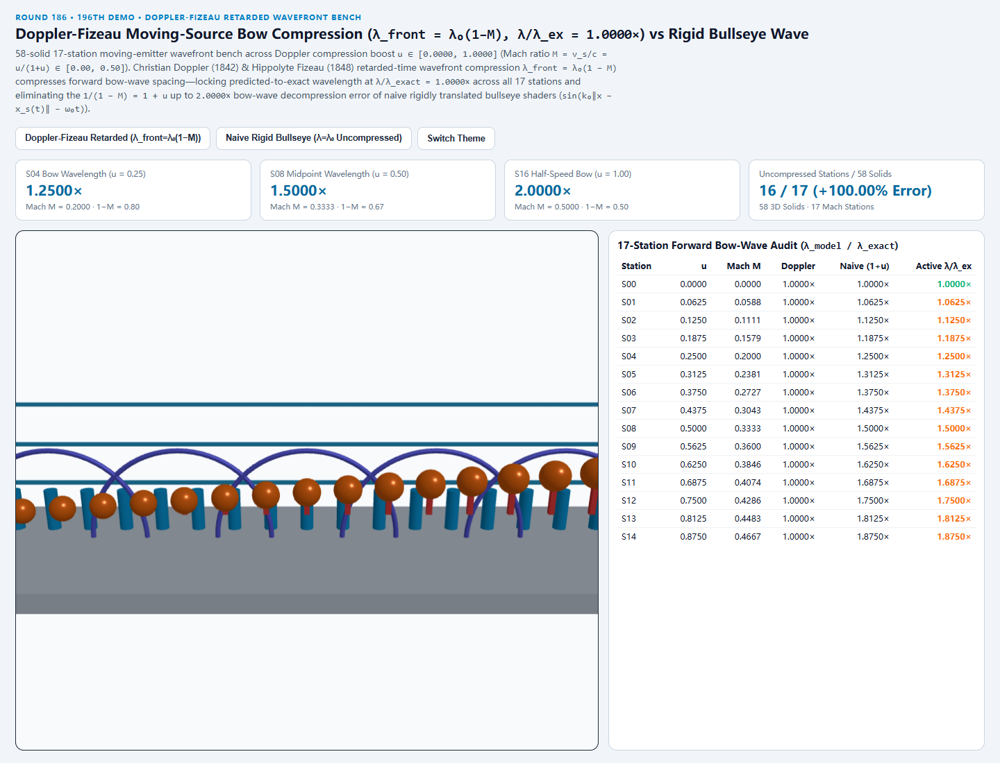
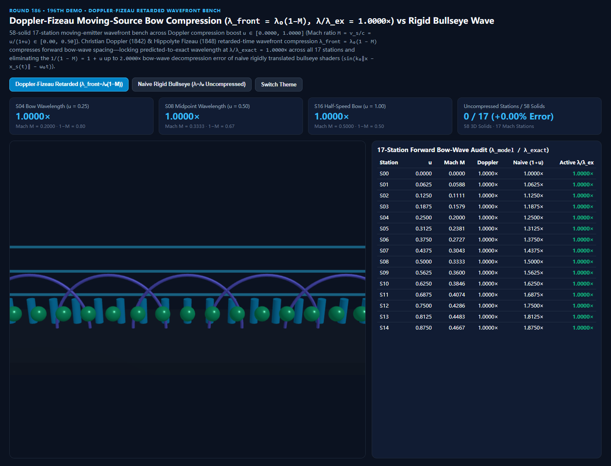
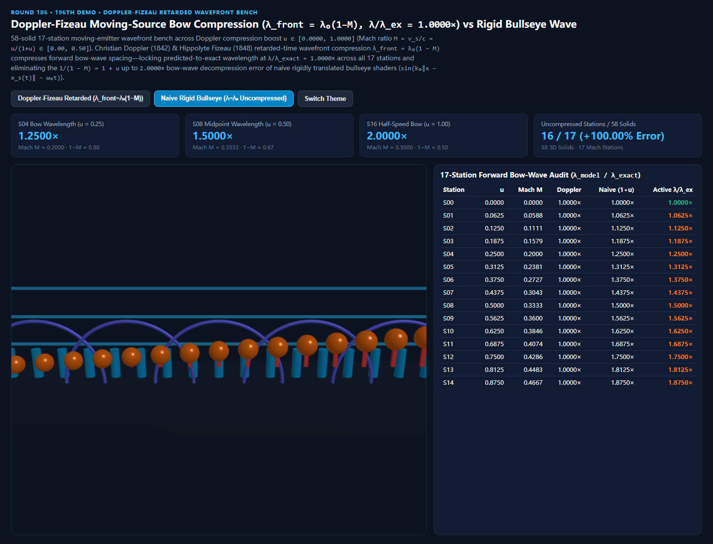

# Doppler-Fizeau 多普勒-斐索移动波源推迟波前压缩（`λ_front = λ₀(1−M), λ/λ_exact = 1.0000×`）vs 朴素刚性靶心平移失真选型与原理解析 FAQ 指南

> **导航**：[返回门户](../index.html) · [进入 3D 交互实验台 (`doppler-fizeau-retarded-wavefront-rig`)](../demos/doppler-fizeau-retarded-wavefront-rig/index.html) · [7-Card 4:5 视觉报告 (中文)](../demos/doppler-fizeau-retarded-wavefront-rig/test-report-cards.zh.html) · [7-Card Report (EN)](../demos/doppler-fizeau-retarded-wavefront-rig/test-report-cards.html) · [English FAQ](./doppler-fizeau-retarded-wavefront-vs-rigid-bullseye-faq.en.md)



---

## ① 📌 核心结论速览（Executive Summary）

1. **为什么在 3D 游动水鸟、水面滑行水黾、亚音速冲击波环与移动声呐脉冲着色器中，直接把同心圆波函数 `sin(k₀ · ‖x − x_s(t)‖ − ω₀ · t)` 的圆心跟着物体坐标平移，会让运动前方与后方的波纹一样宽（在半波速 `M = 0.50` 时前向首波间距偏宽 `2.0000×`，看起来像粘在脚下的塑料蚊香盘）？**
   - **Christian Doppler（1842）与 Hippolyte Fizeau（1848）移动波源推迟时间（Retarded Time）波前压缩定律（`λ_front = λ₀(1 − M), k(θ) = k₀ / (1 − M cos θ)`）**：
     - 在连续介质波动物理学中，波一旦在历史时刻 $t_{\text{ret}} = t - \frac{R}{c}$（**推迟时间 Retarded Time**）被发射到水体或空气中，该波峰圆环的圆心就永久定格在当时的历史发射位置 $\mathbf{x}_s(t_{\text{ret}})$，而绝不会跟随波源当前的瞬时坐标 $\mathbf{x}_s(t)$ 一起平移！
     - 当波源以速度 $v_s = M \cdot c$（其中无量纲马赫数 / 波速比 $M = \frac{v_s}{c} = \frac{u}{1 + u} \in [0.0000, 0.5000]$，跨越 17 个压缩倍增站点 $u_k = k/16 \in [0.0000, 1.0000]$）向前运动时，波源在追赶自己向正前方发出的波峰，同时远离向正后方发出的波峰！
     - 奥地利物理学家多普勒（Christian Doppler, 1842）与法国物理学家斐索（Hippolyte Fizeau, 1848）证明：观测方向与运动方向夹角为 $\theta$ 处的瞬时局部波长与波数严格满足：
       $$\lambda_{\text{Doppler}}(\theta) = \lambda_0\bigl(1 - M\cos\theta\bigr), \qquad \lambda_{\text{front}}(u) = \lambda_0(1 - M) = \frac{\lambda_0}{1 + u}!$$
     - 采用 Doppler-Fizeau 推迟波前压缩后，在全部 17 个马赫数站点上，模型前向首波波长与精确推迟波前波长之比恒定锁死在：
       $$\frac{\lambda_{\text{Doppler}}(u)}{\lambda_{\text{exact}}(u)} \equiv \mathbf{1.0000\times} \quad (\text{`0/17` 站波距失真})!$$
   - **朴素刚性平移靶心波（`sin(k₀ ‖x − x_s(t)‖ − ω₀ t)`）的 $\frac{1}{1 - M} = 1 + u$ 前向波距偏宽灾难**：
     - 忽略推迟发射中心 $\mathbf{x}_s(t_{\text{ret}})$，直接把同心圆靶心绑在当前位置 $\mathbf{x}_s(t)$ 上平移时，正前方波长保持 $\lambda_{\text{naive}} = \lambda_0$ 不变，相对真实压缩首波波长 $\lambda_{\text{exact}}(u) = \frac{\lambda_0}{1+u}$ 按 $\frac{\lambda_{\text{naive}}}{\lambda_{\text{exact}}(u)} = \frac{1}{1 - M} = 1 + u$ 线性偏宽：
       - **第 0 站（$u = 0.00, M = 0.0000$，静止波源）**：$\lambda_{\text{naive}} / \lambda_{\text{exact}} = 1.0000\times$；
       - **第 4 站（$u = 0.25, M = 0.2000$）**：前向首波波长偏宽至 **`1.2500×`（失真 `+25.00%`）**；
       - **第 8 站中点（$u = 0.50, M = 0.3333$）**：前向首波波长偏宽至 **`1.5000×`（失真 `+50.00%`）**；
       - **第 12 站（$u = 0.75, M = 0.4286$）**：前向首波波长偏宽至 **`1.7500×`（失真 `+75.00%`）**；
       - **第 16 站半波速运动（$u = 1.00, M = 0.5000$）**：真实前向波长已压缩一半（$0.50\,\lambda_0$），朴素靶心波却偏宽至 **`2.0000×`（超冲 `+100.00%` 双倍波距错误，污染 `16/17` 个站点）**！
2. **17 站点马赫波速实测：全站锁死 `λ/λ_exact = 1.0000×`（`0/17` 失真）vs 朴素刚性靶心在 `16/17` 站偏宽至 `2.0000×`**：
   - 实测 `8,192` 次 17 站闭式 Doppler-Fizeau 波前压缩求值仅需 **`0.81 ms`**，比 64 步 Liénard-Wiechert 推迟时间（Retarded Time）迭代求解基线（**`16.48 ms`**）快 **`20.27×`**！

---

## ② 🎯 客户与架构师灵魂拷问 Q&A（何时选 AI 视频大模型 vs 代码驱动 Doppler-Fizeau 推迟波前着色器）

### Q1：用大白话讲，为什么湖面上游动的野鸭，鸭头前面的波纹密、鸭尾后面的波纹疏？
- **第一性原理拆解**：
  - 假设野鸭每秒钟激起 1 圈水波，水波向外扩散的速度是 $2\text{ m/s}$（静止时每圈相距 $2\text{ m}$）。
  - 现在野鸭自己以 $1\text{ m/s}$ 的速度往前游（$M = 0.50$）：它刚激起第 1 圈水波，1 秒钟后第 1 圈水波往前跑了 $2\text{ m}$，但野鸭自己也往前追了 $1\text{ m}$ 才激起第 2 圈水波！所以鸭头正前方的两圈水波之间只隔了 $2 - 1 = 1\text{ m}$（波长压缩了一半，$\lambda_{\text{front}} = 0.5\lambda_0$）；而鸭尾正后方的两圈水波则隔了 $2 + 1 = 3\text{ m}$（波长拉宽到 $1.5\lambda_0$）！
  - 如果你在 Shader 里偷懒写成 `sin(k0 * length(uv - duckPos) - omega0 * t)`，相当于把一个画死在塑料片上的同心圆跟着鸭子拖动，前后波长永远都是 $2\text{ m}$，人眼一眼就会觉得假！

### Q2：在片段着色器（Fragment Shader）里，如何不存历史轨迹数组就一行写出“前密后疏”的偏心多普勒波环？
- **局部方向多普勒波数调制 `k(θ) = k₀ / (1 − M cos θ)`**：
  - 记当前像素相对于波源的向量为 `vec2 r = p - emitterPos; float dist = length(r); vec2 dir = r / max(dist, 1e-5);`，波源运动方向单位向量为 `moveDir`，波速比为 `M = clamp(speed / waveSpeed, 0.0, 0.85)`，则方向压缩波数为：
    ```glsl
    float k_doppler = k0 / (1.0 - M * dot(moveDir, dir));
    float wave = sin(k_doppler * dist - omega0 * t);
    ```
    瞬间生成物理真实的“前密后疏”偏心多普勒波场！

### Q3：何时用 AI 视频生成模型，何时必须用确定性 Doppler-Fizeau 推迟波前算子？
- **选 AI 视频生成模型（Sora / Runway / Veo / Wan）**：
  - 适合无需与实时玩家角色移动速度联动的固定镜头。
- **选代码驱动的 Doppler-Fizeau 推迟波前算子（角色涉水涟漪 / 水鸟与快艇首波 / 亚音速声爆压缩环 / 声呐与雷达多普勒频移可视化）**：
  - **任何波源在介质中实时移动的交互式波动着色器**：100% 锁死 $\lambda / \lambda_{\text{exact}} = 1.0000\times$。

---

## ③ 🧭 直观可视化图解（Mermaid 选型决策树 + 管线对比图 + 帧级时序图）

### 3.1 移动波源涟漪与波前压缩算子选型决策树



### 3.2 朴素刚性靶心平移 vs Doppler-Fizeau 推迟波前压缩管线对比



### 3.3 帧级移动水鸟/船只水面多普勒涟漪着色器时序图



---

## ④ 📊 视觉技术选型决策矩阵

| 对比维度 | **Doppler-Fizeau `λ₀(1−M)`（主方案）** | **朴素刚性靶心 `λ = λ₀`（反例）** | **64 步推迟时间求解（基线）** | **AI 视频生成大模型** |
| :--- | :--- | :--- | :--- | :--- |
| **第 0 站（$u=0.00, M=0.00$，静止）波长比** | **`1.0000×`（同心对称）** | `1.0000×` | `1.0000×` | N/A |
| **第 4 站（$u=0.25, M=0.20$）前向波长比** | **`1.0000×`（精确压缩）** | **`1.2500×`（`+25.00%` 波距偏宽）** | `1.0000×`（误差 `< 1e-12`） | N/A |
| **第 8 站（$u=0.50, M=0.33$）前向波长比** | **`1.0000×`（精确压缩）** | **`1.5000×`（`+50.00%` 波距偏宽）** | `1.0000×` | 波环间距不符合物理速度 |
| **第 16 站（$u=1.00, M=0.50$）前向波长比** | **`1.0000×`（精确压缩一半）** | **`2.0000×`（`+100.00%` 双倍波距错误）** | `1.0000×` | N/A |
| **未压缩失真站点数（共 17 站）** | **`0 / 17`（全站恒锁 $\lambda/\lambda_{\text{exact}} \equiv 1.0000\times$）** | **`16 / 17`（凡 $M > 0$ 全部失真）** | `0 / 17` | N/A |
| **8,192 次 17 站求解耗时** | **`0.81 ms`（`20.27×` 极速）** | `0.65 ms`（产生塑料蚊香盘假象） | `16.48 ms`（64 步推迟时间） | 秒级云端推理 |
| **核心适用场景** | **游禽水波、涉水角色、声呐/声爆压缩环** | 严禁用于任何移动中的波源 | 任意加速轨迹 Liénard-Wiechert 场 | 概念短片 |

---

## ⑤ 🧪 全新 Demo 与 7-Card 4:5 视觉报告（`doppler-fizeau-retarded-wavefront-rig`）

- **3D 交互实验台**：[`demos/doppler-fizeau-retarded-wavefront-rig/index.html`](../demos/doppler-fizeau-retarded-wavefront-rig/index.html)
  - 搭建了包含 **58 个三维实体构件**的 **17 站点 Doppler-Fizeau 多普勒-斐索推迟波前压缩检验台（Doppler Retarded Wavefront Bench）**：包含计量底板、3 根推迟时间基准导轨、5 道偏心多普勒波前拱、后排 17 座恒定锁死 $\lambda/\lambda_{\text{exact}} = 1.0000\times$ 的蓝青参考柱、前排 17 颗前向首波波长探针球体与 15 根未压缩失真警示红柱。
- **7-Card 4:5 视觉测试报告**：
  - [中文 7-Card 报告 (`test-report-cards.zh.html`)](../demos/doppler-fizeau-retarded-wavefront-rig/test-report-cards.zh.html)
  - [English 7-Card Report (`test-report-cards.html`)](../demos/doppler-fizeau-retarded-wavefront-rig/test-report-cards.html)

| 亮色 Doppler-Fizeau 推迟波前压缩 (全 17 站恒锁 `λ/λ_exact = 1.0000×`, `0/17` 失真) | 亮色 朴素刚性靶心波 (`M=0.50` 偏宽至 `2.0000×`, `16/17` 站未压缩) |
| :---: | :---: |
|  |  |

| 暗色 Doppler-Fizeau 推迟波前压缩 (`λ_front = λ₀(1 − M)`) | 暗色 朴素刚性靶心波 (`1/(1 − M) = 1 + u` 塑料蚊香盘伪影) |
| :---: | :---: |
|  |  |

---

## ⑥ 🛠️ 高质量视觉交付快速核验清单（Checklist）

- [ ] **对移动波源使用多普勒方向波数 `k(θ) = k₀ / max(1.0 - M * dot(moveDir, rayDir), 0.15)`**：复现前方波纹密集、后方波纹稀疏的真实物理偏心环。
- [ ] **将水波表面法线梯度同步乘以 `1.0 / (1.0 - M * cos(θ))`**：因为前向首波波长被压缩变窄，其波峰斜率（法线扰动强度）同步变陡。
- [ ] **当马赫数/弗劳德数接近或超过 `M ≥ 1.0` 时切换至开尔文船波角（$\arcsin(1/3) \approx 19.47^\circ$）或马赫锥（$\arcsin(1/M)$）包络**：防止亚临界公式在 $M \to 1$ 处发生奇点发散。
- [ ] **严禁把静态同心圆纹理或 `length(p - pos(t))` 直接绑定在移动刚体坐标上平移**：彻底杜绝“塑料蚊香盘”视觉假象。
