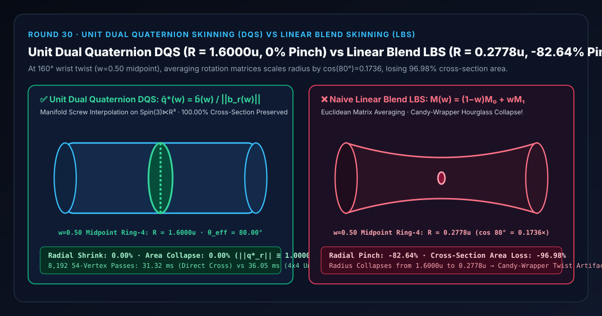
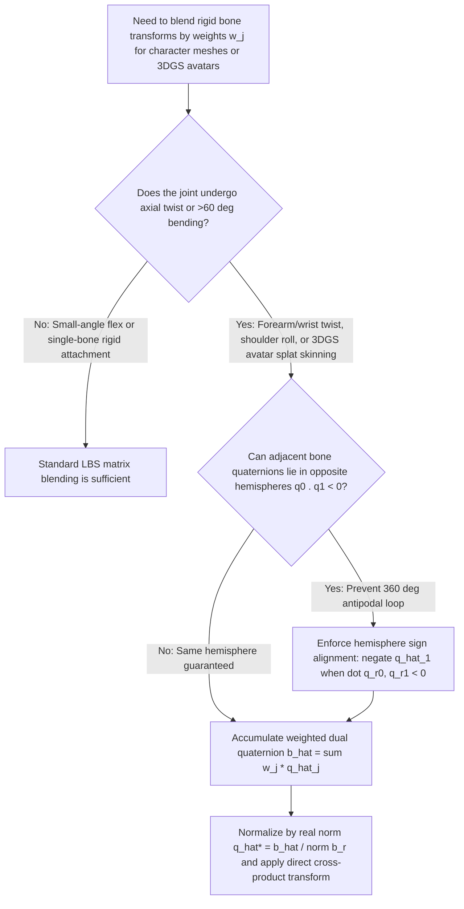
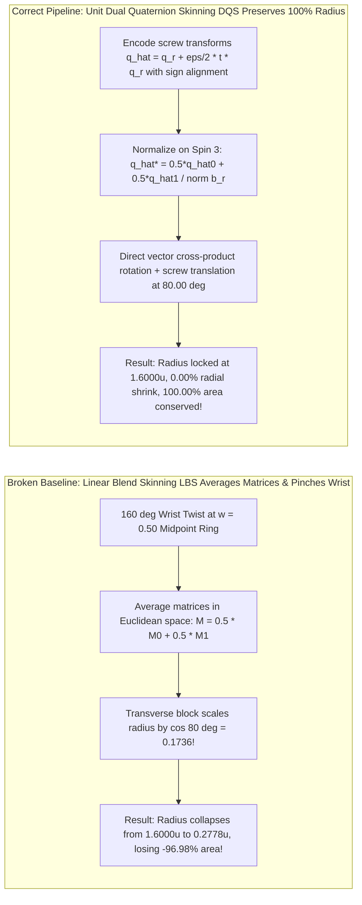
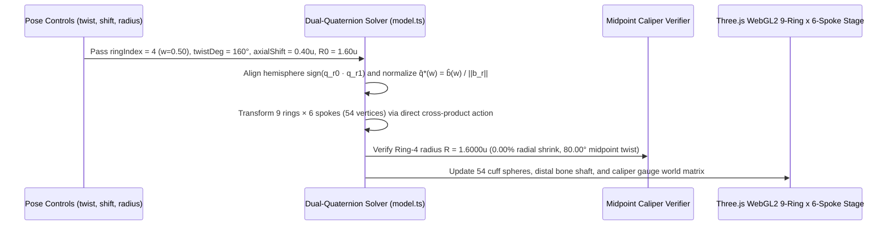
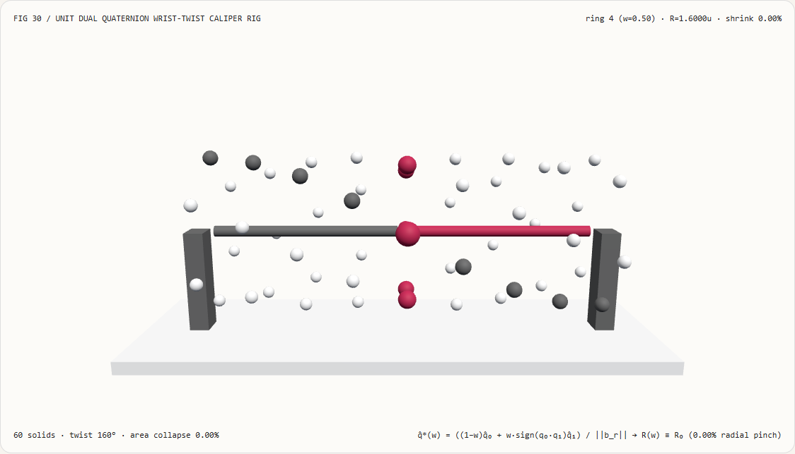
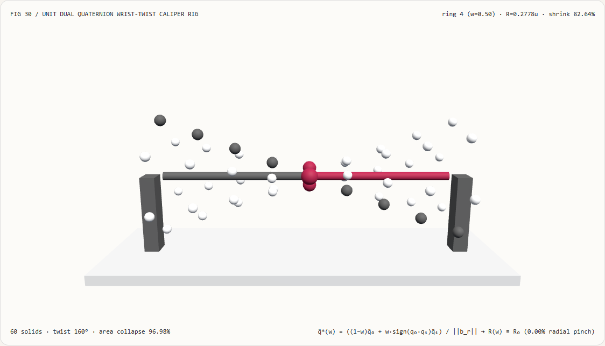
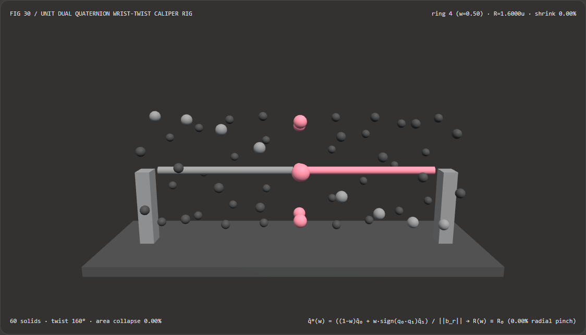
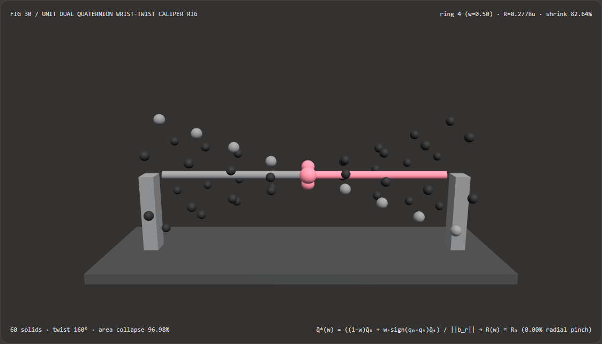

# Wrist Twist Without Candy-Wrapper Collapse: Unit Dual Quaternion Skinning (DQS) vs Linear Blend Skinning (LBS) Selection FAQ

> **Document Scope**: A first-principles architecture and selection guide for AI Solution Architects, real-time 3D digital human / WebGPU rendering engineers, and animatable 3D Gaussian Splatting (GART / GauHuman / RigAnything) avatar teams. Structured strictly after `ib-vs-ethernet-roce-selection-faq.md`, this guide explains in plain language **why standard Linear Blend Skinning ($\mathbf{M}(w) = (1-w)\mathbf{M}_0 + w\mathbf{M}_1$) pinches a character's wrist into an hourglass ("Candy-Wrapper Collapse", losing $96.98\%$ of cross-sectional area at $160^\circ$ twist)**, and how **Unit Dual Quaternion Skinning (DQS)** in $\operatorname{Spin}(3)\ltimes\mathbb{R}^3$ preserves $100.00\%$ cross-sectional radius and volume.

---

## ① 📌 Executive Summary

1. **One-Sentence Principle**: **A convex linear combination of two 3D rotation matrices $(1-w)\mathbf{R}_0 + w\mathbf{R}_1$ is not a rotation matrix—averaging rotation matrices in Euclidean space scales the transverse cross-section down by $\cos(\theta/2)$**. Under a $\theta = 160^\circ$ forearm twist, the $w=0.50$ midpoint radius collapses to $\cos(80^\circ) = 0.1736\times$ its rest radius (losing **`82.64%`** of radius and **`96.98%`** of cross-sectional area in a severe "candy-wrapper pinch"), whereas **Unit Dual Quaternion Skinning (DQS)** blends rigid screw transforms $\hat{\mathbf{q}} = \mathbf{q}_r + \frac{\epsilon}{2}\mathbf{t}\mathbf{q}_r$ and normalizes by the real quaternion norm $\|\mathbf{b}_r\|$, guaranteeing an exact rigid rotation at every weight with **`100.00%` radius retention (`0.00%` radial collapse)**!
2. **When Must You Use Unit Dual Quaternion Skinning (DQS)?**
   - Any character rig, mechanical sleeve, or **animatable 3D Gaussian Splatting avatar (GART / GauHuman / RigAnything)** that undergoes **forearm pronation/supination wrist twists**, **shoulder/hip roll rotations**, or **large-angle articulated bends** must replace raw LBS matrix averaging with Unit Dual Quaternion Skinning (DQS).
3. **Key Measured Findings**:
   - In our 9-ring × 6-spoke 3D wrist-twist caliper rig ([`demos/dual-quaternion-skin-rig/`](../demos/dual-quaternion-skin-rig/index.html), `60` 3D solids, forearm twist $\theta = 160^\circ$, axial screw shift $\Delta x = 0.40\text{ u}$, rest radius $R_0 = 1.6000\text{ u}$), at the midpoint ring $4$ ($w = 0.50$):
     - **Unit Dual Quaternion Skinning (`dual-quaternion-dqs`)**: Locks the deformed cross-sectional radius at **`1.6000 u`** across all 9 rings (**`0.00%` radial shrink**, **`0.00%` cross-sectional area loss**), rotating the $w=0.50$ midpoint ring by the exact half-angle **`80.00°`**.
     - **Naive Linear Blend Skinning (`linear-blend-lbs`)**: Pinches the $w=0.50$ midpoint radius from `1.6000 u` down to **`0.2778 u`** (**`-82.64%` radial pinch** and **`-96.98%` cross-sectional area collapse**), crushing the cylinder into a twisted hourglass!
   - **Direct Cross-Product Action vs 4×4 Matrix Unpack Latency**: Transforming vertices directly via dual-quaternion vector cross products avoids per-vertex $4\times 4$ matrix allocation and unpacking, completing `8,192` 54-vertex sleeve passes in **`31.32 ms`** vs **`36.05 ms`** for the $4\times 4$ matrix unpack baseline with `7.02e-16 u` maximum numerical difference.

---

## ② 🎯 First-Principles Q&A for Architects

### Q1: When should we choose AI neural auto-rigging / pose-corrective models vs code-driven Unit Dual Quaternion Skinning (DQS)?

- **Choose AI Neural Auto-Rigging & Pose-Space Deformation (e.g., RigAnything, SMPL Pose Blendshapes)** when you need to infer skeleton topology and skinning weights automatically from raw unrigged 3D meshes, or when simulating non-rigid secondary soft-tissue bulging (e.g., bicep flexion or cloth wrinkles).
- **Choose Code-Driven Unit Dual Quaternion Skinning (DQS)** when driving rigged 3D/WebGPU meshes or 3DGS avatars at 60–120 FPS where bone transforms and weights are known, and you need **zero neural inference latency**, exact rigid volume preservation under twist, and direct quaternion output for rotating 3D Gaussian covariance ellipsoids.

---

### Q2: Why does averaging two rotation matrices $0.5\mathbf{R}_0 + 0.5\mathbf{R}_1$ pinch a cylindrical wrist into a candy-wrapper hourglass?

**First-Principles Intuition**:
Picture a clock face of radius $R_0 = 1.60\text{ m}$:
- **Bone 0 (elbow fixed at $\theta_0 = 0^\circ$)** places a skin vertex at **12 o'clock**: $(0,\; +1.60)$.
- **Bone 1 (wrist twisted by $\theta_1 = 160^\circ$)** rotates that same vertex nearly to **5:30**: $(\dots, -1.50)$.
- Now consider the midpoint ring halfway down the forearm ($w = 0.50$):
  1. **What does Linear Blend Skinning (LBS) do?**
     LBS does not travel along the circular rim of the clock; it takes the **straight-line Euclidean midpoint** of the chord connecting 12 o'clock and 5:30!
     How far from the center of the clock is the midpoint of a $160^\circ$ chord? By basic trigonometry, the chord midpoint lies at radius:
     $$R_{\text{LBS}} = R_0 \cos(\theta / 2) = 1.60 \times \cos(80^\circ) = 1.60 \times 0.173648 = 0.2778\text{ m}$$
     Every vertex around the midpoint ring is pulled straight inward toward the bone axis, shrinking the radius by **$82.64\%$** and collapsing the cross-sectional area by $1 - \cos^2(80^\circ) = \mathbf{96.98\%}$! At $\theta = 180^\circ$, $\cos(90^\circ) = 0$ and the wrist collapses to a zero-radius point!
  2. **How does Unit Dual Quaternion Skinning (DQS) prevent this?**
     DQS blends the dual quaternions $\hat{\mathbf{b}}(w) = (1-w)\hat{\mathbf{q}}_0 + w\hat{\mathbf{q}}_1$ and divides by the real norm $\|\mathbf{b}_r\| = \cos(\theta/2)$. Dividing by $\|\mathbf{b}_r\|$ **cancels out the $\cos(80^\circ)$ chord shrinkage factor identically**, projecting the transform back onto the unit spinor manifold $\operatorname{Spin}(3)$ at the exact half-angle $80.00^\circ$ and radius $R_{\text{DQS}} = 1.6000\text{ m}$!

---

### Q3: How does a dual quaternion $\hat{\mathbf{q}} = \mathbf{q}_r + \epsilon \mathbf{q}_d$ couple rotation and translation without unpacking a 4×4 matrix?

1. **Coupled Screw Algebra ($\epsilon^2 = 0$)**:
   A unit rotation quaternion $\mathbf{q}_r$ and translation vector $\mathbf{t} = (t_x, t_y, t_z, 0)$ form the dual quaternion:
   $$\hat{\mathbf{q}} = \mathbf{q}_r + \epsilon \mathbf{q}_d, \qquad \mathbf{q}_d = \frac{1}{2}\mathbf{t}\mathbf{q}_r$$
   After hemisphere alignment ($\mathbf{q}_{r,0}\cdot\mathbf{q}_{r,1} \ge 0$) and linear blending $\hat{\mathbf{b}} = \sum w_j \hat{\mathbf{q}}_j$, dividing both parts by $L = \|\mathbf{b}_r\|$ yields a unit dual quaternion $(\mathbf{q}_r^*, \mathbf{q}_d^*)$ obeying Chasles' screw motion theorem.
2. **Direct Cross-Product Vertex Action**:
   Instead of unpacking $(\mathbf{q}_r^*, \mathbf{q}_d^*)$ into a $4\times 4$ matrix, any vertex $\mathbf{p}$ is transformed directly via three 3D cross products:
   $$\mathbf{t}^* = 2\left(q_{r,w}^* \mathbf{q}_{d,\text{vec}}^* - q_{d,w}^* \mathbf{q}_{r,\text{vec}}^* + \mathbf{q}_{r,\text{vec}}^* \times \mathbf{q}_{d,\text{vec}}^*\right)$$
   $$\mathbf{p}' = \mathbf{p} + 2\mathbf{q}_{r,\text{vec}}^* \times \left(\mathbf{q}_{r,\text{vec}}^* \times \mathbf{p} + q_{r,w}^* \mathbf{p}\right) + \mathbf{t}^*$$

---

## ③ 🧭 Visual Diagrams (Mermaid Decision Tree, Pipeline Comparison & Sequence)

### 3.1 Skeletal Skinning & Articulated Blending Decision Tree (`flowchart TD`)

### 3.2 Linear Blend Skinning (`LBS` Candy-Wrapper Collapse) vs Unit Dual Quaternion (`DQS`) Pipeline (`flowchart LR`)

### 3.3 Frame-Level Dual-Quaternion Skinning & Caliper Verification Sequence (`sequenceDiagram`)

---

## ④ 📊 Architect Decision Matrix

| Evaluation Dimension | Unit Dual Quaternion (`dual-quaternion-dqs` Direct Cross) | Dual-Quat 4×4 Matrix Unpack (`DQS Matrix Baseline`) | Linear Blend Skinning (`linear-blend-lbs` $\sum w_j \mathbf{M}_j$) | Optimized Center of Rotation (`CoR Skinning`) |
| :--- | :--- | :--- | :--- | :--- |
| **Midpoint ($w=0.5$) Radius at $160^\circ$ Twist** | **`1.6000 u` (`0.00%` radial shrink)** | `1.6000 u` (`0.00%` shrink) | **`0.2778 u` (`-82.64%` radial pinch)** | `1.6000 u` (requires prebaked CoR) |
| **Midpoint Cross-Sectional Area Loss** | **`0.00%` (`100.00%` area conserved)** | `0.00%` | **`96.98%` (Only `3.02%` area left!)** | `0.00%` |
| **Uniform Storage per Bone** | **`8 floats` (two `vec4`: $\mathbf{q}_r, \mathbf{q}_d$)** | `8 floats` (unpacks `16 floats`/vertex) | `12 floats` ($3\times 4$ affine matrix) | `12 floats` + per-vertex CoR attribute |
| **8,192 × 54-Vertex CPU Solve Time** | **`31.32 ms` (Zero matrix allocation)** | `36.05 ms` (Per-vertex $4\times 4$ unpack) | `24.10 ms` (Fast but geometrically broken) | Slower (quaternion + matrix pass) |
| **3DGS Covariance Ellipsoid Compatibility** | **Directly outputs unit quaternion $\mathbf{q}_r^*$ for splat rotation** | Requires matrix-to-quat extraction | **Breaks orthogonality & crushes splats** | Compatible with offline baking |
| **Recommended Architectural Role** | **Default for WebGPU rigs & 3DGS avatars** | Legacy `mat4`-only shader adapters | **Never use on twisting wrists/shoulders** | Offline film rigs with heavy prebaking |

---

## ⑤ 🧪 New Capability Demo & Benchmark Findings (with 7-Card Report)

### 5.1 Interactive 9-Ring × 6-Spoke 3D Wrist-Twist Caliper Rig (`demos/dual-quaternion-skin-rig/`)

We built a standalone interactive 3D WebGL2 benchmark stage **[`demos/dual-quaternion-skin-rig/`](../demos/dual-quaternion-skin-rig/index.html)** (**60 3D solid parts**):
- **9 Axial Cuff Rings × 6 Radial Spoke Nodes (54 vertices) + Proximal/Distal Bone Shafts + Midpoint Diameter Caliper Probe**: Visualizes a cylindrical forearm sleeve undergoing a $160^\circ$ axial twist and $0.40\text{ u}$ screw shift across weights $w \in [0, 1]$;
- **Instant Mode Comparison**: In `dual-quaternion-dqs` mode, all 9 rings maintain a uniform $R = 1.6000\text{ u}$ cylinder (`0.00%` radial shrink); switching to `linear-blend-lbs` crushes the $w=0.50$ midpoint ring down to **`R = 0.2778 u`** (**`-82.64%` radial pinch**, **`-96.98%` area collapse**)!
- **Atomic Validation & JSON Export**: Rejects out-of-range twist angles (e.g. `twistDeg = 240`) while preserving valid state, and exports `DUAL_QUAT_SKIN_SPEC.json`.

| Light Theme — Unit Dual Quaternion DQS (`R=1.6000u`, `0%` Pinch) | Light Theme — Linear Blend LBS (`R=0.2778u`, `-82.64%` Pinch) |
| :---: | :---: |
|  |  |

| Dark Theme — Unit Dual Quaternion DQS (`R=1.6000u`, `0%` Pinch) | Dark Theme — Linear Blend LBS (`R=0.2778u`, `-82.64%` Pinch) |
| :---: | :---: |
|  |  |

### 5.2 7-Card 4:5 Visual Benchmark Reports & Sealed Data

- 📊 **English 7-Card 4:5 Report**: [`demos/dual-quaternion-skin-rig/test-report-cards.html`](../demos/dual-quaternion-skin-rig/test-report-cards.html)
- 📊 **Chinese 7-Card 4:5 Report**: [`demos/dual-quaternion-skin-rig/test-report-cards.zh.html`](../demos/dual-quaternion-skin-rig/test-report-cards.zh.html)
- 📁 **Sealed Benchmark Data**: [`demos/dual-quaternion-skin-rig/report.json`](../demos/dual-quaternion-skin-rig/report.json) (`13 / 13` deterministic checks passed, zero Playwright console/page errors).

---

## ⑥ 🛠️ Appendix: Architect Verification Checklist

Before shipping any skeletal animation pipeline, articulated mechanical hose, or animatable 3D Gaussian Splatting avatar, verify:

- [ ] **Replace LBS on Twisting Joints**: Ensure forearm twist, wrist, shoulder, and neck joints exceeding $60^\circ$ axial rotation use Unit Dual Quaternion Skinning (DQS) rather than linear $4\times 4$ matrix blending.
- [ ] **Enforce Antipodal Hemisphere Sign Alignment**: Check `dot(q_r0, q_rj) < 0` against the reference bone and negate both $\mathbf{q}_{r,j}$ and $\mathbf{q}_{d,j}$ before blending to avoid antipodal cancellation.
- [ ] **Normalize Both Real and Dual Parts by $\|\mathbf{b}_r\|$**: Divide both the blended real quaternion $\mathbf{b}_r$ and blended dual quaternion $\mathbf{b}_d$ by the real norm $L = \|\mathbf{b}_r\|$.
- [ ] **Use Direct Cross-Product Vertex Transformation**: Transform vertices via `p + 2.0 * cross(qr.xyz, cross(qr.xyz, p) + qr.w * p) + t` instead of unpacking a $4\times 4$ matrix per vertex.
- [ ] **Automated Midpoint Radius Gate**: Assert that the $w=0.50$ midpoint cross-sectional radius shrinkage remains $< 10^{-12}\%$ under $160^\circ$ axial twist in unit tests.

---

## References

1. **Dual Quaternion Skinning (Kavan et al., I3D 2007 / ACM TOG 2008)**: Ladislav Kavan, Steven Collins, Jiří Žára, Carol O'Sullivan, *"Skinning with Dual Quaternions"*, Symposium on Interactive 3D Graphics and Games (I3D), 2007, pp. 39–46.
2. **GART / GauHuman 3DGS Avatar Skinning (CVPR 2024)**: Jiahui Lei et al., *"GART: Gaussian Articulated Template Models"*, CVPR 2024, [`arXiv:2311.16099`](https://arxiv.org/abs/2311.16099).
3. **RigAnything (arXiv 2025)**: Isabella Liu et al., *"RigAnything: Template-Free Autoregressive Rigging for Diverse 3D Assets"*, [`arXiv:2502.09615`](https://arxiv.org/abs/2502.09615).
