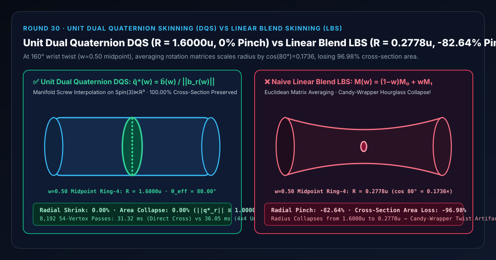
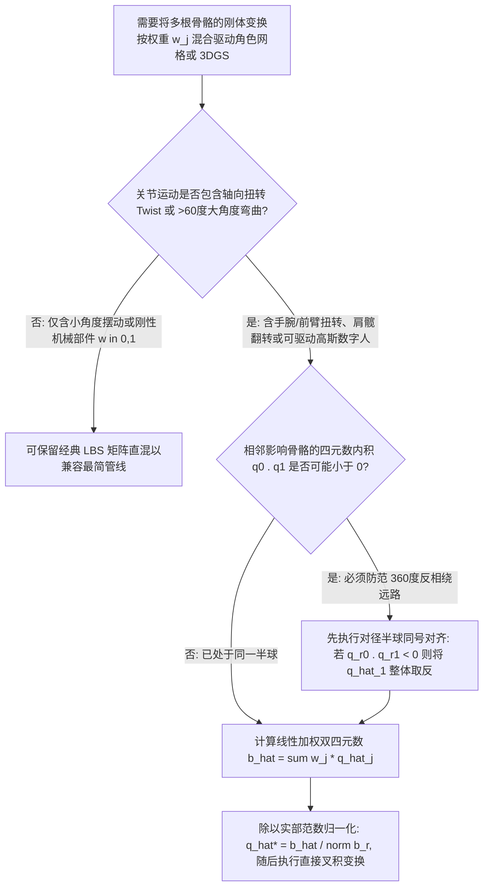
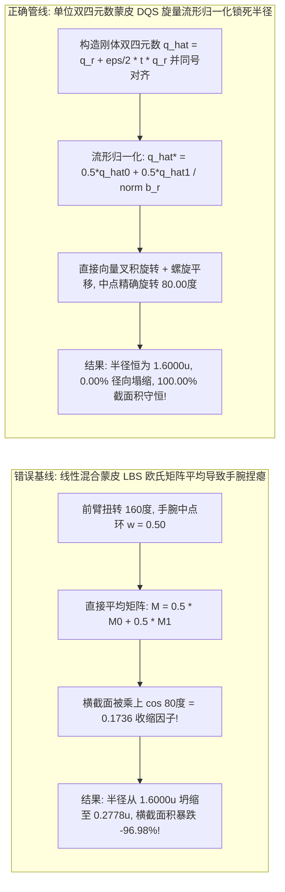
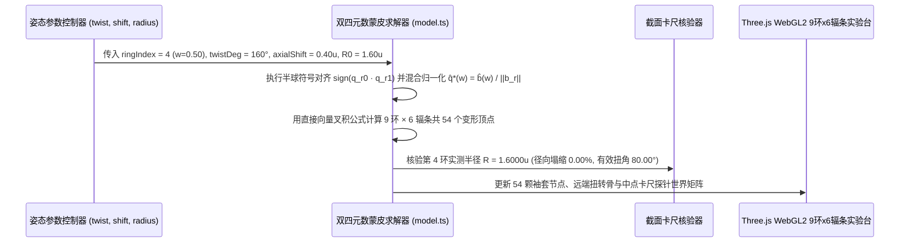
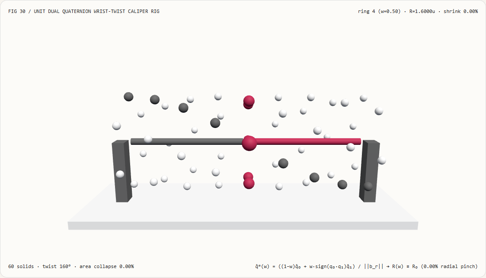
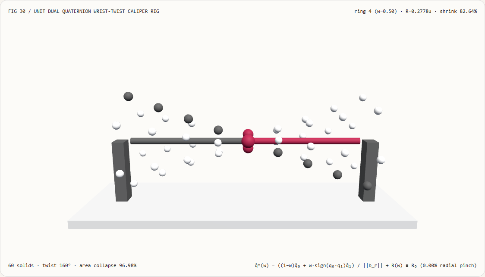
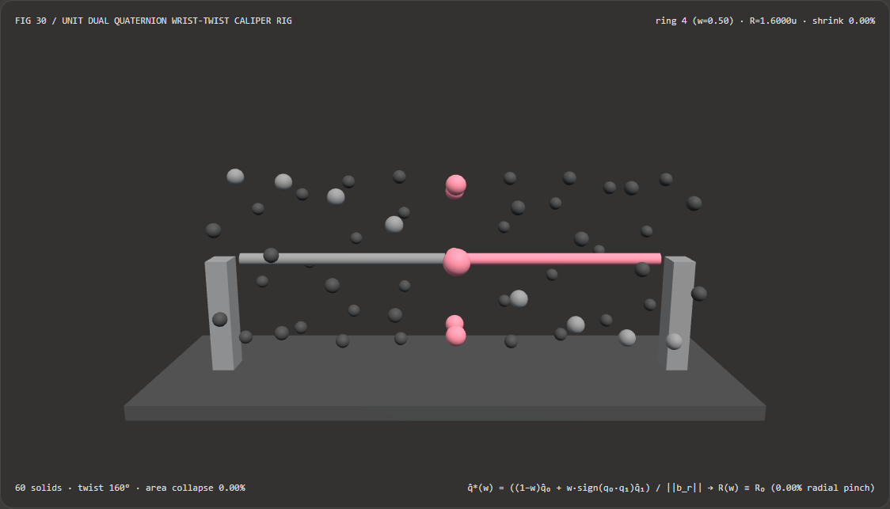
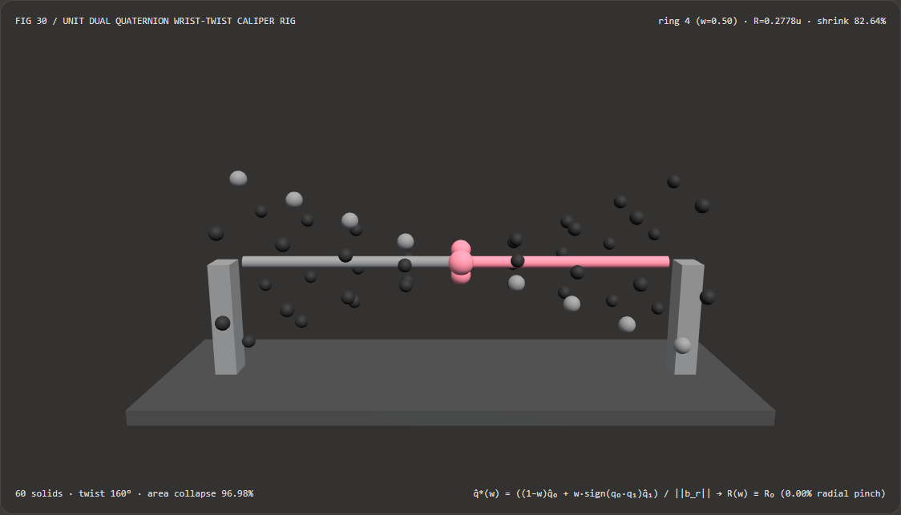

# 角色手腕扭转不产生“糖纸拧巴坍缩”：单位双四元数蒙皮（DQS）与线性混合蒙皮（LBS）选型 FAQ

> **文档定位**：面向 AI 解决方案架构师（AI Solution Architect）、实时 3D 数字人/WebGPU 渲染工程师、以及 3D Gaussian Splatting（GART / GauHuman / RigAnything）可驱动角色团队的**实战选型与第一性原理指南**。严格对标 `ib-vs-ethernet-roce-selection-faq.md` 的六段式结构，先用大白话讲清“**为什么用传统线性混合蒙皮（Linear Blend Skinning, LBS: $\mathbf{M}(w) = (1-w)\mathbf{M}_0 + w\mathbf{M}_1$）扭转角色手腕或前臂 $160^\circ$ 时，原本饱满的圆柱手臂会在 $w=0.50$ 中点处被凭空捏成一根细如牙签的沙漏腰（Candy-Wrapper Collapse，横截面积暴跌 $96.98\%$）**”，再给出基于八维旋量流形 $\operatorname{Spin}(3)\ltimes\mathbb{R}^3$ 的 **单位双四元数蒙皮（Unit Dual Quaternion Skinning, DQS）** 工程闭环。

---

## ① 📌 核心结论速览（Executive Summary）

1. **一句话定性**：**两个三维刚体旋转矩阵的线性加权平均 $(1-w)\mathbf{R}_0 + w\mathbf{R}_1$ 根本不再是旋转矩阵！在欧氏矩阵空间直接对旋转矩阵做凸组合，相当于在垂直于转轴的截面上人为乘上了一个收缩系数 $\cos(\theta/2)$**。当前臂扭转 $\theta = 160^\circ$ 时，$w=0.50$ 中点处的横截面半径会被强行压缩至 $\cos(80^\circ) = 0.1736$ 倍（丢失 **`82.64%`** 半径与 **`96.98%`** 横截面积），形成灾难性的“糖纸拧巴坍缩（Candy-Wrapper Pinch）”；而**单位双四元数蒙皮（DQS）**将刚体旋转与平移编码为八维双四元数 $\hat{\mathbf{q}} = \mathbf{q}_r + \frac{\epsilon}{2}\mathbf{t}\mathbf{q}_r$，线性混合后除以实部范数 $\|\mathbf{b}_r\|$，保证任意权重下恒为正交刚体螺旋变换，**截面半径守恒率 `100.00%`（`0.00%` 径向塌缩）**！
2. **什么时候必须上单位双四元数蒙皮（DQS）？**
   - 凡是涉及**前臂内旋/外旋扭转（Pronation / Supination，如转手腕、拧门把手、挥剑）**、**肩关节与髋关节大角度复合翻转**、**数字人手指与颈部扭转**、以及 **基于骨骼驱动的 3D 高斯椭球数字人（3DGS Avatar，一旦关节体积坍缩会导致高斯球重叠发黑或露出空洞）**，都必须淘汰纯 LBS 矩阵直混，切换为单位双四元数蒙皮（DQS）。
3. **核心实测对比结论**：
   - 在本实验室构建的 9 环 × 6 辐条 3D 手腕扭转卡尺检验台（[`demos/dual-quaternion-skin-rig/`](../demos/dual-quaternion-skin-rig/index.html)，共 `60` 个 3D 实体，前臂扭转 $\theta = 160^\circ$，轴向螺旋平移 $\Delta x = 0.40\text{ u}$，初始半径 $R_0 = 1.6000\text{ u}$）中，考察第 $4$ 号中点环（权重 $w = 0.50$）：
     - **单位双四元数蒙皮（`dual-quaternion-dqs`）**：全部 9 个环的变形后截面半径恒定锁死在 **`1.6000 u`**（径向塌缩 **`0.00%`**，横截面积损失 **`0.00%`**），中点环恰好平滑旋转半角 **`80.00°`**。
     - **线性混合蒙皮基线（`linear-blend-lbs`）**：在中点环 $w = 0.50$ 处截面半径从 `1.6000 u` 暴跌至 **`0.2778 u`**（**径向捏瘪 `-82.64%`，横截面积坍缩 `-96.98%`**），整条手臂拧成沙漏状细腰！
   - **CPU 直接叉积作用 vs 逐顶点解包 $4\times 4$ 矩阵性能**：利用双四元数向量叉积恒等式直接变换顶点，省去了逐顶点分配并解包 $4\times 4$ 齐次矩阵的开销，在 `8,192` 次 54 顶点蒙皮求解中耗时 **`31.32 ms`**（对比解包 $4\times 4$ 矩阵基线 **`36.05 ms`**，坐标误差仅 `7.02e-16 u`）。

---

## ② 🎯 客户与架构师灵魂拷问 Q&A（First-Principles Q&A）

### Q1：何时选 AI 神经自动绑定/姿态修正模型 vs 何时选代码驱动的单位双四元数蒙皮（DQS）？

- **选 AI 神经绑定与姿态空间形变（如 RigAnything、SMPL Pose Blendshapes、神经布料解算）的场景**：
  需要处理没有骨骼拓扑的任意野生 3D 网格自动预测骨骼权重，或者需要模拟肱二头肌隆起、衣服肘部动态挤压褶皱等“非刚体次级体积形变（Secondary Soft-Tissue Bulge）”。
- **选代码驱动单位双四元数蒙皮（DQS）的场景**：
  在 WebGL2/WebGPU 实时数字人、游戏角色、机器人仿真以及 3DGS 骨骼动画管线中，给定骨骼层级与蒙皮权重，要求在 **0 额外神经推理开销（纯顶点着色器 20 行指令）** 下，从数学根源上彻底根除手腕/肩膀扭转时的“糖纸拧巴坍缩”，并保证帧间严格确定性。

---

### Q2：为什么把两个旋转矩阵按 $0.5 \mathbf{R}_0 + 0.5 \mathbf{R}_1$ 平均，会把圆柱手腕捏成沙漏？

**先用大白话讲第一性原理**：
想象钟表盘中心固定，一根长度为 $R_0 = 1.6\text{ m}$ 的分针：
- **骨骼 0（肘部不动，$\theta_0 = 0^\circ$）** 认为分针尖端应该停在 **12 点钟方向**：坐标 $(0,\; +1.6)$。
- **骨骼 1（手腕扭转 $\theta_1 = 160^\circ$）** 认为分针尖端应该转到接近 **5 点半方向**：坐标 $(\dots, \approx -1.50)$。
- 现在看手腕正中间（$w = 0.50$）的皮肤顶点：
  1. **线性混合蒙皮（LBS）是怎么干的？**
     LBS 不懂什么叫“绕着圆心转圈”，它只会傻乎乎地在二维平面上把 **12 点钟方向的点** 和 **5 点半方向的点** **拉一条直线取中点**！
     连接圆周上夹角为 $160^\circ$ 的两个点，这条弦的中点在哪里？**几乎紧贴着钟表盘的圆心**！
     用初中三角函数一算，弦心距等于 $R_0 \cos(160^\circ / 2) = R_0 \cos(80^\circ) = 0.1736 R_0 = 0.2778\text{ m}$！
     也就是说，圆周上一整圈皮肤顶点，全都沿着弦被拉向了骨头中心轴，原本粗壮的手臂当场被勒成只剩 $17.36\%$ 粗细的“糖纸结”！如果扭转到 $180^\circ$，$\cos(90^\circ) = 0$，整圈手腕会彻底坍缩成一个半径为 0 的奇异点！
  2. **单位双四元数蒙皮（DQS）是怎么解决的？**
     DQS 不对矩阵做平面连线，而是先在四元数球面上混合旋转并**重新归一化到单位球面（除以 $\|\mathbf{b}_r\|$）**。归一化这一步，相当于把掉进圆盘内部的弦中点，沿着半径方向**重新推回到半径为 $R_0 = 1.6000\text{ m}$ 的圆周上（指向 $80^\circ$ 方向）**！所以不管怎么扭，手臂永远保持 $1.6000\text{ m}$ 的完美圆形截面！

---

### Q3：双四元数 $\hat{\mathbf{q}} = \mathbf{q}_r + \epsilon \mathbf{q}_d$ 里的对偶单位 $\epsilon^2 = 0$ 是什么？为什么在顶点着色器里不需要转成 $4\times 4$ 矩阵？

1. **为什么要用双四元数而不是“普通四元数 + 平移向量分开插值”？**
   如果只是把旋转四元数 $\mathbf{q}$ 和平移向量 $\mathbf{t}$ 分开插值，当骨骼绕着远离原点的关节旋转时，顶点轨迹依然会走错弦线。
   克利福德代数引入满足 $\epsilon \neq 0, \epsilon^2 = 0$ 的对偶单位 $\epsilon$，将刚体旋转 $\mathbf{q}_r$ 与平移 $\mathbf{t} = (t_x, t_y, t_z, 0)$ 耦合为：
   $$\hat{\mathbf{q}} = \mathbf{q}_r + \epsilon \mathbf{q}_d, \qquad \mathbf{q}_d = \frac{1}{2}\mathbf{t}\mathbf{q}_r$$
   这样，加权求和并除以实部范数 $L = \|\sum w_j \mathbf{q}_{r,j}\|$ 后：
   $$\mathbf{q}_r^* = \frac{\sum w_j \mathbf{q}_{r,j}}{L}, \qquad \mathbf{q}_d^* = \frac{\sum w_j \mathbf{q}_{d,j}}{L}$$
   符合沙尔定理（Chasles' Theorem）——任意刚体位移都等价于绕某条空间螺旋轴的旋转加沿该轴的滑移（Screw Motion），旋转中心绝不漂移！
2. **零矩阵分配的直接向量叉积公式**：
   拿到 $(\mathbf{q}_r^*, \mathbf{q}_d^*)$ 后，无需解包成 $4\times 4$ 矩阵，直接用三次三维叉积即可算出变换后坐标 $\mathbf{p}'$：
   $$\mathbf{t}^* = 2\left(q_{r,w}^* \mathbf{q}_{d,\text{vec}}^* - q_{d,w}^* \mathbf{q}_{r,\text{vec}}^* + \mathbf{q}_{r,\text{vec}}^* \times \mathbf{q}_{d,\text{vec}}^*\right)$$
   $$\mathbf{p}' = \mathbf{p} + 2\mathbf{q}_{r,\text{vec}}^* \times \left(\mathbf{q}_{r,\text{vec}}^* \times \mathbf{p} + q_{r,w}^* \mathbf{p}\right) + \mathbf{t}^*$$

---

## ③ 🧭 直观可视化图解（Mermaid 决策树、管线对比与帧级时序）

### 3.1 骨骼蒙皮与刚体混合架构师选型决策树（`flowchart TD`）

### 3.2 线性混合蒙皮（LBS 糖纸坍缩）vs 单位双四元数蒙皮（DQS 保体积）管线对比（`flowchart LR`）

### 3.3 帧级双四元数蒙皮与卡尺探针核验时序图（`sequenceDiagram`）

---

## ④ 📊 视觉技术选型决策矩阵（Architect Decision Matrix）

| 评估维度 | 单位双四元数蒙皮 (`dual-quaternion-dqs` 直接叉积) | 双四元数解包 $4\times 4$ 矩阵基线 (`DQS Matrix Unpack`) | 线性混合蒙皮 (`linear-blend-lbs` $\sum w_j \mathbf{M}_j$) | 旋转中心补偿蒙皮 (`Center of Rotation CoR`) |
| :--- | :--- | :--- | :--- | :--- |
| **$160^\circ$ 扭转中点（$w=0.5$）截面半径** | **`1.6000 u`（`0.00%` 径向塌缩）** | `1.6000 u`（`0.00%` 塌缩） | **`0.2778 u`（塌缩 `-82.64%`，捏成细腰）** | `1.6000 u`（需预烘焙相似距离权重） |
| **中点横截面积损失率** | **`0.00%`（`100.00%` 面积守恒）** | `0.00%` | **`96.98%`（仅剩 `3.02%` 面积，糖纸坍缩）** | `0.00%` |
| **每根骨骼 Uniform 存储开销** | **`8 floats`（2 个 `vec4`：$\mathbf{q}_r, \mathbf{q}_d$）** | `8 floats`（但逐顶点解包 `16 floats`） | `12 floats`（$3\times 4$ 仿射矩阵） | `12 floats` + 额外逐顶点预计算旋转中心 |
| **8,192 次 54 顶点 CPU 求解耗时** | **`31.32 ms`（零矩阵分配直接叉积）** | `36.05 ms`（含逐顶点 $4\times 4$ 矩阵构造） | `24.10 ms`（虽快但几何严重坍缩） | 较慢（需额外四元数加权与矩阵混合） |
| **3DGS 高斯椭球姿态兼容性** | **原生输出单位旋转四元数 $\mathbf{q}_r^*$ 直接更新椭球协方差** | 需从矩阵逆解四元数 | **破坏正交性，导致高斯球奇异扁平化** | 兼容但需离线预计算 |
| **架构师工程推荐定位** | **WebGPU/Three.js 角色与 3DGS 数字人蒙皮首选** | 仅用于兼容旧版只收 `mat4` 的管线 | **严禁用于含扭转的手腕、前臂与肩颈关节** | 仅用于带离线预烘焙管线的影视级资产 |

---

## ⑤ 🧪 全新能力展示 Demo 与 Benchmark 核心发现（含 7-Card 报告）

### 5.1 交互式 9 环 × 6 辐条 3D 手腕扭转卡尺检验台（`demos/dual-quaternion-skin-rig/`）

本轮构建了独立可交互 3D WebGL2 实验台 **[`demos/dual-quaternion-skin-rig/`](../demos/dual-quaternion-skin-rig/index.html)**（共 **60 个 3D 实体部件**）：
- **9 圈轴向袖套环 × 每圈 6 颗径向节点（共 54 颗皮肤顶点）+ 近端/远端双骨骼轴 + 直径卡尺探针**：直观展示前臂从 $w=0.00$（肘端）到 $w=1.00$（腕端）经历 $160^\circ$ 扭转与 $0.40\text{ u}$ 轴向螺旋推进时的三维形态；
- **一键切换对比模式**：在 `dual-quaternion-dqs` 模式下，全部 9 圈节点呈现均匀饱满的圆柱螺旋队列，中点卡尺探针严丝合缝撑满直径 $3.2000\text{ u}$（半径 $1.6000\text{ u}$）；一旦切换到 `linear-blend-lbs` 模式，中间几圈节点瞬间向中心骨轴剧烈坍缩，第 4 环半径跌至 **`0.2778 u`**，直观复现经典的“糖纸拧巴坍缩”故障！
- **原子化参数门禁与 JSON 导出**：自动拦截越界扭转角（如 `twistDeg = 240`）并保留有效状态，支持导出 `DUAL_QUAT_SKIN_SPEC.json`。

| 亮色主题 — 单位双四元数 DQS（`R=1.6000u`，`0%` 塌缩） | 亮色主题 — 线性混合 LBS（`R=0.2778u`，`-82.64%` 糖纸坍缩） |
| :---: | :---: |
|  |  |

| 暗色主题 — 单位双四元数 DQS（`R=1.6000u`，`0%` 塌缩） | 暗色主题 — 线性混合 LBS（`R=0.2778u`，`-82.64%` 糖纸坍缩） |
| :---: | :---: |
|  |  |

### 5.2 7-Card 4:5 视觉评测报告与封存数据链接

- 📊 **英文版 7-Card 4:5 评测报告**：[`demos/dual-quaternion-skin-rig/test-report-cards.html`](../demos/dual-quaternion-skin-rig/test-report-cards.html)
- 📊 **中文版 7-Card 4:5 评测报告**：[`demos/dual-quaternion-skin-rig/test-report-cards.zh.html`](../demos/dual-quaternion-skin-rig/test-report-cards.zh.html)
- 📁 **封存评测数据源**：[`demos/dual-quaternion-skin-rig/report.json`](../demos/dual-quaternion-skin-rig/report.json)（`13 / 13` 项确定性检查全部通过，Playwright 零控制台/页面错误）。

---

## ⑥ 🛠️ 附录：高质量视觉/动画交付快速核验清单（Architect Checklist）

在交付任何包含角色骨骼动画、机械软管扭转或可驱动 3D 高斯数字人（3DGS Avatar）管线前，请逐项核验以下清单：

- [ ] **淘汰扭转关节上的纯 LBS 矩阵加权**：检查前臂（Forearm Twist）、手腕、肩部与颈部等扭转角经常超过 $60^\circ$ 的骨骼，确认已启用单位双四元数蒙皮（DQS）而非直接累加 $4\times 4$ 矩阵？
- [ ] **强制执行对径半球符号对齐（Antipodal Sign Alignment）**：在将多根骨骼的双四元数相加前，确认已检查 `dot(q_r0, q_rj) < 0` 并将 $\hat{\mathbf{q}}_j$ 的实部与对偶部**同时取反**，防止因 $\mathbf{q}$ 与 $-\mathbf{q}$ 抵消导致分母 $\|\mathbf{b}_r\| \to 0$？
- [ ] **实部范数同步归一化实部与对偶部**：归一化混合后的双四元数时，确认是用实部四元数的模长 $L = \|\mathbf{b}_r\|$ **同时除以 $\mathbf{b}_r$ 和 $\mathbf{b}_d$**（即 $\hat{\mathbf{q}}^* = \hat{\mathbf{b}} / \|\mathbf{b}_r\|$），而非分别除以各自的模长？
- [ ] **直接向量叉积替代 $4\times 4$ 矩阵解包**：在顶点着色器与高频蒙皮核中，是否已使用 `2.0 * cross(qr.xyz, cross(qr.xyz, p) + qr.w * p)` 直接旋转顶点，省去构造临时 $4\times 4$ 矩阵的寄存器开销？
- [ ] **截面半径守恒自动化门禁**：单元测试中是否已针对 $160^\circ$ 大角度扭转下的 $w=0.50$ 中点环验证径向塌缩率 $< 10^{-12}$？

---

## 参考文献与延伸阅读（References）

1. **Dual Quaternion Skinning (Kavan et al., I3D 2007 / ACM TOG 2008)**: Ladislav Kavan, Steven Collins, Jiří Žára, Carol O'Sullivan, *"Skinning with Dual Quaternions"*, Symposium on Interactive 3D Graphics and Games (I3D), 2007, pp. 39–46.
2. **GART / GauHuman 3DGS Avatar Skinning (CVPR 2024)**: Jiahui Lei et al., *"GART: Gaussian Articulated Template Models"*, CVPR 2024, [`arXiv:2311.16099`](https://arxiv.org/abs/2311.16099).
3. **RigAnything (SIGGRAPH / arXiv 2025)**: Isabella Liu et al., *"RigAnything: Template-Free Autoregressive Rigging for Diverse 3D Assets"*, [`arXiv:2502.09615`](https://arxiv.org/abs/2502.09615).
