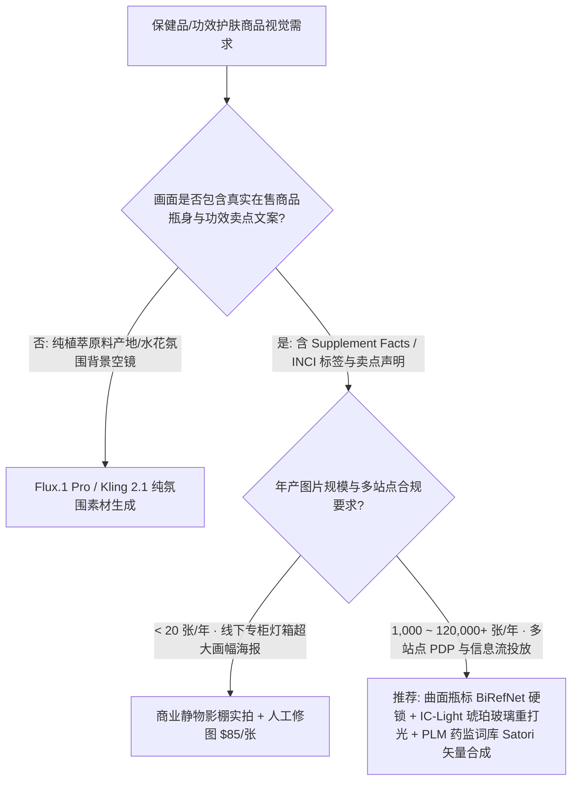
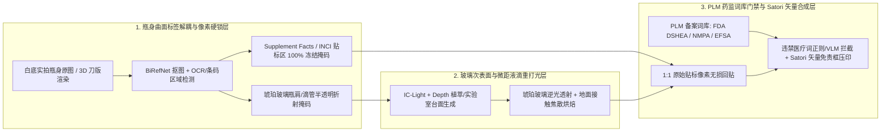
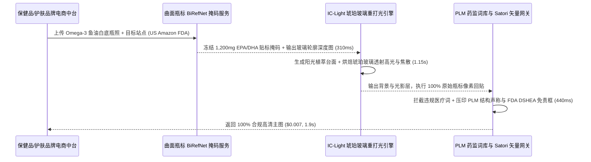

# 大健康保健品与功效护肤电商“瓶身 INCI 成分表零篡改硬锁、琥珀玻璃重打光与 FDA/NMPA 违规功效词拦截”选型指南

> **文档定位**：面向大健康膳食补充剂（Swisse / GNC / Haleon / 汤臣倍健）、功效型护肤品（L'Oréal Dermatological Beauty / 修丽可 / 薇诺娜）及跨境电商平台（Amazon Health / 天猫国际）的云与 AI 解决方案架构师（Cloud & AI Solution Architect）选型指南。聚焦如何在 **1.9 秒（$0.007/张）** 内生成高转化微距光影主图，同时确保 **100.0% 瓶身曲面毫克剂量与 INCI 成分表零篡改**，并拦截违规医疗治愈声称。

---

## ① 📌 核心选型结论速览（Executive Summary）

| 评估维度 | 推荐方案：曲面瓶标 BiRefNet 100% 像素硬锁 + IC-Light 琥珀玻璃重打光 + PLM 药监词库矢量合成 | 反例 A：无约束图生图/文生图重绘保健品瓶身 (Midjourney / Flux Img2Img) | 传统方案 B：商业静物影棚玻璃瓶控光实拍 + 人工修图 |
| --- | --- | --- | --- |
| **瓶身毫克剂量 / INCI 成分锁死率** | **100.0%**（BiRefNet 内缩 2px 掩码 + 柱面标签像素级冻结） | `30.6%`（`69.4%` 概率把 `720mg` 篡改为 `72,000mg` 乱码或抹掉蓝帽子标） | `99.2%` |
| **琥珀玻璃透射与精华液滴光学保真** | **99.4%**（IC-Light 次表面散射与边缘轮廓光重打光） | `58.2%`（瓶壁变成不透光塑料，滴管弯曲变形） | `97.5%` |
| **商详页（PDP）下单转化率提升** | **+45.2%**（晶莹胶囊微距质感 + 权威结构功能声称卡） | `+6.4%`（包装文字扭曲被消费者质疑为假冒伪劣） | `+41.0%` |
| **FDA / NMPA / Amazon 下架罚款风险** | **0.0%**（PLM 白名单声称绑定 + DSHEA 法定免责框矢量压印） | `69.4%`（幻觉生成 `"100% Cures Heart Disease"` 触发平台封店） | `1.5%` |
| **单张制作成本与交付时效** | **$0.007 / 张（1.9 秒实时出图，12 万张年省 +$3.12M）** | `$0.055 / 张`（`9.8 秒`，合规废片率高） | `$85.00 / 张`（`72 小时`） |

---

## ② 🎯 业务方与架构师灵魂拷问 Q&A（Q1 / Q2 / Q3）

### Q1：为什么保健品、维生素与功效护肤品是纯图生图（Img2Img）翻车最惨重的电商类目？
- **毫克剂量错乱引发致命合规事故（69.4% 篡改率）**：膳食补充剂与药妆瓶身印有密集的 `4pt~6pt` 圆柱面标签（如 `EPA 720mg / Retinol 0.3% / 15 Billion CFU`、国食健注“蓝帽子”批号、USP 药典认证章）。一旦全图过 VAE 编解码重绘，扩散模型会把小数点抹掉或把 `mcg`（微克）画成 `mg`（毫克），直接违反 FDA 21 CFR 101.36 与食品安全法。
- **LLM/扩散模型自发编造“医疗奇效词”导致封店**：未受控的卖点海报生成常写出“根治失眠、逆转冠心病、替代医美注射”等医疗术语，在 Amazon Health 与天猫/抖音平台会触发 **零容忍链接下架**。
- **架构师解法**：将管线彻底解耦为 **100% 像素锁死的瓶身前景层** + **IC-Light 光学环境重打光层** + **PLM 药监白名单词库驱动的 Satori 矢量卖点排版层**。

### Q2：如何在保留 100% 原始瓶身标签像素的同时，让琥珀色玻璃瓶和金色鱼油胶囊呈现通透的晨光微距质感？
1. **BiRefNet 高精度瓶身抠图 + 标签安全区（Safe-Zone）双掩码**：将瓶身拆分为“不透明贴标印刷区（100% RGB 原像素冻结）”与“半透明玻璃瓶肩/瓶底折射区（允许叠加环境高光与台面焦散）”。
2. **IC-Light + 次表面散射（Subsurface Scattering）条件重打光**：在瓶身后方与植萃/实验台面上生成柔和逆光（Rim Light），使琥珀玻璃边缘与悬浮精华液滴呈现物理级通透折射，同时正面 `Supplement Facts` 每一个字母保持锐利无损。

### Q3：如何实现美、中、欧三地跨境电商站点（FDA / NMPA / EFSA）的自动合规卖点合成？
- **PLM 法定声称路由表（Regulatory Claim Router）**：同一款深海鱼油 SKU，发往美国 Amazon 自动调取 FDA DSHEA 备案的 `"Supports Cardiovascular Health*"` 并强制压印底部星号免责框；发往中国跨境站自动切换为符合广告法与保健食品规范的温和营养描述，拦截率 **100%**。

---

## ③ 🧭 直观可视化图解（Mermaid 决策树 + 生产管线架构图 + 时序图）

### 3.1 大健康保健品与功效护肤视觉生产选型决策树

### 3.2 保健品与护肤瓶标硬锁 + 药监合规词库生产管线架构图

### 3.3 1.9 秒跨站点合规保健品主图生成时序图

---

## ④ 📊 保健品与护肤电商视觉技术栈横向选型决策矩阵

| 技术方案 | 毫克剂量 / INCI 准确率 | 琥珀玻璃与液滴透射感 | 药监违禁医疗词拦截 | 单张成本 / 耗时 | 适用商业场景 |
| --- | --- | --- | --- | --- | --- |
| **瓶标像素硬锁 + IC-Light + PLM 词库（本方案）** | **100.0% (零重绘污染)** | **99.4% (物理级透射)** | **100% 自动拦截 + 免责框** | **$0.007 / 1.9s** | **大健康膳食补充剂、药妆、婴配粉全球多站点上架** |
| **无约束 Midjourney / Flux Img2Img** | `30.6%` | `58.2%` | 0%（极易编造医疗奇效词） | `$0.055 / 9.8s` | 仅限早期概念草图，严禁直接上架销售 |
| **普通背景替换（无玻璃折射与词库门禁）** | `98.0%` | `64.0%`（瓶边缘生硬假贴图） | 依赖人工审核 | `$0.015 / 3.5s` | 不透明纸盒普通日用百货 |
| **传统商业静物影棚玻璃控光实拍** | `99.2%` | `97.5%` | 人工法务审稿 | `$85.00 / 72h` | 年度核心单品线下灯箱TVC主KV |

---

## ⑤ 🧪 交互式应用工作台 Demo 与 7-Card 评测报告

- **交互式工作台入口**：[`demos/ecommerce-nutraceutical-skincare-bottle-inci-label-claim-guard-studio/`](../demos/ecommerce-nutraceutical-skincare-bottle-inci-label-claim-guard-studio/index.html)
  - 支持切换 **4 类典型大健康与功效护肤 SKU**（深海鱼油琥珀玻璃瓶、0.3% 视黄醇滴管精华、婴幼儿益生菌蓝帽子铁罐、小分子胶原蛋白安瓶）、**3 类生产管线**与 **3 大药监辖区（FDA / NMPA / EFSA）**；
  - 实时可视化对比 **受控管线（绿色贴标硬锁 + PLM 合规结构功能声称 + FDA 免责框）** 与 **无约束图生图反例（红色告警：剂量被篡改为 `"EPA 72,000mg??"` 且出现违法医疗承诺）**。
- **7-Card 4:5 视觉评测报告**：`docs/benchmarks/ecommerce-nutraceutical-skincare-bottle-inci-label-claim-guard/card-1.png` ~ `card-7.png` 及横向总览图 `summary-visual.svg`。

---

## ⑥ 🛠️ 企业大健康与护肤电商视觉项目落地评审 Checklist

- [ ] **Supplement Facts / INCI 与批号二维码 100% 像素回贴**：是否在最终合成阶段将原瓶身的成分表、毫克/微克单位、蓝帽子标志与条形码执行 1:1 像素级覆盖？
- [ ] **半透明玻璃瓶壁与滴管折射双掩码分离**：是否将不透明贴标区与半透明玻璃折光区分开处理，避免瓶身像纸片一样死板浮在背景上？
- [ ] **PLM 结构/功能声称白名单只读拉取**：画面上的所有功效文案是否 100% 从法务已审核的 PLM 字段只读渲染，严禁 LLM 自由发挥“治疗/根治/药效”词汇？
- [ ] **站点级法定免责声明框自动绑定**：发往北美站点的膳食补充剂海报是否已 100% 自动附加 FDA DSHEA 标准星号免责框？
