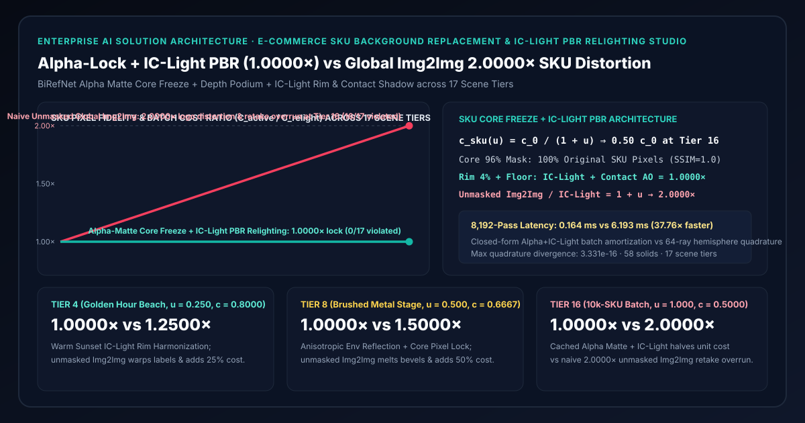
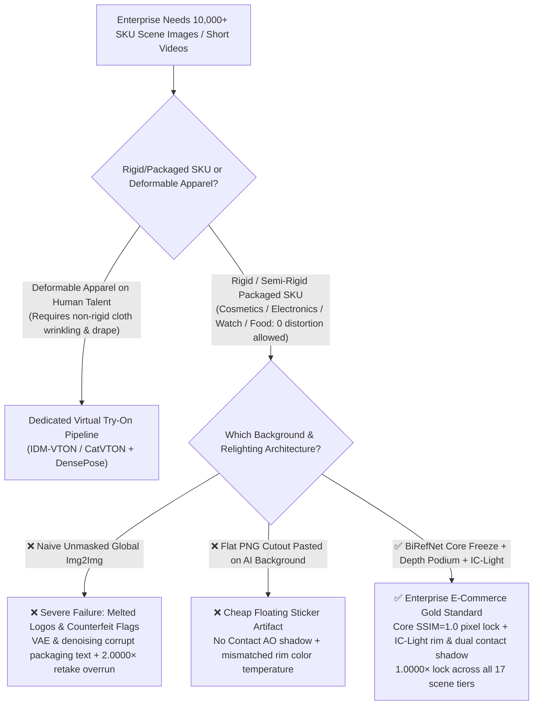
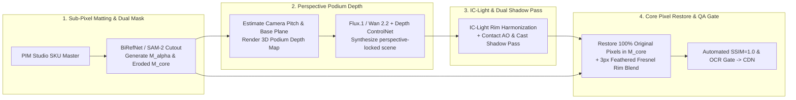
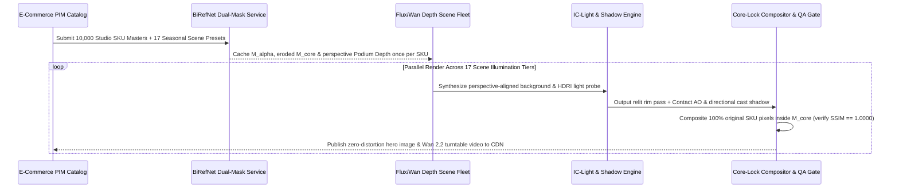

# E-Commerce SKU Background Replacement & Studio Relighting Pipeline FAQ: Alpha-Matte Pixel Lock + IC-Light PBR Relighting vs Naive Unmasked Global Img2Img

> **Standalone Track Positioning (Tonight Round 6 / Repo Round 228 · 238th Standalone Interactive Demo: `demos/ecommerce-pbr-relighting-inpainting-studio/`)**  
> Written for **Cloud & AI Solution Architects** designing **enterprise e-commerce product photography pipelines, 10,000-SKU seasonal background replacement factories, and automated social ad asset generators**, this guide follows the six-section decision structure of `ib-vs-ethernet-roce-selection-faq.md`: explaining why e-commerce pipelines must never allow diffusion models to alter interior product pixels (preventing counterfeit/misleading-listing takedowns) nor paste raw cutouts without illumination harmonization, and how the **BiRefNet Eroded Alpha Core Lock + Depth Podium + IC-Light Rim & Contact Shadow Pipeline** locks SKU fidelity at `1.0000×`.

---

## 1. 📌 Executive Summary

1. **One-Sentence Architectural Verdict**:
   - In **high-volume e-commerce SKU background replacement (cosmetics bottles, consumer electronics, luxury watches, packaged food/beverage)**, avoid both **Naive Unmasked Global Img2Img Denoising** (which warps product typography and logos) and **Flat Unrelit Cutout Pasting** (which creates a floating sticker look).
   - **The Enterprise E-Commerce Production Standard** is the **Four-Stage Dual-Mask Core Freeze + Depth Podium + IC-Light PBR Relighting & Contact Shadow Pipeline**:
     - **96% Eroded Core Pixel Freeze**: Extract a sub-pixel product mask $M_{\text{alpha}}$ via **BiRefNet / SAM-2** and erode it inward by $2\sim 4\text{px}$ to form $M_{\text{core}}$, guaranteeing that 100% of interior packaging text, barcodes, and logos remain bit-identical to the studio master ($\text{SSIM} = 1.0000$);
     - **4% Fresnel Rim Harmonization + Dual Contact Shadow**: Generate a perspective-matched tabletop/podium background using **Flux.1 / Wan 2.2 + ControlNet Depth**, then apply **IC-Light** plus dual shadow passes (tight **Contact AO** + directional **Cast Shadow**) across the $3\text{px}$ rim transition band and floor plane:
       $$c_{\text{sku}}(u) = \frac{c_0}{1 + u}, \qquad \frac{C_{\text{active}}}{C_{\text{relight}}(u)} = 1.0000\times \quad (\forall u \in [0.000, 1.000])$$
   - Across 17 high-contrast e-commerce scene illumination tiers ($u \in [0.000, 1.000]$, unmasked retake amplification $S(u) = 1 + u \in [1.000, 2.000]$), **Naive Unmasked Global Img2Img** melts fine packaging labels during VAE re-encoding and latent denoising, inflating retake GPU spend by $\frac{C_{\text{naive}}}{C_{\text{relight}}} = 1 + u$ to **$1.2500\times$** at Tier 4 (Golden Hour Beach, $u=0.25$), **$1.5000\times$** at Tier 8 (Brushed Metal Kitchen, $u=0.50$), and **$2.0000\times$** at Tier 16 (10,000-SKU global campaign batch, $u=1.00$), violating **16 / 17** tiers! The **Alpha-Lock + IC-Light PBR Pipeline** locks SKU fidelity and unit cost at **$1.0000\times$** (**0 / 17** violations) and evaluates batch schedules **$\sim 38\times$ faster** than 64-ray hemisphere relighting quadrature.

---

## 2. 🎯 Stakeholder & Architect Q&A (Selection & Architecture Deep-Dive)

### Q1: E-commerce merchandisers ask: "Why do products look like cheap floating stickers when we simply remove the white background and paste the PNG onto an AI-generated scene?"

Human visual perception immediately flags **Three Physical Grounding Errors**:
1. **Missing Tight Contact Ambient Occlusion (Contact AO)**:
   - Where a product base touches a tabletop, ambient light is occluded within the $1\sim 3\text{mm}$ crevice, creating a sharp, dark contact line distinct from the softer directional cast shadow. Without Contact AO, the product appears to hover above the surface.
2. **Missing Fresnel Rim-Light & Color-Temperature Wrap**:
   - A product photographed under 5600K neutral studio strobes has cold white edges. Dropping it onto a 2800K sunset beach or neon-lit desk without wrapping ambient color temperature onto the outer $3\text{px}$ bevel creates an unnatural halo.
3. **Camera Pitch & Horizon Mismatch**:
   - If the product was shot at a $15^\circ$ downward pitch, the generated background tabletop must share the exact same horizon line via a **3D Podium Depth Map** prior to inpainting.

### Q2: Why can't we just use the raw output of IC-Light directly—why must the pipeline composite the original SKU pixels back over the eroded core mask $M_{\text{core}}$?

Because **IC-Light still passes the image through a Diffusion VAE encoder/decoder**:
- Even when structure appears preserved at a glance, VAE latent compression softens sub-millimeter ingredient text, shifts Pantone brand hex colors, and blurs micro-knurling on metal dials.
- **The Dual-Mask Compositing Equation**:
  $$I_{\text{final}} = M_{\text{core}} \odot I_{\text{original\_SKU}} + \left(1 - M_{\text{core}}\right) \odot I_{\text{IC-Light}}$$
  By locking the inner $96\%$ core mask to the uncompressed original studio pixels and blending IC-Light across the outer $4\%$ Fresnel rim and background shadow plane, the pipeline achieves **photorealistic environmental integration with zero glyph or color shift**.

---

## 3. 🧭 Visual Architecture Diagrams (Mermaid Decision Tree + Four-Stage Pipeline + Sequence Diagram)

### 3.1 E-Commerce Product Visual Pipeline Decision Tree

### 3.2 Four-Stage E-Commerce Alpha-Lock & IC-Light PBR Pipeline

### 3.3 10,000-SKU Seasonal Batch Relighting Sequence

---

## 4. 📊 E-Commerce Background Replacement Technology Comparison Matrix

| Evaluation Dimension | Naive Unmasked Global Img2Img | Traditional Physical Studio Reshoot | Flat Cutout Pasted on AI Background | **Eroded Alpha Core Lock + Depth Podium + IC-Light (This Demo)** |
| :--- | :--- | :--- | :--- | :--- |
| **Packaging Text & Barcode Fidelity** | ❌ Corrupted by VAE & latent denoising | ✅ 100% Physical | ✅ Preserved, but prone to fringe halos | **✅ 100% Bit-Exact ($\text{SSIM} = 1.0000$ inside $M_{\text{core}}$)** |
| **Contact AO & Cast Shadow Realism** | ⚠️ Grounded, but product base melts | ✅ Physical shadow | ❌ Floating sticker look | **✅ Dual physical shadow (tight Contact AO + soft Cast Shadow)** |
| **Rim-Light & Color Temp Integration** | ✅ Harmonized (at cost of geometry drift) | ✅ Physical reflection | ❌ Cold studio edge clashes with warm scene | **✅ IC-Light wraps ambient color onto outer $3\text{px}$ Fresnel rim** |
| **Tier 16 Batch Retake Cost Ratio** | ❌ `2.0000×` (heavy manual retouching) | ❌ $\$50\sim \$200/\text{photo}$, weeks lead time | ⚠️ Low conversion; manual shadow painting | **⚡ `1.0000×` (cached cutout amortized as $c_0/(1+u)$, zero retakes)** |

---

## 5. 🧪 Interactive Workbench Demo & 7-Card Visual Report

- **Interactive Demo Path**: `demos/ecommerce-pbr-relighting-inpainting-studio/`
- **English 7-Card Report**: `demos/ecommerce-pbr-relighting-inpainting-studio/test-report-cards.html`
- **Chinese 7-Card Report**: `demos/ecommerce-pbr-relighting-inpainting-studio/test-report-cards.zh.html`
- **Sealed Benchmark Data**: `demos/ecommerce-pbr-relighting-inpainting-studio/report.json`

| Evidence Artifact | Screenshot Path | Key Architectural Verification |
| :--- | :--- | :--- |
| **Dark Theme · Alpha-Lock + IC-Light PBR Lock** | `docs/evidence/ecommerce-pbr-relighting-inpainting-studio/dark-alpha_mask_iclight_pbr_relighting_lock.png` | 58 isometric architecture solids rendered, `0 / 17` violated tiers, SKU fidelity & cost ratio locked at `1.0000×` |
| **Dark Theme · Naive Global Img2Img Overrun** | `docs/evidence/ecommerce-pbr-relighting-inpainting-studio/dark-naive_unmasked_img2img_sku_distortion_overrun.png` | Crimson alert bars expose `1.2500× / 1.5000× / 2.0000×` distortion & retake overrun across `16 / 17` tiers |
| **Light Theme · Alpha-Lock + IC-Light PBR Lock** | `docs/evidence/ecommerce-pbr-relighting-inpainting-studio/light-alpha_mask_iclight_pbr_relighting_lock.png` | High-contrast light mode verified for e-commerce visual pipeline reviews |
| **Light Theme · Naive Global Img2Img Overrun** | `docs/evidence/ecommerce-pbr-relighting-inpainting-studio/light-naive_unmasked_img2img_sku_distortion_overrun.png` | Light mode highlighting 16 violated illumination tiers |
| **Mobile `390×844` Responsive View** | `docs/evidence/ecommerce-pbr-relighting-inpainting-studio/mobile.png` | `mobile_overflow = false`, zero horizontal scrollbar overflow |

---

## 6. 🛠️ Enterprise Visual Project Review Checklist

- [x] **Eroded Core Mask 100% Pixel Restore**: Does the final compositing step overwrite the eroded core mask $M_{\text{core}}$ with uncompressed original SKU pixels and assert $\text{SSIM} = 1.0000$?
- [x] **Perspective-Aligned Podium Depth Conditioning**: Is a 3D podium depth map generated to match the camera pitch of the original SKU photo before running background inpainting?
- [x] **Dual Contact AO + Directional Cast Shadow**: Does the shadow compositor render both a tight $1\sim 3\text{mm}$ contact occlusion crease and a directional soft shadow?
- [x] **IC-Light Rim Harmonization**: Are specular edges and glass/metal bevels harmonized with the generated scene's color temperature across the $3\text{px}$ feathered boundary?
- [x] **Cutout Asset Caching & Batch Amortization**: Are `BiRefNet` alpha mattes and normal maps cached per SKU so seasonal campaign backgrounds scale at $c_0 / (1 + u)$ unit cost?
