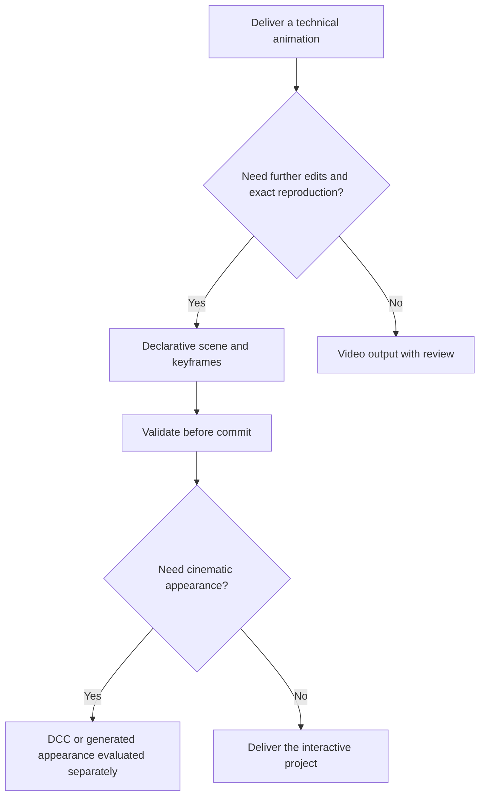
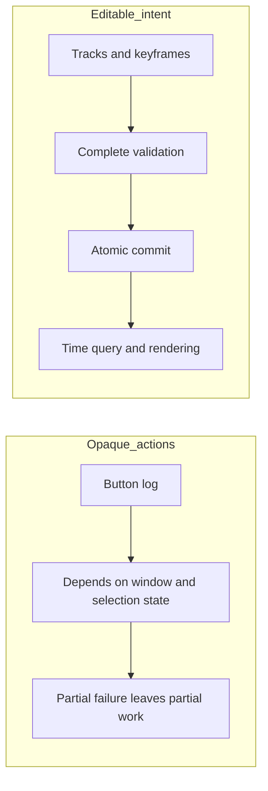
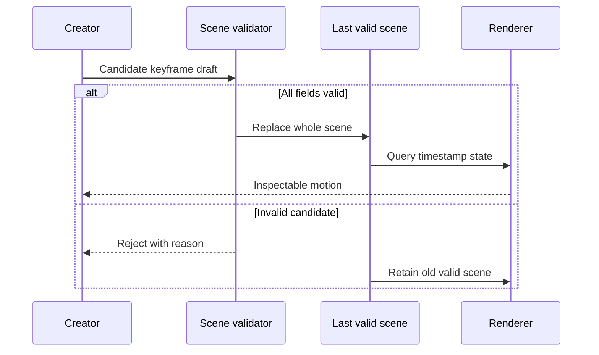

# AI authoring should leave editable scenes: keyframes and atomic changes FAQ

**Three minutes for the decision; ten minutes to edit a keyframe.**

[中文](editable-keyframe-scenes-faq.md) · [Interactive demo](https://turbo998.github.io/animation/demos/keyframe-compiler-bench/) · [Measured cards](../demos/keyframe-compiler-bench/test-report-cards.html)

## ① 📌 Executive Summary

- **Pixels and editable intent are different assets.** Action logs record buttons pressed; a declarative scene records which track should be where at a time. The latter supports inspection, reproduction and local edits.
- **Validate the entire candidate before replacing the old scene.** Missing tracks, duplicate timestamps and out-of-range positions must not partially apply. This prototype retains the last valid state on rejection.
- **A new original 71-solid three-lane motion bench with eleven local checks.** Rails, bearing blocks, carriages and stops accompany shared keyframe editing, sampling and export.
- **Verified current direction: editable AI/DCC workflows.** Maxon's October 14, 2026 release confirms Autograph MCP and editable Cinema 4D scene/camera/animation interchange. This demo illustrates a control contract; no vendor software, server or model is executed. Retrieved November 9, 2026; no invented same-day popularity ranking.

## ② 🎯 Customer and architect Q&A

### Q1 When should I choose AI video versus interactive code?

Generation is valuable for atmosphere, natural performances and materials. Requirements to move A at four seconds while preserving B/C, revisit a frame, or continue editing after export favor an explicit scene interface.

Combine layers when useful: AI assists with intent and assets; deterministic code validates, saves and renders control. **A polished result is not necessarily an editable project.** No generated-video quality is measured here.

### Q2 Under which explicit constraints does code win?

Track IDs, time, position, invariants and round-trip export are directly testable. Artistic clips without inspectable internal state may favor generation. The conclusion remains acceptance-specific.

An SA can deliver equipment or architecture explanations where a customer adjusts one movement without rebuilding other tracks. Preserve reviewed keyframes as an asset, not merely an assistant conversation or click log. Actual actuators, safe limits and industrial tolerances require separate systems.

### Q3 What are declarative scenes, keyframes and atomic edits?

Think of a timetable: A is left at zero seconds, middle at four and right at ten. The renderer computes positions between stations. Keyframes are those stations; linear interpolation is uniform, while the smooth rule slows near station boundaries.

Declarative source states the target, not a fragile button sequence. Replaying clicks depends on windows, selection and execution state; a timetable is easier to inspect and reproduce.

Atomic application resembles submitting a complete order: first verify unique tracks, increasing times, endpoints and legal positions, then replace the scene as one operation. Any invalid item preserves the previous valid order rather than sneaking in a partial update.

Key lookup can scan from the start or repeatedly halve the search interval. At the tested 2048 keys per track and 3000 queries, binary lookup saves CPU; tiny tracks show little difference. This is not model inference or screen-FPS acceleration.

Rendering also needs truth. A broad base must not hide its rear rails because its center sorts later. The bench reuses projected-overlap/separating-plane ordering from the earlier new cutaway and fixes a genuine fastener/housing intersection—not an eye-tuned depth bias.

### Q4 How can I reproduce it in ten minutes?

1. Run `npm run dev`, open `/demos/keyframe-compiler-bench/`, and seek four seconds.
2. Select A and change its second key to −30; B/C retain their values at that same time.
3. Set a JSON key's time to duplicate zero and apply. Expect a visible rejection with the old valid scene retained.
4. Restore legal times, apply, then play or seek. A longer duration requires every track to cover the new endpoint.
5. Export `EDITABLE_SCENE.json` and reapply it without losing track/key meaning.
6. Run `npx vitest run tests\keyframe-compiler.test.ts`; after building and previewing on 4335, run `node scripts\benchmark-keyframes.mjs`.

## ③ 🧭 Visual explanations

## ④ 📊 Architect Decision Matrix

| Requirement | Click log | Declarative keyframes | Editable DCC project | Video only |
| --- | --- | --- | --- | --- |
| Exact timestamp reproduction | Fragile | Direct query here | Preserve the full project | Pixel seeking, not necessarily geometry state |
| Edit one track and retain others | Not guaranteed | Testable invariants | Suitable with tool semantics | Requires rework/editing |
| Keep valid state on failure | Transaction layer needed | Complete validation here | Integration-dependent | Not a scene-state guarantee |
| Photographic art | Depends on tools | Geometric illustration here | Professional strength | Generation often useful |
| Real-device safety | Not established | Not certified | Separate engineering system | Pixels do not certify it |

**Capacity example:** three tracks preserve key stations and rules, not every mouse click. Exact bytes, rendering cost and reversibility depend on assets and tools; no compression, token saving or VRAM figure is invented.

## ⑤ 🧪 New demo and measured findings, including seven cards

The [sealed report](../demos/keyframe-compiler-bench/report.json) records eleven local checks: local-track editing, duplicate-time rejection, seven reversed timestamp visits and JSON round trips. The 71 solids also receive separate intersection and true-order checks.

Three key-count tiers each retain seven Node CPU repeats, with 3000 scene queries per run. Both lookup methods produce identical positions; binary lookup improves the large tested tier, while tiny tracks do not imply a strong benefit. Raw samples retain variation.

| Keys per track | Binary lookup median | Linear scan median |
| --- | --- | --- |
| 64 | 0.931 ms | 1.122 ms |
| 256 | 1.065 ms | 3.207 ms |
| 2048 | 1.574 ms | 25.444 ms |

**Quantified example:** at 2048 keys per track, the same 3000 queries save approximately 23.870 ms of Node CPU time. That is not a per-frame saving and does not imply proportional browser-FPS improvement. The sealed data retains the environment and all seven repeats.

[English cards](../demos/keyframe-compiler-bench/test-report-cards.html) · [中文七卡](../demos/keyframe-compiler-bench/test-report-cards.zh.html). Illustration: `synthetic`; local code: `measured`; Autograph MCP execution, third-party tool success, video quality and physical safety: `not_measured`.

## ⑥ 🛠️ Architect Checklist

- [ ] Preserve editable intent, not only conversations or button logs.
- [ ] Define stable IDs, units, duration and interpolation rules.
- [ ] Require increasing times and endpoints; visibly reject duplicates/out-of-range values.
- [ ] Validate the complete draft before replacing valid state.
- [ ] Test invariants for unedited tracks.
- [ ] Preserve semantic round trips and timestamp revisits.
- [ ] Check intersections and real depth order, not only numeric states.
- [ ] Separate CPU lookup, rendering, model and tool execution metrics.
- [ ] Mark unconnected MCP execution as unmeasured; a compatible format is not a receipt.
- [ ] Verify physical control safety and commercial asset rights separately.

**Primary source:** [Maxon Fall 2026, October 14](https://www.maxon.net/en/article/maxon-fall-2026-release-faster-workflows-more-creative-control): Autograph MCP with natively editable creative workflows. Retrieved November 9, 2026; vendor software not executed or reproduced and no daily ranking claimed.
