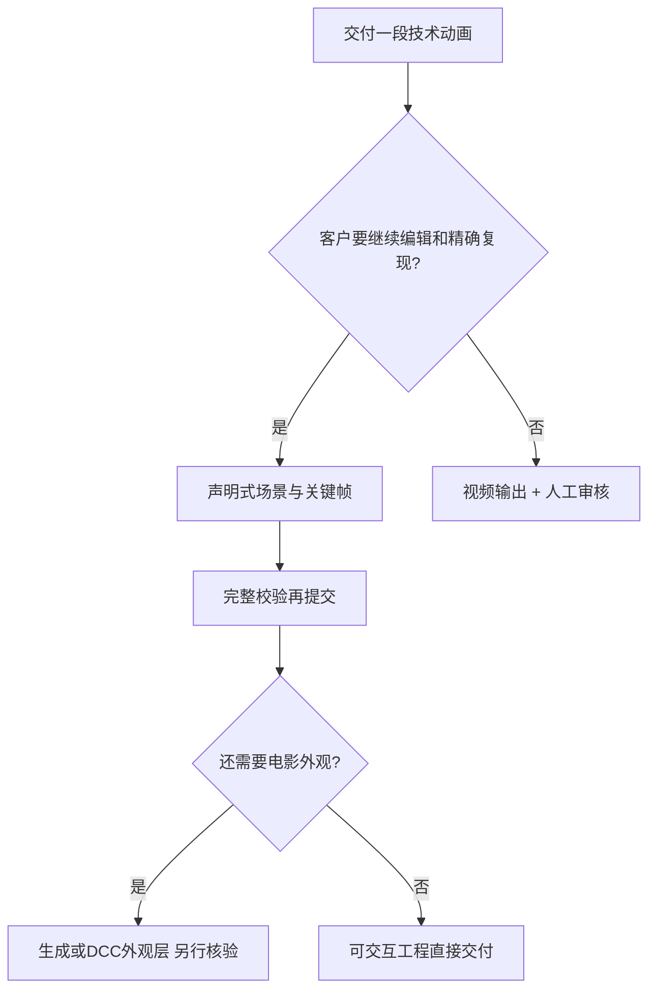
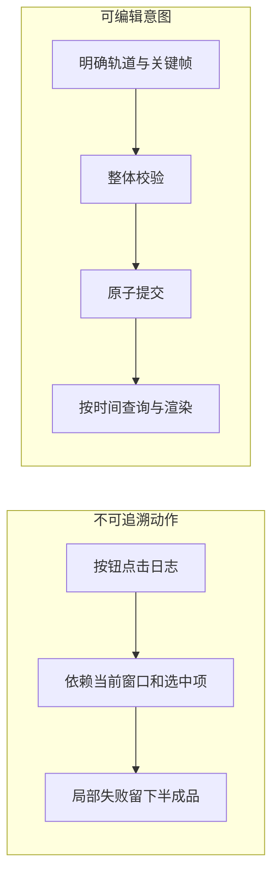
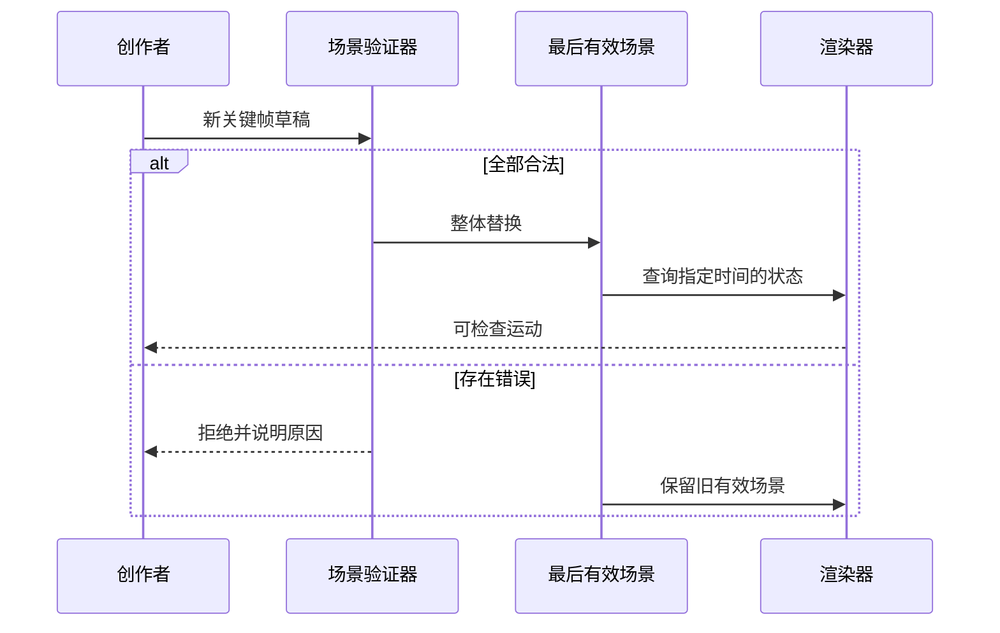

# AI 创作应留下可编辑场景：声明式关键帧与原子修改选型 FAQ

**3 分钟看结论与矩阵；10 分钟编辑一个关键帧。**

[English](editable-keyframe-scenes-faq.en.md) · [交互 Demo](https://turbo998.github.io/animation/demos/keyframe-compiler-bench/) · [中文七卡](../demos/keyframe-compiler-bench/test-report-cards.zh.html)

## ① 📌 核心结论速览（Executive Summary）

- **最终像素与可编辑意图不是同一种资产。** 操作日志说明“点过哪个按钮”，声明式场景说明“哪条轨道在何时到哪里”。要复刻、审查与局部修改，后一种信息更直接。
- **先校验整份新场景，再替换旧场景。** 重复时间、缺轨、非法位置不应部分应用；本例拒绝无效编辑并保留最后有效状态。
- **全新 71 实体三轨运动工作台，11 项本机验收。** 轨道、轴承块、滑台与限位器是真正原创的 SVG 几何；关键帧编辑、时间查询、导出共用一份场景。
- **今日追踪的真实方向：可继续编辑的 AI/DCC 创作。** Maxon 2026-10-14 发布说明确认 Autograph MCP Server 与 Cinema 4D 场景/相机/动画互通。本例只演示可编辑控制契约，没有调用这些软件、服务器或模型；不声称今日发布或日热度排名。

## ② 🎯 客户与架构师灵魂拷问 Q&A

### Q1 何时选 AI 视频大模型 vs 何时选代码驱动交互式动画？

当画面氛围、自然人物与材质是核心目标，生成视频很有价值。若要求“把第4秒的 A 改到另一位置，B/C 不动”“回到任意一帧”“导出之后还能继续编辑”，代码场景提供更可检查的接口。

两层可协作：AI 帮创作者写场景意图与素材，确定性控制层校验、保存和渲染。**生成一个漂亮结果不等于交付一个可修改工程。** 本例不评测视频生成质量。

### Q2 什么场景下代码驱动动画严格更优？

验收写明轨道 ID、时间、位置、不变量、可往返导出时，代码能直接测试这些属性。对于不要求内部状态的艺术片段，生成模型可能更适合；“严格更优”仍限定在具体约束上。

SA 业务方案：设备或架构原理说明视频，客户希望随时调整一步运动并保留其他轨道。把审阅后的关键帧作为交付资产，可追溯编辑；不要仅保存助手的聊天或工具点击历史。真实执行器控制、安全限位与工业公差仍需独立系统，网页示意不是控制器。

### Q3 声明式场景、关键帧和原子修改到底是什么？

把动画看成“时间表”：A 在0秒位于左侧，4秒到中间，10秒到右侧。程序在相邻两站之间算位置。关键帧就是时间表的站点；线性插值匀速前进，平滑曲线在站点附近放缓。

“声明式”是在说目标状态，不是一串脆弱的按钮动作。重放点击日志时，窗口、选中项、执行顺序可能已变；时间表本身更容易审查、保存与复刻。

“原子”像提交一份完整订单：先检查所有轨道 ID 唯一、时间递增、覆盖首尾、位置合法，再整体应用。只要一处非法就保留旧场景，不把半份错误订单悄悄塞进去。

查找关键帧可以从头逐个扫，也可以每次把搜索区间减半。本机在每轨2048键、每次3000查询的条件下，二分查找比线性更省 CPU；小轨道差异很小。它不是模型推理或屏幕 FPS 加速。

视觉方面，长底板不能按中心点盖住后排导轨。本例与此前新扫描仪复用经过验证的“投影重叠 + 实体分离面”绘制顺序，并修正了真实螺钉与壳体的交叉；不是靠眼睛调遮挡偏置。

### Q4 10 分钟如何复刻？

1. `npm run dev` 后打开 `/demos/keyframe-compiler-bench/`，点击到4秒。
2. 选择 A，把第2关键帧位置改为 −30；B 与 C 在同一时间保持原值。
3. 编辑 JSON：将一个关键帧时间改为重复0并点击“校验后应用”。错误应明确显示，旧有效场景保持。
4. 恢复合法时间，重新应用并从0秒播放或跳转。增加时长时，每条轨道都必须覆盖新尾端。
5. 导出 `EDITABLE_SCENE.json`，再应用它，核对轨道与关键帧含义不丢失。
6. 执行 `npx vitest run tests\keyframe-compiler.test.ts`；构建并启动4335预览后，运行 `node scripts\benchmark-keyframes.mjs`。

## ③ 🧭 直观可视化图解

## ④ 📊 Architect Decision Matrix

| 交付需求 | 点击日志 | 声明式关键帧 | 可编辑 DCC 工程 | 纯视频 |
| --- | --- | --- | --- | --- |
| 任意时间精确复现 | 脆弱 | 本例直接查询 | 需保存完整工程 | 可定位像素，未必有几何状态 |
| 局部修改留其他轨道 | 不保证 | 可检查不变量 | 适合，需工具语义 | 要重做或额外编辑 |
| 失败保留旧有效状态 | 要事务层 | 本例整体校验 | 依具体工具和集成 | 不适用场景状态 |
| 摄影级美术 | 依外部工具 | 本例是几何示意 | 专业强项 | 生成层常有价值 |
| 真实设备安全 | 不能据此证明 | 未认证 | 仍需工程系统 | 像素不能认证 |

**容量算例：** 三条轨道只需保存关键站点和规则，不必保存每次鼠标点击。具体字节、渲染成本与可逆性依资产和工具；不编造压缩率、模型 Token 节省或显存数字。

## ⑤ 🧪 全新 Demo 与 Benchmark 核心发现（含 7-Card）

[封存数据](../demos/keyframe-compiler-bench/report.json)记录 11 项本机验收，包括局部轨道修改、重复时间拒绝、7个时间点逆序重访和JSON往返。71个实体有单独的几何交叉与正确绘制顺序检查。

查找算法的三个键数档，每档7次 Node CPU 重复，每次3000次场景查询。两种查找返回相同位置；高键数下二分更快，小键数不能据此保证明显收益。所有原始重复保留，不只挑最快。

| 每轨关键帧 | 二分查找中位数 | 顺序扫描中位数 |
| --- | --- | --- |
| 64 | 0.931 ms | 1.122 ms |
| 256 | 1.065 ms | 3.207 ms |
| 2048 | 1.574 ms | 25.444 ms |

**定量算例：** 2048 键/轨这一档，完成同样 3000 次查询少用约 23.870 ms 的 Node CPU 时间。不是一帧少用这么多时间，也不保证浏览器 FPS 按比例提升。原始样本、运行环境与七次重复见封存数据。

[中文七卡](../demos/keyframe-compiler-bench/test-report-cards.zh.html) · [English cards](../demos/keyframe-compiler-bench/test-report-cards.html)。示意场景为 `synthetic`，本机代码为 `measured`；Autograph MCP、第三方工具执行、视频画质和真实机械安全为 `not_measured`。

## ⑥ 🛠️ Architect Checklist

- [ ] 交付工程意图与可编辑状态，不只保留聊天或点击日志。
- [ ] 稳定轨道 ID、单位、时间范围与插值规则明确。
- [ ] 时间递增且覆盖首尾；重复与越界明确拒绝。
- [ ] 先校验完整草稿，再原子替换最后有效场景。
- [ ] 局部编辑时检查未编辑轨道不变量。
- [ ] 导出再导入不丢语义，任意时间重访一致。
- [ ] 实体不相交、深度绘制正确，不能只看数值。
- [ ] CPU 查找、渲染、模型与实际工具执行分开计量。
- [ ] 第三方 MCP 未连接就标未执行，不借兼容格式冒充回执。
- [ ] 真实设备控制和商业素材另做安全及许可核验。

**来源：** [Maxon Fall 2026，2026-10-14](https://www.maxon.net/en/article/maxon-fall-2026-release-faster-workflows-more-creative-control)：Autograph MCP 与继续可编辑的原生创作工作流。检索于2026-11-09；未运行或转载该软件，不声称当日热度排名。
