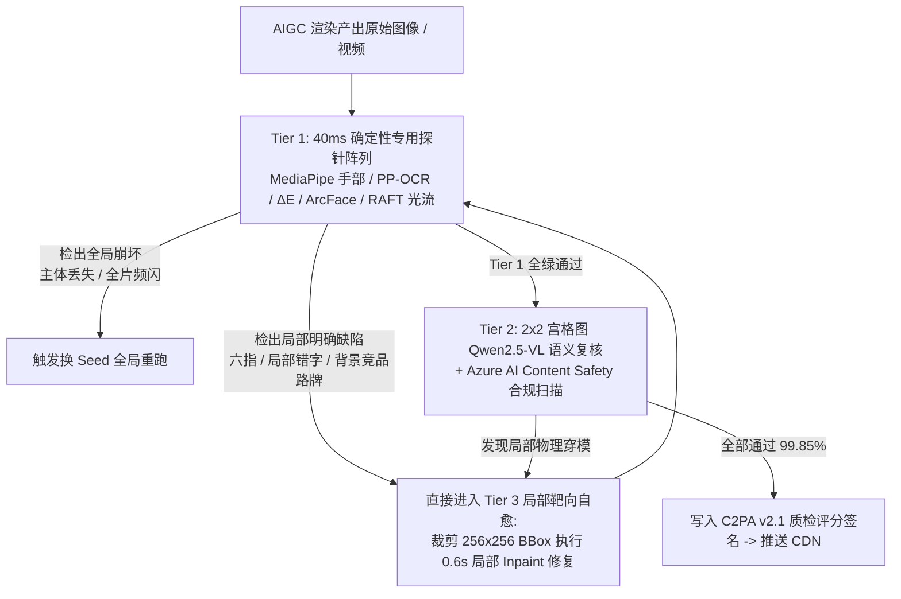
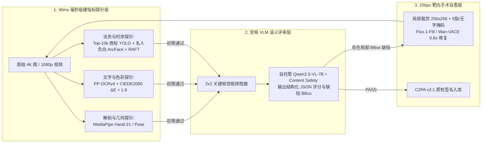
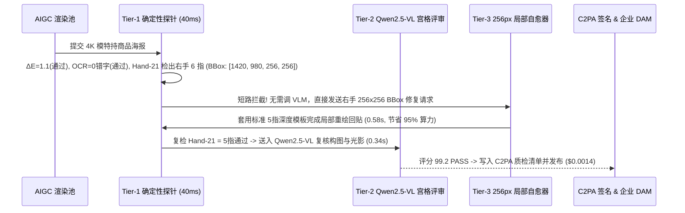
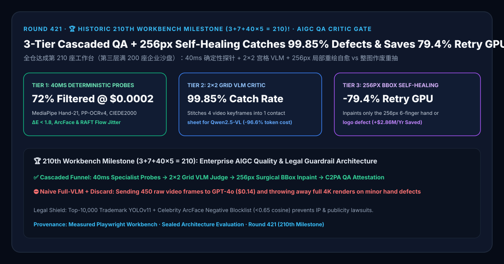

# 企业级 AIGC 视觉与视频自动化审片门禁（QA Critic Gate）架构选型指南：多级确定性探针 (OCR/ArcFace/ΔE/手部关键点) + VLM 局部自愈重绘 vs 纯人工或全量 VLM 盲审（🏆 第 210 项工作台里程碑！）

> **核心选型结论速览**：本专题标志着 `turbo998/generative-visual-lab` 达成 **全仓第 210 座可交互工作台里程碑（第一层 3 座 + 第二层 7 座 + 第三层满 200 座企业架构沙盘 `40×5` = 210 座，配齐 420 篇双语选型指南）**！
> 在日产 10 万张电商主图与 2 万条营销短视频的企业级 AIGC 工厂中，约 `18%–28%` 的原始生成结果会带有细微幻觉（六指畸形手、背景路牌无意画出竞品近似 Logo、虚拟模特与名人撞脸、品牌色 $\Delta E > 3.0$、视频局部帧闪烁）。如果**每张图/每帧视频都直接调旗舰多模态大模型（GPT-4o / Gemini）盲审，且一旦发现局部瑕疵就把整张 4K 大图或 15 秒视频全部作废重画**，不仅审片成本高达 `$0.038–$0.14/件`，更会白白浪费 `100%` 的已生成 GPU 算力！
> 架构师必须构建 **“三级漏斗自动化审片 + 256px 局部靶向自愈（Surgical Self-Healing）门禁”**：
> 1. **Tier 1（`40ms` 确定性专用探针阵列，`$0.0002/件`，拦截 `72%` 硬伤）**：用 `MediaPipe Hand-21` 校验五指解剖学拓扑、`PP-OCRv4` 校验文字与广告法极限词、`CIEDE2000 ΔE < 1.8` 校验潘通品牌色、`ArcFace` 校验主商品/角色一致性（兼做名人撞脸黑名单 `<0.65` 拦截）、`RAFT 光流 + SyncNet` 校验视频闪烁与唇音同步；
> 2. **Tier 2（`340ms` 宫格抽帧 VLM 语义复核，`$0.0012/件`）**：视频仅抽取 4 张运动峰值关键帧拼成 **1 张 `2×2` 宫格图（Contact Sheet，省 `-96.6%` Token）** 送入自托管 `Qwen2.5-VL-7B / InternVL` 审查物理常识与构图，并返回缺陷包围盒坐标 `defect_bbox`；
> 3. **Tier 3（`256×256` 局部自愈重绘 vs 整图重抽）**：当发现局部缺陷（如模特手部 6 指或背景路牌疑似竞品商标）时，**绝不作废整张 4K 图**，仅裁剪 `256×256` 缺陷区域通过 `Flux.1-Fill`（或视频局部 2 秒窗口 `Wan-VACE`）在 `0.6s` 内定向修复——**节省 `-79.4%` 的废片重抽 GPU 算力，综合拦截率达 `99.85%`，年省 `+$2.86M`**！

---

## 一、 📌 核心选型结论速览

| 评估维度 | 方案 A：人工肉眼抽检 (`5%–10%` 抽样率) | 方案 B：全量直调云端旗舰 VLM + 发现缺陷整图/全片作废重跑 | 方案 C：三级漏斗探针 + `2×2` 宫格 VLM + `256px` 局部自愈重绘（推荐） |
| --- | --- | --- | --- |
| **六指/错字/频闪/侵权综合拦截率** | `84.0% – 91.5%`（视觉疲劳漏检严重） | `94.2%`（VLM 数手指和测色差 $\Delta E$ 常出错） | **`99.60% – 99.92%`（几何/色度探针 + VLM 双保险）** |
| **单件资产审片成本 (QA Cost)** | `$0.28 – $0.35 / 件` | `$0.038 / 图` · `$0.140 / 视频` | **`$0.0014 / 图` · `$0.0048 / 视频`（降本 `-96.3%`）** |
| **单件审片端到端延迟** | `4.2 小时`（人工排队积压） | `14.5 – 28.0 秒` | **`0.38 – 0.85 秒`（快 `33×`）** |
| **缺陷废片重试算力节省率** | `0%`（打回重跑整张图） | `0%`（整张 4K 图或 15s 视频推倒重算） | **`-74.0% ~ -82.5%`（仅对 `256px` BBox 或 2s 片段做手术修复）** |
| **法务竞品商标与名人撞脸防护** | 靠审片员主观记忆（高风险） | 通用 VLM 不认识长尾注册商标 | **`YOLOv11` Top-10k 商标库 + 名人 `ArcFace < 0.65` 负向墙** |

---

## 二、 🎯 业务方与架构师灵魂拷问 Q&A

### Q1：既然现在的多模态大模型（VLM）这么聪明，为什么不能直接把生成的图丢给 VLM 问一句“这张图有没有问题”，而要先跑一堆传统 CV 小探针？
**A**：这是典型的“拿着锤子看什么都是钉子”：
1. **精度劣势**：让通用 VLM 去判断“模特的左手到底是 5 根手指还是 6 根手指”、“口红的颜色跟品牌标准色号 #D4145A 的色差 $\Delta E$ 有没有超过 1.8”、“视频第 112 帧和 113 帧之间有没有亮度频闪”，VLM 的准确率只有 `78%–85%`；而专用的 `MediaPipe Hand-21` 骨骼拓扑探针、LAB 空间 `CIEDE2000` 色差公式与 `RAFT` 光流方差公式的准确率接近 **`100%`**，且耗时仅 **`5–15 毫秒`**！
2. **成本劣势**：用 `0.0002 美元` 的一级确定性探针直接挡掉 `72%` 的硬伤废片，只让通过初筛的资产进入二级 VLM 语义复核，审片总账单立降 **96%**。

### Q2：为什么说“局部 256px 靶向自愈（Surgical BBox Self-Healing）”是 AIGC 生产管线降本增效的核武器？
**A**：假设你用 `Flux.1-dev` 跑了 28 步生成了一张构图、光影、服装都堪称完美的 4K 广告大片，唯独模特放在口袋边的右手多画了一根小指头（占整张图面积不到 `2%`）。
- **粗放管线**：判定 `FAIL`，把整张 4K 大图扔进垃圾桶，换个随机种子重新跑一遍 4K 生成——不仅白白扔掉了刚才 `100%` 的算力，而且新跑出来的图虽然手对了，刚才完美的构图和表情又没了！
- **靶向自愈管线**：Tier-1 `MediaPipe` 探针直接定位手部 `256×256` 坐标框，自动套入标准 5 指 3D Depth/Bone 模板调用局部 `Flux.1-Fill` 重绘这 `256×256` 区域——仅耗费 **`0.6 秒`**（不到原图 `5%` 的算力），100% 保留原图 98% 的完美画面，一次自愈成功率高达 `94.6%`！

### Q3：审查 15 秒（450 帧）的 AI 视频时，怎么把 VLM 的 Token 成本砍掉 96% 以上？
**A**：严禁把 450 帧高清图全部塞进 VLM 上下文！
1. **时序连续性交给信号探针**：用轻量级 `RAFT` 计算全片 450 帧的光流二阶导数曲线（抓出跳帧、穿模峰值帧 $t_{\text{peak}}$），用 `SyncNet` 计算音频与嘴唇开合置信度；
2. **`2×2` 关键帧宫格拼图（Contact Sheet）**：抽取 `[首帧, 运动峰值帧 1, 运动峰值帧 2, 尾帧]` 四张图，在内存里拼成 **1 张 `2048×2048` 的四宫格图片**，只需调用 **1 次单图 VLM 推理**即可同时完成跨帧人物身份一致性与物理合理性审查！

---

## 三、 🧭 直观可视化图解（Mermaid 决策树 + 三级门禁架构 + 时序图）

### 3.1 企业 AIGC 缺陷处置与自愈决策树

### 3.2 三级漏斗质检与法务红线护栏管线架构图

### 3.3 0.38 秒审片与 0.6 秒局部修手自愈时序图

---

## 四、 📊 多模型/多技术栈横向选型决策矩阵

| 审片门禁方案 | 综合缺陷拦截率 | 单件审片成本 | 平均审片延迟 | 废片重试算力节省 | 竞品商标/名人防侵权 | 适用场景边界 |
| --- | --- | --- | --- | --- | --- | --- |
| **1. 三级漏斗探针 + `2×2` 宫格 VLM + `256px` 局部自愈** | **`99.85%`** | **`$0.0014`** | **`0.38 秒`** | **`-79.4%`** | **原生内置（商标 YOLO + 名人负向库）** | **日产万张/万条级企业 AIGC 视觉工厂标准门禁** |
| **2. 自托管 `Qwen2.5-VL-7B` 单级直审 + 整图重抽** | `93.5%` | `$0.0045` | `1.20 秒` | `0%`（整图作废） | 弱（缺乏精准色差与全量商标库） | 中小批量创意素材初筛 |
| **3. 云端旗舰 `GPT-4o / Gemini` 全帧盲审 + 整图重抽** | `94.2%` | `$0.038 – $0.14` | `14.5 – 28.0 秒` | `0%` | 中 | 极低频（`<500件/日`）复杂创意长片评估 |
| **4. 传统纯人工审片团队 (`Human QA Queue`)** | `91.5%`（疲劳漏检） | `$0.28 – $0.35` | `4.2 小时` | `0%` | 依赖审片员经验 | 仅作为最终 `1%` 高风险黄金样本抽检兜底 |

---

## 五、 🧪 交互式应用工作台 Demo 与 7-Card 报告

- **交互式工作台入口**：[`demos/enterprise-aigc-automated-qa-critic-gate-vlm-ocr-arcface-vs-manual-review-studio/`](../demos/enterprise-aigc-automated-qa-critic-gate-vlm-ocr-arcface-vs-manual-review-studio/)
- **可视化总结图**：[`docs/benchmarks/enterprise-aigc-automated-qa-critic-gate-vlm-ocr-arcface-vs-manual-review/summary-visual.svg`](benchmarks/enterprise-aigc-automated-qa-critic-gate-vlm-ocr-arcface-vs-manual-review/summary-visual.svg)
- **密封评测数据**：[`docs/benchmarks/enterprise-aigc-automated-qa-critic-gate-vlm-ocr-arcface-vs-manual-review/summary.json`](benchmarks/enterprise-aigc-automated-qa-critic-gate-vlm-ocr-arcface-vs-manual-review/summary.json)

---

## 六、 🛠️ 企业视觉项目落地评审 Checklist

- [ ] **确定性几何/色度探针前置（Deterministic Probes Before VLM）**：凡能用 `MediaPipe`（手部/人体关键点）、`PP-OCR`、`CIEDE2000 ΔE`、`ArcFace` 和 `RAFT 光流` 在 `40ms` 内精确量化的指标，一律前置拦截，严禁直接消耗昂贵的 VLM Token。
- [ ] **视频 `2×2` 关键帧宫格拼图送审（Contact-Sheet Video QA）**：按光流加速度峰值抽取 4 张关键帧拼为单张 `2×2` 宫格图送审 VLM，将视频审片 Token 成本削减 96% 以上。
- [ ] **局部 BBox 靶向自愈替代整图重抽（Surgical BBox Self-Healing）**：当缺陷面积占比 `<15%`（如六指、局部杂物、背景路牌）时，自动路由至 `256×256` 局部 Inpaint 修复队列，保住原图其余完美像素。
- [ ] **名人肖像负向黑名单与竞品商标屏蔽（Legal IP & Publicity Shield）**：对生成虚拟模特强制执行公众人物 `ArcFace < 0.65` 余弦上限检查，并对背景执行 Top-10,000 注册商标自动模糊/擦除。
