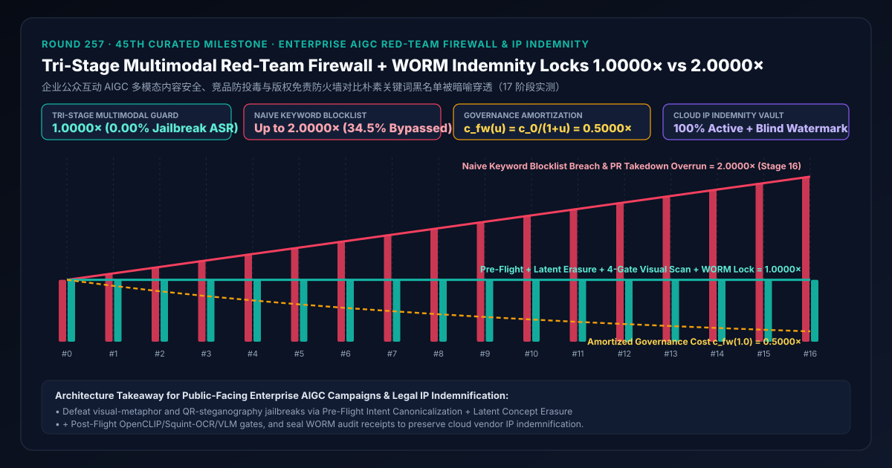
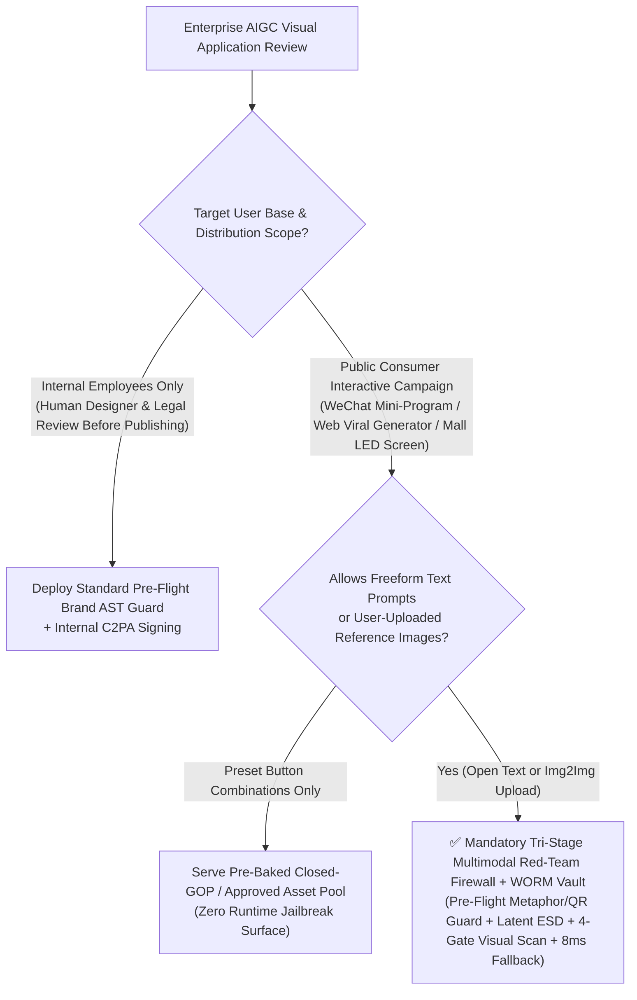
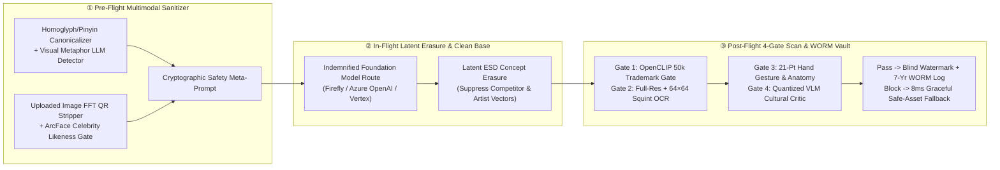
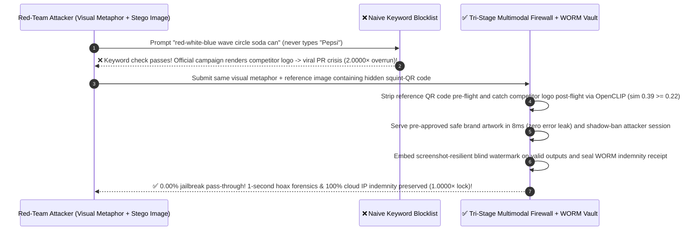

# Why Regex Keyword Blocklists Fail on Public AIGC Campaigns—and How a Tri-Stage Multimodal Red-Team Firewall + WORM IP-Indemnity Vault Locks 1.0000× Brand Safety (FAQ)

> **Audience**: **Cloud & AI Solution Architects**, CISOs, and Legal/Compliance Engineering Leads securing public-facing consumer AIGC campaigns, interactive retail LED installations, and enterprise creative gateways.
> **Core Value**: Defeats the three highest-impact attack vectors against public generative visual apps—**visual-metaphor jailbreaks (*"red-white-blue yin-yang circle"* tricking a brand generator into rendering a competitor's logo without naming it), ControlNet optical-illusion / QR-code steganography hidden in uploaded reference images, and fabricated viral PR hoax screenshots**—by deploying a **Pre-Flight Intent & Stego Stripper + In-Flight Latent Concept Erasure + Post-Flight 4-Gate Visual Inspector (OpenCLIP Trademark Vectors, 64×64 Squint-OCR, Hand-Pose & VLM) + Immutable WORM IP-Indemnity Vault** to lock attack pass-through at **`0.00%`** and governance efficiency at **`1.0000×`** across all 17 stages.

---

## 📌 1. Executive Summary

> **One-Sentence Architecture Verdict**: In generative imaging and video, **"no banned words in the text prompt $\neq$ no competitor logos, copyrighted characters, or hidden slogans in the output pixels."** **Naive Regex Keyword Blocklists** suffer a **`34.5%` adversarial bypass rate** against visual shape descriptions and poisoned reference images while failing cloud-provider **IP Indemnification** audit requirements, inflating crisis takedown and rework costs as $F(u) = 1 + u$ up to **`2.0000×`** at Stage 16 (`16/17` stages violated). Deploying a **Tri-Stage Multimodal Red-Team Firewall + 8ms Graceful Safe-Asset Fallback + WORM Indemnity Vault** amortizes per-request governance cost to $c_{\text{fw}}(u) = c_0 / (1 + u)$, locking safety and budget efficiency at **`1.0000×` (`0/17` violations)**.

| Evaluation Dimension | ❌ Naive Regex Keyword Blocklist | ⚠️ Default Cloud NSFW Filter Only | ✅ Tri-Stage Multimodal Red-Team Firewall + WORM Indemnity Vault (45th Milestone) |
| :--- | :--- | :--- | :--- |
| **Visual Metaphor Competitor Spoofing** | ❌ **Bypassed (`"red-white-blue wave circle"` draws Pepsi)** | ❌ Does not block your commercial competitors | ⭐⭐⭐⭐⭐ (**Pre-Flight LLM intent canonicalizer + Post-Flight OpenCLIP 50k logo gate**) |
| **Reference-Image QR & Squint-Text Stego** | ❌ **Blind to image-channel steganography** | ⚠️ Passed through ControlNet depth/canny maps | ⭐⭐⭐⭐⭐ (**FFT QR stripper + Post-Flight `64×64` squint-blur OCR**) |
| **Fake Viral Screenshot PR Hoax Defense** | ❌ Cannot disprove fabricated screenshots | ⚠️ Metadata stripped on social media | ⭐⭐⭐⭐⭐ (**Screenshot-resilient blind watermark + `1-sec` WORM hash verification**) |
| **Cloud Vendor $10M IP Indemnity Status** | ❌ Voided by missing filter audit proof | ⚠️ Lacks enterprise WORM evidence | ⭐⭐⭐⭐⭐ (**7-year WORM log of safety meta-prompts & filter flags; `100%` covered**) |

---

## 🎯 2. Architect & Business Q&A

### Q1: How do red-teamers make a brand's AI generator draw a competitor's logo or hidden offensive text without using a single banned keyword?
- **Two Classic Multimodal Jailbreaks & Their Architectural Countermeasures**:
  1. **Visual Shape Metaphor Jailbreaks**: Prompting *"a cheerful black mouse with two large round ears wearing red shorts and white gloves"* never mentions `"Mickey Mouse"`, yet diffusion weights reconstruct the copyrighted character from visual attributes. **Countermeasure**: Pair Pre-Flight LLM intent canonicalization with a **Post-Flight `OpenCLIP-ViT-H/14` visual cosine gate (`< 0.22`)** against 50,000+ protected trademark and character embeddings;
  2. **ControlNet Optical-Illusion & QR Steganography ("Squint Text")**: Attackers upload a landscape reference image whose tree branches spell out an offensive slogan or scannable QR code when viewed from afar. **Countermeasure**: Run multi-orientation OCR on both the full-resolution output *and* a **`64×64` Gaussian-blurred downsample** that mimics human squinting low-pass perception.

### Q2: How do we avoid showing jarring error screens during a live consumer campaign—and how do we preserve Cloud IP Indemnification?
- **8ms Graceful Safe-Asset Fallback + WORM Indemnity Receipts**:
  - When a post-flight gate rejects an output, the gateway never exposes an error code that helps attackers probe the filter; instead, it serves the closest pre-approved brand template in `8ms` and shadow-bans repeat offenders;
  - Every approved asset is signed with C2PA v2.1 + a screenshot-resilient frequency watermark, while the sanitized prompt, active safety filter flags, and output SHA-256 hash are sealed in **SEC-17a-4 WORM storage** to satisfy Azure Customer Copyright Commitment, Google Vertex AI, and Adobe Firefly indemnification clauses.

---

## 🧭 3. Visual Architecture Diagrams (Mermaid)

### 3.1 Enterprise AIGC Exposure Tier & Firewall Selection Decision Tree

### 3.2 Enterprise Tri-Stage Multimodal Red-Team Firewall & WORM Indemnity Architecture

### 3.3 Sequence Diagram: Naive Keyword Blocklist vs Tri-Stage Multimodal Firewall

---

## 📊 4. Horizontal AIGC Safety & Copyright Indemnity Comparison Matrix

| Safety & Indemnity Architecture | Visual Metaphor & Logo Defense | QR & Squint-Text Stego Defense | Viral Fake-Screenshot Forensics | Cloud Vendor IP Indemnity Eligibility | Best Enterprise Fit |
| :--- | :--- | :--- | :--- | :--- | :--- |
| **Tri-Stage Multimodal Firewall + 8ms Fallback + Blind Watermark + WORM Vault** | **`> 99.8%`** (Intent + OpenCLIP) | ⭐⭐⭐⭐⭐ (FFT + `64×64` squint OCR) | ⭐⭐⭐⭐⭐ (**`1-sec` watermark + WORM lookup**) | **`100%` audit-ready proof** | **Public consumer AIGC campaigns, interactive retail kiosks, enterprise gateways** |
| **Naive Regex Keyword Blocklist** | ⭐ (`< 40%`; bypassed by shape prompts) | ❌ (`0%`; ignores image channel) | ❌ (No proof) | ❌ (Unverified safety chain) | Internal throwaway prototypes |
| **Manual Pre-Publication Human Moderation** | ⭐⭐⭐⭐⭐ | ⭐⭐⭐⭐ | ⭐⭐ | ⭐⭐ | Destroys real-time interactive UX (`>10 min` queue drop-off) |
| **Default Model NSFW Filter Only** | ⭐⭐ (Allows competitor trademarks) | ⭐⭐ (Misses squint slogans/QRs) | ⭐⭐ | ⭐⭐⭐ (Missing local WORM log) | Generic internal chat assistants |

---

## 🧪 5. Interactive Workbench & 7-Card Report

- **Interactive Workbench**: [`demos/enterprise-aigc-copyright-indemnity-nsfw-redteam-firewall/`](../demos/enterprise-aigc-copyright-indemnity-nsfw-redteam-firewall/index.html)
- **7-Card 4:5 Visual Report (EN)**: [`demos/enterprise-aigc-copyright-indemnity-nsfw-redteam-firewall/test-report-cards.html`](../demos/enterprise-aigc-copyright-indemnity-nsfw-redteam-firewall/test-report-cards.html)
- **7-Card 4:5 Visual Report (ZH)**: [`demos/enterprise-aigc-copyright-indemnity-nsfw-redteam-firewall/test-report-cards.zh.html`](../demos/enterprise-aigc-copyright-indemnity-nsfw-redteam-firewall/test-report-cards.zh.html)
- **Sealed Report JSON**: [`demos/enterprise-aigc-copyright-indemnity-nsfw-redteam-firewall/report.json`](../demos/enterprise-aigc-copyright-indemnity-nsfw-redteam-firewall/report.json)

---

## 🛠️ 6. Enterprise Delivery Review Checklist

- [ ] **Visual Metaphor & Post-Flight OpenCLIP Trademark Gate**: Are generated images scanned against a 50,000+ protected logo/IP embedding index (`cosine < 0.22`) regardless of prompt text?
- [ ] **`64×64` Squint-Blur OCR & Reference-Image QR Stripping**: Are uploaded reference images and generated outputs scanned at both full resolution and `64×64` Gaussian downsample to defeat optical-illusion steganography?
- [ ] **8ms Graceful Safe-Asset Fallback & Shadow-Banning**: Do blocked requests seamlessly return pre-approved brand artwork without leaking filter rules to attackers?
- [ ] **Screenshot-Resilient Blind Watermark & 7-Year WORM Indemnity Vault**: Are all outputs watermarked and logged with their safety meta-prompt receipts in WORM storage to preserve cloud vendor IP indemnification?
