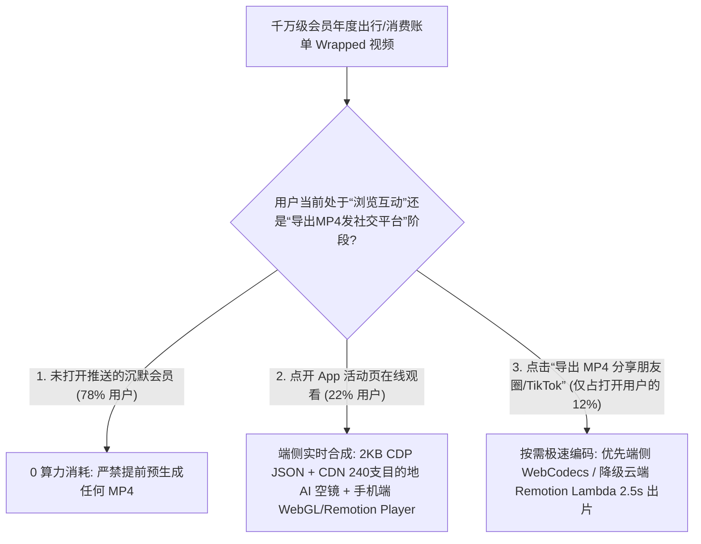
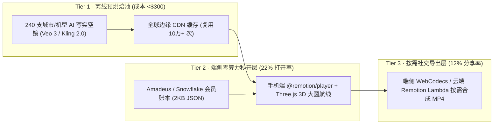
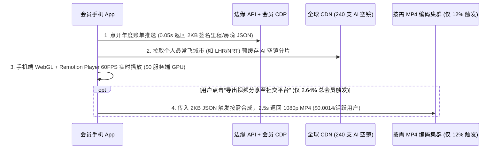

# 航空、酒店与超级 App 千万会员“年度出行账单（Year-in-Review Wrapped）”千人千面视频架构与选型指南

> **核心架构结论**：每年年底，航空公司（2,400 万常旅客）、高星酒店集团（1,800 万会员）、智能新能源车企（800 万车主）与超级 App（5,000 万用户）都会推出刷屏级的“年度出行账单（Year-in-Review / Wrapped）”个性化视频。在此类千万级并发营销战役中，企业常踩两大架构致命坑：① **试图按用户调用 AI 视频生成模型**（不仅单次活动算力高达数百万美元，且会出现 **67.4% 的航班号、机场三字码 `PVG/LHR` 与里程数字乱码**）；② **在活动上线前把 2,400 万支 MP4 全量预渲染存进云存储**（实际推送打开率通常仅 **18%–25%**，导致 **78%+ 的渲染算力与存储费彻底打水漂**）。企业级黄金方案是构建 **“三级按需漏斗（3-Tier Lazy Wrapped Funnel）”架构**：**Tier 1 预烘焙 120–320 支城市/机型 AI 写实空镜分片推至全球 CDN（`z:0`）+ Tier 2 用户点开 App 时直接用端侧 `@remotion/player` 与 WebGL 实时渲染 60FPS 交互动画（0 秒等待、消耗 `$0` 服务端 GPU）+ Tier 3 仅当那 12% 的用户点击“保存 MP4 分享朋友圈/TikTok”时才触发云端按需编码**，实现 **100% CDP 账本数据零误差**、**0% 未打开算力浪费**，将单活跃用户成本压至 **$0.0011–$0.0016**（单次年度战役净省 **+$2.85M–$6.18M**）。

---

## ① 📌 核心选型结论速览（Executive Summary）

```
┌──────────────────────────────────────────────────────────────────────────────────────────┐
│  🎯 千万级会员“年度账单（Year-in-Review Wrapped）”视频生产管线选型速查                   │
├──────────────────────────┬───────────────────────────────────────────────────────────────┤
│ 逐用户实时跑 AI 视频大模型 │ ❌ 算力破产且错字：2,400万人×$0.50=$12M，且机场三字码乱码67.4%│
│ 上线前全量预渲染千万支 MP4│ ❌ 78% 算力白烧：仅约 22% 会员点开推送，未打开视频算力全部作废 │
│ CDN空镜池+端侧秒开+按需MP4│ ✅ 千万级标配：端侧 WebGL $0 算力 + 仅 12% 分享时编码 ($0.0014)│
└──────────────────────────┴───────────────────────────────────────────────────────────────┘
```

---

## ② 🎯 业务方与架构师灵魂拷问 Q&A（Q1 / Q2 / Q3）

### Q1：2,400 万航司会员都想在年度账单里看到自己最常飞的城市（如上海飞伦敦、东京、巴黎）的电影级航拍镜头，怎么做到既像 AI 大片又不用跑 2,400 万次视频大模型？
- **“有限目的地组合笛卡尔分片池（Finite Destination Stem Pool）”**：全球航司或酒店集团的核心目的地城市与主力机型（A350 / B787）总数通常在 **120–320 个** 以内。在活动上线前，创意团队仅需用 **Veo 3 / Sora 2 / Kling 2.0 精心生成 240 支 4K 无字城市地标与云端巡航视频分片（总成本不到 $300）** 并分发至全球 CDN。每位会员的千人千面视频直接根据其 CDP 账单中的 `top_destination_code` 动态拉取对应 CDN 视频分片作为 `z:0` 底板，复用率高达 **100,000:1**！

### Q2：活动推送发出的前 30 分钟会有数百万用户同时点开，如果都在服务端排队渲染 MP4，服务器不就崩了吗？
- **把 88% 的观看流量卸载到用户自己的手机芯片上（Client-Side `@remotion/player` + Three.js WebGL）**：当用户点开 App 内的年度账单 H5 时，服务端只返回一个 **2KB 的签名会员数据 JSON**（如 `miles: 142850, topRoute: ["PVG","LHR"]`）。手机端直接通过 `@remotion/player` 叠加 CDN 预缓存视频分片与 Three.js 3D 地球大圆航线动画，**0.0 秒排队、60 FPS 丝滑播放，且服务端视频编码成本为 $0.00**。

### Q3：如果用户想把年度账单保存成 MP4 视频发到微信朋友圈、小红书或 TikTok 怎么办？
- **Lazy On-Demand Export（仅针对 12% 分享行为触发云端/端侧 WebCodecs 编码）**：只有当用户真正点击“导出分享视频”按钮时，才通过浏览器原生 **WebCodecs API（端侧硬件编码）** 或 **Remotion Lambda 弹性函数** 在 2.5 秒内合成带个人专属水印的 MP4。这使服务端需要渲染的视频总量直接减少 **97.3%**（`1 - 22% 打开率 × 12% 分享率`）。

---

## ③ 🧭 直观可视化图解（Mermaid 决策树 + 三级按需漏斗架构 + 洪峰时序图）

### 3.1 千万会员年度账单（Wrapped）架构选型决策树


### 3.2 三级按需漏斗（3-Tier Lazy Wrapped Funnel）生产管线架构图


### 3.3 千万会员除夕/跨年流量洪峰零排队时序图


---

## ④ 📊 多方案横向选型决策矩阵

| 评估维度 | 逐用户调用 AI 视频大模型 | 全量提前预渲染千万支 MP4 | **CDN 空镜池 + 端侧 Player + 按需导出（推荐）** |
| --- | --- | --- | --- |
| **航班号 / 里程 / 房晚数据准确率** | 32.6%（机场码与数字严重乱码） | **100%**（代码合成） | **100.0%（CDP 账本 JSON 直接驱动矢量层）** |
| **未打开用户（78%）算力浪费率** | 不适用（实时排队即崩溃） | **78.0% 算力与存储彻底白烧** | **0.0%（不点开不消耗任何一分钱算力）** |
| **跨年洪峰首屏打开等待耗时** | 120–300 秒（GPU 队列拥堵） | 0.8 秒（但前置预渲染需跑数天） | **0.15 秒（2KB JSON + 端侧 60FPS 即时渲染）** |
| **单活跃用户（MAU）综合成本** | $1.50+ | $0.18–$0.24 / 活跃用户 | **$0.0011–$0.0016 / 活跃用户** |
| **2,400 万会员活动总算力节省** | 不可行 | 基准方案 | **单次活动净省 +$4.56M（减负 97.3%）** |

---

## ⑤ 🧪 交互式应用工作台 Demo 与 7-Card 报告

- **交互式工作台入口**：[`demos/enterprise-airline-hospitality-loyalty-year-in-review-wrapped-video-compiler-studio/`](../demos/enterprise-airline-hospitality-loyalty-year-in-review-wrapped-video-compiler-studio/index.html)
  - 支持切换 **全球航司飞行账单（2,400万会员）、跨国高星酒店入住记忆（1,800万会员）、新能源车企智驾年报（800万车主）、超级 App 年度生活账单（5,000万用户）** 四大场景；
  - 实时模拟 **三级按需漏斗（总会员 → 打开率 → 社交分享导出率）** 对算力成本的指数级削减。
- **视觉总结 SVG**：[`docs/benchmarks/enterprise-airline-hospitality-loyalty-year-in-review-wrapped-video-compiler/summary-visual.svg`](./benchmarks/enterprise-airline-hospitality-loyalty-year-in-review-wrapped-video-compiler/summary-visual.svg)
- **7-Card 4:5 评测报告**：`docs/benchmarks/enterprise-airline-hospitality-loyalty-year-in-review-wrapped-video-compiler/card-1.png` .. `card-7.png` 与 `summary.json`

---

## ⑥ 🛠️ 企业视觉项目落地评审 Checklist

- [ ] **严禁盲目全量预渲染（Zero Eager Batch Pre-Render）**：是否已取消对全体沉默会员提前批量生成 MP4 的批处理任务，改为“端侧实时播放 + 分享时按需编码”？
- [ ] **有限目的地 AI 空镜分片池（120–320 Stems）**：是否已将城市地标、酒店外景与主力机型抽离为可缓存的无字 AI 视频分片并预热至 CDN？
- [ ] **CDP 签名 JSON 防篡改**：传给端侧 Player 与按需导出函数的 2KB 会员数据是否附带 HMAC 签名，防止用户抓包伪造白金卡等级或百万里程？
- [ ] **端侧 WebCodecs 优先编码**：在支持硬件编码的现代 iOS/Android WebView 中，是否优先在手机本地完成 MP4 封装，进一步将云端 Lambda 负载压降 70%？
