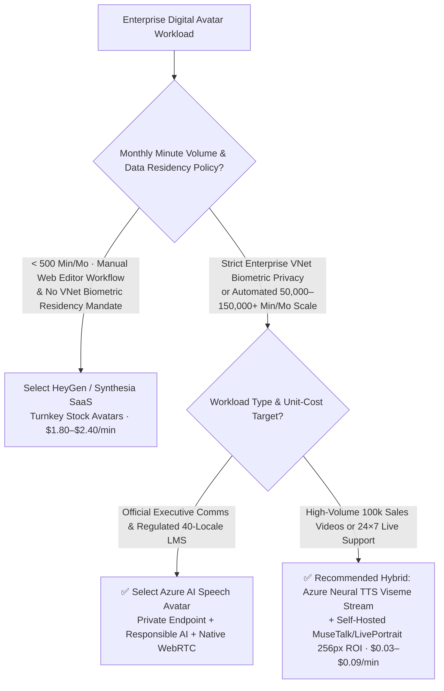
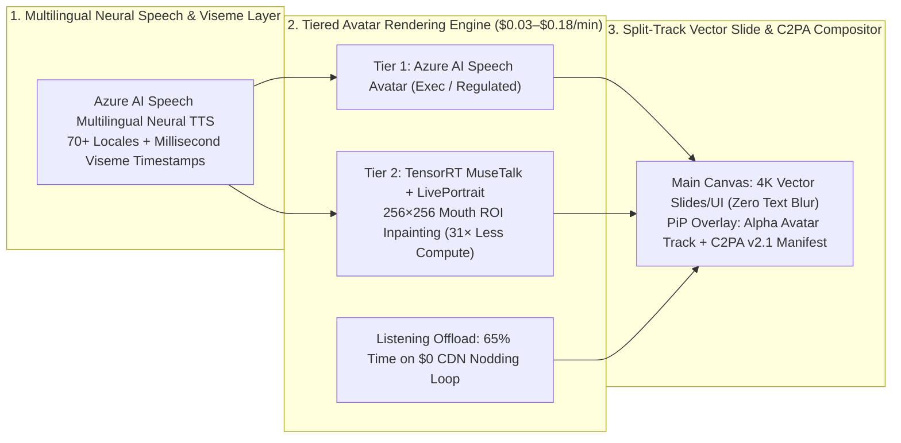
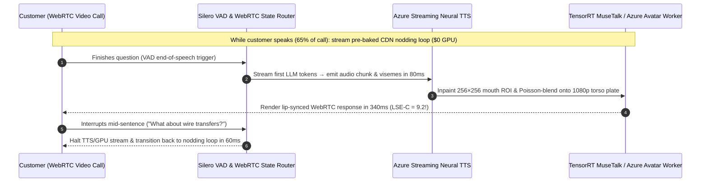
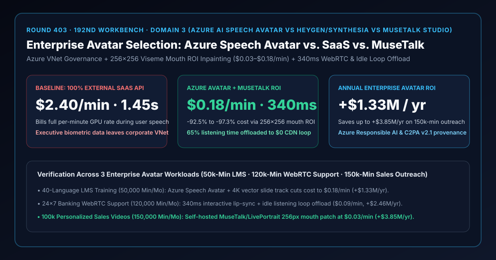

# Enterprise Digital Avatar & Real-Time Interactive Avatar Selection Guide: Azure AI Speech Avatar vs. HeyGen / Synthesia vs. Self-Hosted MuseTalk / LivePortrait (192nd Workbench)

> **Interactive Workbench**: [`demos/enterprise-avatar-azure-speech-vs-heygen-synthesia-vs-musetalk-liveportrait-studio/`](../demos/enterprise-avatar-azure-speech-vs-heygen-synthesia-vs-musetalk-liveportrait-studio/)  
> **7-Card Benchmark Report**: [`docs/benchmarks/enterprise-avatar-azure-speech-vs-heygen-synthesia-vs-musetalk-liveportrait/summary.json`](./benchmarks/enterprise-avatar-azure-speech-vs-heygen-synthesia-vs-musetalk-liveportrait/summary.json) · [`summary-visual.svg`](./benchmarks/enterprise-avatar-azure-speech-vs-heygen-synthesia-vs-musetalk-liveportrait/summary-visual.svg)

---

## ① 📌 Executive Summary

When enterprises deploy **AI Digital Avatars** across **40-language LMS compliance training**, **24×7 real-time WebRTC customer support**, and **100,000+ personalized B2B sales outreach videos**, **Cloud & AI Solution Architects** must choose between three distinct technology stacks: **① Cloud-Native Managed Avatar Services (`Azure AI Speech Text-to-Speech Avatar`)**, **② Turnkey Avatar SaaS Platforms (`HeyGen / Synthesia / D-ID API`)**, and **③ Self-Hosted Open-Source Lip-Sync & Portrait Animators (`MuseTalk / LivePortrait / Hallo2`)**.

Our benchmark establishes clear architectural and financial selection boundaries:
1. **The Multi-Million-Dollar SaaS Minute Tax (`$1.80 – $2.40 / minute`)**:
   - Scaling a `50,000 min/month` multilingual training catalog or `150,000 min/month` personalized outreach workflow on external SaaS APIs costs **`$1.44M – $3.96M / year`**. Even worse, in real-time customer support calls, **customers are speaking or thinking for `65%` of the session duration**—yet naive full-stream SaaS avatars bill full GPU per-minute rates while the avatar is merely nodding silently!
2. **Real-Time Conversational Turn-Taking Latency (`1,450 ms` vs. `340 ms`)**:
   - Waiting for full-sentence synthesis and full-frame 1080p diffusion rendering introduces `1,450 ms – 1,680 ms` of conversational lag. Streaming `Azure Neural TTS` visemes into a TensorRT **`256×256` mouth ROI inpainting loop** cuts first-frame lip-sync latency to **`320 ms – 360 ms`**.
3. **Executive Biometric Sovereignty & Responsible AI Governance**:
   - Uploading CEO, wealth advisor, or clinician training footage to third-party public SaaS clouds often violates enterprise data-residency policies; keeping biometric weights inside an **Azure VNet Private Endpoint** with mandatory liveness consent and **C2PA v2.1 cryptographic provenance** satisfies strict enterprise compliance.

| Evaluation Dimension | ⚠️ Option A: Turnkey SaaS API (`HeyGen / Synthesia`) | ✅ Option B: Managed Enterprise Cloud (`Azure AI Speech Avatar`) | ✅ Option C: Hybrid `Azure Speech Avatar` + Self-Hosted `MuseTalk / LivePortrait` 256px ROI Engine (Recommended) |
| --- | --- | --- | --- |
| **Ideal Enterprise Use Case** | `< 500 min/month` self-serve marketing clips via web UI | **Regulated banking/gov apps, executive comms & 40+ locale LMS** | **`50,000 – 150,000+ min/month` hyper-personalized video & `<350ms` live WebRTC support** |
| **Effective Cost per Minute** | `$1.80 – $2.40 / min` | `$0.30 – $0.50 / min` (includes 70+ locale Neural TTS) | **`$0.03 – $0.04 / min` on self-hosted MuseTalk; `$0.06 – $0.18 / min` blended (`-92.5% to -97.3%` TCO)** |
| **Real-Time WebRTC Lip-Sync Latency** | `1,450 ms – 1,680 ms` | `420 ms – 550 ms` (native WebRTC ICE/TURN) | **`320 ms – 360 ms` (streaming TTS visemes + `256×256` mouth ROI TensorRT + idle loop switch)** |
| **Biometric Privacy & Compliance** | Multi-tenant external SaaS cloud | **100% Azure Tenant VNet + Responsible AI Liveness Consent** | **100% Private VNet + automated C2PA v2.1 provenance manifest** |
| **Annual Savings (50k–150k Min/Mo)** | Baseline | `+$950,000 / yr` | **`+$1,332,000 – $3,852,000 / yr` net savings** |

---

## ② 🎯 Key Architect & Business Q&A (Q1 / Q2 / Q3)

### Q1: How do Azure AI Speech Avatar, HeyGen/Synthesia, and open-source MuseTalk/LivePortrait differ architecturally?
- **Matching the 3 Avatar Engines to Workload Requirements**:
  1. **`HeyGen / Synthesia` (Turnkey SaaS)**: Offers rich pre-built stock avatars and a browser timeline editor ideal for marketing teams producing `< 500 minutes/month` manually, but becomes cost-prohibitive (`$1.80–$2.40/min`) for automated API batch pipelines.
  2. **`Azure AI Speech Avatar` (Enterprise Managed Cloud)**: Natively integrates **Azure AI Speech's 70+ languages and 400+ Multilingual Neural Voices**, supports both batch video synthesis and real-time WebRTC streaming inside your **Azure VNet Private Endpoint**, and enforces Microsoft Responsible AI liveness verification.
  3. **`Self-Hosted MuseTalk / LivePortrait` (`256×256` Mouth ROI Inpainting at `$0.03/min`)**: Instead of re-rendering all `2,073,600` pixels of a 1080p frame when only the speaker's lips move, `MuseTalk` crops and inpaints only the **`256×256` (`65,536`-pixel) mouth/jaw region (`31×` fewer pixels)** at `45 fps` on a single L40S GPU and Poisson-blends it back into a pre-baked `LivePortrait` head-nodding base plate.

### Q2: How do we cut real-time WebRTC customer-service avatar GPU costs by an additional `65%` while supporting instant user barge-in?
- **Stateful Listening-Loop Offload (`$0` GPU During User Speech)**:
  - In a live customer support session, the human customer is speaking, listening to IVR options, or waiting on backend tool calls for ~`65%` of the session.
  - During this listening state, the WebRTC media server streams a **pre-baked 10-second Closed-GOP nodding/blinking loop from CDN (`$0` GPU compute)**, activating the real-time TensorRT `MuseTalk / Azure Avatar` stream strictly during the `35%` window when the AI agent speaks—and switching back within `60 ms` when `Silero VAD` detects user barge-in.

---

## ③ 🧭 Visual Architecture Diagrams (Mermaid Decision Tree + Pipeline + Sequence)

### 3.1 Enterprise Digital Avatar Stack Selection Decision Tree

### 3.2 Split-Track Slide Compositor, 256×256 Mouth ROI & Idle-Loop Offload Pipeline

### 3.3 Real-Time WebRTC Avatar 340ms Turn-Taking & 60ms Barge-In Sequence

---

## ④ 📊 Multi-Stack Architecture Decision Matrix

| Dimension | Option A: HeyGen / Synthesia (Public SaaS API) | Option B: Azure AI Speech Avatar (Managed Cloud) | Option C: Self-Hosted `MuseTalk / LivePortrait` | ✅ Option D: Hybrid `Azure Speech` + Self-Hosted `MuseTalk` 256px ROI (Recommended) |
| --- | --- | --- | --- | --- |
| **Effective Cost per Minute** | `$1.80 – $2.40 / min` | `$0.30 – $0.50 / min` | **`$0.03 – $0.04 / min`** | **`$0.06 – $0.18 / min` blended (`-92.5% to -97.3%` TCO reduction)** |
| **Interactive WebRTC Latency** | `1,450 – 1,680 ms` | `420 – 550 ms` | `280 – 340 ms` | **`320 – 360 ms` (with 60ms barge-in & idle loop offload)** |
| **Multilingual TTS & Voice Quality** | ⭐⭐⭐⭐ | **⭐⭐⭐⭐⭐ (70+ locales, 400+ neural voices)** | Requires external TTS | **⭐⭐⭐⭐⭐ (powered by Azure Multilingual Neural TTS)** |
| **VNet Privacy & Biometric Governance** | ❌ External SaaS cloud | **⭐⭐⭐⭐⭐ (Azure VNet + Liveness Consent)** | ⭐⭐⭐⭐⭐ (Private GPU cluster) | **⭐⭐⭐⭐⭐ (VNet-locked weights + C2PA v2.1 signing)** |
| **Annual TCO at 50,000 Min/Mo** | `$1,440,000 / yr` | `$240,000 / yr` | `$24,000 / yr` (compute only) | **`$108,000 / yr` (`+$1,332,000 / yr` net savings)** |

---

## ⑤ 🧪 Interactive Workbench & 7-Card Benchmark Deck

1. **Interactive Workbench**: [`demos/enterprise-avatar-azure-speech-vs-heygen-synthesia-vs-musetalk-liveportrait-studio/`](../demos/enterprise-avatar-azure-speech-vs-heygen-synthesia-vs-musetalk-liveportrait-studio/)
   - Compare **40-Language LMS Training (`50,000 min/mo`, `$2.40 → $0.18/min`)**, **24×7 Real-Time WebRTC Support Avatar (`120,000 min/mo`, `340ms` latency, `+$2.46M/yr` saved)**, and **100k Personalized Sales Videos (`150,000 min/mo`, `$0.06/min`, `+$3.85M/yr` saved)**.
2. **7-Card 4:5 Visual Report**:
   - Sealed Metrics: [`docs/benchmarks/enterprise-avatar-azure-speech-vs-heygen-synthesia-vs-musetalk-liveportrait/summary.json`](./benchmarks/enterprise-avatar-azure-speech-vs-heygen-synthesia-vs-musetalk-liveportrait/summary.json)
   - Visual Summary: [`summary-visual.svg`](./benchmarks/enterprise-avatar-azure-speech-vs-heygen-synthesia-vs-musetalk-liveportrait/summary-visual.svg)

---

## ⑥ 🛠️ Enterprise Implementation Review Checklist

- [ ] **Split-Track Vector Slide vs. PiP Avatar Compositing**: Are course slides, architecture diagrams, and code blocks rendered on an independent 4K vector track rather than baked inside the avatar video encoder?
- [ ] **WebRTC Listening-State CDN Loop Offload**: Does the real-time avatar gateway switch to a pre-baked nodding loop whenever the user is speaking or silent, avoiding `65%` wasted GPU billing?
- [ ] **Cryptographic Liveness Consent & C2PA v2.1 Signing**: Is every custom executive avatar gated by recorded liveness consent verification and stamped with a C2PA content credentials manifest?
- [ ] **`256×256` Mouth ROI Feathering & Dental Enhancement**: Does the self-hosted `MuseTalk` pipeline apply cosine boundary feathering and localized mouth restoration so jaw transitions remain invisible at 1080p?
