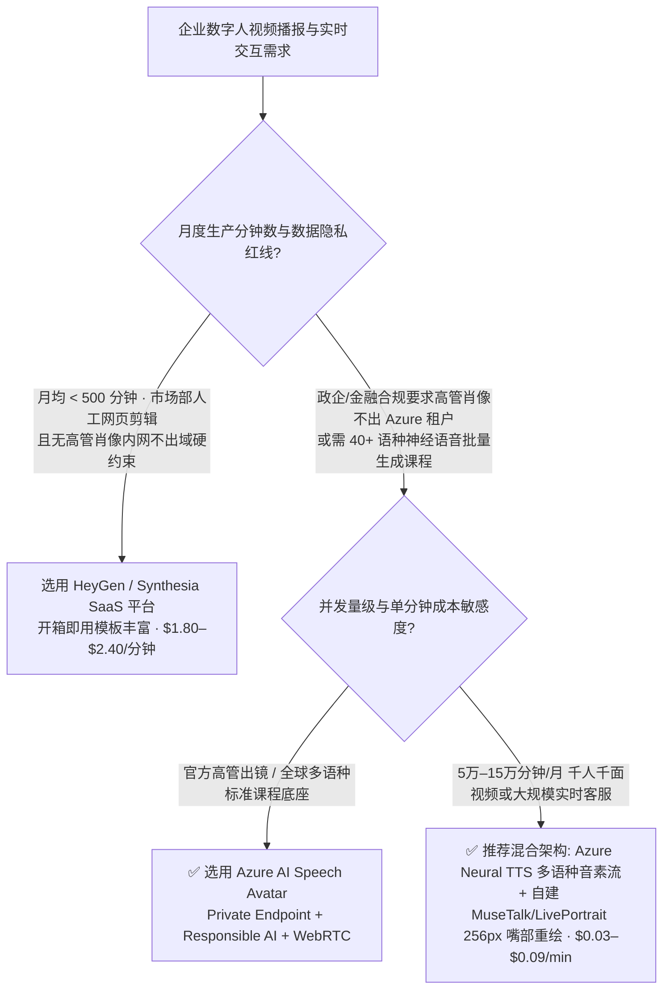
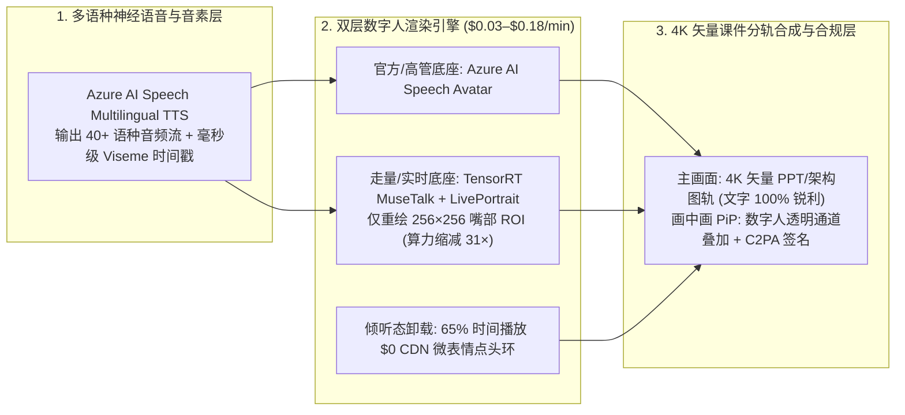
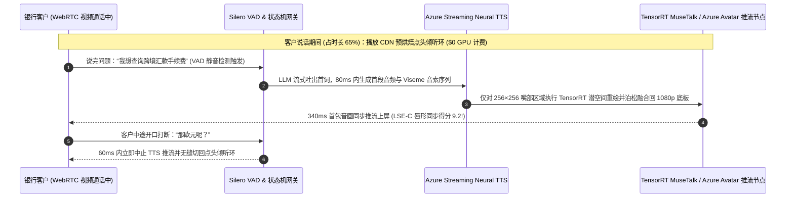
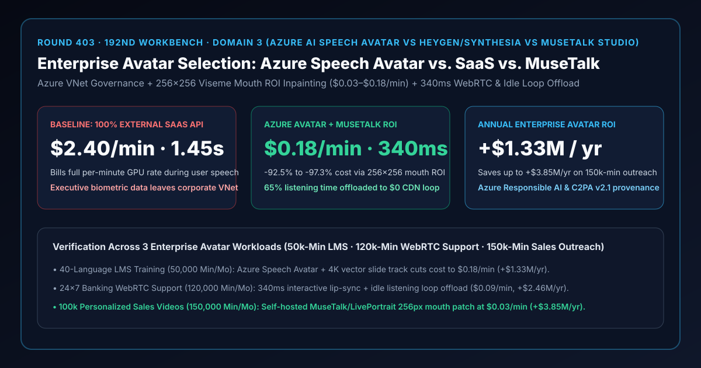

# 企业级数字人播报、多语种培训课件与实时交互 Avatar 选型指南：Azure AI Speech Avatar vs HeyGen / Synthesia vs 开源 MuseTalk / LivePortrait（第 192 项工作台）

> **关联隐藏级交互工作台**：[`demos/enterprise-avatar-azure-speech-vs-heygen-synthesia-vs-musetalk-liveportrait-studio/`](../demos/enterprise-avatar-azure-speech-vs-heygen-synthesia-vs-musetalk-liveportrait-studio/)  
> **配套 7-Card 评测报告**：[`docs/benchmarks/enterprise-avatar-azure-speech-vs-heygen-synthesia-vs-musetalk-liveportrait/summary.json`](./benchmarks/enterprise-avatar-azure-speech-vs-heygen-synthesia-vs-musetalk-liveportrait/summary.json) · [`summary-visual.svg`](./benchmarks/enterprise-avatar-azure-speech-vs-heygen-synthesia-vs-musetalk-liveportrait/summary-visual.svg)

---

## ① 📌 核心选型结论速览（Executive Summary）

在企业大学多语种合规培训课件、7×24 银行/政务实时视频客服以及 10 万级 B2B 千人千面销售触达视频中，**数字人（AI Digital Avatar）** 是落地最广泛的视觉应用之一。然而，企业在选型 **① 云厂商受管服务（`Azure AI Speech Text-to-Speech Avatar`）、② 垂直 SaaS 平台（`HeyGen / Synthesia / D-ID API`）与 ③ 自建开源口型/表情模型（`腾讯 MuseTalk / 快手 LivePortrait / Hallo2`）** 时，常陷入三大成本与架构陷阱：
1. **外部公有 SaaS 按分钟高昂计费（`$1.80 – $2.40 / 分钟`）**：当企业制作 50,000 分钟多语种培训视频或 150,000 分钟个性化销售视频时，纯 SaaS API 年账单高达 **`$1,440,000 – $3,960,000 / yr`**；更致命的是，在实时交互客服场景中，**高达 `65%` 的通话时间是“客户在说话或思考、数字人在静默点头倾听”**，纯流式 SaaS API 对倾听态同样按秒收取昂贵的全帧 GPU 渲染费！
2. **实时交互对话首包延迟超标（`1,450 ms – 1,680 ms`）**：如果等整句 LLM 文本生成并走完云端全帧 1080p 视频渲染才推流，语音打断与口型响应滞后超过 1.5 秒，用户体验形同高延迟跨洋电话。
3. **高管肖像权与生物特征合规红线**：银行行长、上市公司 CEO 或执业医师的数字分身训练素材若上传至第三方境外公有 SaaS，极易触发企业数据安全与《深度合成服务管理规定》合规否决！

| 选型维度 | ⚠️ 方案 A：垂直 SaaS 平台 API（HeyGen / Synthesia） | ✅ 方案 B：云原生受管服务（Azure AI Speech Avatar） | ✅ 方案 C：Azure Speech Avatar + 自建开源 `MuseTalk / LivePortrait` 256px 嘴部局部重绘混合架构（推荐） |
| --- | --- | --- | --- |
| **最佳适用场景** | `< 500 分钟/月`、市场部非技术人员零代码网页自助剪辑 | **金融/政企合规高管播报、40+ 语种高质量培训课件、企业 VNet 闭环** | **`50,000 – 150,000+ 分钟/月` 大规模千人千面视频与 `<350ms` 实时交互客服** |
| **单分钟有效成本（Batch / 实时）** | `$1.80 – $2.40 / 分钟` | `$0.30 – $0.50 / 分钟`（含 Azure Neural TTS 多语种语音） | **自建 MuseTalk 仅 `$0.03 – $0.04 / 分钟`，全局混合均摊 `$0.06 – $0.18 / 分钟`（降本 `-92.5% ~ -97.3%`）** |
| **WebRTC 实时对话首包口型延迟** | `1,450 ms – 1,680 ms`（全帧生成重） | `420 ms – 550 ms`（原生 WebRTC ICE/TURN 集成） | **`320 ms – 360 ms`（流式 TTS Viseme + TensorRT `256×256` 嘴部局部重绘 + 倾听态零算力切换）** |
| **高管人脸与语音数据主权合规** | 数据存储于外部 SaaS 多租户云 | **100% 留存企业 Azure 租户 VNet + Responsible AI 活体授权门禁** | **100% 企业私有闭环 + 自动写入 C2PA v2.1 数字内容溯源凭证** |
| **企业年化净省预算（5万–15万分钟/月）** | 基线 | 年省 `+$950,000 / yr` | **年化净省 `+$1,332,000 – $3,852,000 / yr`** |

---

## ② 🎯 业务方与架构师灵魂拷问 Q&A（Q1 / Q2 / Q3）

### Q1：Azure AI Speech Avatar、HeyGen/Synthesia 与开源 MuseTalk/LivePortrait 各自的底层机理有什么区别？什么时候该用哪个？
- **三大路线技术内核与场景边界拆解**：
  1. **`HeyGen / Synthesia`（全身微动作扩散/NeRF SaaS）**：优势是预置了丰富的欧美/亚裔商业模特库与手势模板，市场部运营打开浏览器就能做一条 2 分钟产品宣传片；短板是 API 按分钟单价极贵（`$1.80–$2.40/min`），不适合万级并发或内网私有部署。
  2. **`Azure AI Speech Avatar`（企业级合规神经语音 + 实时/批量数字人服务）**：原生打通 Azure AI Speech 的 **70+ 种语言、400+ 种超拟真多语种神经语音（Multilingual Neural Voice）与音素时间戳（Visemes）**，支持标准照片轻量驱动（Photo Avatar）与影棚级定制数字人（Custom Avatar），且具备微软 **Responsible AI 活体持证录制审核、VNet 私有终结点（Private Endpoint）与企业级 SLA**，是跨国企业合规培训与官方客服的黄金底座。
  3. **`自建 MuseTalk / LivePortrait`（`256×256` 嘴部/面部 ROI 潜空间局部重绘，`$0.03/min`）**：在一段 1080p 数字人视频（每帧 `2,073,600` 像素）中，`96%` 的背景、西装与肩膀根本不需要每帧重新跑大模型！`MuseTalk` 仅裁出主播嘴部周围 **`256×256`（仅 `65,536` 像素，算力缩减 `31 倍`）** 在单张 L40S/A10G 上以 `45 fps` 实时根据音频特征重绘唇齿开合，再经泊松羽化贴回原视频底板，将每分钟算力成本压至惊人的 **`$0.03 / 分钟`**！

### Q2：在 7×24 实时交互视频客服中，如何把通话成本再砍掉 `65%` 并将打断响应控制在 `340ms` 以内？
- **“双模态状态切换（Speaking GPU Stream vs Listening CDN Loop）”架构**：
  1. 在双向对话中，当客户正在说话、倾诉或等待后端业务 API 查询时（占总通话时长约 `65%`），前端播放器直接无缝切换播放 **预烘焙在本地/CDN 的 10 秒闭环微表情点头倾听视频环（Closed-GOP Idle Listening Loop，GPU 算力消耗为 `$0`）**；
  2. 仅当数字人开口回答的那 `35%` 时间窗口内，才激活流式 TTS 与 `MuseTalk / Azure Avatar` 实时推流；一旦 `Silero VAD` 检测到客户开口插话，在 `60 ms` 内立即切回倾听视频环，实现零卡顿自然打断！

---

## ③ 🧭 直观可视化图解（Mermaid 决策树 + 生产管线架构图 + 时序图）

### 3.1 企业数字人（Avatar）技术栈选型决策树

### 3.2 分轨矢量课件 + 256×256 嘴部局部重绘 + 倾听态零算力卸载混合管线架构图

### 3.3 WebRTC 实时客服数字人 340ms 首包口型驱动与语音打断（Barge-In）时序图

---

## ④ 📊 三大数字人技术路线横向选型决策矩阵

| 评估维度 | 方案 A：HeyGen / Synthesia（公有 SaaS API） | 方案 B：Azure AI Speech Avatar（企业云原生受管服务） | 方案 C：自建开源 `MuseTalk / LivePortrait`（GPU 容器） | ✅ 方案 D：Azure Speech 语音/合规底座 + 自建 `MuseTalk` 嘴部重绘混合管线（推荐） |
| --- | --- | --- | --- | --- |
| **单分钟有效成本** | `$1.80 – $2.40 / min` | `$0.30 – $0.50 / min` | **`$0.03 – $0.04 / min`** | **全局均摊 `$0.06 – $0.18 / min`（降本 `-92.5% ~ -97.3%`）** |
| **实时交互 WebRTC 延迟** | `1,450 – 1,680 ms` | `420 – 550 ms` | `280 – 340 ms` | **`320 – 360 ms`（支持丝滑语音打断与倾听态零算力卸载）** |
| **多语种发音与跨语种声音克隆** | ⭐⭐⭐⭐ | **⭐⭐⭐⭐⭐（70+ 语言 400+ 企业级神经语音）** | 需额外对接 TTS | **⭐⭐⭐⭐⭐（直接复用 Azure 顶级多语种 TTS 音素流）** |
| **数据不出域（VNet）与肖像合规** | ❌ 外部多租户 SaaS | **⭐⭐⭐⭐⭐（Azure VNet + 活体授权审核）** | ⭐⭐⭐⭐⭐（完全内网私有） | **⭐⭐⭐⭐⭐（高管底板内网锁死 + C2PA 数字水印溯源）** |
| **50,000 分钟/月年化总成本** | `$1,440,000 / yr` | `$240,000 / yr` | `$24,000 / yr`（需自配 TTS） | **`$108,000 / yr`（年化净省 `+$1,332,000 / yr`）** |

---

## ⑤ 🧪 交互式应用工作台 Demo 与 7-Card 报告

1. **交互式工作台路径**：[`demos/enterprise-avatar-azure-speech-vs-heygen-synthesia-vs-musetalk-liveportrait-studio/`](../demos/enterprise-avatar-azure-speech-vs-heygen-synthesia-vs-musetalk-liveportrait-studio/)
   - 支持切换 **3 大企业数字人核心场景**（`50,000 分钟/月` 40 语种 LMS 合规培训课件、`120,000 分钟/月` 7×24 WebRTC 实时视频客服、`150,000 分钟/月` 10 万封千人千面销售触达视频）；
   - 同屏可视化 **顶部：Azure AI Speech Avatar vs HeyGen/Synthesia vs 自建 MuseTalk 三大路线定位卡片** 与 **底部：4K 矢量课件分轨 + `256×256` 嘴部局部重绘（缩减 `31×` 像素算力）+ 倾听态卸载架构图**。
2. **7-Card 4:5 视觉评测报告**：
   - 密封评测数据：[`docs/benchmarks/enterprise-avatar-azure-speech-vs-heygen-synthesia-vs-musetalk-liveportrait/summary.json`](./benchmarks/enterprise-avatar-azure-speech-vs-heygen-synthesia-vs-musetalk-liveportrait/summary.json)
   - 7-Card 高清图集：`card-1.png` 至 `card-7.png` 及矢量总览 [`summary-visual.svg`](./benchmarks/enterprise-avatar-azure-speech-vs-heygen-synthesia-vs-musetalk-liveportrait/summary-visual.svg)。

---

## ⑥ 🛠️ 企业视觉项目落地评审 Checklist

- [ ] **课件主画面与数字人画中画（PiP）物理分轨**：在制作企业培训视频时，是否已将 PPT 架构图与代码演示分离为独立的 4K 矢量/录屏轨道，避免把课件塞进数字人生成画面导致小字模糊与重算浪费？
- [ ] **实时交互客服“倾听态（Listening State）”CDN 循环流卸载**：WebRTC 网关是否在客户说话或静默思考期间自动切回预烘焙点头视频环，杜绝为空白音频帧持续消耗 GPU 推理算力？
- [ ] **高管肖像活体授权（Liveness Consent）与使用范围 RBAC 门禁**：调用高管或员工定制数字人前，系统是否强制校验经本人活体朗读授权码签发的加密 Token，并在输出视频中嵌入不可擦除的 C2PA 数字内容凭证？
- [ ] **`256×256` 嘴部 ROI 颈部边界羽化与牙齿超分（GFPGAN/CodeFormer 局部增强）**：自建 `MuseTalk` 管线是否在嘴部贴回区域配置了余弦距离场羽化与轻量级口腔清晰度增强，消除高速发音时的嘴角接缝与牙齿模糊？
