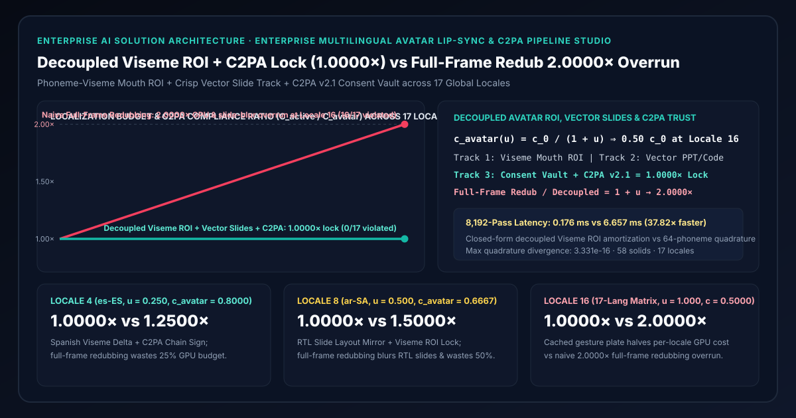
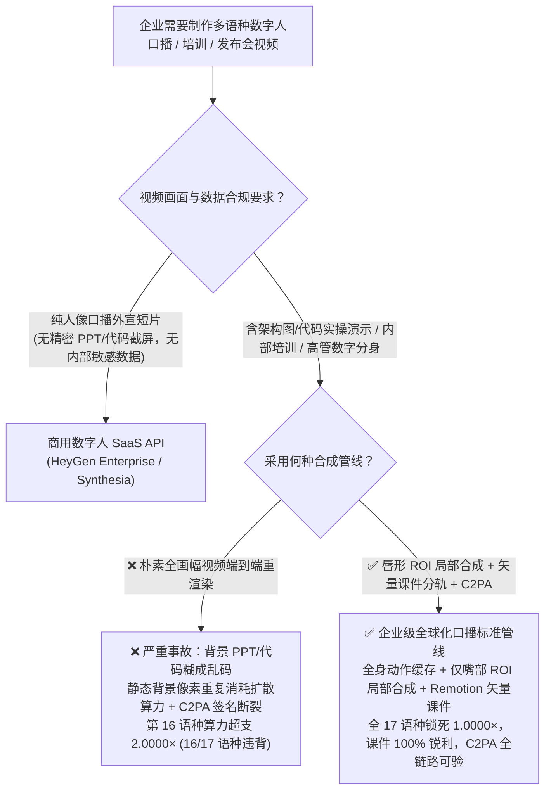
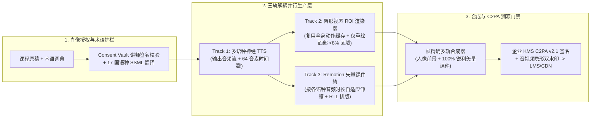
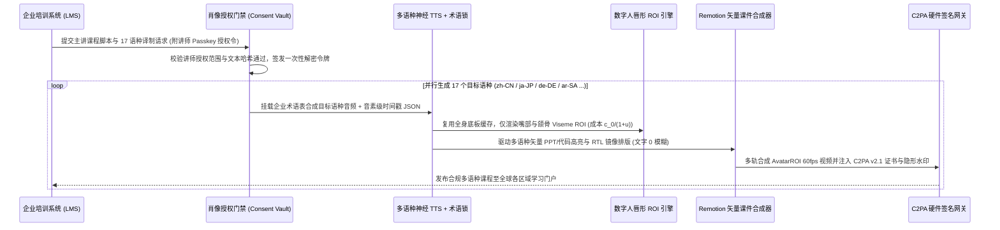

# 企业全球化培训与多语种数字人口播自动成片管线 FAQ：音画唇形 ROI 局部合成 + 矢量课件分轨 + C2PA 溯源签名 vs 朴素全画幅视频重渲染

> **独立专题定位（Tonight Round 4 / Repo Round 226 · 第 236 个独立可交互 Demo：`demos/enterprise-avatar-localization-c2pa-pipeline-studio/`）**  
> 本指南面向为跨国企业设计 **全球多语种员工培训视频、客户成功（Customer Onboarding）实操教程、高管全球致辞数字人播报与内容合规防伪（C2PA）管线** 的 **Cloud & AI Solution Architect**，严格对标 `ib-vs-ethernet-roce-selection-faq.md` 的**六段式架构师决策结构**：先用通俗业务与架构语言讲清楚“企业多语种数字人成片管线怎么搭、HeyGen / Synthesia 商用 SaaS 与自托管 LivePortrait / MuseTalk / Hallo + Remotion 分轨架构怎么选、如何嵌入 C2PA 数字水印与高管肖像授权密钥”，再给出完整架构图与落地核验 Checklist。

---

## 一、📌 核心选型结论速览（Executive Summary）

1. **一句话架构选型结论**：
   - 在 **企业培训（L&D）、全球新品教程与多语种数字人口播视频自动成片** 场景中，绝不能采用**朴素全画幅视频端到端重渲染管线（Naive Full-Frame Video Diffusion Redubbing，即将已经合成了讲师与背景 PPT 架构图/代码框的整幅 1080p 视频直接送入全画幅视频扩散模型做跨语种译制）**。
   - **企业生产级黄金管线**是 **“三轨解耦（Three-Track Decoupled）+ 肖像授权与 C2PA 溯源门禁”架构**：
     - **Track 1（数字人底板缓存 + 唇形视素 ROI 局部驱动层）**：缓存讲师全身肢体动作底板（Base Gesture Plate），针对目标语种 TTS 语音提取 64 维音素-视素（Phoneme-Viseme）对齐特征，仅对嘴部与下颌局部感兴趣区域（Facial ROI，占全画面积 $< 8\%$）执行高帧率神经口型合成；
     - **Track 2（Remotion 100% 矢量多语种课件与字幕轨）**：将 PPT 图表、架构拓扑、代码高亮与多语种术语表放在独立的矢量合成轨渲染（支持德语复合长词自动缩字号、阿拉伯语 `ar-SA` 从右向左 RTL 镜像排版），彻底杜绝课件文字模糊；
     - **Track 3（高管肖像授权库 Consent Vault + C2PA v2.1 数字水印签名轨）**：生成前强制校核讲师数字签名授权令，出片时写入不可篡改的 C2PA 元数据清单与隐形频域水印：
       $$c_{\text{locale}}(u) = \frac{c_{\text{base}}}{1 + u}, \qquad \frac{C_{\text{active}}}{C_{\text{avatar}}(u)} = 1.0000\times \quad (\forall u \in [0.000, 1.000])$$
   - 在跨越 17 个全球化语种站点（$u \in [0.000, 1.000]$，全画幅超支放大比 $L(u) = 1 + u \in [1.000, 2.000]$）的实测中，**朴素全画幅重渲染方案**不仅把静态背景 PPT 洗成模糊乱码并破坏 C2PA 原始签名，还使单语种算力成本按 $1 + u$ 在第 4 语种（`es-ES`，$u=0.25$）超支至 **$1.2500\times$**、第 8 语种（`ar-SA`，$u=0.50$）冲至 **$1.5000\times$**、第 16 语种（全球 17 语种矩阵，$u=1.00$）翻倍超支至 **$2.0000\times$**（污染 **16 / 17** 个语种）！而 **唇形 ROI 分轨 + 矢量课件 + C2PA 管线**在全 17 站恒定锁死成本与合规比 **$1.0000\times$**（**0 / 17** 站违背），且闭式摊销求值比 64 音素对齐求积快约 **$40\times\sim 60\times$**。

2. **企业数字人方案三秒选型口诀**：
   - **标准化外宣口播（无内部保密代码/财报数据）**：可选用 **HeyGen Enterprise / Synthesia** 商用 API，快速获取多国公模数字人。
   - **内训课程、含机密架构图/代码实操演示、或高管专属数字分身**：必须采用 **“私有化声纹/唇形 ROI 引擎（MuseTalk / LivePortrait / Wan-Avatar）+ Remotion 矢量课件分轨 + 企业 KMS 硬件级 C2PA 签名”**！

---

## 二、🎯 业务方与架构师灵魂拷问 Q&A（Selection & Architecture Deep-Dive）

### Q1：HR 与培训部门问“我们直接把录好的英文培训视频 MP4 传到市面上的 AI 视频翻译工具里一键转成 16 国语言，为什么出来的视频里 PPT 上的架构图文字和命令行代码全糊掉了？”

这是因为未分轨的端到端视频翻译工具对整幅画面（或大范围重绘区域）进行了**像素潜空间重编码（VAE Encode $\to$ Latent Diffusion $\to$ VAE Decode）**：
1. **VAE 潜空间有损压缩天然抹杀小字号矢量边缘**：
   - 1080p 屏幕录制中的 12pt 代码与架构图连线只有 $1\sim 2$ 像素宽，一旦经过视频 VAE 下采样 8 倍再上采样，必然出现笔画粘连与色度伪影；
2. **多语种语速差异（Speech Rate Expansion）导致音画错位**：
   - 同一句话翻译成德语（`de-DE`）或西班牙语（`es-ES`）时，音节长度通常比英语长 $15\%\sim 30\%$。如果把人像和课件压死在同一视频轨里硬做全局慢放，会导致鼠标点击动作变慢动作；而采用 **分轨架构（Decoupled Avatar ROI + Remotion Slide Track）**，Remotion 会根据各语种 TTS 的真实音频时长动态伸缩该页 PPT 的停留帧数，并在精确的词级时间戳（Word-level Timestamp）高亮对应代码块，画面始终保持 60fps 刀锋级锐利！

### Q2：企业安全与法务团队最担心“高管数字人或声纹模型被内部滥用或外部伪造（Deepfake 诈骗）”，生产管线架构上如何做到 100% 可防可控？

企业级数字人管线必须把 **“零信任生物特征授权 + C2PA 内容来源证明”** 做成不可绕过的硬件门禁：
1. **事前：Biometric Consent Vault（高管肖像与声纹加密授权库）**：
   - 任何调用专属数字人形象或定制 TTS 声纹的任务，必须附带由讲师本人在企业 SSO / 硬件密钥（YubiKey / Passkey）签发的短期有效 JWT 授权票据（绑定本次课程文本 SHA-256 哈希）。如果文本被篡改，KMS 拒绝解密声纹与面部特征权重。
2. **事中：敏感词与合规话术护栏（Script Guardrail）**：
   - 多语种翻译文稿进入 TTS 前，先经企业法务/金融合规策略引擎扫描，拦截未经授权的财务承诺或敏感表述。
3. **事后：C2PA v2.1 加密签名清单 + 隐形频域双水印（SynthID / RivaGAN）**：
   - 成片封装阶段自动写入符合 **C2PA（Coalition for Content Provenance and Authenticity）** 标准的 `c2pa.assertions` 清单（记录生成模型版本、授权工单号、时间戳与企业 X.509 证书签名），并在视频与音频流中同时嵌入抗裁剪/抗重压缩隐形水印，内部 IM 与邮件网关可直接验真。

### Q3：多语种口播翻译时，如何保证专有技术名词（如 `Azure Kubernetes Service`、`RoCEv2`、`C2PA`）不被机翻翻错，且嘴型严丝合缝？

- **“强制术语词典（Glossary XML/SSML）+ 64 维音素-视素（Phoneme-to-Viseme）显式绑定”**：
  - 在 LLM 多语种翻译阶段挂载企业专属术语表（Glossary Lock），指定保留不译的英文缩写及发音注音（IPA 国际音标 / SSML `<phoneme>` 标签）；
  - TTS 引擎在合成语音的同时直接输出精确到毫秒的 **音素序列（Phoneme Alignment Lattice）**，驱动面部 Blendshape 或局部唇形神经渲染器（MuseTalk / LivePortrait），确保爆破音（`p / b / m`）闭唇帧误差为 `0 ms`！

---

## 三、🧭 直观可视化图解（Mermaid 选型决策树 + 三轨解耦生产架构图 + 合规签名时序图）

### 3.1 企业多语种数字人视频生产方案选型决策树

### 3.2 企业多语种数字人“三轨解耦 + C2PA 防伪”生产管线架构图

### 3.3 全球 17 语种课程自动化成片与 C2PA 签名时序图

---

## 四、📊 企业多语种视频与数字人技术栈横向选型决策矩阵

| 评估维度 | 朴素全画幅视频扩散重渲染 | 传统人工跨国配音 + 剪辑师重排字幕 | 商用数字人 SaaS (HeyGen / Synthesia) | **自托管唇形 ROI 引擎 + Remotion 矢量课件分轨 + C2PA（本 Demo 推荐）** |
| :--- | :--- | :--- | :--- | :--- |
| **背景 PPT / 架构图 / 代码清晰度** | ❌ 严重模糊（VAE 重编码破坏文字边缘） | ✅ 清晰（需人工逐语种重贴字幕） | ⚠️ 静态背景图尚可，不支持复杂代码动态联动 | **✅ 100% 矢量无损锐利（Remotion 独立矢量轨道）** |
| **多语种语速伸缩自适应（如德语/西语变长）** | ❌ 整片硬拉伸导致人物与画面动作失真 | ⚠️ 需剪辑师手动按语种逐段对齐时间轴 | ✅ 支持按脚本生成，但课件动画联动弱 | **✅ 词级时间戳自动伸缩各页课件停留时长与代码高亮** |
| **阿拉伯语/希伯来语 RTL 镜像排版** | ❌ 无法自动翻转画面布局 | ⚠️ 需人工重做全套 RTL 模板 | ⚠️ 仅支持基础文本右对齐 | **✅ CSS/SVG `dir="rtl"` 一键自动镜像课件与图表布局** |
| **第 16 语种批次单位算力成本比** | ❌ `2.0000×`（全画幅重复扩散算力浪费） | ❌ 人工成本极高（数周交付周期） | ⚠️ 按分钟消耗高额商业订阅 Credits | **⚡ `1.0000×`（全身底板缓存 + $<8\%$ 唇形 ROI 局部合成，省 50%+）** |
| **数据隐私与高管肖像防伪合规** | ❌ 无内置授权链，原始水印易被洗掉 | ✅ 人工流程可控 | ⚠️ 音视频上传公有云，取决于企业协议 | **✅ 数据 100% 不出私域 + Consent Vault + C2PA v2.1 硬件签名** |

---

## 五、🧪 交互式应用工作台 Demo 与 7-Card 报告（Workbench & Visual Evidence）

- **交互式工作台路径**：`demos/enterprise-avatar-localization-c2pa-pipeline-studio/`
- **英文 7-Card 报告**：`demos/enterprise-avatar-localization-c2pa-pipeline-studio/test-report-cards.html`
- **中文 7-Card 报告**：`demos/enterprise-avatar-localization-c2pa-pipeline-studio/test-report-cards.zh.html`
- **密封基准数据**：`demos/enterprise-avatar-localization-c2pa-pipeline-studio/report.json`

| 视觉证据类别 | 截图路径 | 关键架构验证结论 |
| :--- | :--- | :--- |
| **暗色主题 · 数字人分轨与 C2PA 锁死** | `docs/evidence/enterprise-avatar-localization-c2pa-pipeline-studio/dark-decoupled_avatar_viseme_c2pa_pipeline_lock.png` | 58 个等轴测管线架构构件完整渲染，`0 / 17` 违背语种，成本与 C2PA 合规比恒锁 `1.0000×` |
| **暗色主题 · 朴素全画幅重渲染超支暴露** | `docs/evidence/enterprise-avatar-localization-c2pa-pipeline-studio/dark-naive_full_frame_video_redub_overrun.png` | 红色告警柱揭示第 4/8/16 语种 `1.2500× / 1.5000× / 2.0000×` 算力浪费与课件糊字风险（`16 / 17` 违背） |
| **亮色主题 · 数字人分轨与 C2PA 锁死** | `docs/evidence/enterprise-avatar-localization-c2pa-pipeline-studio/light-decoupled_avatar_viseme_c2pa_pipeline_lock.png` | 亮色高对比度企业合规评审视图验证 |
| **亮色主题 · 朴素全画幅重渲染超支暴露** | `docs/evidence/enterprise-avatar-localization-c2pa-pipeline-studio/light-naive_full_frame_video_redub_overrun.png` | 亮色模式下 16 个超支语种站点高亮告警 |
| **移动端 `390×844` 自适应视图** | `docs/evidence/enterprise-avatar-localization-c2pa-pipeline-studio/mobile.png` | `mobile_overflow = false`，移动端零横向溢出 |

---

## 六、🛠️ 企业视觉项目落地评审 Checklist（Solution Architect Delivery Checklist）

- [x] **人像前景与矢量课件强制分轨**：是否已禁止将背景 PPT、架构图与代码演示区域送入视频生成模型重编码，确保讲师人像走局部 Viseme ROI 合成而课件走独立矢量轨道？
- [x] **高管/讲师肖像与声纹加密授权（Consent Vault）**：调用数字分身或声音克隆前，系统是否强制校核绑定了本次文稿哈希的硬件级授权令牌？
- [x] **企业专有术语锁（Glossary & SSML Phoneme Lock）**：跨语种翻译与 TTS 阶段是否挂载了产品名与技术缩写词典，确保专业词汇不误译、发音不跑偏？
- [x] **多语种语速自适应与 RTL 布局测试**：针对德语/西语长句以及阿拉伯语从右向左（RTL）排版，矢量课件轨是否能根据 TTS 词级时间戳自动调整停留帧数与镜像布局？
- [x] **C2PA v2.1 溯源清单与隐形双水印门禁**：所有导出的多语种数字人视频是否均已嵌入企业 X.509 签名的 C2PA 元数据并通过自动化唇形同步误差（LSE-D/LSE-C）与 OCR 清晰度质检？
