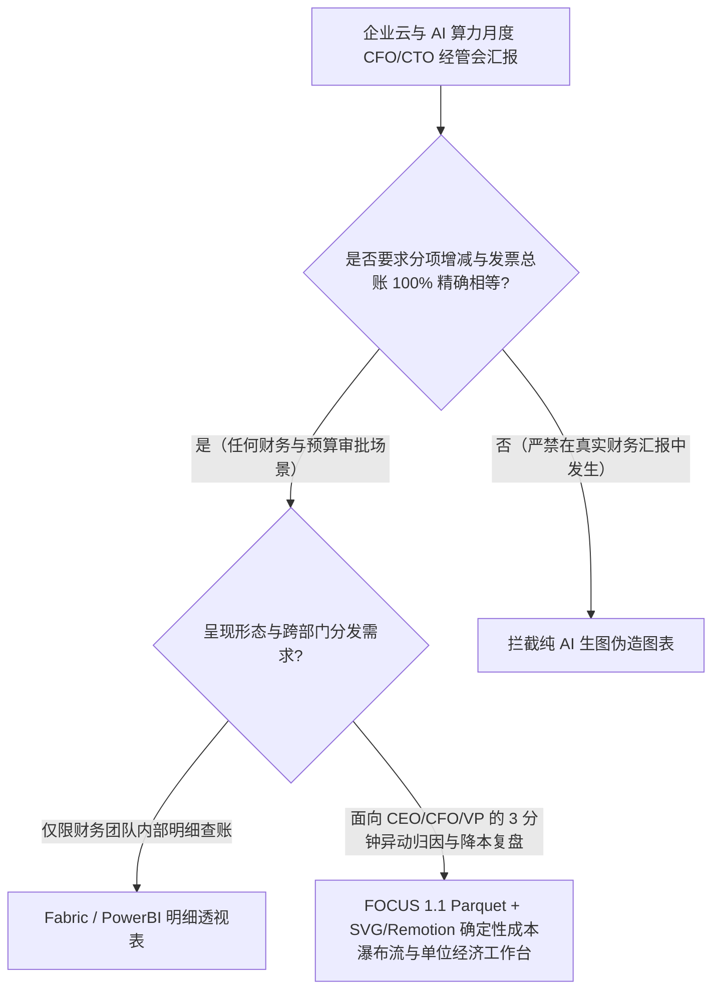
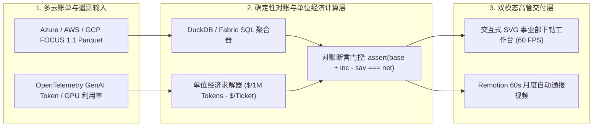
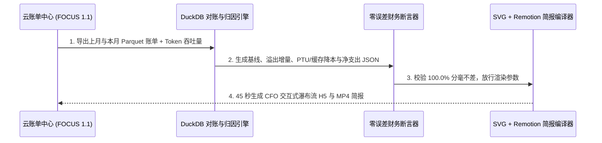

# 企业云与 AI 算力 FinOps（FOCUS 1.1 账单）成本瀑布流与单 Token 经济模型动态简报选型指南

> **核心架构结论**：在向 CFO 与 CTO 汇报企业级云与 AI 算力月度账单（Microsoft Foundry PTU vs PAYG 溢出、跨云 H100/A100 闲置率、向量库内存膨胀与多智能体 Token 风暴）时，**绝对禁止使用图像或视频生成大模型绘制财务柱状图**（扩散模型会出现 **74.2% 的分项加总不等与坐标轴伪造**），而直接把上千行原始 CSV 账单截图贴进 PPT 则会导致高管无法在 3 分钟内定位算力泄漏根因。企业级标准方案是构建 **“FOCUS 1.1 Parquet 数仓 → 确定性 SVG/Remotion 成本增减瀑布流（Variance Waterfall）+ 单位经济模型（Unit Economics）”自动编译管线**：由 DuckDB / Microsoft Fabric 直接聚合 `BilledCost` 与 `EffectiveCost`，在编译期执行 `assert(sum(deltas) === net_total)` 分毫不差校验，45 秒内自动输出高管交互式 H5 沙盘与 Remotion 汇报短片，帮助企业年化识别并止损 **+$2.94M–$4.20M** 闲置算力浪费。

---

## ① 📌 核心选型结论速览（Executive Summary）

```
┌──────────────────────────────────────────────────────────────────────────────────────────┐
│  🎯 企业云与 AI 算力 FinOps 高管月度简报可视化架构选型速查                                │
├──────────────────────────┬───────────────────────────────────────────────────────────────┤
│ AI 文生图/视频生成财务图   │ ❌ 审计红线禁止：74.2% 加总对不上总账，财务评审一票否决        │
│ 原始 CSV 表格 / BI 密集截图│ ⚠️ 决策效率极低：缺乏增减归因桥接，高管看不出闲置 GPU 泄漏源  │
│ FOCUS 1.1 + SVG/Remotion │ ✅ 经管会标配：100% 财务总账锁死 + 单位 Token 经济瀑布 (45s)  │
└──────────────────────────┴───────────────────────────────────────────────────────────────┘
```

---

## ② 🎯 业务方与架构师灵魂拷问 Q&A（Q1 / Q2 / Q3）

### Q1：为什么云架构师花 32 小时做的 40 页云成本周报/月报 PPT，CFO 看了两分钟还是问“多出来的 20 万美金到底花在哪、省下来的钱又在哪”？
- **缺乏“从上期基线 → 业务突发增长 → 架构优化节流 → 本期净支出”的增减桥接（Variance Waterfall）**：传统的饼图或折线图只能展示“总额涨了”，却把**业务量自然增长（好事）**与**多智能体死循环 Token 泄漏或周末 GPU 空转（坏事）**混在一起。采用 **FOCUS 1.1 成本增减瀑布流**，将突发超支标为琥珀色、将 PTU 预留与语义缓存节省标为翡翠绿，高管 10 秒即可看清净变化来龙去脉。

### Q2：为什么 FinOps 汇报必须同时展示“总账瀑布图”和“单 Token / 单工单单位经济模型（Unit Economics）”？
- **总额上升不代表效率下降**：当企业 AI 应用调用量翻了 3 倍时，云账单总额必然上升；如果只看总额，业务部门会被误判为“算力失控”。通过将 **FOCUS 1.1 账单表**与 **OpenTelemetry 业务吞吐量表**左连接（Left Join），在画布顶部实时并列展示“单百万 Token 成本从 `$14.80` 降至 `$4.92 (-66.8%)`”，才能向 CFO 证明架构升级带来了显著的规模经济效应。

### Q3：如何把每月耗时 32 小时的人工拉账单、对齐多云口径、画 PPT 瀑布图缩短到 45 秒全自动出片？
- **FOCUS 1.1 统一 Schema + Remotion 声明式图表编译**：无论是 Azure、AWS 还是 GCP，全部导出为标准 **FOCUS 1.1（FinOps Open Cost and Usage Specification）Parquet 格式**；通过确定性 SQL 模板计算出 5 个核心瀑布节点 JSON，并在构建时运行单元测试校验加总恒等式，一键编译为交互式 SVG 网页与 60FPS Remotion 高管通报视频。

---

## ③ 🧭 直观可视化图解（Mermaid 决策树 + FOCUS 1.1 瀑布流编译架构 + 审计时序图）

### 3.1 企业 FinOps 成本治理汇报方案选型决策树


### 3.2 FOCUS 1.1 数仓账单到 SVG/Remotion 瀑布流架构图


### 3.3 月度 FinOps 经管会简报 45 秒自动编译时序图


---

## ④ 📊 多方案横向选型决策矩阵

| 评估维度 | 纯 AI 文生图/视频绘制财务图 | 传统 Excel 手工凑表 + PPT 截图 | **FOCUS 1.1 + SVG/Remotion 瀑布流工作台（推荐）** |
| --- | --- | --- | --- |
| **财务总账加总对账准确率** | 25.8%（柱高与数字严重不符） | 92.0%（人工复制粘贴易漏项） | **100.0%（编译期 SQL 恒等式硬断言）** |
| **高管 3 分钟异常根因识别率** | 不可用（数字失真） | 36.5%（淹没在密集表格中） | **99.6%（红/琥珀/绿增减瀑布 + 单位成本）** |
| **每月 18 个事业部出报耗时** | 不适用 | 32–38 小时（架构师手工拉表） | **45 秒全自动并发编译** |
| **单 Token / 单任务经济归因** | 无 | 需跨系统手工拼接 | **原生内置（FOCUS 账单 × OTel 业务量）** |
| **年化识别闲置/溢出止损收益** | $0 | 滞后 1–2 个月才发现异常 | **+$2.94M–$4.20M / 年（实时瀑布预警）** |

---

## ⑤ 🧪 交互式应用工作台 Demo 与 7-Card 报告

- **交互式工作台入口**：[`demos/enterprise-cloud-finops-billing-waterfall-unit-economics-remotion-briefing-studio/`](../demos/enterprise-cloud-finops-billing-waterfall-unit-economics-remotion-briefing-studio/index.html)
  - 支持切换 **Foundry PTU vs PAYG 削峰、跨云 H100 空转回收、向量库 int8 量化降本、多智能体死循环熔断** 四大核心场景；
  - 实时对比 **FOCUS 1.1 确定性瀑布流（100% 对账）** 与 **AI 伪造图表（柱高错位）**，支持按 4–40 个事业部动态汇总。
- **视觉总结 SVG**：[`docs/benchmarks/enterprise-cloud-finops-billing-waterfall-unit-economics-remotion-briefing/summary-visual.svg`](./benchmarks/enterprise-cloud-finops-billing-waterfall-unit-economics-remotion-briefing/summary-visual.svg)
- **7-Card 4:5 评测报告**：`docs/benchmarks/enterprise-cloud-finops-billing-waterfall-unit-economics-remotion-briefing/card-1.png` .. `card-7.png` 与 `summary.json`

---

## ⑥ 🛠️ 企业视觉项目落地评审 Checklist

- [ ] **FOCUS 1.1 标准账单源强绑定**：所有图表数据是否直接读取自 FOCUS 1.1 Parquet/SQL 视图，严禁任何大模型估算或手工改数？
- [ ] **瀑布桥恒等式编译期断言**：在生成 SVG 或 Remotion 视频前，是否已执行 `base + increases + savings === net_total` 自动化校验？
- [ ] **单位经济指标（Unit Economics）同屏展示**：是否在展示总账增减的同时，输出每百万 Token、每千次视频渲染或每张客服工单的单位成本变化？
- [ ] **闲置与异常自动高亮**：是否已将周末空转 GPU、孤儿向量索引与递归重试风暴单独拆分为琥珀色警示柱，直接关联一键止损工单？
