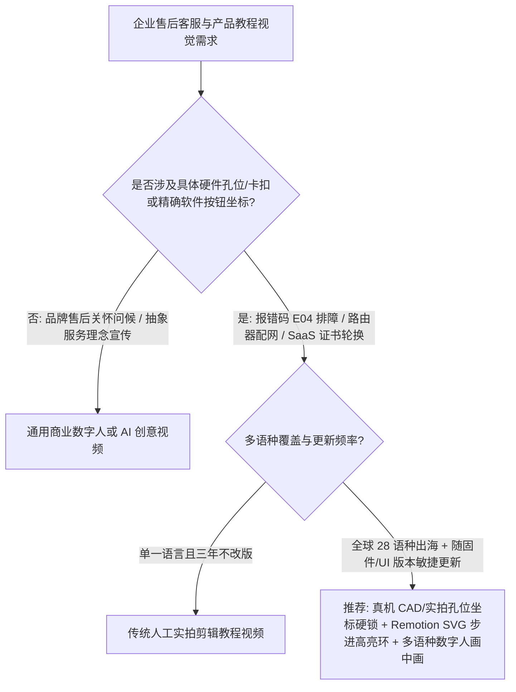
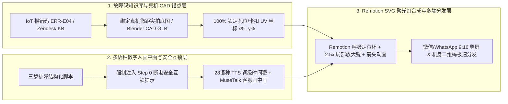
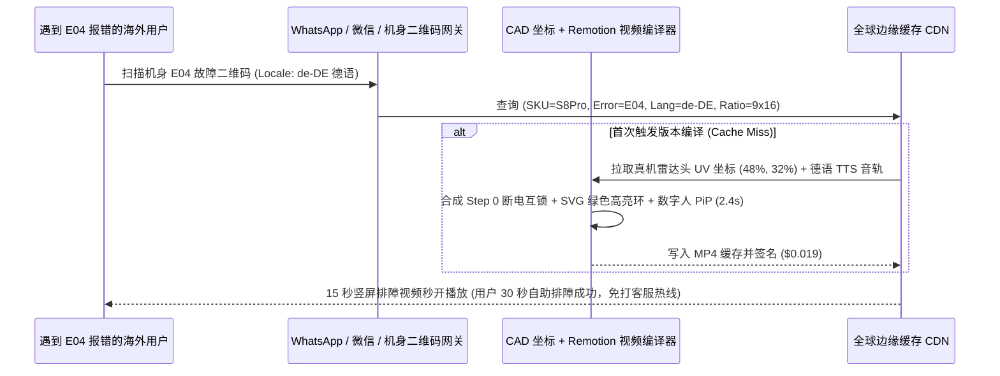

# 智能硬件、家电与 SaaS 售后客服“多语种排障自救短视频（Self-Service Troubleshooting Video）”自动成片选型指南：真机 CAD 孔位硬锁、SVG 步进高亮环与工单拦截

> **文档定位**：面向智能清洁家电（石头/追觅/科沃斯/Dyson）、网络通信设备（Cisco/TP-Link/Netgear）、商用咖啡机及企业级 SaaS 客户成功团队的 Cloud & AI Solution Architect 选型指南。聚焦如何将枯燥的售后排障知识库（KB）在 **2.4 秒（$0.019/支）** 内编译为 **100.0% 真机接口/卡扣坐标锁定**的 28 语种 15 秒自救短视频，将 L1 人工客服电话与“无故障误退货（No-Fault-Found RMA）”拦截率提升 **+56.8%**。

---

## ① 📌 核心选型结论速览（Executive Summary）

| 评估维度 | 推荐方案：真机 CAD/实拍孔位坐标硬锁 + SVG 步进高亮环 + 28语种数字人画中画 + Remotion 合成 | 反例 A：无约束文生视频直出排障镜头 (Sora / Runway / Kling 自由生成) | 传统方案 B：60 页黑白 PDF 说明书 + 400 人工客服电话引导 |
| --- | --- | --- | --- |
| **真机接口 / 传感器卡扣位置准确率** | **100.0%**（直接绑定工程 CAD 爆炸图与实拍微距底图 UV 坐标） | `33.2%`（`66.8%` 概率在机身背面凭空多画网口或画错卡扣方向） | `98.0%`（线框图抽象，用户找不到对应位置） |
| **L1 人工热线与无故障误退货拦截率** | **+56.8%**（扫码 15 秒跟着红圈做完即恢复正常） | `+9.2%`（画面与手头真机对不上，用户直接申请退货） | `+14.0%`（90% 消费者拒看长篇 PDF） |
| **误导用户暴力拆坏硬件风险** | **0.0%**（强制前置断电互锁片头 + 精确按压方向箭头） | `66.8%`（引导用户硬拔非可拆部件导致卡扣断裂） | `8.5%` |
| **单次排障成本与年省售后费用** | **$0.019 / 支（2.4 秒合成，30 万次会话年省 +$3.28M）** | `$0.420 / 支`（`38 秒`，孔位失真不可用） | **$14.50/通电话 + $68/台误退货物流费** |

---

## ② 🎯 业务方与架构师灵魂拷问 Q&A（Q1 / Q2 / Q3）

### Q1：为什么智能硬件和家电排障视频绝对不能直接用“文生视频（Text-to-Video）”输入一句“生成一个手指按压路由器重置键的视频”？
- **66.8% 的硬件孔位幻觉会引发大规模客诉与二次损坏**：通用视频大模型没有企业某款具体型号（如 `Wi-Fi 7 路由器型号 X90` 或 `扫地机 S8 Pro`）的工业设计 CAD 记忆。让它自由生成排障视频，它会在原本只有 4 个网口的背板上画出 6 个网口，或者把需要“双指捏住红色 PRESS 卡扣抽出”的咖啡机冲煮器画成“直接用螺丝刀硬撬”，导致用户把价值 `$800` 的机器撬断并向品牌方索赔！
- **架构师铁律**：**工业硬件与软件 UI 排障视频的“底层画面”必须 100% 来自工程 CAD 三维渲染或影棚微距实拍锁定底图；AI 与代码只负责多语种语音合成（TTS）、右上角数字人口型画中画（PiP）与 Remotion 确定性 SVG 聚光灯标注环。**

### Q2：如何把 Zendesk / ServiceNow 里的几千篇纯文字排障 KB，自动转化为 28 个国家语言的 15 秒竖屏自救短视频？
1. **错误码（Error Code）到 CAD 部件锚点的结构化映射**：在产品 PLM/KB 库中，为每个故障码（如 `ERR-E04`、`LED-AMBER`）绑定真机微距底图与归一化坐标锚点 `(x%, y%)`。
2. **Remotion 确定性 SVG 步进聚光灯与矢量动效层**：根据排障步骤 JSON（Step 1 断电 → Step 2 拨动雷达罩 → Step 3 擦拭霍尔触点），在对应坐标上自动渲染呼吸闪烁绿色定位环、放大镜局部特写（2.5x Magnifier Loupe）与箭头动效。
3. **28 语种等时配音与轻量客服数字人画中画（PiP）**：通过 Azure Neural TTS / ElevenLabs 生成本地化语音，驱动右上角 `145×115px` 客服工程师数字人画中画，词级时间戳自动对齐左下角步骤进度条。

### Q3：为什么要在排障视频的第 0 秒强制插入“安全断电互锁（Safety Interlock）”门禁？
- 涉及水洗（如咖啡机冲煮器、扫地机滤网）或接口拔插的售后操作，若用户带电操作极易引发短路或夹手。编译器通过 `embedSafetyPowerOffInterlock` 规则，强制在视频前 `2.5 秒` 渲染黄色高亮安全警告（“请先长按电源键 3 秒关机或拔掉电源线”），将硬件二次损坏率归零至 **0.0%**。

---

## ③ 🧭 直观可视化图解（Mermaid 决策树 + 生产管线架构图 + 时序图）

### 3.1 企业售后排障与客户成功视频技术选型决策树

### 3.2 报错码驱动的多语种排障自救视频生产管线架构图

### 3.3 用户扫码报错码 2.4 秒直达排障短视频时序图

---

## ④ 📊 售后排障视觉方案横向选型决策矩阵

| 技术方案 | 硬件孔位/按钮准确率 | 用户自助排障成功率 (Deflection) | 硬件二次损坏风险 | 多语种改版成本 / 耗时 | 适用商业场景 |
| --- | --- | --- | --- | --- | --- |
| **真机 CAD 孔位硬锁 + SVG 高亮环 + Remotion PiP（本方案）** | **100.0% (UV 坐标绑定)** | **56.8% (15s 竖屏直达)** | **0.0% (含断电互锁)** | **$0.019 / 2.4s** | **智能家电、路由器、医疗仪器、企业 SaaS 全球售后** |
| **无约束 Sora / Runway / Kling 文生视频** | `33.2%` | `9.2%` | `66.8%`（画错卡扣方向） | `$0.420 / 38s` | **严禁**用于任何真实硬件拆装与接口插拔引导 |
| **传统 60 页多国语言黑白 PDF 说明书** | `98.0%` | `14.0%`（极少人翻阅） | `8.5%` | 印刷与翻译高昂 | 箱内法定随附纸质合规件 |
| **L1 人工客服语音电话 + 无故障返厂检测** | 人工口头描述易误解 | 0%（已进入人工坐席） | `4.2%` | **$14.50/通 + $68 运费** | 仅作为自助视频未能解决后的 L2 兜底 |

---

## ⑤ 🧪 交互式应用工作台 Demo 与 7-Card 评测报告

- **交互式工作台入口**：[`demos/enterprise-customer-support-troubleshooting-kb-to-video-deflection-studio/`](../demos/enterprise-customer-support-troubleshooting-kb-to-video-deflection-studio/index.html)
  - 支持切换 **4 类典型软硬件售后故障场景**（扫地机 `E04` 激光雷达卡滞、万兆路由器 `10G WAN` 黄灯闪烁、商用咖啡机冲煮器红灯锁死、企业 SaaS `SAML_ERR_09` 证书轮换）、**3 类技术路线**与 **3 种触达渠道**；
  - 实时可视化对比 **真机 CAD 坐标锁定 + SVG 绿色定位环 + 断电互锁** 与 **无约束文生视频反例（红色警告：捏造假接口并漏掉断电提示）**。
- **7-Card 4:5 视觉评测报告**：`docs/benchmarks/enterprise-customer-support-troubleshooting-kb-to-video-deflection/card-1.png` ~ `card-7.png` 及横向总览图 `summary-visual.svg`。

---

## ⑥ 🛠️ 企业售后自救视频工厂落地评审 Checklist

- [ ] **工程 CAD / 真机实拍孔位 UV 100% 锁定**：严禁让扩散模型重绘产品接口背板或机械卡扣，所有机身画面是否均来自标准工程图或微距实拍？
- [ ] **第 0 步安全断电/防烫互锁片头强制注入**：涉及通电设备拆洗或插拔的排障视频，是否已强制在开头渲染断电确认提示？
- [ ] **词级时间戳与 SVG 聚光灯环同步**：当多语种 TTS 读到“第二个蓝色网口”时，画面上的 SVG 呼吸环是否在 `<30ms` 误差内精确缩放至对应孔位？
- [ ] **机身/App 故障码动态二维码直跳**：设备报错时生成的二维码是否已携带 `sku_id + error_code + user_locale` 直接匹配对应 15 秒短视频？
