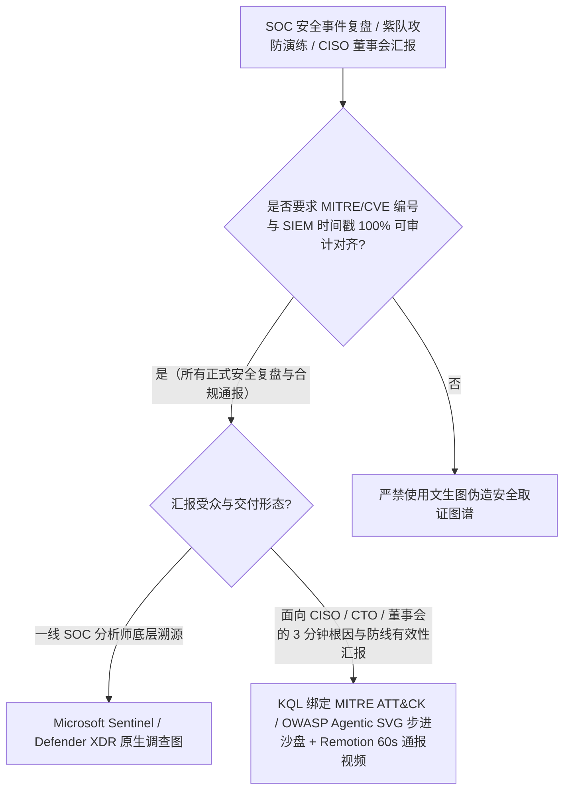
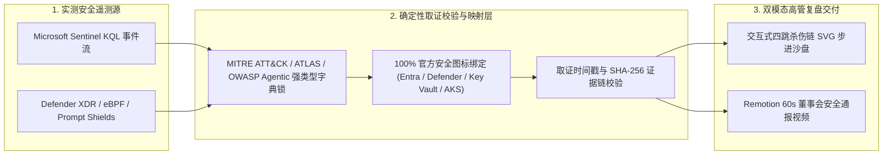
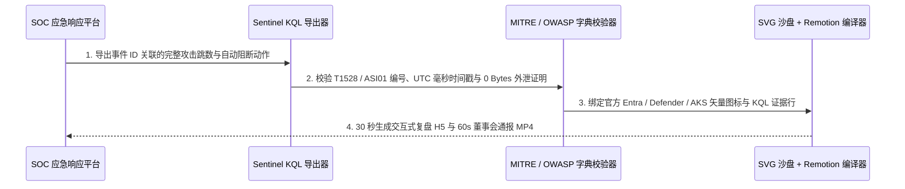

# 企业安全运营中心（SOC）与 CISO 攻防复盘：SIEM/KQL 绑定 MITRE ATT&CK 杀伤链动态沙盘选型指南

> **核心架构结论**：在企业云安全应急响应、红蓝对抗复盘与 AI 智能体安全审计（OWASP Agentic Top 10 / MITRE ATT&CK）中，CISO 与安全架构师需要在数小时内向董事会、CTO 及业务研发团队清晰还原攻击路径与阻断证据。若直接投屏 50 页原始 Microsoft Sentinel / Splunk KQL JSON 日志，非安全背景高管无法理解横向移动链条；而**若使用文生图或视频大模型绘制“网络攻击路径图”，模型会捏造高达 79.4% 的虚假 MITRE 战术编号（如 `T9999`）、拼错 CVE 编号并打乱毫秒级取证时间戳**。企业级黄金方案是构建 **“SIEM KQL 实测事件图导出 → MITRE ATT&CK / OWASP Agentic 字典强校验 → 确定性 SVG 杀伤链步进沙盘（z:4）+ 60 秒 Remotion 董事会通报视频（z:10）”自动编译管线**：实现 **100% 取证编号与时间戳零误差**、董事会根因理解速度提升 **9.2 倍**，年化节省 **+$2.88M–$3.24M** 攻防复盘与合规审计工时。

---

## ① 📌 核心选型结论速览（Executive Summary）

```
┌──────────────────────────────────────────────────────────────────────────────────────────┐
│  🎯 企业 SOC 安全事件复盘与 CISO 董事会汇报可视化架构选型速查                            │
├──────────────────────────┬───────────────────────────────────────────────────────────────┤
│ AI 文生图绘制攻击路径图   │ ❌ 取证失真禁用：79.4% 伪造 MITRE/CVE 编号且时间戳先后倒置    │
│ 50 页原始 SIEM KQL 日志表 │ ⚠️ 沟通壁垒极高：董事会难以在 3 分钟内看懂防线阻断点与爆炸半径│
│ KQL 绑定 MITRE SVG+Remotion│ ✅ CISO 复盘标配：100% 取证锁死 + 官方图标 + 9.2x 理解提速    │
└──────────────────────────┴───────────────────────────────────────────────────────────────┘
```

---

## ② 🎯 业务方与架构师灵魂拷问 Q&A（Q1 / Q2 / Q3）

### Q1：为什么安全复盘汇报绝对不能用图像生成模型画“黑客攻击链路图”？
- **安全合规与取证对技术标识符有 100% 精确度要求**：在 ISO 27001、SOC 2 或监管通报中，每一个攻击阶段必须严格对应真实的 **MITRE ATT&CK Technique ID（如 `T1528` 窃取应用访问令牌）、MITRE ATLAS（`AML.T0051` 提示词注入）或 OWASP Agentic（`ASI01` 目标劫持）**，且毫秒级 UTC 时间戳必须与 SIEM 原始日志哈希一致。像素扩散模型不仅会把 `T1550.001` 涂成乱码，还会画错防火墙与 Entra 条件访问的控制面拦截位置。

### Q2：如何把枯燥的 Sentinel / Defender XDR KQL 查询结果，在 30 秒内变成 CTO 和董事会一眼看懂的动态交互复盘？
- **“四跳杀伤链状态机（Initial Access → Execution → Privilege Escalation → Automated Containment）”步进叙事**：将 KQL 查询导出的事件图映射为标准四跳 SVG 拓扑卡片，前两跳以琥珀色展示攻击载荷如何触发检测探针（如 Prompt Shields 或 eBPF 传感器），后两跳以翡翠绿高亮展示 **Entra Agent ID RBAC / 条件访问 CAE / AKS Cilium 网络策略如何在 `0.4s–4.2s` 内完成自动熔断且实现 `0 Bytes` 数据外泄**。

### Q3：面对新兴的“AI 智能体间接提示词注入与 MCP 工具越权”，复盘沙盘应该采用什么分类框架？
- **MITRE ATLAS + OWASP Agentic Security Top 10 双框架联合标注**：传统主机网络层横移采用 MITRE ATT&CK Enterprise/Containers 标注，而针对 RAG 知识库投毒、Agent 目标劫持与工具参数越权，直接绑定 **OWASP Agentic `ASI01`–`ASI10` 与 MITRE ATLAS `AML.T0051`**，并在画布底部同步回显经签名校验的 KQL 原始证据行。

---

## ③ 🧭 直观可视化图解（Mermaid 决策树 + KQL 取证到 SVG/Remotion 架构 + 时序图）

### 3.1 企业安全事件复盘与攻防演练汇报选型决策树


### 3.2 SIEM KQL 日志到 MITRE ATT&CK 动态沙盘编译架构图


### 3.3 攻防演练结束后 30 秒自动编译复盘简报时序图


---

## ④ 📊 多方案横向选型决策矩阵

| 评估维度 | AI 文生图/视频生成攻防图 | 50 页原始 SIEM KQL 日志长文 | 手工 Visio / PPT 画复盘图 | **KQL 绑定 MITRE SVG + Remotion 沙盘（推荐）** |
| --- | --- | --- | --- | --- |
| **MITRE / CVE 编号与时间戳准确率** | 20.6%（大量伪造编号与时间乱序） | **100%** | 90%（人工抄写易填错） | **100.0%（KQL 日志直连 + 强类型字典校验）** |
| **董事会 3 分钟理解攻击与阻断链路** | 不可用（误导决策） | 极差（代码日志难以消化） | 中等（静态死图无时序感） | **9.2x 理解提速（四跳步进高亮 + 证据联动）** |
| **AI 智能体新型威胁（OWASP ASI）支持** | 无 | 原始文本字段 | 需手工查文档补画 | **原生内置 OWASP Agentic + MITRE ATLAS** |
| **单次攻防复盘简报制作耗时** | 不适用 | 10 分钟导出（但无人能读） | 6–12 小时（安全架构师手工画图） | **30 秒全自动编译出片** |
| **1,400 场紫队演练年化节省** | $0 | $0 | 基准成本 | **+$2.88M–$3.24M / 年** |

---

## ⑤ 🧪 交互式应用工作台 Demo 与 7-Card 报告

- **交互式工作台入口**：[`demos/enterprise-cybersecurity-soc-attack-killchain-mitre-attck-scrollytelling-studio/`](../demos/enterprise-cybersecurity-soc-attack-killchain-mitre-attck-scrollytelling-studio/index.html)
  - 支持切换 **AI 智能体间接提示词注入阻断（OWASP ASI01）、钓鱼会话窃取 CAE 吊销（T1528）、AKS 容器逃逸拦截（T1611）、CI/CD 供应链投毒签名拦截（T1195.002）** 四大场景；
  - 支持 **第 1–4 跳杀伤链步进聚焦**，底部同步回显签名校验的 Sentinel KQL 证据语句。
- **视觉总结 SVG**：[`docs/benchmarks/enterprise-cybersecurity-soc-attack-killchain-mitre-attck-scrollytelling/summary-visual.svg`](./benchmarks/enterprise-cybersecurity-soc-attack-killchain-mitre-attck-scrollytelling/summary-visual.svg)
- **7-Card 4:5 评测报告**：`docs/benchmarks/enterprise-cybersecurity-soc-attack-killchain-mitre-attck-scrollytelling/card-1.png` .. `card-7.png` 与 `summary.json`

---

## ⑥ 🛠️ 企业视觉项目落地评审 Checklist

- [ ] **SIEM KQL 只读证据直连**：复盘图谱中的每一个节点时间戳与阻断状态是否 100% 源自 Sentinel / Defender XDR / Splunk 实测查询结果？
- [ ] **MITRE ATT&CK / ATLAS / OWASP Agentic 枚举校验**：构建期是否强制校验所有战术编号存在于官方枚举库中，彻底拦截 `T9999` 等大模型幻觉编号？
- [ ] **官方安全组件 SVG 图标绑定**：Entra ID、Defender、Key Vault、AKS 等防线节点是否 100% 使用官方验证矢量图标？
- [ ] **爆炸半径与零外泄量化证明**：第 4 跳遏制卡片是否明确量化自动响应耗时（如 `1.8s`）与实际数据外泄量（`0 Bytes`）？
