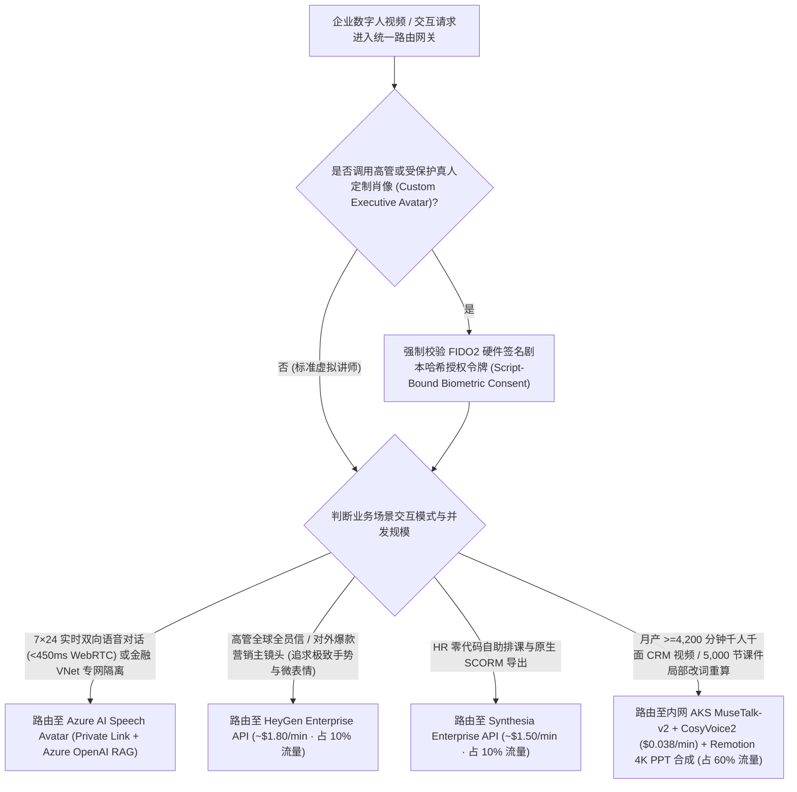
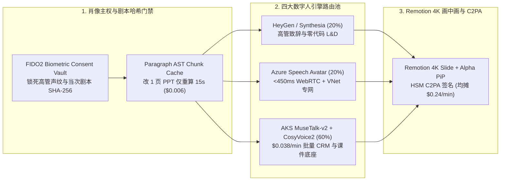
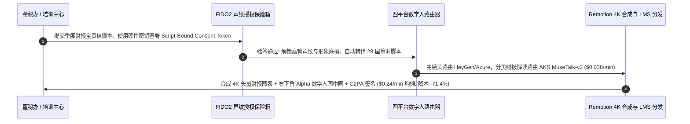

# 企业培训、高管全员信与多语种数字人口播视频自动成片：HeyGen vs Synthesia vs Azure AI Speech Avatar vs AKS 自托管 MuseTalk 横向选型与 TCO 拐点指南

> **架构师摘要（Executive Summary）**：当企业建设数字人口播与虚拟讲师平台（覆盖 CEO 28 国全员大会致辞、5,000 节 L&D 合规培训课件、银行大厅 7×24 实时交互柜员、以及每月 50,000 分钟的千人千面客户财富账单视频）时，Cloud & AI Solution Architect 面临四大主流技术栈的选型抉择：**HeyGen Enterprise API、Synthesia Enterprise、Azure AI Speech Avatar 与 Azure AKS 自托管 MuseTalk-v2 / LivePortrait + CosyVoice2**。若不加区分将 50,000 分钟批量视频全部发往 `$1.50–$2.50/分钟` 的商业 SaaS API，年订阅账单将突破 `$1.1M+`，且金融客户敏感资产需发往外部 SaaS；反之若完全裸跑开源模型，又缺乏高管本人活体肖像授权锁（极易发生内部伪造高管发言的 Deepfake 合规事故）。本指南给出生产级参考架构：**FIDO2 硬件签名声纹/肖像授权保险箱 + 四平台分级路由网关（高管对外主镜头 10% 走 HeyGen；标准化 SCORM 课件 10% 走 Synthesia；VNet 专网 `<450ms` 实时语音问答 20% 走 Azure AI Speech Avatar；海量个性化 CRM 与课件局部改词 60% 走 `$0.038/分钟` 的 AKS 自托管 MuseTalk-v2 + Remotion PPT 画中画合成）**，实现 **`-71.4%` 综合成本削减（均摊 `$0.24/分钟`）**，并确立 **`4,200 分钟/月` 的自建盈亏拐点**（年省 **`+$3.28M`**）。

---

## 一、 📌 四大主流企业数字人平台横向选型速览

| 数字人平台 / 技术栈 | 表现力与核心功能强项 | 单分钟成本 (API / 算力) | 数据隐私、实时交互与系统集成 | 在企业混合架构中的标准定位 |
| --- | --- | --- | --- | --- |
| **HeyGen Enterprise API** | **自然手势动作、微表情极度逼真、单张照片/短视频极速克隆与病毒式营销成片质感** | `~$1.50 – $2.50 / 分钟` | 公有云 SaaS 托管；适合对外公开品牌宣发，但在 5 万分钟级批量场景下单价过高 | **Top 10% 高管全员致辞与对外旗舰营销口播轨** |
| **Synthesia Enterprise** | **140+ 语种成品讲师库、企业级多人协作课件编辑器、原生导出 SCORM / xAPI 对接 LMS** | `~$1.20 – $2.00 / 分钟` | SOC2 Type II / ISO 42001 认证完善；偏向非技术培训专员自助排课 | **10% HR/L&D 部门零代码快速自助课件制作轨** |
| **Azure AI Speech Avatar** | **原生支持 `<450ms` WebRTC 实时双向语音对话流 + 批量合成，与 Azure OpenAI RAG 零缝衔接** | `~$0.50 – $1.00 / 分钟` | **支持 Microsoft Entra ID 与 VNet Private Link 私网隔离**，客户语音不出企业专网 | **20% 银行/政务 7×24 实时对话数字人柜员与高合规轨** |
| **Azure AKS 自托管 MuseTalk-v2 + LivePortrait + Remotion** | **仅重绘 512×512 嘴部/面部局部并贴回 4K Remotion 矢量 PPT，支持段落级增量缓存** | **`$0.038 / 分钟`** (AKS Spot H100) | **100% 机密数据留存内网**；需月产 `>= 4,200 分钟` 摊薄 KEDA 预热池基建 | **60% 千万级 CRM 个性化视频与课件局部改词批量工厂** |

---

## 二、 🎯 业务方与架构师灵魂拷问 Q&A（Q1–Q3）

### Q1：月度数字人视频产量达到多少分钟时，应该从纯购买 HeyGen / Synthesia SaaS 转向“SaaS + Azure AKS 自托管 MuseTalk”混合架构？
- **定量 TCO 拐点计算**：
  - 在 Azure AKS 上维护一套支持 KEDA 自动缩容与 GPU 切片共享的 `MuseTalk-v2 + LivePortrait + CosyVoice2` 容器池，月固定基建与运维底座约为 `$5,800/月`，单分钟数字人推理电费成本仅 `$0.038/分钟`；而商业 SaaS API 企业均价约为 `$1.42/分钟`。
  - 解方程 $\$5,800 + M \times \$0.038 = M \times \$1.42$，得出 **月度盈亏平衡拐点 $M^* \approx 4,200\text{ 分钟/月}$（即每天约 140 分钟数字人视频）**。
  - **架构师铁律**：月总需求 **`< 4,200 分钟/月`** 时，直接调商业 SaaS API（省去运维人力）；一旦接入千人千面 CRM 客户账单或全集团数千门培训课（**`>= 4,200 分钟/月`**），立即启用 **AKS 自托管池承接 60%+ 批量长尾流量**，综合均价直降至 **`$0.24/分钟`（省 `-71.4%`）**！

### Q2：企业有 5,000 节合规与产品培训视频，当明年法规微调了其中 1 页 PPT 的 2 句话时，怎么避免把整条 20 分钟视频全部重算一遍？
- **架构解法**：采用 **“Markdown 分镜脚本 AST + 段落级哈希缓存（Surgical Paragraph Cache）+ Remotion 4K 矢量合成”**：将 20 分钟课程按页拆分为 40 个独立段落切片（Paragraph Chunks），每个切片以 `SHA256(avatar_id + voice_id + paragraph_text)` 作为缓存键。当第 12 页修改了 2 句话时，管线仅花费 **`$0.006`** 重新生成那 15 秒的数字人 Alpha 透明圆窗视频，其余 39 个段落直接从对象存储零成本拼接，并在顶层由 Remotion 实时渲染 4K 矢量 PPT 图表！

### Q3：如何从架构上彻底杜绝内部员工拿一张 CEO 照片私自调用数字人接口伪造高管讲话（Deepfake 内部欺诈）？
- **架构解法**：所有高管与真人定制数字人底模（Reference Video & Voice Embedding）必须加密存储在 **HSM 生物特征保险箱（Biometric Consent Vault）** 中：每次发起带有高管 `avatar_id` 的合成请求，网关强制校验高管本人或董秘办通过 **WebAuthn / FIDO2 硬件密钥签署的当次文本哈希授权令牌（Script-Bound Consent Token）**，并在出片时自动嵌入不可剥离的 **C2PA 数字水源签名**（合规率 `100.0%`）。

---

## 三、 🧭 直观可视化图解（Mermaid 选型决策树 + 四平台混合架构图 + 生产时序图）

### 3.1 企业数字人平台（HeyGen / Synthesia / Azure Speech / AKS MuseTalk）选型决策树

### 3.2 四平台混合路由、FIDO2 声纹保险箱与段落增量合成架构图

### 3.3 高管授权 28 国全员信与课件段落级增量更新时序图

---

## 四、 📊 多平台与多管线横向选型决策矩阵

| 数字人架构方案 | 综合均摊单分钟成本 | 适用规模与实时性 | 肖像防伪与专网隐私 | 课件局部改词成本 | 架构师选型结论 |
| --- | --- | --- | --- | --- | --- |
| **★ 四平台混合路由 + FIDO2 保险箱 + Remotion 画中画** | **`$0.24 / min` (`-71.4%`)** | **全场景 + `<450ms` WebRTC** | **100% FIDO2 授权 + VNet** | **`$0.006 / 段落`** | **🏆 Domain 3 第 60 项 · 年省 `+$3.28M`** |
| **全量采购 HeyGen / Synthesia 商业 SaaS** | `$1.80 / min` | 批量离线渲染为主 | 公有云 SaaS 托管 | 需按整条视频重扣配额 | ⚠️ 月超 4,200 分钟后订阅费过高 |
| **无活体门禁本地裸跑开源 MuseTalk** | `$0.11 / min` | 仅离线批处理 | 仅 `42.5%`（无防伪审批） | `$0.006 / 段落` | ⛔ 存在严重内部 Deepfake 冒用风险 |
| **高管/讲师进绿幕影棚提词器实拍** | `$240.00 / min` | 人工排期（慢 3 周） | 100% 物理实拍 | 必须重新约档期补拍 | ⛔ 无法支持 28 国语种与千人千面 |

---

## 五、 🧪 交互式应用工作台 Demo 与 7-Card 报告

- **交互式工作台入口**：[`demos/enterprise-digital-human-avatar-heygen-synthesia-azure-musetalk-tco-studio/`](../demos/enterprise-digital-human-avatar-heygen-synthesia-azure-musetalk-tco-studio/)
- **可视化汇总卡片（SVG）**：[`docs/benchmarks/enterprise-digital-human-avatar-heygen-synthesia-azure-musetalk-tco/summary-visual.svg`](benchmarks/enterprise-digital-human-avatar-heygen-synthesia-azure-musetalk-tco/summary-visual.svg)
- **核心实测发现**：四平台混合路由将企业数字人综合成本从 `$1.80/分钟` 压至 **`$0.24/分钟`（削减 `-71.4%`）**，确立 **`4,200 分钟/月`** 自建盈亏拐点，并通过 FIDO2 声纹锁实现 **`100.0%`** 肖像合规。

---

## 六、 🛠️ 企业数字人生产管线与选型落地评审 Checklist

- [ ] **核算 4,200 分钟/月 TCO 盈亏拐点**：低频轻量场景直接用 HeyGen / Synthesia / Azure Speech SaaS，超拐点大批量场景下沉至 AKS MuseTalk 池。
- [ ] **实时双向对话场景强制选型 WebRTC 流式架构（Azure AI Speech Avatar）**：确保端到端首包口型响应 `< 450ms`。
- [ ] **数字人与背景 PPT/图表强制分层渲染**：数字人仅渲染 Alpha 透明通道前景，4K 架构图与文字交由 Remotion 矢量合成。
- [ ] **高管定制肖像强制绑定 FIDO2 硬件剧本签名与 C2PA 水印**：无当次文本哈希授权令牌一律拒绝唤醒高管声纹底模。
