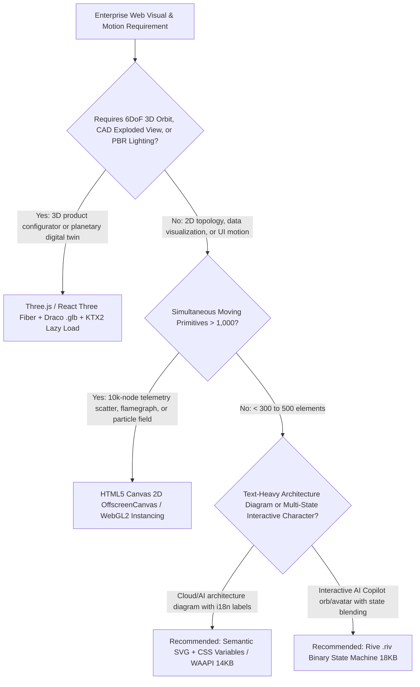
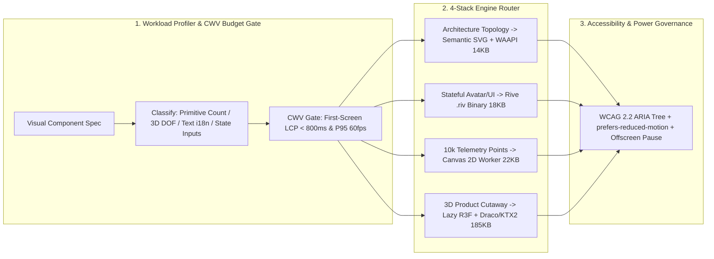

# Enterprise Web Interactive Visualization Stack Selection Guide: Native SVG vs Rive (.riv) State Machine vs Lottie JSON vs Canvas 2D vs Three.js / React Three Fiber

> **Audience**: Cloud & AI Solution Architects, Frontend Principal Engineers, and Design Systems Leads. This guide provides a quantitative decision framework comparing **Semantic SVG + CSS/WAAPI, Rive (`.riv`) State Machines, Legacy Lottie JSON, HTML5 Canvas 2D, and Three.js / React Three Fiber (R3F)** across bundle size, Core Web Vitals (`LCP` / `INP`), mobile 60fps stability, WCAG 2.2 accessibility, and engineering maintenance TCO.

---

## ① 📌 Executive Summary

| Dimension | Native Semantic SVG + CSS / WAAPI | Rive (`.riv`) Binary State Machine | Legacy Lottie (After Effects JSON) | HTML5 Canvas 2D / WebGL Instancing | Three.js / React Three Fiber (Draco `.glb`) |
| --- | --- | --- | --- | --- | --- |
| **Primary Enterprise Use Case** | **Cloud/AI architecture diagrams, data-flow lines, icons (`<300` nodes)** | **Interactive AI Copilot avatars, multi-state UI micro-interactions** | Simple non-interactive linear icons (`<30 KB` only) | **High-density `>10,000` node telemetry scatter, flamegraphs** | **3D hardware exploded views, 6DoF orbit & PBR material inspection** |
| **Total First-Screen Payload** | **~14 KB** (`0 KB` JS runtime) | **~66 KB** (`18 KB` `.riv` binary + `48 KB` WASM runtime; `97%` smaller asset than Lottie) | `680 KB – 2.4 MB` (Massive JSON text blocks main-thread `JSON.parse`) | **~22 KB** (Native Canvas / thin instanced shader) | **~185 KB** (Code-split lazy load + Draco `.glb` + KTX2) |
| **Mid-Range Mobile P95 FPS** | **60 fps** (`<300` DOM nodes) | **60 fps** (GPU/WASM vector bone interpolation) | `28 – 38 fps` (SVG DOM mutation thrashing on complex rigs) | **60 fps** (Single bitmap / 1 instanced draw call) | **60 fps** (When capped at `<25` batched draw calls) |
| **Searchable Text / i18n / WCAG** | **100% Native** (`Ctrl+F`, browser translation & screen readers) | Dynamic runtime Text Runs + ARIA wrapper | Poor (Text baked to bezier outlines; unsearchable) | Requires shadow ARIA tree | Uses R3F `<Html>` DOM portal overlays |
| **Interactivity & State Control** | High (CSS variables & DOM events) | **Ultra-High (Built-in state machine booleans/numbers/triggers)** | Low (Frame-number `playSegments` hacks without smooth blending) | High (Requires spatial quadtree hit-testing) | Ultra-High (6DoF camera + 3D raycasting) |

---

## ② 🎯 Architect & Frontend Principal Q&A (Q1 / Q2 / Q3)

### Q1: Why should interactive cloud & AI architecture diagrams use Semantic SVG + WAAPI rather than Three.js or Lottie?
- **Architecture Diagrams Demand Searchable Text, Instant i18n, and Zero Runtime Overhead**:
  - Exporting an architecture diagram as a **Lottie JSON** converts text labels into thousands of bezier outline nodes (`1.4 MB`), breaking `Ctrl+F` search, screen readers, and runtime localization;
  - Rendering a 2D architecture diagram inside a **12 MB WebGL/Unity canvas** balloons First Contentful Paint (`4,850ms LCP`) and causes thermal throttling on mobile devices;
  - **Semantic SVG + CSS `stroke-dashoffset` / Web Animations API (WAAPI)** weighs **14 KB**, scales infinitely on 4K displays, supports live DOM text localization, and runs on the compositor thread at **60fps**.

### Q2: Why is Rive (`.riv`) replacing Lottie JSON for interactive AI Copilot avatars and micro-animations?
1. **97% Asset Size Reduction & Zero `JSON.parse` Blocking**: A complex multi-state character rig exported from After Effects via Bodymovin produces a `680 KB – 1.4 MB` uncompressed JSON file that stalls the mobile main thread during parsing and mutates hundreds of DOM nodes every frame (`28fps`). Rive compiles the same rig into an **18 KB `.riv` binary** rendered on a single GPU/WASM canvas at **60fps**.
2. **Declarative State Machines vs Frame-Number Spaghetti**: Instead of hardcoding brittle frame ranges (`playSegments([42, 96])`) when an AI Copilot transitions from `Listening` to `Thinking` to `Speaking` while tracking the user's cursor, Rive exposes typed state-machine inputs (`isThinking = true`, `cursorX = 0.65`) with automatic bone interpolation.

### Q3: Where is the exact architectural boundary between SVG, Canvas 2D, and Three.js / R3F?
- **The 1,000-Node SVG DOM Cliff**: Keep SVG under `300–500` animated DOM elements. Once a visualization renders `>1,000` moving primitives (e.g., `10,000` live Kubernetes pod metrics or particle streams), switch to **HTML5 Canvas 2D (`OffscreenCanvas`) or instanced WebGL2** to avoid browser style/layout recalculation stalls.
- **Reserve Three.js / R3F for True 3D Spatial Value**: Load Three.js/R3F lazily via `IntersectionObserver` only when the user needs 6DoF camera orbit, CAD exploded views, or PBR lighting—never for flat 2D charts.

---

## ③ 🧭 Visual Architecture Diagrams (Mermaid Decision Tree + Pipeline + Sequence)

### 3.1 Web Interactive Visualization Stack Selection Decision Tree


### 3.2 Workload-Routed 4-Stack Frontend Architecture & CWV Gate


### 3.3 Sub-700ms First-Screen LCP & Lazy 3D Hydration Sequence
```mermaid
sequenceDiagram
    participant Browser as Mobile WebView / Desktop Browser
    participant AboveFold as Inline SVG + Rive State Machine
    participant Observer as IntersectionObserver Gate
    participant R3F as Lazy Three.js / Draco 3D Chunk

    Browser->>AboveFold: Request page; stream 14KB inline SVG topology + 18KB .riv avatar
    AboveFold-->>Browser: Paint LCP in 680ms at 60fps (Zero main-thread JSON stall)
    Browser->>Observer: User scrolls within 200px of 3D hardware cutaway section
    Observer->>R3F: Dynamic import() R3F chunk + Draco .glb asset (185KB)
    R3F-->>Browser: Mount 60fps 3D canvas; auto-pause rAF loop when scrolled off-screen
```

---

## ④ 📊 4-Stack Web Visualization Quantitative Comparison Matrix

| Stack | Total Payload (Gzipped) | 10,000-Element Scaling | Mobile Battery / Thermal Impact | Designer-to-Dev Handoff | i18n Text Edit & Maintenance Cost |
| --- | --- | --- | --- | --- | --- |
| **Semantic SVG + CSS / WAAPI** | **14 KB (Best)** | Great `<500` nodes; stalls `>1,500` | **Lowest (Compositor thread)** | Figma SVG / Code compiler | **Lowest (Direct DOM/i18n strings)** |
| **Rive (`.riv`) State Machine** | **66 KB (18KB asset + 48KB WASM)** | Built for bone/vector rigs | **Low (C++/WASM GPU canvas)** | Designer builds state machine in Rive | **Low (Runtime Text Runs API)** |
| **Legacy Lottie (AE JSON)** | `680 KB – 2.4 MB` | Drops to `28fps` on complex masks | High (Main-thread JSON traversal) | Frequent AE plugin expression bugs | High (Requires re-export from AE) |
| **HTML5 Canvas 2D / WebGL 2D** | **22 KB** | **60fps at 10,000–100,000 points** | Low-Med (With offscreen pause) | Programmatic D3/Canvas code | Low (Data-driven; needs custom hit-test) |
| **Three.js / R3F (Draco + KTX2)** | **185 KB (Lazy-loaded)** | `60fps` at `<25` draw calls | Medium (Cap to 30fps on Low Power Mode) | Blender MCP `.glb` -> `gltfjsx` | Low-Med (Use `<Html>` overlays for text) |

---

## ⑤ 🧪 Interactive Workbench & 7-Card Benchmark Deck

- **Interactive Workbench**: [`demos/enterprise-frontend-interactive-visualization-svg-rive-lottie-threejs-tco-studio/`](../demos/enterprise-frontend-interactive-visualization-svg-rive-lottie-threejs-tco-studio/index.html)
- **7-Card 4:5 Visual Benchmark Report**: `docs/benchmarks/enterprise-frontend-interactive-visualization-svg-rive-lottie-threejs-tco/card-1.png` through `card-7.png` and `summary-visual.svg`.

---

## ⑥ 🛠️ Enterprise Web Visualization Architecture Readiness Checklist

- [ ] **Semantic SVG Default for `<300`-Node Topologies**: Are all 2D cloud/AI architecture diagrams rendered in native SVG so text remains searchable, localizable, and screen-reader accessible?
- [ ] **100 KB Lottie Cap & Rive `.riv` Migration**: Are interactive UI animations and AI avatars compiled to compact `.riv` binary state machines rather than multi-megabyte Lottie JSON files?
- [ ] **1,000-Element DOM Cutoff to Canvas 2D**: Do high-density telemetry scatter plots and particle flows switch from SVG DOM to `Canvas 2D / Instanced WebGL` above `1,000` elements?
- [ ] **Mandatory `IntersectionObserver` & `prefers-reduced-motion` Gate**: Do all active animation loops pause automatically when scrolled out of the viewport or when the user enables reduced motion?
