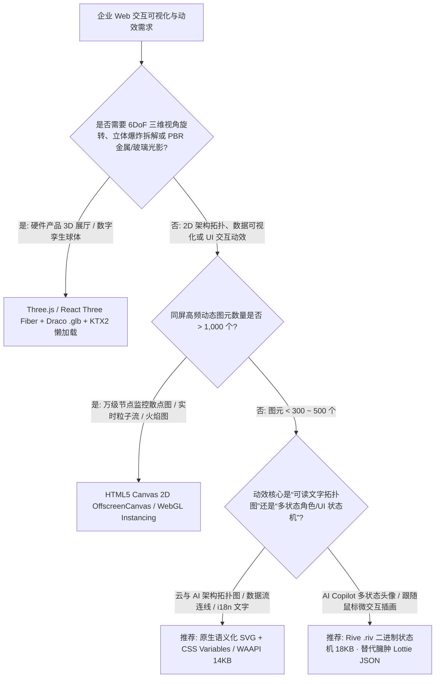
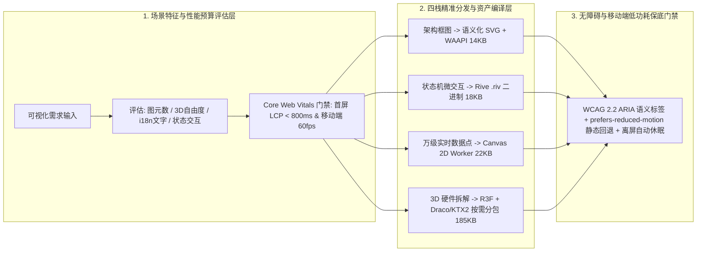
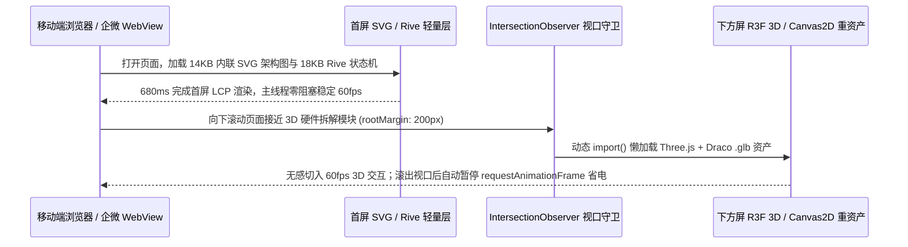

# Web 交互可视化四大技术栈横向选型指南：SVG 矢量动态架构图 vs Canvas 2D vs Rive / Lottie 状态机动效 vs Three.js / React Three Fiber 轻量 3D

> **文档定位**：面向企业级 AI 应用架构师（Cloud & AI Solution Architect）、前端技术负责人与设计工程（Design Engineering）团队的权威选型手册。针对企业构建 **云与 AI 动态架构沙盘、AI Copilot 多状态交互头像、万级节点实时可观测性大盘与产品 3D 发布会微站** 时的技术选型困惑，量化对比 **SVG + CSS/WAAPI、Rive (`.riv`) 状态机、Lottie JSON、HTML5 Canvas 2D 与 Three.js / React Three Fiber (R3F)** 的适用边界、首屏性能（LCP/INP）、开发维护成本与移动端兼容性。

---

## ① 📌 核心选型结论速览（Executive Summary）

| 评估维度 | 原生语义化 SVG + CSS / WAAPI | Rive (`.riv`) 二进制状态机动效 | 传统 Lottie (After Effects JSON) | HTML5 Canvas 2D / WebGL Instancing | Three.js / React Three Fiber (Draco `.glb`) |
| --- | --- | --- | --- | --- | --- |
| **最佳适用业务场景** | **云/AI 系统动态架构图、数据流连线、响应式图标 (`<300` 节点)** | **AI 助手多状态交互徽标、游戏化引导、鼠标跟随状态混合** | 仅适合简单无交互线性播放的小图标 (`<30 KB`) | **高密度万级节点拓扑、火焰图、实时遥测粒子流 (`>1,000` 图元)** | **硬件/商品 360° 6DoF 拆解、PBR 材质与空间光影展示** |
| **首屏包体积（资产 + 运行时）** | **~14 KB**（0 KB JS 运行时，原生浏览器解析） | **~66 KB**（`18 KB` `.riv` 二进制 + `48 KB` 运行时，比 Lottie 小 90%+） | `680 KB ~ 2.4 MB`（冗长 JSON 文本阻塞主线程 `JSON.parse`） | **~22 KB**（纯原生 Canvas API 或轻量着色器） | **~185 KB**（按需懒加载 R3F + Draco 压缩 `.glb`） |
| **中端移动端 P95 帧率** | **60 fps**（`<300` DOM 节点内） | **60 fps**（C++/WASM 骨骼与状态机插值） | `28 ~ 38 fps`（大量 SVG 路径逐帧重绘拖垮主线程） | **60 fps**（单次位图绘制 / 1 Draw Call） | **60 fps**（控制 `<25 Draw Calls` 与 KTX2 纹理） |
| **文本可搜索 / i18n / 无障碍** | **100% 原生支持**（`<text>` 支持 `Ctrl+F`、自动翻译与屏幕阅读器） | 支持运行时动态文本槽位（Text Runs）与 ARIA 包装 | 差（文字常被转为曲率路径 Outlines，无法翻译或搜索） | 需外挂无障碍影子 DOM（Shadow A11y Tree） | 需配合 HTML `<Html>` 锚点标签实现可搜索标注 |
| **状态交互与代码控制力** | 高（CSS 变量与事件绑定） | **极高（内置布尔/数值/触发器状态机，零胶水代码）** | 低（只能按帧号 `goToAndPlay` 硬切，缺乏平滑状态混合） | 极高（需自建空間索引 Quadtree 拾取） | 极高（支持 3D 射线检测 Raycasting 与相机轨道） |

---

## ② 🎯 业务方与架构师灵魂拷问 Q&A（Q1 / Q2 / Q3）

### Q1：做 CTO 汇报的“云与 AI 动态架构流向图”时，为什么首选原生 SVG + CSS/WAAPI，而绝对不能上 Three.js 或 Lottie？
- **架构图的第一性原理是“文字清晰可读、支持多语种切换与浏览器 `Ctrl+F` 检索”**：
  - 如果用 **Lottie** 导出架构图，设计师往往把字体转曲（Create Shapes from Text），不仅 JSON 膨胀到 `1.5 MB`，而且无法根据页面语言切换中英文，放大后还容易因层级嵌套掉帧；
  - 如果用 **Three.js 3D 场景** 画普通 2D 架构框图，移动端首屏需要下载数兆 WebGL 引擎与字体纹理，手机发热降频且屏幕阅读器完全无法读取节点语义；
  - 采用 **原生语义化 SVG + CSS `stroke-dashoffset` 流光脉冲动画**，包体积仅 **14 KB**，任意缩放 400% 绝对锐利，支持一键切换深浅色主题（CSS Variables）与中英文文案！

### Q2：为什么在 2026 年的企业级 AI 产品（如 Copilot 思考/聆听动效球、交互式空状态插画）中，Rive (`.riv`) 正在全面取代 Lottie JSON？
1. **二进制体积缩减 90%–97%**：同一个带骨骼形变的 AI 助手交互角色，After Effects 导出的 Lottie JSON 高达 **680 KB ~ 1.4 MB**（纯文本数字数组，主线程 `JSON.parse()` 就会造成 `120ms` 阻塞）；而 **Rive `.riv`** 采用紧凑二进制编码，体积仅 **18 KB**。
2. **原生状态机（State Machine）告别面条式前端代码**：当需要实现“AI 助手根据用户麦克风音量大小实时改变波纹幅度、鼠标移入时转头注视、报错时平滑过渡到红色摇头状态”时，Lottie 只能靠前端写几十个 `playSegments([f1, f2])` 硬切跳帧；而 Rive 在编辑器内内置状态机转换图，前端只需一行 `listeningInput.value = true` 即可自动完成 60fps 骨骼混合过渡！

### Q3：什么时候必须放弃 SVG 转投 HTML5 Canvas 2D 或 Three.js / React Three Fiber？
- **1,000 节点 DOM 悬崖法则（The 1,000-Node DOM Cliff）**：当画面包含超过 **1,000 个同时运动的图元**（如万级 Pod 集群实时网络流量散点、长时序 eBPF 火焰图、频谱瀑布图）时，每个 SVG `<circle>` 都是一个完整 DOM 对象，浏览器的样式重算（Recalculate Style）会将帧率拖垮至 `<12 fps`。此时必须切换至 **HTML5 Canvas 2D（配合 `OffscreenCanvas` Web Worker）或 WebGL InstancedMesh**。
- **真三维空间与 PBR 材质需求**：只有当业务确实需要 **6DoF 自由视角旋转、真实金属/玻璃环境光反射（HDRI PBR）或硬件产品爆炸拆解图** 时，才启用 **Three.js / R3F**（并强制开启 Draco 网格压缩、KTX2 显存纹理与 `<25 Draw Calls` 静态合批）。

---

## ③ 🧭 直观可视化图解（Mermaid 决策树 + 生产管线架构图 + 时序图）

### 3.1 企业级 Web 交互可视化技术栈黄金选型决策树

### 3.2 四栈按需路由与 Core Web Vitals / WCAG 2.2 性能门禁架构图

### 3.3 移动端首屏零阻塞加载与离屏节能生命周期时序图

---

## ④ 📊 Web 交互可视化四大技术栈全维量化对比矩阵

| 技术栈 | 首屏总体积 (Gzipped) | 1,000+ 图元性能 | 移动端功耗与发热 | 设计-研发协作流 | 维护成本与 i18n 改字难度 |
| --- | --- | --- | --- | --- | --- |
| **原生 SVG + CSS / WAAPI** | **14 KB (最优)** | `<500` 节点极佳，`>1,500` 节点卡顿 | **极低（浏览器合成层加速）** | Figma / 代码直接生成 | **极低（直接改 HTML/i18n JSON）** |
| **Rive (`.riv`) 状态机** | **66 KB (18KB 资产 + 48KB 引擎)** | 适合复杂骨骼矢量插画 | **低（C++/WASM 硬件渲染）** | 设计师在 Rive 编好状态机，研发零胶水接入 | **低（支持运行时修改 Text Run 文本）** |
| **Lottie (AE JSON)** | `680 KB ~ 2.4 MB` | 路径节点多时严重掉帧 (`28fps`) | 高（主线程每帧遍历巨型 JSON 树） | AE 插件导出常丢失表达式或蒙版报错 | 高（改一个字需设计师回 AE 重新导出 JSON） |
| **HTML5 Canvas 2D / WebGL 2D** | **22 KB** | **10,000 ~ 100,000 点稳 60fps** | 中（需离屏暂停控制） | 纯代码数据驱动（D3-scale + Canvas） | 低（数据驱动，但需自写碰撞拾取与无障碍层） |
| **Three.js / R3F (Draco + KTX2)** | **185 KB (按需分包)** | 支持数万三角面（`<25 Draw Calls`） | 中高（iOS 低电量模式需降帧至 30fps） | Blender 4.5 MCP -> `.glb` -> `gltfjsx` | 中（文案标注用 `<Html>` 组件叠加） |

---

## ⑤ 🧪 交互式应用工作台 Demo 与 7-Card 评测报告

- **交互式工作台入口**：[`demos/enterprise-frontend-interactive-visualization-svg-rive-lottie-threejs-tco-studio/`](../demos/enterprise-frontend-interactive-visualization-svg-rive-lottie-threejs-tco-studio/index.html)
  - 支持切换 **4 类典型企业前端可视化场景**（云与 AI 架构动态流向图、AI Copilot 状态机动效徽标、万级节点实时遥测粒子流、3D 硬件空间爆炸拆解）、**3 类工程选型策略**与 **3 档终端设备环境**；
  - 实时可视化对比 **四栈精准选型象限（680ms LCP · 60fps）** 与 **全站滥用 1.4MB Lottie JSON / 12MB 重型 WebGL 反例**。
- **7-Card 4:5 视觉评测报告**：`docs/benchmarks/enterprise-frontend-interactive-visualization-svg-rive-lottie-threejs-tco/card-1.png` ~ `card-7.png` 及横向总览图 `summary-visual.svg`。

---

## ⑥ 🛠️ 企业前端交互可视化架构落地评审 Checklist

- [ ] **2D 架构框图与流程图 100% 优先采用语义化 SVG**：节点数 `<300` 且包含多语种技术术语的架构图，是否已禁止使用不可搜索的位图视频或重型 WebGL？
- [ ] **Lottie JSON 100KB 体积红线与 Rive `.riv` 迁移**：凡大于 `100 KB` 或需要响应鼠标/状态输入的 UI 动画，是否已强制从 Lottie JSON 迁移至 Rive 二进制状态机？
- [ ] **SVG 1,000 节点熔断转 Canvas 2D**：当监控大盘动态图元超过 `1,000` 个时，渲染层是否自动切换为 `Canvas 2D / Instanced WebGL` 防止 DOM 重排卡死？
- [ ] **`prefers-reduced-motion` 与 `IntersectionObserver` 离屏休眠**：所有 Canvas / Rive / Three.js 实例在滚出视口或系统开启“减弱动态效果”时，是否已 100% 自动停止渲染循环？
