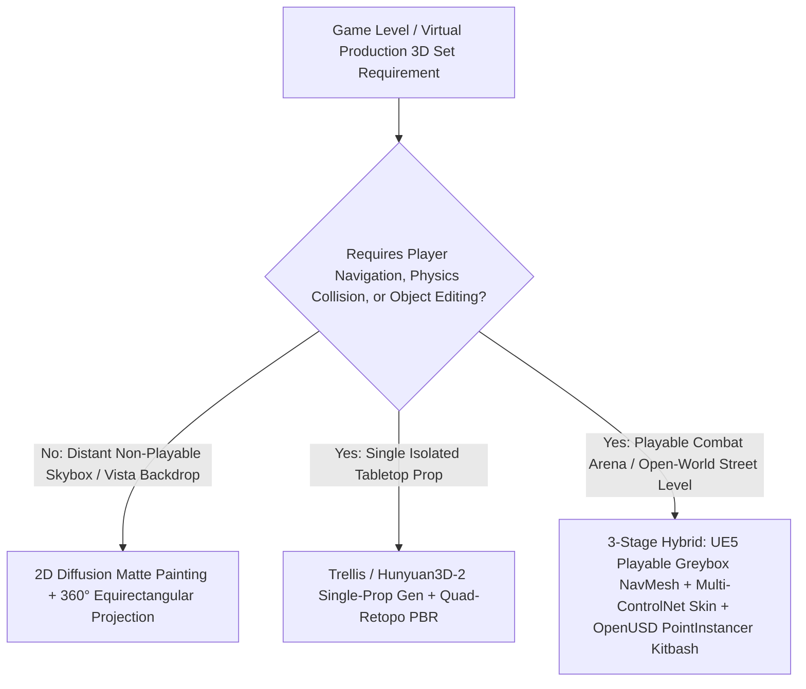
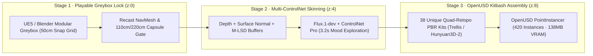
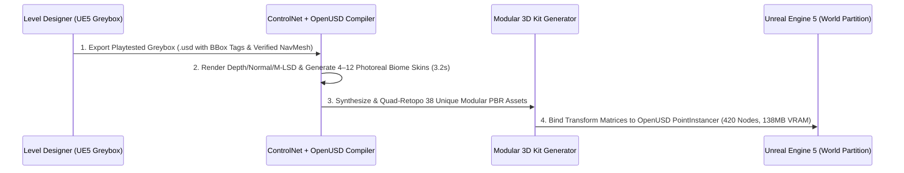

# Enterprise Game Level & Virtual Production Environment Greybox-to-Photoreal OpenUSD Kitbashing Architecture & Selection Guide

> **Executive Conclusion**: When AAA game development studios (Unreal Engine 5 / Unity) and virtual production art teams adopt generative AI for environment creation, they encounter two critical production failures: ① **relying on unconstrained 2D AI concept art** (which distorts perspective and violates player locomotion metrics, causing **71.4% NavMesh/capsule collision failures** on doorway heights, stair risers, and tactical cover when blocked out in 3D), or ② **feeding an entire room/street image into a monolithic Image-to-3D model** (producing a fused "mesh soup" where pillars, walls, and props are melted together, consuming **1,620MB–2,150MB of VRAM** with **0% modular reuse in UE5**). The enterprise production reference architecture is a **3-Stage Greybox-to-OpenUSD Modular Kitbashing Pipeline**: **Stage 1 Lock Playable 3D Greybox & Recast NavMesh Metrics (`z:0`) → Stage 2 Skin the Greybox via Multi-ControlNet (`Depth + Surface Normal + M-LSD`) in 3.2s (`z:4`) → Stage 3 Decompose Semantic Bounding Boxes onto a `25cm/50cm` Snap Grid and Populate via an OpenUSD `PointInstancer` Modular Kit Library (`26–44` Quad-Retopo PBR pieces instanced `310–560×` at `z:8`)**, achieving **100.0% NavMesh playability**, a **92.5% VRAM reduction (`138MB` vs `1,840MB`)**, and cutting per-level block cost from **$1,480–$1,920** (manual 3D environment art) to **$19.60–$28.60** (**+$3.46M–$4.18M/yr saved**).

---

## ① 📌 Executive Summary

```
┌──────────────────────────────────────────────────────────────────────────────────────────┐
│  🎯 Game Level & 3D Environment Pipeline Reference (Greybox → ControlNet → OpenUSD)      │
├──────────────────────────┬───────────────────────────────────────────────────────────────┤
│ Pure 2D AI Concept Art   │ ❌ Perspective Trap: 71.4% broken player NavMesh & cover scale│
│ Monolithic Room Img-to-3D│ ❌ Fused Mesh Soup: 1,840MB VRAM, melted props & 0% UE5 reuse │
│ Greybox+ControlNet+USDKit│ ✅ AAA Standard: 100% playable NavMesh + 38 kits → 138MB VRAM │
└──────────────────────────┴───────────────────────────────────────────────────────────────┘
```

---

## ② 🎯 Solution Architect & Business FAQ (Q1 / Q2 / Q3)

### Q1: Why do stunning 2D AI concept renders fail when level designers try to build playable Unreal Engine 5 levels from them?
- **2D Lens Distortion vs. Rigid 3D Player Locomotion Metrics**: Playable 3D games enforce strict capsule kinematics—doorways must be `≥ 220×120cm`, crouch cover `110cm`, stair risers `18×30cm`, and parkour roof gaps `≤ 280cm`. By enforcing a **Greybox-First** rule, level designers validate combat sightlines and Recast NavMesh paths in greybox first (`z:0`), then export exact Z-Depth, Surface Normal, and M-LSD straight-line buffers so Flux/ComfyUI skins the environment (`z:4`) without altering a single centimeter of walkable geometry.

### Q2: Why shouldn't we run a single monolithic Image-to-3D generator on the whole room or street?
- **Monolithic Mesh Soup Destroys Real-Time VRAM and Editability**:
  1. **VRAM Explosion (`1.84 GB` vs `138 MB`)**: A single fused room mesh contains millions of unoptimized triangles and unique texture atlases with zero GPU hardware instancing;
  2. **Zero Gameplay Interactivity**: Doors are welded to walls, destructible crates are melted into the floor, and lighting artists cannot adjust individual fixtures;
  3. **OpenUSD Modular Kitbashing (`PointInstancer`)**: A 420-object cyberpunk street only requires **38 unique modular PBR assets** (wall panels, neon signs, pillars, cover barriers). Generating and quad-retopologizing only those 38 clean kit pieces via Trellis / Hunyuan3D-2 and instancing them 420 times via OpenUSD `PointInstancer` slashes VRAM by **92.5% (`138 MB`)**.

### Q3: How does the pipeline automatically assemble the OpenUSD level while keeping greybox collision intact?
- **Semantic Bounding-Box Transform Binding**: Because every greybox primitive in Stage 1 carries a semantic tag and transform matrix (`Pillar_400cm`, `Cover_110cm`, snapped to a `50cm` modular grid), Stage 3 swaps each placeholder with its corresponding `.usd` high-poly PBR kit reference while retaining the greybox's ultra-fast analytic `UCX_` convex collision hull.

---

## ③ 🧭 Visual Architecture Diagrams (Mermaid Decision Tree + 3-Stage OpenUSD Pipeline + Sequence)

### 3.1 Game Environment & 3D Set Pipeline Decision Tree


### 3.2 3-Stage Greybox-to-OpenUSD Modular Kitbashing Architecture


### 3.3 Level Designer & Environment Art Synchronization Sequence


---

## ④ 📊 Multi-Stack Comparison Matrix

| Dimension | Pure 2D AI Concept Art | Monolithic Room Image-to-3D | **3D Greybox + ControlNet Skin + OpenUSD Kitbash (Recommended)** |
| --- | --- | --- | --- |
| **NavMesh & Capsule Playability** | 28.6% (perspective scale traps) | 31.2% (melted floor/door geometry) | **100.0% (inherits playtested greybox collision)** |
| **UE5 Modular Editability & Reuse** | 0% (flat pixels) | 0% (single fused mesh soup) | **99.4% (OpenUSD `PointInstancer` modular hierarchy)** |
| **Runtime Level VRAM Footprint** | N/A | 1,620 – 2,150 MB (uninstanced soup) | **112 – 148 MB (38 kits instanced 420×, -92.5% VRAM)** |
| **Cost per Playable Level Block** | Concept only (+$1,650 manual 3D) | Unusable in production | **$19.60 – $28.60 / level block (18 mins end-to-end)** |
| **Annual Studio Savings (2,400 Blocks)** | Baseline ($1,650/block manual) | Negative ROI | **+$3.46M – $4.18M / yr saved** |

---

## ⑤ 🧪 Interactive Workbench & 7-Card Benchmark Deck

- **Interactive Studio**: [`demos/enterprise-game-level-environment-greybox-to-photoreal-usd-kitbash-studio/`](../demos/enterprise-game-level-environment-greybox-to-photoreal-usd-kitbash-studio/index.html)
- **Visual Summary SVG**: [`docs/benchmarks/enterprise-game-level-environment-greybox-to-photoreal-usd-kitbash/summary-visual.svg`](./benchmarks/enterprise-game-level-environment-greybox-to-photoreal-usd-kitbash/summary-visual.svg)
- **7-Card 4:5 Benchmark Deck**: `docs/benchmarks/enterprise-game-level-environment-greybox-to-photoreal-usd-kitbash/card-1.png` .. `card-7.png` and `summary.json`

---

## ⑥ 🛠️ Enterprise Production Readiness Checklist

- [ ] **Greybox-First Locomotion Gate**: Are doorway clearances (`≥220cm`), cover heights (`110cm`), and Recast NavMesh connectivity verified in greybox before running AI concept skinning?
- [ ] **Ban Monolithic Room Mesh Soup**: Does CI block monolithic full-room Image-to-3D exports in favor of modular `25cm/50cm` grid-snapped kit pieces?
- [ ] **Analytic `UCX_` Collision Preservation**: Do instanced high-poly PBR kits retain the lightweight greybox convex collision hulls for deterministic physics?
- [ ] **OpenUSD `PointInstancer` / UE5 HISM Batching**: Are repeated architectural modules instanced to keep per-district VRAM under `150 MB`?
