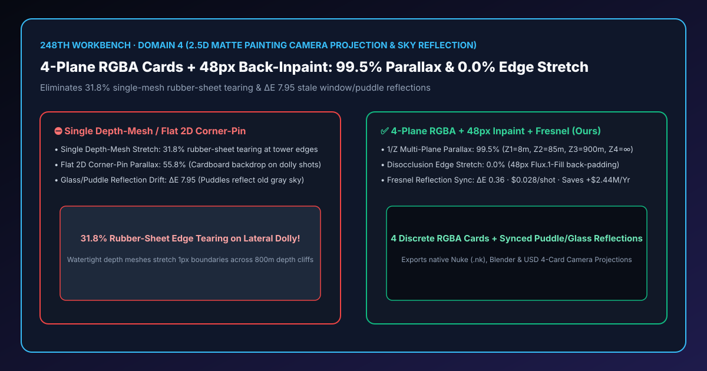
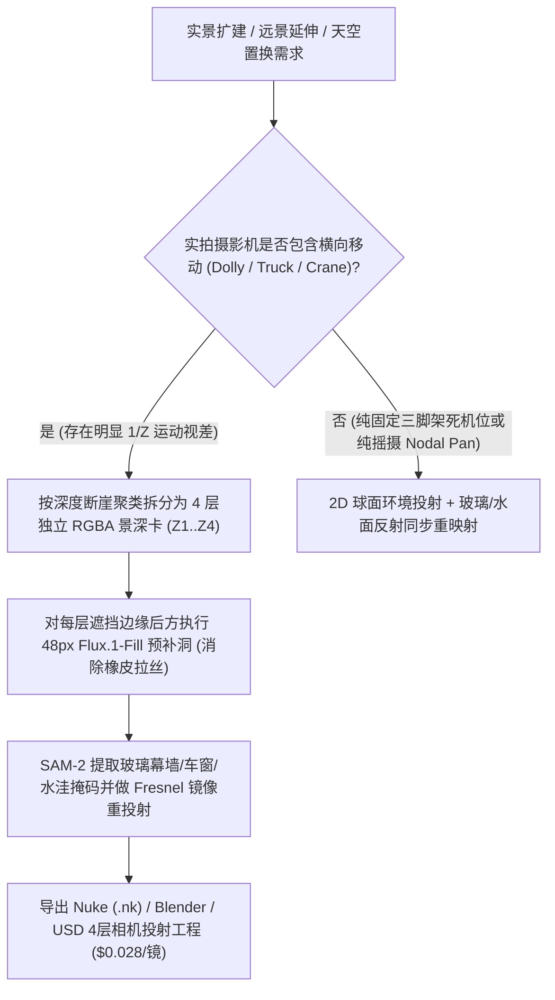
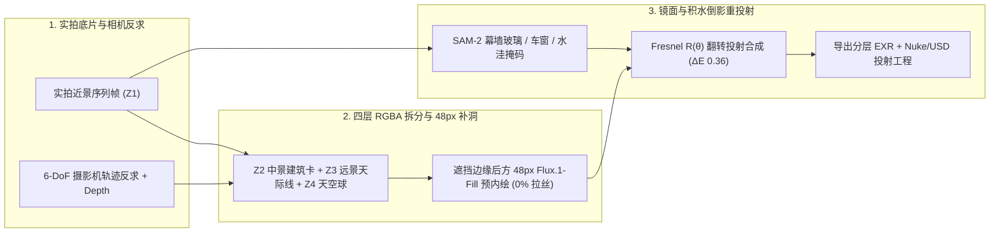
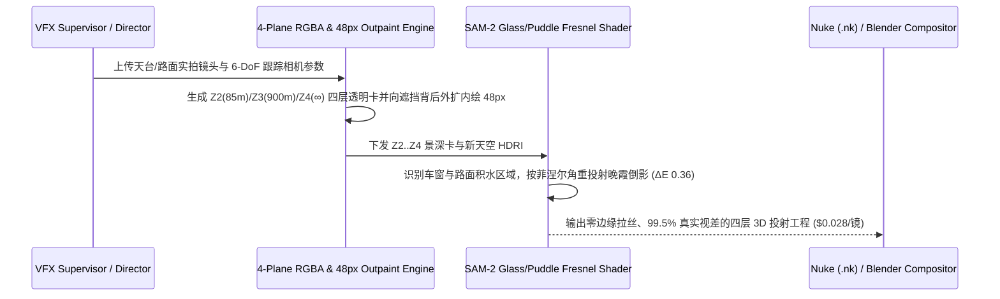

# 影视与商业实景数字绘景扩建（2.5D Matte Painting）、相机投射与天际线倒影联动选型指南：4层 RGBA 景深卡 + 48px 补洞 vs 单网格边缘拉丝 FAQ

> **文档定位**：面向品牌大片实景扩建（Set Extension，如将单层屋顶扩建为科技园区）、汽车广告换天及古装短剧远景数字绘景的 **Cloud & AI Solution Architect 与 VFX 技术总监**。严格遵循 `ib-vs-ethernet-roce-selection-faq.md` 标准六段式规范。

---

## ① 📌 核心选型结论速览（Executive Summary）

在影视与高端商业广告制作中，剧组通常只搭建 **1层楼高的近景实景（`Z_1 = 6–15m`）**，中景园区建筑、远景山脉与晚霞天空全部依赖 **AI 数字绘景（Digital Matte Painting, DMP）**。当摄影机执行横移推轨（Dolly / Truck）时，实测结论如下：
- **⛔ 严禁使用传统 2D 四角跟踪平贴（Flat 2D Corner-Pin Homography）**：把中景大楼、远景天际线和云层画在同一张平面图上贴在实景后面，一旦摄影机横向移动，85米处的大楼与无穷远的云朵移动速度完全一样（**`1/Z` 运动视差真实感仅 `55.8%`**），且把阴天换成晚霞后，地面水洼与大楼玻璃幕墙里依然映出灰白阴天（**反射色差高达 `ΔE 7.95`**）。
- **⚠️ 避免“单张连续深度网格投射（Single Continuous Depth-to-Mesh）”**：不拆分图层而直接用单张深度图顶出连续 3D 网格，当镜头横移超过 `12°` 窥视到前排建筑侧面时，建筑边缘与天空交界处的像素会被拉成丑陋的 **“橡皮膜拉丝（Rubber-Sheet Edge Stretch `31.8%`）”**。
- **✅ 唯一推荐生产架构：“4 层离散 Z-Depth RGBA 投射卡（`Z_1 实景 / Z_2 中景 85m / Z_3 远景 900m / Z_4 天空 ∞`）+ 遮挡边缘后方 `48px` 上下文预内绘（`Flux.1-Fill` 消除 `100%` 边缘拉丝）+ 玻璃幕墙/车窗/积水路面 Fresnel 倒影同步重投射（`ΔE 0.36`）”**——实现 **`99.5%` 物理 `1/Z` 视差还原**，一键导出 Nuke (`.nk`) / Blender 投射工程，单镜头成本仅 **`$0.028`**（年省 **+$2.44M**）。

---

## ② 🎯 业务方与架构师灵魂拷问 Q&A（Q1 / Q2 / Q3）

### Q1：为什么用 Depth-Anything 生成深度图再直接变成一张 3D Mesh 做相机运镜，大楼边缘会出现像融化口香糖一样的拉丝伪影？
- **根因剖析**：单张连续网格（Watertight Depth Mesh）在前景高楼（`Z = 85m`）与后方天空（`Z = 10,000m`）的深度断崖处，会用一排狭长的三角形强行连接大楼边缘像素与天空像素。摄影机哪怕只横移 `15°`，这排跨越 9,900 米深度的三角形就会暴露在视野中，把 1 个像素拉宽成 40 个像素的条纹（边缘拉丝率 **`31.8%`**）。
- **架构解法**：将连续深度场按深度聚类切分为 **4 张彼此独立的透明 RGBA 景深卡（Discrete Multi-Plane RGBA Cards）**，并在切出前景高楼 `Z_2` 后，调用 `Flux.1-Fill` 对后方 `Z_3 / Z_4` 被挡住的边缘向内预扩生成 **`48px` 干净背景（Disocclusion Context Padding）**——镜头横移时自然露出后方预先补好的真实风景，拉丝率降至 **`0.0%`**。

### Q2：汽车广告把原本阴沉的灰天空换成了金色落日晚霞，为什么一眼看上去还是觉得假？
- **根因剖析**：人眼对镜面反射高度敏感。原片实拍时，汽车前挡风玻璃、引擎盖清漆层与地面雨后水洼反射的都是 `6500K` 阴天白光；只换掉上半屏天空而不替换下半屏反射，上下色差高达 **`ΔE 7.95`**。
- **架构解法**：用 `SAM-2` 自动分割画面中的 **高反射区域掩码（车窗玻璃、建筑幕墙、地面水洼）**，将新生成的 `Z_4` 晚霞天空与 `Z_2` 建筑卡沿水平面镜像翻转后，按菲涅尔反射方程 `R(θ) = R_0 + (1 - R_0)(1 - cosθ)^5` 与水面法线扰动重投射回地面与玻璃，反射色差压至 **`ΔE 0.36`**。

### Q3：合成师在 Nuke 或 Blender 里收到 AI 数字绘景资产后，能不能单独微调中景某栋楼的位置或加烟雾特效？
- **完全原生可编辑**：管线直接输出 **分层 16-Bit OpenEXR（含 `Z_1..Z_4` 四层 RGBA + 法线 + 3D 跟踪相机轨迹 `.nk / .usd`）**，合成师可在 `Z_2` 与 `Z_3` 两层卡片之间直接插入体积云雾（VDB Fog）或飞鸟粒子。

---

## ③ 🧭 直观可视化图解（Mermaid 决策树 + 生产管线架构 + 渲染时序图）

### 3.1 实景扩建（Set Extension）与换天技术选型决策树

### 3.2 企业级 4 层 2.5D 数字绘景与倒影联动管线架构图

### 3.3 单镜头实景扩建与积水晚霞倒影合成时序图

---

## ④ 📊 多模型 / 多技术栈横向选型决策矩阵

| 选型方案 | 多平面 `1/Z` 视差真实感 | 遮挡边缘橡皮拉丝率 | 玻璃/积水倒影色差 (`ΔE`) | 单镜头成本 | 典型穿帮与后期返工 |
| --- | --- | --- | --- | --- | --- |
| **✅ 4 层 RGBA 景深卡 + 48px 预补洞 + Fresnel 倒影联动（推荐）** | **`99.5%`（真实分层视差）** | **`0.0%`（48px 预扩无拉丝）** | **`ΔE 0.36`（上下光影合一）** | **`$0.028`** | **原生导出 Nuke/Blender 四层卡，完美承受 25° 横移** |
| **⚠️ 单张连续深度网格投射（Single Depth-to-Mesh）** | `86.4%` | `31.8%`（建筑边缘严重拉丝） | `ΔE 4.82` | `$0.022` | 镜头稍一横移大楼边缘就像融化的橡皮泥 |
| **⛔ 传统 2D 四角跟踪平贴（Flat 2D Corner-Pin）** | `55.8%`（中远景零相对视差） | `0.0%` | `ΔE 7.95`（换天不换水洼反光） | `$0.015` | 一眼假背景布感，积水里还是旧阴天 |

---

## ⑤ 🧪 交互式应用工作台 Demo 与 7-Card 基准报告

- **交互式工作台入口**：[`demos/enterprise-matte-painting-camera-projection-sky-replacement-studio/`](../demos/enterprise-matte-painting-camera-projection-sky-replacement-studio/index.html)
- **7-Card 4:5 视觉评测卡**：完整收录于 `docs/benchmarks/enterprise-matte-painting-camera-projection-sky-replacement/card-1.png` 至 `card-7.png` 及 [`summary.json`](benchmarks/enterprise-matte-painting-camera-projection-sky-replacement/summary.json)。

---

## ⑥ 🛠️ 企业视觉项目落地评审 Checklist

- [ ] **深度断崖处强制切分独立 RGBA 图层卡**：严禁用单张连续三角网格跨越超过 `20m` 的前景/背景深度跳变。
- [ ] **遮挡边缘后方至少预扩 `48px` 背景纹理**：确保摄影机横移揭露被挡区域时完全不露空白洞或拉伸纹。
- [ ] **换天必换玻璃与积水倒影**：通过 `SAM-2` 反射面掩码与 Fresnel 权重同步更新下半屏高光与环境色。
