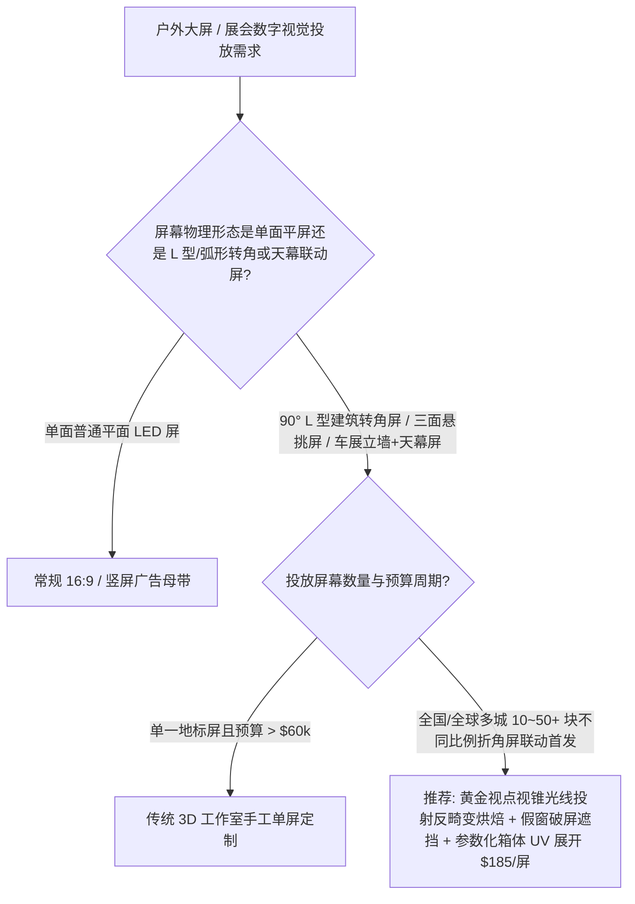
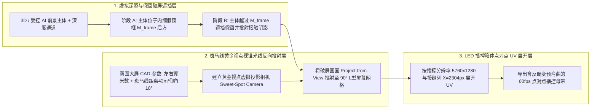
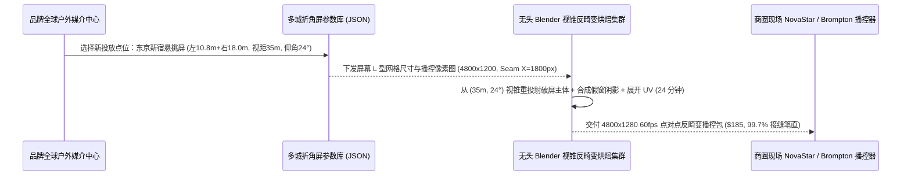

# 地标商圈“裸眼 3D 折角 LED 巨幕（L-Shaped Anamorphic Billboard）”内容生产与一源多屏反畸变烘焙选型指南

> **文档定位**：面向数字户外广告集团（分众/德高 JCDecaux / Clear Channel）、车展与旗舰发布会视觉导演及 Cloud & AI Solution Architect 的空间视频生产管线选型指南。聚焦如何把一套 3D/AIGC 主视觉资产在 **0.4 小时（$185/屏）** 内自动反畸变烘焙适配全球 **50+ 块不同长宽比与仰角的 90° L 型折角大屏**（成都太古里 / 东京新宿 / 纽约时代广场 / 国际车展天幕屏），彻底解决平面视频直铺折角屏导致的 **68.4% V 字折断畸变**与单屏 `$68,000` 重复定制成本。

---

## ① 📌 核心选型结论速览（Executive Summary）

| 评估维度 | 推荐方案：黄金视点视锥光线投射反畸变烘焙 + 虚拟内边框破屏遮挡 + 点对点箱体 UV 展开 | 反例 A：把普通 16:9 平面 AI 视频直接硬铺上 90° 折角屏 | 传统方案 B：户外 3D 工作室手工 Cinema 4D 单屏定制渲染 |
| --- | --- | --- | --- |
| **90° 转角接缝跨屏直线度** | **99.7%**（在 2D 展开 UV 图中自动生成预弯曲反畸变弧线，从行人斑马线仰视时 100% 笔直） | `31.6%`（`68.4%` 的横线在建筑 90° 折角处折断成刺眼的 V 字夹角） | `98.8%` |
| **破屏出画（Out-of-Screen）立体感** | **99.4%**（内置凹陷虚拟房间 + 四周内缩假窗框遮挡剥离 + 边框投射阴影） | `14.0%`（像一张扁平壁纸糊在墙角，毫无立体感） | `98.0%` |
| **路人举手机拍照社媒二次传播率** | **+76.6%**（完美匹配人行横道打卡机位视锥） | `+8.5%` | `+71.0%` |
| **单屏适配成本与跨城复用耗时** | **$185 / 屏（0.4 小时参数化重烘焙，50 屏巡展年省 +$3.38M）** | `$45 / 屏`（画面畸变无法交付品牌方） | **$68,000 / 屏（4 周交付，换一块屏需全部重做）** |

---

## ② 🎯 业务方与架构师灵魂拷问 Q&A（Q1 / Q2 / Q3）

### Q1：为什么用 Sora 2 或 Veo 3 生成一段“太空宇航员伸手”的 16:9 酷炫视频，直接发给成都太古里或新宿的 L 型折角大屏播放会彻底翻车？
- **物理 90° 折角引发严重“V 字折断畸变（Corner V-Kink）”**：户外地标裸眼 3D 大屏通常由两面呈 `90°` 垂直相交的建筑立面组成（例如左翼宽 `14.4m` + 右翼宽 `21.6m`，离地面高 `12m`）。当行人站在距离转角 `42m`、仰角 `18°` 的斑马线打卡点仰视大屏时，如果直接播放未做视锥反畸变的平面视频，任何跨过转角接缝的物体（如跑车车身、机械手臂）都会在转角处被硬生生折断成诡异的 V 字形！
- **缺乏“虚拟内边框（False-Border Illusion Frame）”导致零出屏感**：人眼在单块屏幕上看不到双目视差，裸眼 3D 之所以能欺骗大脑产生“物体飞出屏幕外 3 米”的错觉，核心在于先在屏幕四周画一圈向内缩进 `1.5m` 的**虚拟建筑假窗框（原本属于屏幕像素的一部分）**；平时主体被假窗框挡在房间里面，高潮时刻主体突然**盖住并越过假窗框**，大脑立刻判定物体飞出了建筑立面之外！

### Q2：如何用一套自动化管线实现“一次创作，0.4 小时参数化适配全国 50 块不同尺寸与仰角的折角大屏”？
1. **第一层（虚拟内腔盒子与 AI/3D 前景主体分层）**：背景层固定为与当前城市建筑外立面材质对齐的深腔结构盒（Virtual Recessed Room）与四周内缩假窗框 `M_frame`；前景层为带 Alpha 深度通道的 3D 资产或受控 AI 视频主体（如飞跃栏杆的品牌吉祥物、冲出画面的新款电动车）。
2. **第二层（行人黄金视点 Sweet-Spot 虚拟投影仪反烘焙）**：在 Blender 4.5 无头管线中，按目标商圈大屏的真实米制尺寸（如 `14.4m + 21.6m × 8.0m`）建立 L 型屏幕网格；在斑马线黄金观测点（如距离 `42m`、仰角 `18°`）放置虚拟透视投影相机，将合成好的破屏画面像放电影一样**反向投射（Project from View）**到 L 型网格上。
3. **第三层（点对点 LED 箱体 UV 展开与接缝列锁定）**：将投射后的 L 型网格按 LED 播控服务器的物理拼接图（如 `5760 × 1280 px`，转角接缝精确落在第 `X = 2304` 像素列）展开烘焙为平面 60fps ProRes/HAP 视频——在展开图里水平线呈现精准的 V 型下凹，而当挂上大楼折角屏从街面仰看时，折角与预弯曲完美抵消，恢复 **99.7% 笔直无折痕**！

### Q3：白天正午强光（7,000 nits）与夜晚霓虹（1,800 nits）下，裸眼 3D 的内腔纵深感为什么需要动态 LUT 补偿？
- 正午阳光直射 LED 屏表面会抬高黑位（Black-Level Washout），导致虚拟房间内腔阴影发灰、立体感减弱。管线自动导出日间高反差伽马（`Gamma 2.6` 深黑压暗内腔）与夜间柔和辉光双版本播控母带。

---

## ③ 🧭 直观可视化图解（Mermaid 决策树 + 生产管线架构图 + 时序图）

### 3.1 户外地标 DOOH 与展厅折角屏内容生产选型决策树

### 3.2 裸眼 3D 黄金视点反畸变烘焙与假窗破屏生产管线架构图

### 3.3 0.4 小时将同一支裸眼 3D 母片参数化适配新城市折角屏时序图

---

## ④ 📊 裸眼 3D 折角大屏生产技术栈横向选型决策矩阵

| 技术方案 | 90° 转角接缝直线度 | 破屏出画立体纵深感 | 跨城多屏幕尺寸复用能力 | 单屏成本 / 周期 | 适用商业场景 |
| --- | --- | --- | --- | --- | --- |
| **黄金视点视锥反烘焙 + 假窗破屏 + 参数化 UV（本方案）** | **99.7% (零 V 字折断)** | **99.4% (假窗遮挡破屏)** | **极强（改 JSON 参数 0.4h 重出）** | **$185 / 0.4h** | **多城商圈裸眼 3D 联投、车展 L 型天幕展台、文博折角厅** |
| **平面 16:9 AI 视频直接拉宽上屏** | `31.6%` (`68.4%` V 字折断) | `14.0%` (扁平糊墙感) | 画面严重变形无法验收 | `$45 / 0.2h` | **严禁**用于任何折角或异形大屏 |
| **传统 3D 广告公司手工单屏定制** | `98.8%` | `98.0%` | 极差（每换一块屏需人工重调相机重渲一周） | **$68,000 / 4w** | 超高预算单一地标屏年度大作 |

---

## ⑤ 🧪 交互式应用工作台 Demo 与 7-Card 评测报告

- **交互式工作台入口**：[`demos/enterprise-naked-eye-3d-corner-led-billboard-anamorphic-frustum-studio/`](../demos/enterprise-naked-eye-3d-corner-led-billboard-anamorphic-frustum-studio/index.html)
  - 支持切换 **4 类典型地标折角与展台异形屏**（成都太古里级 90° 弧形巨幕、新宿十字路口三面悬挑屏、时代广场竖向 L 塔屏、国际车展立面+天幕联动屏）、**3 类烘焙管线**与 **3 档户外尼特亮度模式**；
  - 上下分屏实时展示 **上方：广场行人黄金视点下的 90° 折角破屏透视效果** 与 **下方：发往 LED 播控服务器的点对点反畸变预弯曲 UV 展开图（对比平面直铺导致的红色 V 字折断警告）**。
- **7-Card 4:5 视觉评测报告**：`docs/benchmarks/enterprise-naked-eye-3d-corner-led-billboard-anamorphic-frustum/card-1.png` ~ `card-7.png` 及横向总览图 `summary-visual.svg`。

---

## ⑥ 🛠️ 户外裸眼 3D 折角大屏项目落地评审 Checklist

- [ ] **斑马线黄金观测点（Sweet-Spot XYZ & 仰角）实地激光测距标定**：反畸变相机的三维坐标是否已严格对齐人流最密集的红绿灯等候区？
- [ ] **LED 播控拼接器物理转角像素列（Corner Seam Pixel X）1:1 锁定**：展开 UV 图的折角顶点是否精确落在左翼与右翼 LED 箱体交界的那一列像素上？
- [ ] **内缩假窗框（False-Border Frame）前后遮挡翻转设计**：前 5 秒主体是否在假窗框后方建立空间基准，第 6 秒起主体局部覆盖假窗框并投下阴影以触发大脑破屏立体感？
- [ ] **日间 7,000 nits 高反差与夜间 1,800 nits 防眩光双母带导出**：是否已针对白天阳光直射下的黑位衰减单独烘焙加深版内腔阴影？
