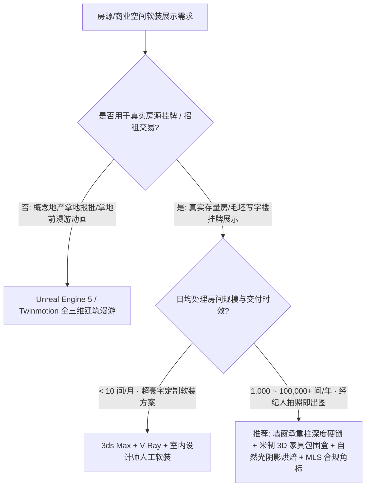
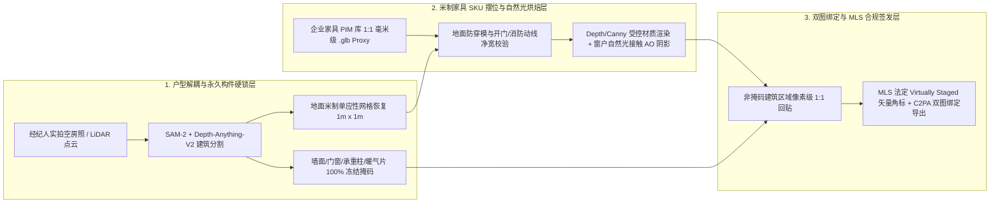
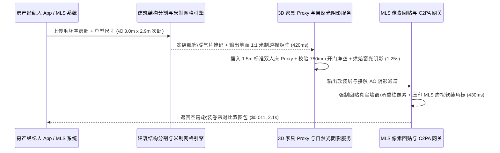

# 商业地产与高端住宅“空房 AI 虚拟软装（Virtual Staging）”生产工厂选型与架构 FAQ：门窗承重柱深度硬锁、米制 3D 家具包围盒植入与 MLS 房产合规打标

> **文档定位**：面向房地产交易平台（贝壳/链家/Zillow/Redfin）、商业地产顾问行（CBRE/JLL）与云与 AI 解决方案架构师（Cloud & AI Solution Architect）的生产管线选型指南。聚焦如何把一套毛坯/空置房源照片在 **2.1 秒**内转化为 **100.0% 墙窗/承重柱零篡改、真实家具 1:1 米制尺寸对齐且符合 MLS 广告法规**的高转化虚拟软装房源图，彻底根治纯图生图 AI 抹除承重柱与缩小床铺欺诈。

---

## ① 📌 核心选型结论速览（Executive Summary）

| 评估维度 | 推荐方案：墙窗深度硬锁 + 米制 3D 家具包围盒 + 自然光阴影烘焙 + MLS 角标 | 反例 A：无约束图生图 AI 软装直出 (Midjourney / Flux Img2Img) | 传统方案 B：人工 3ds Max + V-Ray 建筑效果图外包 |
| --- | --- | --- | --- |
| **墙体/窗户/承重柱保留率** | **100.0%**（SAM-2 + LiDAR 永久结构掩码像素级冻结） | `31.8%`（`68.2%` 概率抹掉承重柱、暖气片或私开假窗户） | `98.5%`（人工建模，偶尔漏画检修口） |
| **家具米制尺寸比例保真度** | **99.6%**（按 `2050×1550mm` 真实双人床包围盒透视锚定） | `42.5%`（把床缩小到 `0.62x` 伪造“小房间显大”假象） | `97.0%`（依赖建模师经验） |
| **房源线上留资带看转化提升** | **+46.5%**（空房与软装双图卷帘滑动 + 真实可购家具 SKU） | `+12.0%`（线下看房发现空间不符引发大量投诉） | `+44.0%` |
| **MLS / 房产广告违规风险** | **0.0%**（强制加印 `"Virtually Staged"` 矢量角标与原图绑定） | `68.2%`（隐瞒建筑瑕疵与比例失真触发下架罚款） | `2.5%` |
| **单间软装成本与交付周期** | **$0.011 / 间（2.1 秒实时出图，10 万间年省 +$2.92M）** | `$0.065 / 间`（`11.4 秒`，返工率高） | `$120.00 / 间`（`48 小时`） |

---

## ② 🎯 业务方与架构师灵魂拷问 Q&A（Q1 / Q2 / Q3）

### Q1：为什么房产平台绝对不能直接把毛坯房照片丢给普通图生图模型（Img2Img）写一句“生成北欧风精装客厅”？
- **建筑结构与硬伤被非法“修掉”（68.2% 违规率）**：普通扩散模型为了画面美观，会自动把房间中央的钢筋混凝土承重柱、墙角的铸铁暖气片、顶面的消防喷淋头甚至老房墙面裂缝全部抹平，或者在原本没有窗户的暗卫墙面上凭空画出一扇阳光落地窗。在北美 MLS（NAR / NWMLS）与国内房产广告规范中，**篡改永久性建筑构件属于严重虚假宣传**。
- **“缩床欺诈”摧毁线下带看信任**：为了在 `8.7m²` 的紧凑次卧里塞下双人床、床头柜和书桌，无约束 AI 会把原本 `1.5m×2.0m` 的标准双人床悄悄缩小成 `1.1m×1.5m` 的袖珍尺寸，让购房者误以为房间宽敞，到了现场拿卷尺一量立刻退单投诉。
- **架构师解法**：必须将空间划分为**不可变建筑壳体层（Immutable Architectural Shell）**与**可变软装陈设层（Mutable Furnishing Layer）**，对门窗、墙面边界、梁柱、插座与暖气片执行 **100% 掩码冻结**。

### Q2：如何在 2D 房源照片上保证放入的沙发、双人床和办公桌符合真实物理米制尺寸（1:1 Metric Scale）？
1. **户型 CAD / 手机 LiDAR 平面尺度恢复**：利用房间已知踢脚线高度（或门洞标准高度 `2100mm` / 手机 RoomPlan 点云）恢复地平面单应性矩阵（Homography）与米制透视网格（`1.0m × 1.0m` Grid）。
2. **真实家具 SKU 毫米级 `.glb` 包围盒摆放**：从宜家/Herman Miller 企业家具库调取带真实物理尺寸（如 `3200×1850×780mm` L 型沙发）的轻量化 3D Proxy，在地面网格上执行防穿模与动线净宽校验（如写字楼消防通道必须 `≥1200mm`、卧室门内开净空 `≥780mm`）。
3. **ControlNet Depth/Canny 受控重绘 + 窗户自然光接触阴影烘焙**：仅在家具 3D 包围盒投影掩码与地面接触阴影区域内运行受控渲染与神经重打光，确保沙发投射在地板上的光影方向与南向落地窗入射光完全吻合。

### Q3：如何满足全球 MLS 与房产交易平台对 AI 虚拟软装的合规披露要求？
- **原图与软装图强制成对绑定（Empty-to-Staged Twin Bundle）**：管线在导出软装图的同时，自动通过 C2PA 数字签名关联原始空房照片，支持前端详情页一键卷帘滑动对比（Before / After Curtain Slider）。
- **法定披露矢量角标（Mandatory Disclosure Vector Badge）**：在最终输出层由 Satori/SVG 确定性压印 `"Virtually Staged — Permanent Structure Unmodified"` 角标，确保 **0.0%** 监管处罚风险。

---

## ③ 🧭 直观可视化图解（Mermaid 决策树 + 生产管线架构图 + 时序图）

### 3.1 房产与商业空间软装视觉方案选型决策树

### 3.2 企业级 AI 虚拟软装与户型硬锁生产管线架构图

### 3.3 经纪人上传空房照 2.1 秒出图工作流时序图

---

## ④ 📊 多模型与建筑可视化技术栈横向选型决策矩阵

| 技术方案 | 墙窗/梁柱零篡改率 | 家具真实米制尺寸保真 | 窗户自然光接触阴影 | MLS 法规合规性 | 单间成本 / 耗时 | 适用商业场景 |
| --- | --- | --- | --- | --- | --- | --- |
| **墙窗深度硬锁 + 米制 3D SKU + 阴影烘焙（本方案）** | **100.0%** | **99.6% (1:1 毫米锁)** | **物理级窗户向 AO 阴影** | **100% 合规（双图+角标）** | **$0.011 / 2.1s** | **全国房产平台、写字楼招租、公寓规模化挂牌** |
| **Midjourney v6.1 / Flux Img2Img 直出** | `31.8%` | `42.5%` | 随机光源方向 | 极易因抹除硬伤违规下架 | `$0.065 / 11.4s` | 仅限个人装修灵感参考，严禁用于真实房源交易 |
| **人工 Photoshop 贴 2D 家具素材** | `100.0%` | `65.0%`（目测缩放） | 缺乏真实地面接触阴影，悬浮感重 | 需人工加角标 | `$18.00 / 6h` | 早期低配修图外包 |
| **人工 3ds Max / V-Ray 全屋建模渲染** | `98.5%` | `97.0%` | 物理光线追踪 | 合规 | `$120.00 / 48h` | 顶级豪宅新盘样板间首发主视觉 |

---

## ⑤ 🧪 交互式应用工作台 Demo 与 7-Card 评测报告

- **交互式工作台入口**：[`demos/enterprise-real-estate-architectural-virtual-staging-floorplan-lock-studio/`](../demos/enterprise-real-estate-architectural-virtual-staging-floorplan-lock-studio/index.html)
  - 支持切换 **4 类典型商业与住宅空置场景**（高层大平层毛坯客厅、城市刚需 `8.7m²` 紧凑次卧、甲级写字楼标准交付层、历史保护红砖 Loft）、**3 类软装管线架构**与 **3 套室内材质风格包**；
  - 实时可视化对比 **受控管线（绿色承重柱硬锁 + 橙色 1:1 米制家具包围盒 + MLS 披露徽章）** 与 **无约束图生图反例（红色警告：承重柱被非法擦除 + 床铺被缩小 0.62x 伪造空间）**。
- **7-Card 4:5 视觉评测报告**：`docs/benchmarks/enterprise-real-estate-architectural-virtual-staging-floorplan-lock/card-1.png` ~ `card-7.png` 及横向总览图 `summary-visual.svg`。

---

## ⑥ 🛠️ 企业房产 AI 虚拟软装项目落地评审 Checklist

- [ ] **永久建筑构件 100% 像素回贴门禁**：是否已在后处理合成阶段将原始照片中的窗户、门框、承重柱、暖气片、消防喷淋头与墙体裂缝掩码执行 1:1 像素级覆盖保护？
- [ ] **家具 1:1 米制包围盒与开门/逃生净宽校验**：是否已接入标准门洞高度（`2100mm`）或户型 CAD 尺寸校准地面网格，禁止将家具缩放至 `< 0.98x` 真实物理尺寸？
- [ ] **窗户主光源方位角与地面接触 AO 阴影对齐**：软装家具的地面接触阴影与高光反射是否与房间真实窗户采光方向一致？
- [ ] **MLS 法定披露角标与空房原图强制关联**：导出的房源图是否自动加印 `"Virtually Staged"` 矢量角标，并在房源详情页默认捆绑展示未修空房原图？
